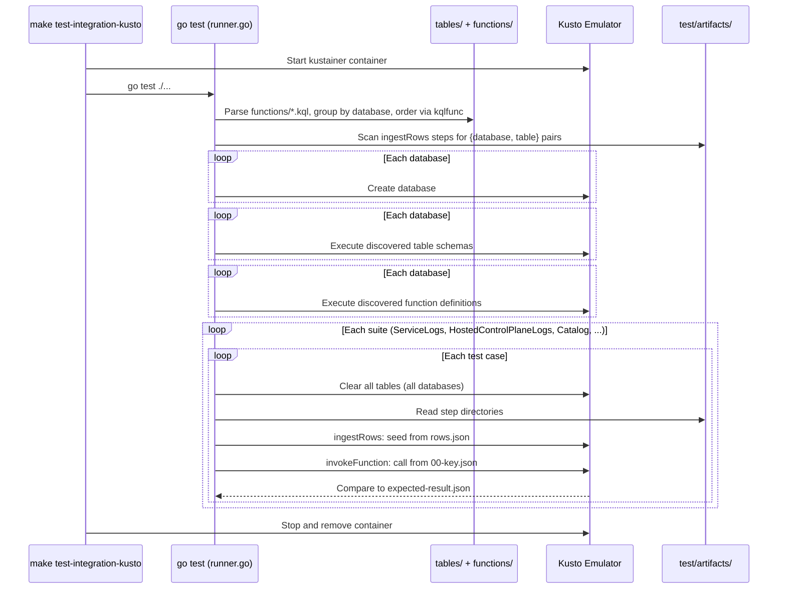

# Kusto Function Integration Tests

Declarative, artifact-driven integration tests for KQL stored functions. This framework is borrowed from the top-level [test-integration](../../../../../test-integration/) folder which tests Frontend/Cosmos/Backend interactions, but instead, it runs a [kusto emulator](https://learn.microsoft.com/en-us/azure/data-explorer/kusto-emulator-overview) and validates table schemas, functions, and outputs of functions. It uses the same KQL we use to define our production logging structure.

## Why?

**This test suite is an attempt to establish a contract between engineering and people that care heavily about consistent production log structure** (e.g. SRE/BU). It highlights what tables and columns or other schema are critically relevant to our daily work (and, indirectly, what isn't), via function definitions - which can be leveraged equally by engineers, dashboards, AI Agents, etc. Broken tests indicate that something we rely on in logs will foundationally impact how we build our product backlog or run production. It means broken reports, broken triage, higher MTTR... in short, it means there's real customer impact.

**Important: While the integration tests will fail on breaking schema changes (e.g. removal of a column referenced in a function), it will NOT fail if log content is changed.** Our mock data may not accurately reflect what is actually logged. The mock data ensures that at least our minimal expected log content continues to import correctly, and also gives us assurance that queries are written correctly and display accurate results based on what we think logs look like.

## Running

```bash
make test-integration-kusto
```

Starts the kustainer emulator, computes table/function topology in-process from `tables/`, `functions/`, and the `ingestRows` fixtures under `artifacts/` (no manifest file), runs all test suites, and cleans up the container. Set `KUSTO_DEBUG=1` for detailed step-level output.

## How It Works



## Writing a Test Case

No Go code changes required. A test case is a directory of numbered step subdirectories under `artifacts/<Suite>/<FunctionName>/<test-case>/`. Steps run sequentially and follow the `NN-<type>-<name>` naming convention.

### Database Topology

No manifest file. Topology is derived fresh on every run:

- **Functions**: every `.kql` file under `functions/`, grouped by database from its `{Database}_` filename prefix, ordered within each database via `tooling/kustoctl/pkg/kqlfunc`'s `// @depends:` parsing (same mechanism `kustoctl generate kql-bicep` uses).
- **Tables**: every `{"database": ..., "table": ...}` pair declared across all `00-ingestRows-*/00-key.json` files in `artifacts/`, regardless of which suite is running.

Filter and enrichment functions operate on a generic piped `T` parameter and never name a table; only `ingestRows` steps declare one.

### Step types

**`ingestRows`**: Seeds a table with test data. `00-key.json` declares the target database and table. Place additional `.json` files in the directory, each an array of row objects. Keys match column names; missing columns get type-appropriate defaults.

```
00-ingestRows-cosmosResourceSnapshots/
  00-key.json     # {"database": "ServiceLogs", "table": "cosmosResourceSnapshots"}
  rows.json       # [{"resourceID": "...", "content": {...}, ...}]
```

**`invokeFunction`**: Calls a stored function. `00-key.json` specifies the database, function, and args:

```
01-invokeFunction-resolve-cluster-id/
  00-key.json               # {"database": "ServiceLogs", "function": "GetClustersServiceIDForARMResourceID", "args": ["...", "datetime(2020-01-01)", "datetime(2099-01-01)"]}
  expected-result.json      # [{"clusters_service_id": "abc-123-def"}]
```

**`invokeQuery`**: Runs raw KQL. `00-key.json` specifies the database and query:

```
02-invokeQuery-count-rows/
  00-key.json               # {"database": "ServiceLogs", "query": "cosmosResourceSnapshots | count"}
  expected-result.json      # [{"Count": "2"}]
```

**`invokeMgmt`**: Runs a management command (e.g. `.show functions`). Not expected to be used frequently; it exists for reflection cases where you need to validate metadata about the database itself rather than query results. The `Catalog/ShowFunctions` tests use this to verify function names, folders, and docstring structure. `00-key.json` specifies the database and command:

```
00-invokeMgmt-list-functions/
  00-key.json               # {"database": "ServiceLogs", "command": ".show functions | project Name, Folder"}
  expected-result.json      # [{"Name": "GetClustersServiceIDForARMResourceID", "Folder": "Triage\\Resolvers"}]
```

For all invoke types, include one of:
- `expected-result.json`: array of expected row objects (column-by-column comparison)
- `expected-error.txt`: expected error substring (negative test)
- Neither: smoke test (validates execution succeeds)

### Example: ID resolver round-trip

```
artifacts/ServiceLogs/IDResolvers/round-trip/
  00-ingestRows-cosmosResourceSnapshots/          # Seed 2 rows into the table
    rows.json
  01-invokeFunction-get-clusters-service-id/      # ARM ID -> Clusters Service ID
    00-key.json
    expected-result.json
  02-invokeFunction-get-arm-resource-id/          # Clusters Service ID -> ARM ID
    00-key.json
    expected-result.json
```

## Function Conventions

- **Filenames** use the pattern `{Database}_{FunctionName}.kql` (e.g. `ServiceLogs_GetClustersServiceIDForARMResourceID.kql`). The database prefix disambiguates functions that share the same name but target different databases. The test runner matches functions by filename across the entire `functions/` tree, so filenames must be globally unique.
- **Function names** use `PascalCase` with verb prefixes that communicate return shape:
  - `Get`: returns exactly one row / scalar lookup (e.g. `GetClustersServiceIDForARMResourceID`)
  - `List`: returns multiple rows (e.g. `ListClusterLogs`)
  - `Filter`: narrows piped input rows via `invoke` (e.g. `FilterContainerLogsByResourceID`)
  - `Enrich`: adds columns to piped input via `invoke` (e.g. `EnrichWithARMResourceID`)
- **Parameters** use `p_PascalCase` (e.g. `p_ResourceId`, `p_StartTime`). The `p_` prefix prevents KQL's parameter shadowing from silently hiding table columns. Our tables mix `snake_case` and `camelCase` for columns, so no single casing avoids all collisions.
- **Time parameters** should prefer a range (`p_StartTime`, `p_EndTime`) over a single cutoff.

```kql
// Good: verb prefix, PascalCase, parameter prefix, time range
GetClustersServiceIDForARMResourceID(p_ResourceId: string, p_StartTime: datetime, p_EndTime: datetime)

// Bad: no verb prefix, lowercase, no parameter prefix, single cutoff
resolveClusterId(resource_id: string, cutoff: datetime)
```

## Function Docstring Format

The `Catalog/ShowFunctions` tests validate that every function's `docstring` follows a structured format. The Catalog test runs `.show functions` and parses each docstring using pipe-delimited sections:

```
Description | Returns: what the function returns | Example: FunctionName("arg1", "arg2", ago(10m), now())
```

All three sections are required. The Catalog test extracts and compares them individually, so the exact wording matters. See the `expected-result.json` files under `artifacts/Catalog/ShowFunctions/` for the authoritative expected values.

## Framework Internals

```
test/
  kusto_test.go             # Entry point: TestKustoFunctions (auto-discovers suites)
  runner.go                 # Walks artifact tree, wires emulator lifecycle
  emulator.go               # Kusto emulator client (create DB, load .kql)
  embed.go                  # //go:embed artifacts/*
  step.go                   # Step interface + NN-<type>-<name> discovery
  step_ingest_rows.go       # Reads table schema, builds datatable(), ingests
  step_invoke_function.go   # Calls stored function, compares results
  step_invoke_query.go      # Runs raw KQL, compares results
  results.go                # Converts query.Dataset to []map[string]any
```
