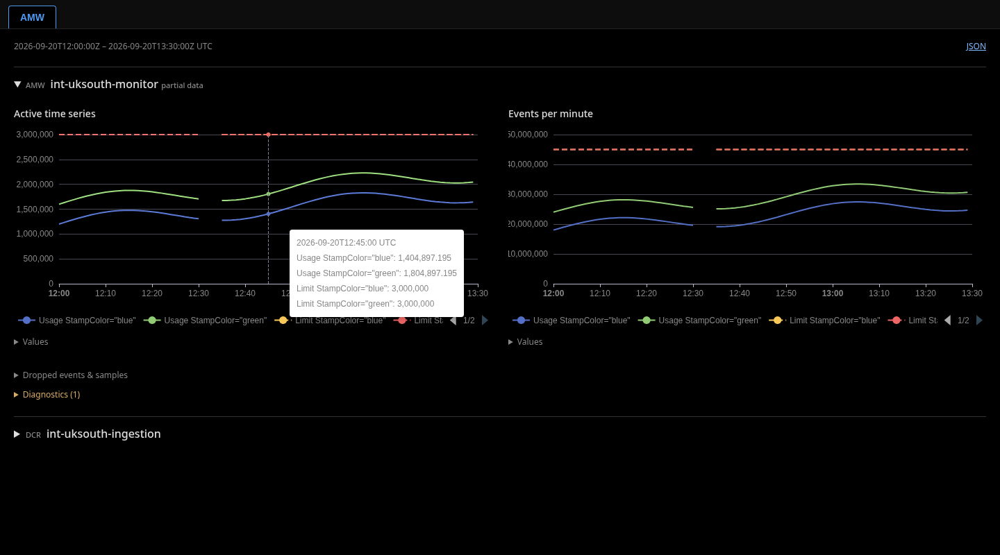
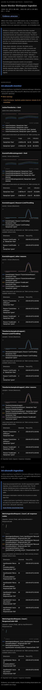

# AMW Platform Observability

`aro-hcp-tests gather-observability` includes an AMW pane and an `amw.json` evidence file alongside its Prometheus metric panels (see [CI Operations](operations.md#post-job-observability-artifacts) for the other post-job artifacts). The pane answers one question: was the Azure Monitor Workspace (AMW) that stores a cluster's Prometheus metrics near its platform limits, or dropping data, during the run? It does so using read-only Azure Resource Manager metric APIs only, with no PromQL, metric-name discovery or diagnostic-settings changes.

## Collecting And Rendering

To collect only the AMW evidence, with the same rendered configuration and timing inputs as a normal gather:

```sh
aro-hcp-tests gather-observability --amw-only \
  --rendered-config /path/to/rendered-config.yaml \
  --subscription-id "$SUBSCRIPTION_ID" \
  --timing-input /path/to/test-artifacts \
  --output /path/to/amw-artifacts
```

Credentials come from the normal Azure SDK selection, for example `AZURE_TOKEN_CREDENTIALS=AzureCLICredential` after `az login`. When timing artifacts are not available, pass `--start-time-fallback` in RFC3339 format. The AMW-only mode skips alerts, JUnit evaluation, utilization collection and every Prometheus API.

Open the resulting `observability-summary.html` locally. The summary tables work without JavaScript; the charts load ECharts from the same CDN as the other observability panes. To regenerate the HTML from saved evidence without Azure access:

```sh
aro-hcp-tests gather-observability render-amw --input amw.json --output observability-summary.html
```

## What The Report Shows

For each AMW in the run, the report charts active time series and events per minute against their limits, and lists dropped events and samples by reason. For each data collection rule (DCR) that sends to those workspaces, it charts ingestion requests per minute by input stream and response code. The first AMW opens expanded and the rest start collapsed; hover a chart for exact UTC values and click legend entries to hide series. Utilization and headroom are only computed from usage and limit values observed at the same timestamp for the same set of dimensions, so different stamps are never summed together, and data that is missing stays unknown rather than being shown as zero. The table states the time of the latest observation instead of presenting it as the workspace's current state.

A few caveats apply when reading it:

- DCR discovery looks only in the selected workspace's subscription. It matches rules by their monitoring-account destination, which shows that a rule is configured to send there, not that data is flowing.
- The documented 15,000 requests per minute limit applies per DCR rather than per stream, and there is no byte-rate metric to compare against the ingestion volume limit.
- The `StampColor` dimension appears in the published metric catalog but not all workspaces expose it, and requesting it makes Azure reject the whole query. The collector does not request it; if a workspace returns it, it is retained.
- Minute maxima are shown as such and never summed into totals of lost data.

## Bounds And Failure Handling

Collection is deliberately small and time-boxed: a total deadline, a per-request timeout, no retries, and caps on the number of workspaces, DCRs, discovery pages, response sizes, series and plotted lines. The values are constants at the top of `test/cmd/aro-hcp-tests/gather-observability/amw.go`. Hitting any bound marks the result incomplete rather than failing the run, and omitted series remain in `amw.json`.

Collection problems are diagnostics, not E2E gates. They stay visible in the JSON and HTML, a normal gather only logs a failure to publish the AMW artifacts without changing any alert verdict, and `--amw-only` returns an error in that case. `amw.json` keeps the time bounds, resource IDs, metric responses, metric definitions and discovery pages, which can include unrelated DCRs in the subscription, so treat it like other CI evidence.

## Preview

The screenshots below use synthetic data.




