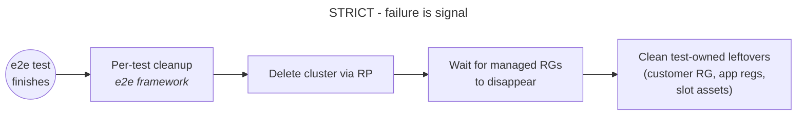
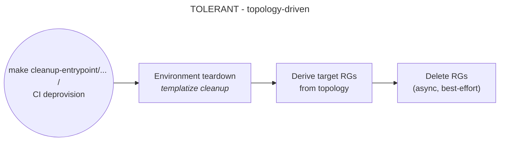
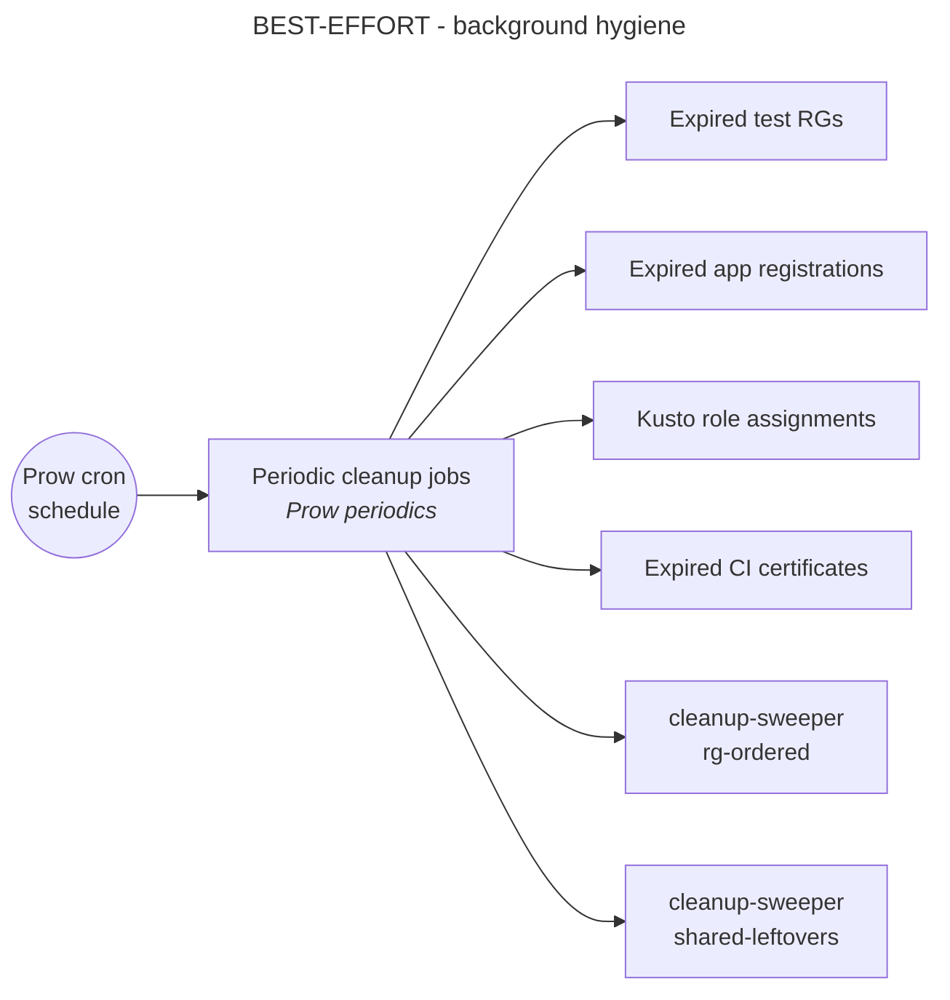

# CI Cleanup

ARO HCP CI cleans up after itself in three different ways, and they differ on purpose. A cleanup that is right for a test, where a leak is a finding, is the wrong one for a background janitor that has to keep going no matter what it trips over. A cleanup that is right for tearing down a throwaway DEV environment is not what we want in public cloud, where the RP owns the lifecycle of what it created.

For how the jobs that run these paths fit into CI, see [CI Execution](execution.md). For finding and inspecting the jobs, see [CI Operations](operations.md).

## The Three Cleanup Modes

### Strict per-test cleanup



The E2E framework runs this after every test. It deletes the HCP clusters through the RP, waits for their managed resource groups to disappear, and then removes what the test itself owns: the customer resource group, the app registrations and service principals it created, and finally returns the identity containers the test borrowed, after cleaning them, to the job's own scheduler so that later specs can reuse them. That last step happens even when `ARO_E2E_SKIP_CLEANUP` is set. It neither deletes the persistent slot assets nor releases the Boskos slot, which stays with the job until the workflow's lease-release post step (see [Acquire, persist, fail, release](../../test/cmd/aro-hcp-tests/slot-manager/DESIGN.md#acquire-persist-fail-release)), so no other job can acquire the slot when an individual test finishes. It also purges the soft-deleted Key Vaults and Managed HSMs that deleting the customer resource group leaves behind, because their names are derived from the resource group and a later run would otherwise collide with them.

This path is strict because a leak here is a finding. If something survives a test, either the product did not delete what it created or the test created something outside the framework's ownership, and both are worth failing on.

Two details are worth knowing. When the tests run with app-only CI credentials, app registrations are permanently purged rather than left in Entra's deleted-items container, and the service principal is purged before the application: the service principal stays independently recoverable and keeps counting against directory quota if only the application is purged. Local runs with delegated user credentials keep the normal soft-delete, since purging needs permissions an ordinary app owner may not have. The second detail is a known gap. When the RP leaves a managed resource group behind after its cluster is gone, the group's system-protected deny assignment blocks everyone except the RP's first-party principals from deleting it. Cleanup recognises that case, logs it for RP-side remediation (AROSLSRE-1591), and still deletes the customer resource group instead of burning its timeout waiting.

### Targeted environment teardown



This is the path for tearing down a known environment: personal-dev cleanup (see [Personal Dev](../personal-dev.md)) and the `aro-hcp-deprovision-environment` post step of the DEV E2E jobs. `templatize entrypoint cleanup` reads the topology, selects the resource groups that belong to the chosen entrypoint or service group, and deletes them. It does not try to prove that cluster deletion worked; it only needs the environment to start going away, so it works from a known target set, tolerates asynchronous deletion, and the CI step does not wait for completion. Regional teardown deliberately leaves the `global` resource group alone, since that holds long-lived services and shared credentials.

The Makefile targets default to `CLEANUP_DRY_RUN=true`, so a manual `make cleanup-entrypoint/<entrypoint>` only prints what it would delete until you pass `CLEANUP_DRY_RUN=false`.

DEV E2E jobs also run a best-effort `aro-hcp-deprovision-tracked-resource-groups` post step, which complements this teardown by removing the resource groups the test step created. It deletes the groups the tests recorded as they went, plus every group carrying the run's `jobID.aro-hcp-ci.redhat.com` tag (the Prow `BUILD_ID`), so groups leaked by an aborted test step are still caught. The step defaults to the `no-rp` workflow described below and refuses it for INT, STG, and PROD, whose jobs set `standard`. Its purpose is to keep role-assignment pressure down between the end of a job and the next periodic sweep.

### Background hygiene



Periodic jobs keep the shared subscriptions healthy over time. They are not trying to prove that any single test or delete behaved correctly; they pick up whatever earlier paths missed, and anything one run skips is retried by the next. All of them are defined in `Azure-ARO-HCP-main__periodic-cleanup.yaml` in [`openshift/release`](https://github.com/openshift/release/blob/main/ci-operator/config/Azure/ARO-HCP/Azure-ARO-HCP-main__periodic-cleanup.yaml), and they cover:

- expired test resource groups, one job per customer subscription (`test/aro-hcp-tests cleanup resource-groups --expired`, driven by the `deleteAfter.aro-hcp-ci.redhat.com` tag the framework puts on the groups it creates);
- expired E2E app registrations and their service principals, per tenant (`cleanup app-registrations`);
- Kusto role assignments (`cleanup kusto-role-assignments`);
- expired CI service certificates in the shared DEV key vault (`cleanup-sweeper --workflow=certificates`);
- `cleanup-sweeper`'s `rg-ordered` workflow, a policy-driven resource-group sweep;
- `cleanup-sweeper`'s `shared-leftovers` workflow, run per environment.

The expired app-registration job resolves each owned `aro-hcp-e2e-*` application's service principal first and then permanently deletes both objects once Entra shows them in deleted items, so the hourly job does not just move quota pressure into the 30-day recycle bin. It only prevents new buildup: objects already in the recycle bin need a separate, explicitly scoped purge, because the ownership query returns active applications only.

## Why They Behave Differently

### Why periodic cleanup is best-effort

Periodic cleanup runs in the background across shared subscriptions, so being too aggressive makes it its own source of instability and Azure throttling. The `cleanup-sweeper` jobs therefore run with a single worker and `rg-ordered` runs without waiting for deletions, to go easy on the Network provider. The aim is steady pressure in the right direction, not maximum throughput in one run. Within a run, the expired-resource-group job attempts every group it discovered regardless of earlier failures and exits non-zero at the end if any failed, so one build log shows the outcome for all of them.

### Why E2E cleanup is strict

Per-test cleanup is part of test correctness. A test that cannot clean up after itself means cluster deletion did not finish properly, test-owned Azure resources were left behind, or the test created resources the framework does not own. The framework treats all three as signal rather than logging and moving on.

### Why DEV cleanup actively deletes managed resource groups but public-cloud cleanup does not

The cleanup tool has two workflows, selected with `--mode`: `standard` (the default) and `no-rp`. The `standard` workflow goes through the RP, so it is cluster-aware and strict. The `no-rp` workflow is for when no RP is around to do the work, and it acts directly. Which one a job uses depends on one question: is there still a live owner for deleting what the cluster left behind?

In public cloud there is. Managed resource groups are part of the cluster lifecycle owned by the RP and its downstream components, so the right behaviour is to delete the cluster through the RP and wait for the managed groups to disappear as a consequence. The groups also carry deny assignments that stop customer principals from modifying them, so a cleanup job trying to delete them directly would just fail with a permission error. Service association links work the same way: Azure creates one when a cluster uses a delegated subnet, and the RP's cluster deletion is expected to remove it. If one is left behind in public cloud, the RP did not finish deleting the cluster, and that is a finding to surface, not something to quietly sweep away.

In DEV the owner may already be gone. Each DEV E2E job brings up its own RP and tears it down afterwards, and personal-dev environments are removed wholesale. If cleanup waited for the RP to delete managed resource groups, they would stay forever, and an orphaned service association link blocks deletion of its subnet's resource group with `InUseSubnetCannotBeDeleted`. So `no-rp` finds the managed resource groups itself and deletes them, deletes any orphaned service association links, and then deletes the parent group. Deleting a link needs the first-party app credentials (the `--fpa-client-id` and `--fpa-cert-path` flags); without them the step is skipped and only the other deletions happen. In the periodic config, the DEV subscription jobs set `CLEANUP_MODE: no-rp`, while the INT, STG, and PROD jobs leave it unset and run `standard`.

So the difference is not that DEV is special for its own sake; it follows from whether the RP is still there to own deletion.

## Running The Periodic Jobs

### Identifying the cleanup job for a subscription

A subscription named in an alert or a failing run maps to its cleanup job through the periodic config. The subscription names come from the `subscriptions.e2e` entries in [`e2e-slots.yaml`](../../test/e2e-config/e2e-slots.yaml). In the periodic cleanup config, each expired-resource-group job is named `delete-expired-<something>-resource-groups` (the Prow job is `periodic-ci-Azure-ARO-HCP-main-periodic-cleanup-<that name>`) and selects its subscription with `CUSTOMER_SUBSCRIPTION` plus a `VAULT_SECRET_PROFILE`. The `<something>` does not follow a mechanical rule across environments (the DEV subscriptions are `dev-ci-shard<N>` and `dev-pers`, INT and STG are `integration` and `stage`, PROD is `prod-<NN>`), so search the config for the subscription name rather than deriving the job name. The legacy cross-tenant "ARO HCP E2E" production subscription has no `CUSTOMER_SUBSCRIPTION` override and its job is the indexless `delete-expired-prod-resource-groups`, which takes the subscription from the `prod` profile's secrets.

If a subscription has no dedicated expired-resource-group job, it is not covered by that job family at all. The sweeper jobs discover their subscriptions from the mounted secret profile instead, so check those next.

### Resource-group policy for `rg-ordered`

`rg-ordered` decides what to delete from [`resourcegroups.policy.yaml`](../../tooling/cleanup-sweeper/resourcegroups.policy.yaml), where the first matching rule wins. The file documents its own rules; the points worth knowing here are the intent behind them. Groups with a live managed-by owner, long-lived shared groups, and the slot-managed identity containers and infrastructure-identity bundles are skipped, because slot assets are reused across runs and must never age out like test resources (see [Slot Assets](slot-assets.md)). Ephemeral CI groups expire in hours, personal-dev groups in days, and `persist=true` groups last longer.

Every delete rule requires the resource group to carry a parseable `createdAt` tag, and Azure does not set one by default. A group without the tag is never a candidate, so `rg-ordered` must not run in a subscription until an Azure Policy that stamps `createdAt` on new resource groups is assigned there; until then only `shared-leftovers`, which deletes no resource groups, is safe. Groups created before the policy was assigned stay out of scope until they are backfilled, for example with policy remediation.

For the DEV, STG, and PROD e2e/customer subscriptions the policy is assigned declaratively: the `createdat-rg-tag-policy` step of the dev-ci pipeline `dev-infrastructure/dev-ci/e2e-subscription-rbac-grants/pipeline.yaml` deploys it to every subscription listed under `.ci.<env>.e2eSubscriptions` in the dev-ci config. That step lives in the privileged dev-ci tree because creating policy definitions and assignments needs permissions the unattended bot does not have, so an OWNERS member runs it with `make dev-ci-privileged-local-run`. For any other subscription, including INT, which that step does not cover, `tooling/cleanup-sweeper/scripts/create-createdat-policy-assignment.sh` creates the same definition and assignment imperatively.

The rule body exists in two places, `tooling/cleanup-sweeper/scripts/rg-createdat-policy-rule.json` for the script and a mirrored copy in `dev-infrastructure/templates/createdat-rg-tag-policy-subscription.bicep` for the pipeline. Both use the same resource names so they converge on one policy, but a change to the rule logic has to be made in both.

### Shared leftovers

`shared-leftovers` runs hourly per environment (`sweeper-shared-leftovers-{dev,int,stg,prod}`), each reporting to that environment's `#aro-hcp-failures-<env>` channel. It deletes role assignments whose principal no longer exists and purges soft-deleted Key Vaults that no longer have an owner. It never deletes resource groups, so it does not depend on `createdAt`.

Deciding that a principal is gone means reading Microsoft Graph, which needs `Directory.Read.All`. The per-environment ARM identity usually lacks that tenant-wide grant, so the `aro-hcp-deprovision-cleanup-sweeper` step in `openshift/release` mounts a second identity selected by `GRAPH_SECRET_PROFILE` (the dev bot by default) and hands it to the sweeper as `GRAPH_AZURE_*` variables; when it resolves to the same profile as the ARM identity, that single identity is used for both. Each deletion is revalidated against Graph immediately beforehand. A failure to discover principals ends the role-assignment step before anything is deleted, while a failed revalidation skips only that target.

### Disposable service certificates

CI service certificates for the frontend, admin API, sessiongate, and Maestro server of `ci00`, `ci01`, and `ci02` runs are issued into the shared `aro-hcp-dev-svc-kv` vault, in the `global` resource group. Regional teardown never touches that group, and you should not enable global resource-group deletion to clean up individual certificates. For these job-named certificates `templatize` sets an `EmailContacts` lifetime action instead of `AutoRenew`, so they are not renewed while waiting to be swept; persistent environments, public cloud, and other vaults keep their normal renewal.

Expired certificates are removed by the hourly `delete-expired-dev-ci-certificates` job, which runs `cleanup-sweeper --workflow=certificates` against [`certificates.policy.yaml`](../../tooling/cleanup-sweeper/certificates.policy.yaml). The policy is deliberately conservative. Rules are evaluated first-match-wins and anything unmatched is kept; certificates with a tag in `protectedTags` (`persist: "true"`) are never selected; deletion requires the certificate to be older than the rule's retention and, for job-named certificates, requires that no resource group for that job still exists in the subscriptions listed under `ownerInventory`. Incomplete inventory or uncertain metadata always favours keeping the certificate. The placeholder and fixture job IDs are protected by the policy's first rule, so keep it first when editing. The policy file is parsed strictly and validated when loaded, which is the quickest way to find out that an edit is invalid.

To preview what a policy change would delete, run the workflow by hand. Like every workflow it applies changes unless `--dry-run=true` is passed, so always start with a dry run, and `cleanup-sweeper --help` lists the workflow's options.

```bash
AZURE_TOKEN_CREDENTIALS=dev \
  go run ./tooling/cleanup-sweeper --workflow=certificates \
    --dry-run=true --policy=tooling/cleanup-sweeper/certificates.policy.yaml \
    --options=certificates.max-deletions=1000 \
    --options=certificates.max-purges=1000 \
    --parallelism=2 --timeout=30m
```

After reviewing the output, repeat with `--dry-run=false` to apply. Active certificates are deleted as whole objects, including every version, so their material becomes unavailable. Azure offers no atomic "delete if the owner is gone" operation, so a resource group created at the same moment as the delete remains a small race, which the age checks, revalidation, and protected tags are there to shrink. Previously deleted certificates (tombstones) are also purged, since a lingering tombstone only blocks reuse of its name.

### Tracing sweeper deletions

When you need to know which job deleted something, the `rg-ordered` and `shared-leftovers` logs carry a unique `runID`, the workflow, the subscription, whether it was a dry run, and, in Prow, `prowJob` and `prowBuildID`. Every ARM DELETE is logged before dispatch (`Sending ARM DELETE request`) and again when a response arrives (`Received ARM DELETE response`), with the `x-ms-client-request-id` sent to Azure and the request, correlation, and routing IDs that Azure returned. Match those IDs against Azure's own records, then use `runID` to find the decision and job behind them. A sent request with no matching response means the outcome is unknown, and an HTTP status does not prove an asynchronous delete finished. The `certificates` workflow and the `cleanup` commands in `aro-hcp-tests` are outside this ARM audit path.

## Where To Look

- Periodic job definitions: `ci-operator/config/Azure/ARO-HCP/Azure-ARO-HCP-main__periodic-cleanup.yaml` and the `aro-hcp-deprovision-*` steps under `ci-operator/step-registry/aro-hcp/deprovision/` in `openshift/release`
- Per-test teardown and the `standard` / `no-rp` workflows: `test/util/framework/per_test_framework.go`
- The `cleanup` commands used by the periodic and post-step jobs: `test/cmd/aro-hcp-tests/cleanup/`
- Environment teardown: `tooling/templatize/cmd/entrypoint/cleanup/`
- `cleanup-sweeper` and its policies: `tooling/cleanup-sweeper/`
