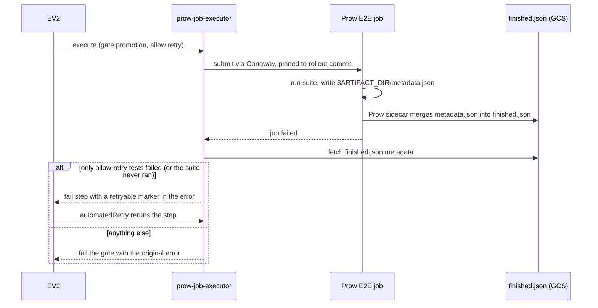

# EV2 Retry Catcher

When an EV2 gating E2E run fails on a small set of tests that already have a tracked issue, the rollout used to wait for someone to notice, read the Prow output, and retrigger the gate by hand. For INT and STG that meant starting a whole new rollout just to rerun the E2E step; for PROD it meant getting onto a SAW device to click retry. The retry catcher automates exactly that manual step: it retries the gating step once, but only when every failed test carries an explicit `allow-retry` label. Anything else, such as infrastructure errors, timeouts, or broad or unexpected failures, still fails the gate and gets triaged by a person.

The mechanism applies to EV2 gating runs only (see [CI EV2 Integration](ev2-integration.md)). Periodic and PR jobs are not affected. It is not a blind retry-until-green, and it does not cover management-cluster or other infrastructure failures beyond the one pre-test case described below. The label is a temporary marker with an owner and a tracking issue, not a permanent allowlist.

## How It Works

Three components each own one part of the decision, and EV2 performs the retry itself:

- The E2E suite in ARO-HCP reports facts: which specs failed and which of those carry `allow-retry`.
- `prow-job-executor` in [Azure/ARO-Tools](https://github.com/Azure/ARO-Tools) decides from those facts whether the failure is retryable, and says so with a marker string in its error.
- EV2's own `automatedRetry` on the `regionalGating` step matches the marker and reruns the whole step.

The executor never resubmits the job itself. An earlier design did, but moving the retry into EV2 means the attempt count and the delay between attempts live in one place, the step's `automatedRetry` configuration, instead of being duplicated in ARO-Tools.

### Labeling tests

A test opts in by adding `labels.AllowRetry` (the `allow-retry` Ginkgo label, defined in `test/util/labels/labels.go`) to its labels. Every use carries an inline comment naming an owner and a tracking issue, and the label is removed once the issue is fixed; `test/e2e/README.md` documents this for test authors, and existing uses are the best examples.

Nothing enforces the expiry today. It is a convention, and a label can linger after its issue is closed. Enforcement (an expiry date next to each use checked by a presubmit, a central manifest, or a periodic audit of labeled tests) is not implemented. Whichever is chosen would only decide who may carry the label; it would not change how the signal is consumed.

### Reporting the facts

`registerEV2RetryCatcher` in `test/cmd/aro-hcp-tests/ev2_reporting.go` hooks into the suite run. It looks up the labeled specs before the suite starts, because the extension framework's per-test result does not carry labels, tracks failures as they complete, and after the whole suite finishes merges these keys into `$ARTIFACT_DIR/metadata.json`:

- `ev2-failed-tests`: every spec that failed.
- `ev2-allow-retry-tests`: the subset of those that carry `allow-retry`.
- `ev2-suite-summary`: total, passed, failed, and skipped counts and the suite duration. This is informational only and is not part of the retry decision; it lets someone triaging a run from `finished.json` see its shape without opening the Prow UI.

The keys are written on every run, including clean ones, where both lists are empty. That way an absent key means the suite never reached this point, rather than being ambiguous between "nothing failed" and "failed but not eligible". The catcher deliberately reports only facts and leaves the policy to the executor, so the policy can change without an ARO-HCP release.

`metadata.json` is Prow's standard way for a test step to attach structured data to a job: the sidecar merges its top-level keys into the `metadata` object of `finished.json`. This was chosen over a custom `finished.json` result value, which Prow derives from the container exit code and test code cannot influence, and over scraping a marker line out of `build-log.txt`, which is fragile on multi-megabyte logs and matches unstructured text.

### Deciding eligibility

When a gating job ends in the `failure` state and the step was started with `--allow-ev2-retry`, the executor fetches `finished.json` from GCS and reads those lists. Jobs that end in an error or are aborted (infrastructure or tooling problems, cancellation, timeouts) are never inspected and fail the gate directly. The decision is in `retrymarker.go` in the executor:

- A run is a known-issue failure when it failed at all, no more than `--max-ev2-auto-retry-failures` tests failed (default 2), and every failed test is labeled `allow-retry`. A single unlabeled failure disqualifies the whole run.
- A run is an infra-precondition failure when no step's `finished.json` carries the failed-tests key at all. That means a shared pre-step, for example lease acquisition finding no free E2E slot (see the [slot-manager design](../../test/cmd/aro-hcp-tests/slot-manager/DESIGN.md)), failed before the test step could report anything. It earns the same single retry.

On a match, the executor fails with an error that contains a fixed marker string, `ev2-retryable-known-issue-failure` or `ev2-retryable-infra-precondition-failure` respectively, and wraps the original error so callers can still inspect the cause. Otherwise it returns the original error unchanged. The read-only `monitor` subcommand never takes part in retries, since it observes a job it did not submit.

### Retrying through EV2

The `regionalGating` step in `test/e2e-pipeline.yaml` lists the markers in its `automatedRetry.errorContainsAny`, together with the connection and MSI failure phrases that the default retry policy covered; EV2 substring-scans the step output for them and, on a match, reruns the whole step up to `maximumRetryCount` times after `durationBetweenRetries`. The step's comments in that file explain two details worth knowing:

- Setting `automatedRetry` on a step replaces the default retry policy instead of extending it, which is why the default phrases are repeated.
- INT and STG use exclusive locks and therefore fail fast. The generator used to ignore a custom `automatedRetry` in that mode, so the retry only worked in PROD. It now merges the custom `errorContainsAny` patterns into the fail-fast retry (AROSLSRE-1764), keeping the count and wait pinned.

The marker strings must not appear anywhere else that could end up in the gating step's output, such as comments echoed by the step's inlined scripts or another step's retry list. EV2 scans all of the step output, so a stray match would retry a genuinely failed run (see AROSLSRE-1292).

## Where To Look

- `test/util/labels/labels.go` and `test/cmd/aro-hcp-tests/ev2_reporting.go` for the label and the facts the suite reports.
- `test/e2e-pipeline.yaml` for the retry configuration of the gate.
- ARO-Tools `tools/prow-job-executor/` (`prowjob/retrymarker.go` for the policy, `options.go` for the flags) for the decision.
- [Azure/ARO-HCP#6409](https://github.com/Azure/ARO-HCP/pull/6409), [Azure/ARO-HCP#6464](https://github.com/Azure/ARO-HCP/pull/6464), and [Azure/ARO-Tools#282](https://github.com/Azure/ARO-Tools/pull/282) for the original implementation and its discussion.
