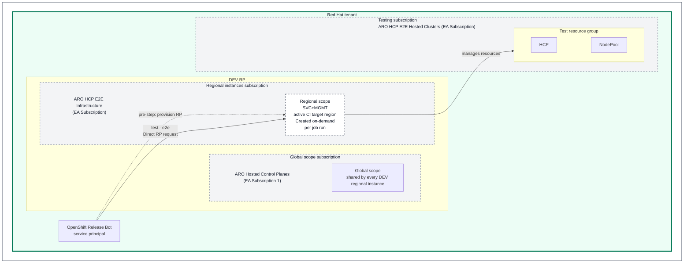
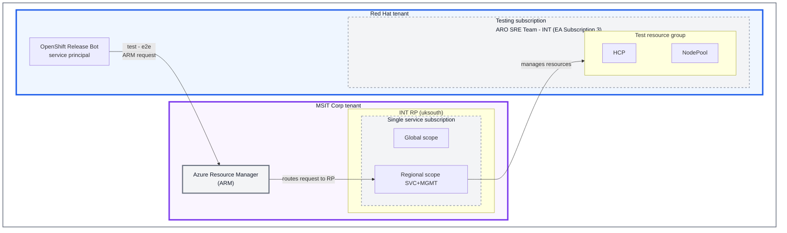
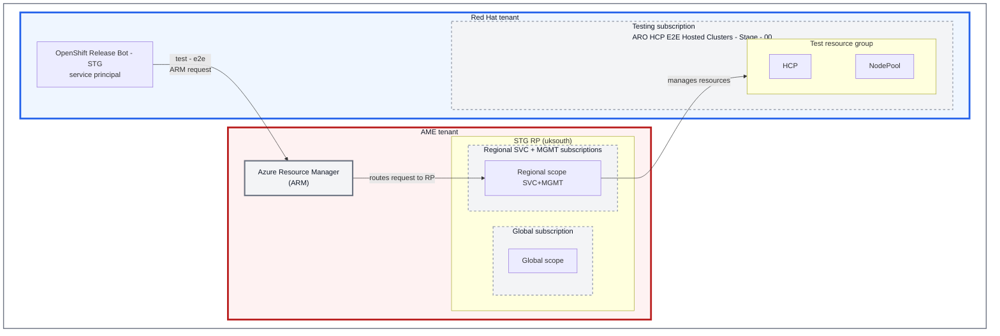
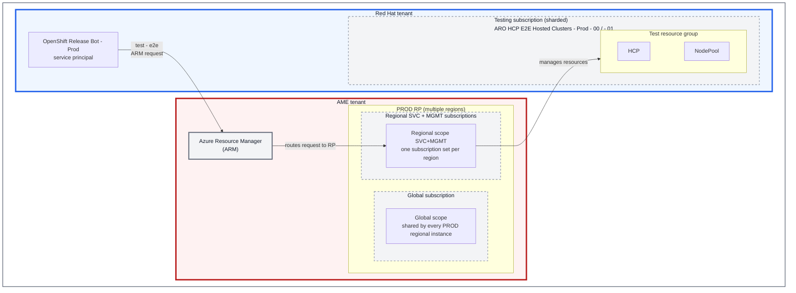

# CI Execution

ARO HCP uses OpenShift's Prow-based CI infrastructure for pull-request validation, rollout gating, and background hygiene. The Prow jobs themselves are defined in `openshift/release`, while this repository holds the product code, test code, EV2 wiring, and most of the behavior those jobs ultimately execute.

This document explains the execution model: what each CI mode validates, how Azure request paths differ across environments, how leases and shared identities are consumed during a run, and why some CI modes can validate undeployed changes while others cannot.

## What CI Validates

CI does not answer a single question. Different job families validate different parts of the system:

- **Build and simulation jobs** answer "does this repository still build, render, and pass fast checks?"
- **DEV PR E2E** answers "does this unmerged change work when CI provisions an on-demand DEV service footprint and exercises it end to end?"
- **Higher-environment PR E2E** answers "does this test code behave correctly against the already-deployed shared environment?"
- **EV2 gating** answers "does the exact commit being rolled out pass E2E checks before promotion continues?"
- **Periodic jobs** answer "are shared environments still healthy, and is background cleanup keeping pace with resource churn?"

The most common misunderstanding is to assume every E2E job validates the same thing. That is not true:

- `e2e-parallel` in DEV can validate undeployed RP or infrastructure changes because the RP footprint is created on demand for the job.
- `integration-e2e-parallel`, `stage-e2e-parallel`, and `prod-e2e-parallel` run against persistent environments that already exist in Azure, so before merge they mainly validate changes in test code and test expectations.
- EV2-triggered jobs validate a specific rollout commit, not whatever happens to be at `HEAD` when the job starts.

## Execution Modes

### CodeQL Analysis

The [CodeQL workflow](../../.github/workflows/codeql-analysis.yml) runs in GitHub Actions and builds the Go workspace by hand so the extractor can trace it. Go modules, discovered from `go.work`, are spread over seven shards that upload separate analysis categories; the `test/` module gets a shard of its own so it stays isolated from the rest. Python runs once. The Go builds are memory-hungry, so each job adds swap and limits build parallelism. Treat both as headroom, not a fix: if a shard is killed, record its peak memory, swap use and source revision before changing the partition, and remember that exit code 143 means SIGTERM, which does not by itself prove an OOM kill. When you change the partition, check that every module is assigned to exactly one shard.

### PR Validation In DEV

DEV PR validation combines fast repository checks with an end-to-end path that can exercise unmerged service and infrastructure changes:

- required build and simulation jobs such as `images` and `frontend-simulation`
- the required `e2e-parallel` and `e2e-parallel-inplace-upgrade` jobs
- DEV-specific environment provisioning through the `aro-hcp-local-e2e` workflow in `openshift/release`

This is the only PR mode that provisions the RP footprint on demand as part of the job run. That makes DEV PR CI the place to validate unmerged RP changes and shared deployment artifacts such as pipeline definitions, Helm charts, Bicep templates, and alerting. It is still not a perfect proxy for higher-environment rollouts, because create-from-scratch CI behavior and in-place updates exercise different paths.

In image terms, this is also the only PR path that normally builds both the runner images and the service images that get injected into the freshly provisioned DEV environment. The on-demand footprint is therefore running the exact service image revision produced by that job.

The on-demand DEV environments depend on pre-existing **global shared infrastructure** that is not provisioned by the E2E job itself. Shared resources such as ACRs, parent DNS zones, Key Vault, Grafana, and Kusto are maintained by the `global-pipeline-postsubmit` Prow job, which runs automatically after merge when changes touch `config/config.yaml`, `observability/observability.yaml`, or anything under `dev-infrastructure/`. If the global postsubmit fails or drifts, on-demand DEV environments will fail at provision time. The global scope lives in a shared subscription, while regional, SVC, and MGMT infrastructure is deployed into CI infrastructure subscriptions.

### PR Validation In INT, STG, And PROD

The higher-environment presubmit jobs are triggered manually when needed:

- `integration-e2e-parallel`
- `stage-e2e-parallel`
- `prod-e2e-parallel`

These jobs target persistent environments that already exist in Azure:

- **INT** runs tests from the Red Hat tenant against the service footprint in the MSIT Corp tenant
- **STG and PROD** run tests from the Red Hat tenant against service footprints in the AME tenant

Because those environments are already deployed before the PR merges, these jobs are most useful for validating E2E test changes and for checking behavior against a known shared environment. They are not the right signal for undeployed RP or infrastructure changes.

These runs are also lighter from an image perspective. They usually need the test runner image, not the full service image set, because they target services that are already deployed in Azure.

### EV2 Gating Jobs

EV2 gating uses postsubmit-style Prow jobs that EV2 triggers through Gangway when a rollout reaches an environment. The job runs against the exact commit being rolled out rather than `HEAD`, and when `gatePromotion` is enabled for the environment, a failure stops the rollout from being promoted. That commit pinning is what separates gating from a periodic job. The wiring from rollout to job, including how to identify a gating run afterwards, is in [CI EV2 Integration](ev2-integration.md).

### Periodic Jobs

Periodic jobs run against `HEAD` on a schedule. They are not rollout-gating and they are not exact replacements for PR jobs. Their role is ongoing health and hygiene:

- scheduled E2E checks in persistent environments
- cleanup of expired or orphaned resources
- image-updater tooling validation

If a periodic fails, that usually points to shared-environment drift, backlog in cleanup, or a regression that was not tied to a specific active rollout.

## CI Azure Flow

E2E jobs in CI can be summarized as follows: the job authenticates as a test identity, that shared identity creates one test resource group per test in a testing subscription, and each request is then sent to the environment's RP entrypoint. In higher environments that request flows through ARM; in DEV it is a direct RP call. The RP then creates the ARO HCP cluster resource back into that test's resource group.

Which identity a job uses, which subscription it targets, and which cluster profile field backs each of those choices are defined by the [Cluster Profile Secret Contract](cluster-profile-secret-contract.md).

The charts below focus on that transaction path and the tenant and subscription boundaries it crosses:

- **DEV** is a same-tenant, cross-subscription flow inside the Red Hat tenant.
- **INT** runs tests from the Red Hat tenant against an RP footprint in the MSIT Corp tenant.
- **STG / PROD** run tests from the Red Hat tenant against RP footprints in the AME tenant.
- **Global scope** is shared by every regional RP instance in that environment.
- **Regional scope** is the environment's regional service footprint; depending on the environment, `SVC` and `MGMT` can share a subscription or span multiple subscriptions.

Each diagram below shows one representative per-test resource group. A full job run creates one such resource group for each test or spec that executes.

### DEV



### INT



### STG



### PROD



## How An E2E Run Works

### Authentication And Test Identity

Each E2E mode starts from a CI identity:

- **DEV and INT** use the `OpenShift Release Bot` service principal on the test side.
- **STG** uses the `OpenShift Release Bot - STG` and **PROD** uses the `OpenShift Release Bot - Prod` service principal, both in the Red Hat tenant.

That identity is the caller that initiates the test-side Azure request. Across the job run, it creates one test resource group per test or spec.

### Environment Selection And Step Wiring

The job selection and environment wiring live in `openshift/release`:

- ci-operator configuration selects the job family and step-registry workflow
- step-registry workflows decide whether the run provisions a fresh DEV RP or targets a persistent environment
- the `aro-hcp-tests` binary is carried inside the `aro-hcp-e2e-tests` image used by the test steps
- local DEV E2E also builds the service images that `aro-hcp-provision-environment` injects into the temporary environment
- persistent-environment E2E usually only needs the runner image because the service footprint already exists

This is why the same test binary can participate in multiple CI modes while still exercising very different Azure topologies.

See [CI Image Lifecycle](image-lifecycle.md) for the full image graph, including shared CI images, job-local builds, and the boundary between CI promotion and ACR mirroring.

### Request Path And Created Resources

For every environment, each test or spec that creates Azure resources gets its own **test resource group** in a testing subscription. The request path then diverges:

- in **DEV**, CI provisions the regional service footprint first and then calls the RP directly inside the Red Hat tenant
- in **INT**, **STG**, and **PROD**, the request flows through ARM into the environment's RP footprint in another tenant

For tests that create HCP clusters, the RP creates the cluster resource back into that test's resource group. Not every test reaches this point; negative and validation tests may only exercise API behavior without creating a cluster.

### Run Cost Attribution

In DEV, a job can opt in to tagging everything it creates with its Prow build ID (`jobID.aro-hcp-ci.redhat.com`) so that Cost Management can show what one job cost across all the subscriptions it touched. Cost Management tag inheritance on the E2E subscriptions copies the tag from resource groups onto the usage records of their contents. A job opts in by setting `RUN_COST_TAG_VALUE` in its `openshift/release` configuration; the literal value `BUILD_ID` resolves to the job's build ID.

The tag lands on the AKS clusters (through the config override generator), on the resource groups the provisioning step creates, and on each test's resource group. The deprovision step also uses it to find the resource groups of an aborted job. Two things are never attributed: the RP-managed resource groups of hosted clusters, because the RP creates them without tags, and shared resources such as the identity fleets, the global Key Vault and the registries.

### Experimental Configuration Overrides

A job can change any configuration key for a single run without a change in this repository. Set `RAW_CONFIG_OVERRIDES` in the job's `openshift/release` configuration (the `aro-hcp-provision-environment` step declares it), one `path.to.key=value` entry per line:

```yaml
env:
  RAW_CONFIG_OVERRIDES: |
    clouds.dev.environments.ci00.defaults.mgmt.aks.userAgentPool.vmSize=Standard_D16ads_v6
    clouds.dev.environments.ci00.regions.westus3.mgmt.aks.userAgentPool.maxCount=4
```

Paths are rooted at the override document, which has the shape of `config/config.yaml`, and values are parsed as YAML. Overrides are applied after everything the generator produces, so they win, but a more specific entry in `config/config.yaml` such as one under `regions.<region>` still beats the same key under `defaults`; override that location when you need to. Two entries that touch the same key fail rather than depending on order, and a misspelled key fails schema validation during provisioning instead of being ignored. The applied entries are echoed to the log and the resolved `config.yaml` is kept in the job artifacts, so never put a secret in an override.

Because the step wrapper, `hack/ci/provision-environment.sh` and the generator all live in this repository, an experiment never needs to merge: open an `openshift/release` PR that sets the variable on a job and run `/pj-rehearse`. `aro-hcp-tests infra build-config-override --raw-config-override path=value` does the same locally.

### Cleanup Handoff

Once a test has created resources, cleanup responsibility moves into one of three deliberately different paths:

- strict per-test cleanup in the E2E framework
- targeted environment teardown for explicit DEV cleanup
- background hygiene from periodic jobs

See [CI Cleanup](cleanup.md) for the cleanup model and why these modes intentionally do not behave the same way.

## Slots And Identities

E2E jobs acquire their environment from `slot-manager`. DEV `e2e-parallel` runs use the `aro-hcp-local-e2e` workflow, whose first pre-step acquires a slot before the environment is provisioned. INT, STG and PROD jobs, whether presubmit, EV2 gating or periodic, use `aro-hcp-persistent-e2e`, which acquires a slot and writes configuration but provisions nothing. In both, the acquire step selects a pool from the [slot catalog](../../test/e2e-config/e2e-slots.yaml), picks the region, and publishes a runtime contract that the later steps read; the post-steps release the slot. Region selection is driven by the job's `LOCATION_WEIGHTS`, `LOCATION`, `MULTISTAGE_PARAM_OVERRIDE_LOCATION` and `ALLOWED_SUBSCRIPTIONS` settings, which are best read from the current `openshift/release` configuration rather than from prose.

Where to read further:

- The [slot-manager design](../../test/cmd/aro-hcp-tests/slot-manager/DESIGN.md) specifies the catalog, the acquire and release lifecycle, and the runtime contract.
- [E2E Slot Assets](slot-assets.md) explains the identities each slot comes with and why the test framework reuses managed identities instead of creating them per cluster.
- [DEV Mock Identities](dev-mock-identities.md) explains the service principals that replace the first-party application in DEV.
- [E2E Capacity And Quotas](e2e-capacity.md) explains how slot and container counts relate to Azure limits.

## EV2 Commit Pinning

The connection between EV2 and Prow is configured in this repository: `config/config.msft.clouds-overlay.yaml` selects the `prowJobName` for each environment, and `test/e2e-pipeline.yaml` passes it to the EV2 pipeline. The job is then triggered against the rollout's commit rather than `HEAD`, which is the key difference between EV2 gating and a periodic E2E. [CI EV2 Integration](ev2-integration.md) covers the full path, including Gangway authentication and how to identify a specific run.

## See Also

- [CI Overview](README.md)
- [CI Image Lifecycle](image-lifecycle.md)
- [E2E Slot Assets](slot-assets.md)
- [CI EV2 Integration](ev2-integration.md)
- [CI Cleanup](cleanup.md)
- [E2E Testing In CI](e2e-testing.md)
- [CI Operations](operations.md)
- [Test E2E README](../../test/e2e/README.md)
