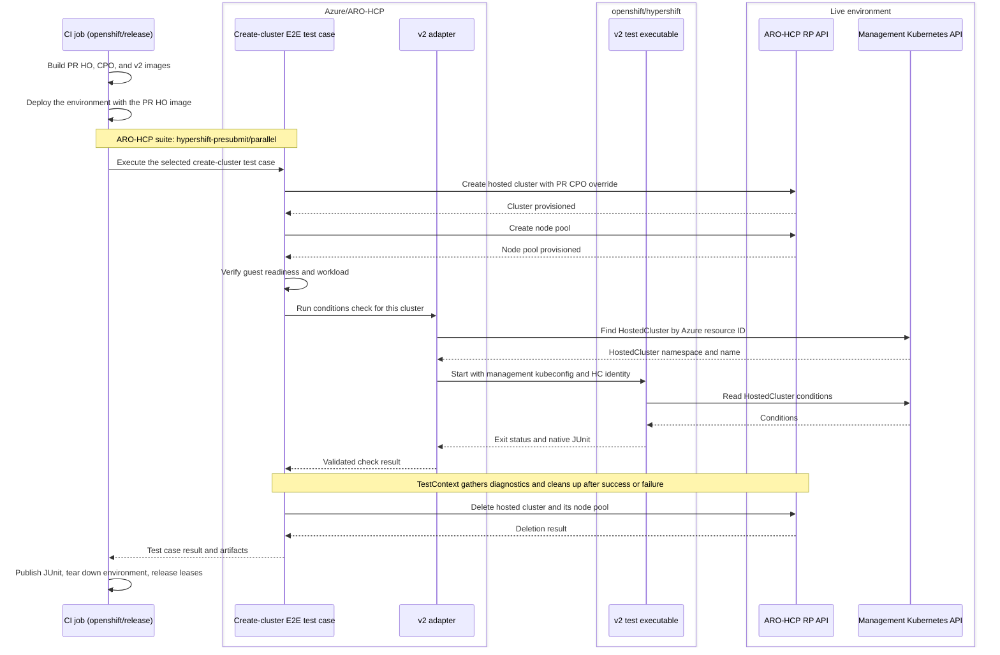

# HyperShift v2 checks in the ARO-HCP presubmit

The HyperShift CI job `e2e-aro-hcp-presubmit` runs ARO-HCP's
`hypershift-presubmit/parallel` test suite. That suite selects the test case
`ARO-HCP HyperShift Presubmit should create a cluster and nodepool to completion`
in [cluster_create_hypershift_presubmit.go](../../test/e2e/cluster_create_hypershift_presubmit.go).

For each test run, the CI job deploys an ARO-HCP environment with the PR-built
HyperShift Operator (HO). The test case creates one hosted cluster through the RP
API with the PR-built Control Plane Operator (CPO) image override, then creates a
node pool. After Console setup, version-rollout readiness, and the web application
check, it calls the adapter to run the upstream HyperShift v2 HostedCluster
conditions check against that cluster. `TestContext` retains ownership of
diagnostics, service deletion, and identity cleanup.

The integration is enabled by `HYPERSHIFT_V2_BINARY`. Existing invocations with
that variable unset retain the ARO-HCP smoke checks. An enabled invocation checks
its executable and management kubeconfig before creating customer resources.

## Test execution

The sequence shows one CI job executing the ARO-HCP test case from the selected
test suite. The RP API handles cluster lifecycle requests. The v2 executable reads
the resulting HostedCluster through the management Kubernetes API. Readiness and
workload checks use the guest cluster's API within the ARO-HCP test case.

The final cleanup section shows normal completion. `TestContext` also attempts
diagnostics and cleanup after setup or assertion failures. The adapter stops the
child executable when its context is canceled, and the CI workflow retains its
post-job environment teardown and lease-release steps.

## Inputs

- `HYPERSHIFT_V2_BINARY`: path to the upstream `test-e2e-v2` executable.
- `HYPERSHIFT_V2_MANAGEMENT_KUBECONFIG`: a separate management-cluster kubeconfig;
  the parent's service-cluster `KUBECONFIG` remains unchanged.
- `ARTIFACT_DIR`: the parent test runner's artifact destination. Each invocation
  creates a fresh directory under the test case's `hypershift-v2` directory.

The executable must contain the upstream `hosted-cluster-conditions` label. The
adapter requires exactly one passing conditions testcase in native v2 JUnit;
missing reports, empty selections, skipped checks, assertion failures, and process
errors fail the parent test case. The child is stopped when the test case's context
is canceled or its execution deadline expires.

Cluster discovery matches the full Azure resource ID against the HostedCluster's
`azure.microsoft.com/hcp-cluster-azure-resource-id` annotation. It uses the actual
HostedCluster name and namespace, rather than guessing names or passing the
control-plane namespace. No matches or multiple matches fail the invocation.

## CI artifacts and rollout

The coordinated `openshift/release` change supplies the v2 executable from the
HyperShift PR's test image in the ARO-HCP test runner. It creates the management
kubeconfig outside the artifact directory. `hypershift-v2-provenance.json` records
the runner and upstream test image digests, binary checksum, PR refs, and HO/CPO
image digests. `hypershift-v2-build-info.txt` records the binary's Go build metadata.
Native JUnit, child output, and non-secret target metadata are retained in the
test case's invocation directory.

The CI step independently requires a fresh report with exactly one passing
conditions testcase. This also fails the job if an older promoted ARO-HCP image
ignores the v2 opt-in during rollout. Reports from earlier invocations cannot
satisfy that check. The combined runner uses amd64, matching the published
ARO-HCP test image.

Merge the HyperShift label change first, then this ARO-HCP adapter and publish its
updated E2E image. Enable the CI wiring after both images contain the required
changes. Validate a real presubmit and inspect its individual conditions testcase
before closing [CNTRLPLANE-4969](https://redhat.atlassian.net/browse/CNTRLPLANE-4969).

Additional cluster variants and API-driven lifecycle test cases are follow-up
work. They can invoke the same adapter while keeping cluster and identity
ownership in their own ARO-HCP test cases.
