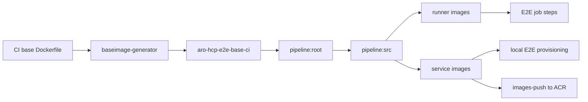

# CI Image Lifecycle

ARO HCP CI works with several image lifecycles at once, and most confusion comes from mixing them up. An E2E job rarely just runs one prebuilt container. Depending on the job family, ci-operator imports a shared CI image that an earlier postsubmit built, builds job-local runner and service images for the exact source revision under test, deploys the service images into a temporary environment, promotes some of them for reuse inside OpenShift CI, and, after merge, mirrors the service images into the ARO service ACR for real deployments.

This page explains how those pieces fit together. For the job families themselves, start with [CI Execution](execution.md). For registry topology and image distribution outside CI, see [ACRs and Images](../acrs-and-images.md).

## Lifecycle Overview



Read the chart left to right. The shared build-root image is built and published by its own job. Each ci-operator run imports it into a temporary namespace as `pipeline:root`, builds a job-local source image (`pipeline:src`) containing the revision under test (for a PR, usually a synthetic merge of the base branch and the PR), and fans out the images the requested test target needs. Runner images execute the CI steps; service images are either deployed into a DEV local E2E environment or mirrored to ACR after merge.

Put differently, there are three layers: persistent shared CI images built by dedicated jobs, job-local `pipeline:*` images that live only in one run's namespace, and the runtime distribution of selected service images to ACR. A few names appear in more than one layer. `aro-hcp-e2e-tests` is built job-locally in many runs and promoted for reuse by selected postsubmits, and service images such as `aro-hcp-backend` exist first as job-local outputs and later as ACR content.

## Shared CI Images

### Shared CI Build Root

Most jobs do not rebuild their toolchain. The ci-operator configs in `openshift/release` import an already-published build root, the `aro-hcp-e2e-base-ci` tag of the `aro-hcp/aro-hcp-ci-images` ImageStream, through `build_root.image_stream_tag`. The `baseimage-generator` variant of the same config produces it: it builds [`dev-infrastructure/openshift-ci/Dockerfile`](../../dev-infrastructure/openshift-ci/Dockerfile) on the builder image selected by [`.ci-operator.yaml`](../../.ci-operator.yaml) in the repo root, and the postsubmit promotes the result into the ImageStream. The generator's jobs also run on PRs that touch the Dockerfile or the tool-version files, so a base image change is validated before merge.

This is why ci-operator logs of later jobs contain a line like:

```text
Tagging aro-hcp/aro-hcp-ci-images:aro-hcp-e2e-base-ci into pipeline:root
```

It means the shared build root is being imported into this job's namespace. How tool versions in the base image are pinned and bumped is covered in the [openshift-ci README](../../dev-infrastructure/openshift-ci/README.md#version-management).

### Nested Podman Toolchain

Integration tests and mega-linter run in nested-Podman jobs. Their toolchain follows the same producer/consumer pattern as the build root:

- [`Dockerfile.nested-podman`](../../dev-infrastructure/openshift-ci/Dockerfile.nested-podman) extends the OpenShift CI `ci/nested-podman` image with the ARO HCP tools (Go, Git, Make, and so on). The `baseimage-generator` variant builds it from that image rather than from `src`, because building from `src` would replace the nested Podman base, and promotes it as `aro-hcp-ci-images:aro-hcp-nested-podman-ci`.
- The main ci-operator config consumes that tag as its `nested-podman` base image. `nested-podman-src` is a small job-local layer on top of it that copies in the source under test. It stays job-local so a PR test never runs against source left over from an earlier postsubmit.

Package downloads therefore happen when the toolchain is published rather than in every job. Two consequences are worth knowing. A failed toolchain build does not replace the last promoted image, so consumers keep working. The generator only rebuilds when one of its trigger paths changes, so upstream base-image and package updates reach CI only after such a change or a deliberate rebuild. The checkout in `nested-podman-src` is owned by UID 1000, the toolchain's default user, so jobs can create repository-local build outputs such as `bin/envtest` without becoming root.

Local build and smoke-test commands are in the [openshift-ci README](../../dev-infrastructure/openshift-ci/README.md#nested-podman-base-image).

### Shared CI Test Runner Image

`aro-hcp-e2e-tests` is built from [`test/Containerfile.e2e`](../../test/Containerfile.e2e), which layers the ARO HCP test and tooling binaries (`hcpctl`, `templatize`, and the `test/` tools) on top of the shared base image. PR jobs usually build it job-locally. The main config also promotes it, together with `aro-hcp-e2e-tools`, into the `aro-hcp` namespace with a `latest` tag so that later jobs can import it instead of rebuilding. The periodic E2E variant does exactly that and takes `aro-hcp-e2e-tests:latest` as a `base_images` entry.

The promoted image can be pulled from the build farm registry as `quay-proxy.ci.openshift.org/aro-hcp/aro-hcp-e2e-tests:latest`. For the RBAC on app.ci and the login, follow [How do I gain access to QCI?](https://docs.ci.openshift.org/how-tos/use-registries-in-build-farm/#how-do-i-gain-access-to-qci) in the OpenShift CI docs.

## Job-Local Images

### Runner Images Vs Service Images

Job-local images fall into two groups.

**Runner images** are the containers that execute step-registry scripts. The two main ones are `aro-hcp-e2e-tests`, used for config rendering, the test run, and most gather steps, and `aro-hcp-e2e-tools`, used by provisioning, deprovisioning, and the image push. A step selects its runner with `from:` in its ref. A few more specialized runners exist for individual targets, such as `nested-podman-src` for nested-Podman jobs, `aro-hcp-api-tools` for API validation, and a tooling image for the image-updater periodics.

**Service images** are the product components the job is testing, such as `aro-hcp-backend`, `aro-hcp-frontend`, and `aro-hcp-admin-api`; the main config lists the full set. They are either deployed into a temporary DEV environment or mirrored to ACR after merge. The provisioning step receives them through ci-operator `dependencies:` in its ref, which resolve to immutable pullspecs in environment variables. The provision script writes those pullspecs into the temporary environment's configuration, so the environment runs exactly the images built from the revision under test.

### Local E2E Versus Persistent E2E

How many images a job builds follows from what it targets, because ci-operator only builds what the requested target depends on.

A local E2E job (the `aro-hcp-local-e2e` workflow, used by `e2e-parallel`) provisions a fresh DEV environment. It needs the runner images for rendering configuration, provisioning, testing, and gathering, and the service images that provisioning deploys. This is why its ci-operator graph builds many images before any test step starts. Which environment it gets, and the identities and slots it leases, is covered by [slot-manager](../../test/cmd/aro-hcp-tests/slot-manager/DESIGN.md); the lease step runs at the start of the workflow's `pre` phase.

A persistent-environment E2E job (the `aro-hcp-persistent-e2e` workflow) targets an environment that is already deployed, so it needs only the runner image. The `__e2e` variant that EV2 triggers (see [CI EV2 Integration](ev2-integration.md)) is the extreme case: it defines nothing but `aro-hcp-e2e-tests`. Periodic variants can go further and skip even that build by importing the promoted `latest` image.

## Promotion Vs Push

These two terms are easily blurred, but they refer to separate mechanisms with separate audiences.

Promotion is a ci-operator feature: it publishes selected CI-built images into a persistent ImageStream on the build farm so that later jobs can import them. For ARO HCP that covers the base CI image (promoted by `baseimage-generator`), the nested Podman toolchain, and the `aro-hcp-e2e-tests` and `aro-hcp-e2e-tools` runner images (promoted by the main config). Promoted images are reused inside OpenShift CI only.

Push is how service images leave CI. The `images-push-postsubmit` job runs the `aro-hcp-images-push` step from `openshift/release`, which receives the CI-built service images as dependencies and mirrors them into the service ACR. A sibling job pushes the tooling images that are deployed rather than tested (`aro-hcp-tenant-quota`). From the ACR, environment deployments and cross-environment mirroring take over, which [ACRs and Images](../acrs-and-images.md) describes.

## How To Read Ci-Operator Logs

The startup output of a ci-operator run reads best as a dependency graph. The lines worth recognizing:

- `Resolved source ... merging: #...` is the exact revision under test, for a PR the synthetic merge of the base branch and the PR.
- `Using namespace .../ci-op-...` is the temporary namespace. All `pipeline:*` images live only there.
- `Tagging ... aro-hcp-e2e-base-ci into pipeline:root` imports the shared build root, and `Building src` creates `pipeline:src` from the checkout.
- `Building aro-hcp-e2e-tools`, `Building aro-hcp-frontend`, and similar lines are the downstream image builds the target requires. A build line does not mean the corresponding test step has started.
- `Image .../pipeline:aro-hcp-frontend created digest=...` means the image now exists at an immutable digest for downstream steps or later mirroring.
- `Running [input:root], lease-proxy-server, src, ..., e2e-parallel` is ci-operator's node graph, not the start of the tests. `input:root` is the imported build root, `src` the source image, `aro-hcp-*` the image builds, and `e2e-parallel` the target, which runs once its prerequisites are ready. `lease-proxy-server` is ci-operator infrastructure, not an ARO HCP image.
- `Found existing build ...` means ci-operator reused an existing Build object for that node. What matters is still the final digest the downstream steps consume.

## Where To Look

The ci-operator configs and step registry live in `openshift/release` under `ci-operator/config/Azure/ARO-HCP/` and `ci-operator/step-registry/aro-hcp/`.

- `Azure-ARO-HCP-main.yaml`: service and runner image definitions, promotion, and the `images-push-postsubmit` job.
- `Azure-ARO-HCP-main__baseimage-generator.yaml`: the shared base and nested Podman images.
- `Azure-ARO-HCP-main__e2e.yaml` and `Azure-ARO-HCP-main__periodic.yaml`: the runner-only EV2 and periodic variants.
- `step-registry/aro-hcp/local-e2e/`, `provision/environment/`, and `images-push/`: the local E2E workflow, how service images reach provisioning, and the ACR push.
- In this repository: [`dev-infrastructure/openshift-ci/`](../../dev-infrastructure/openshift-ci/) for the base images and [`test/Containerfile.e2e`](../../test/Containerfile.e2e) for the test runner.
