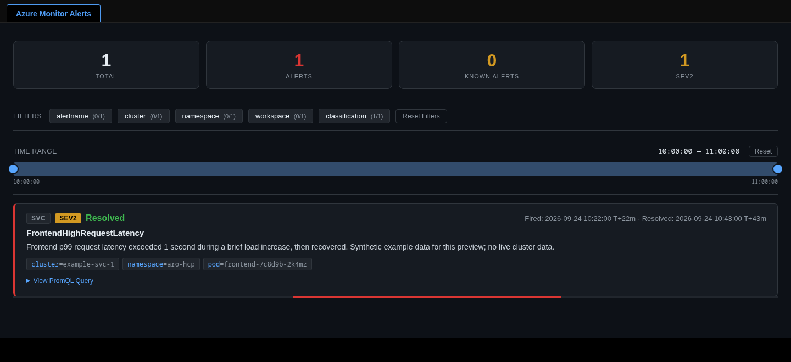
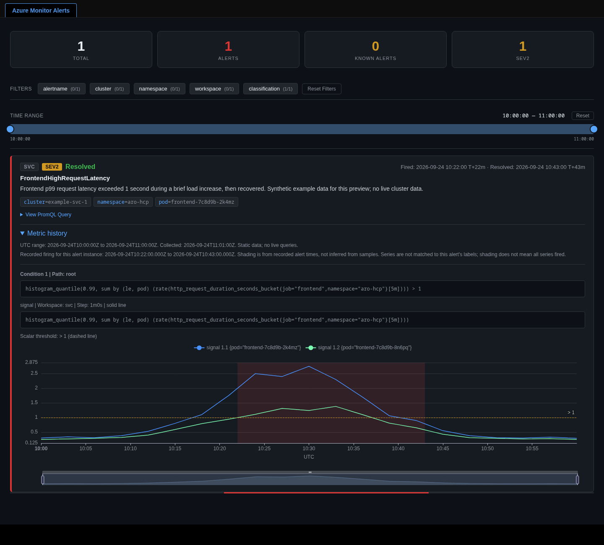
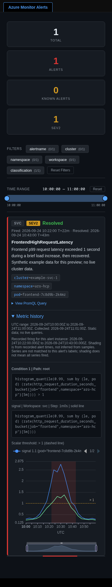
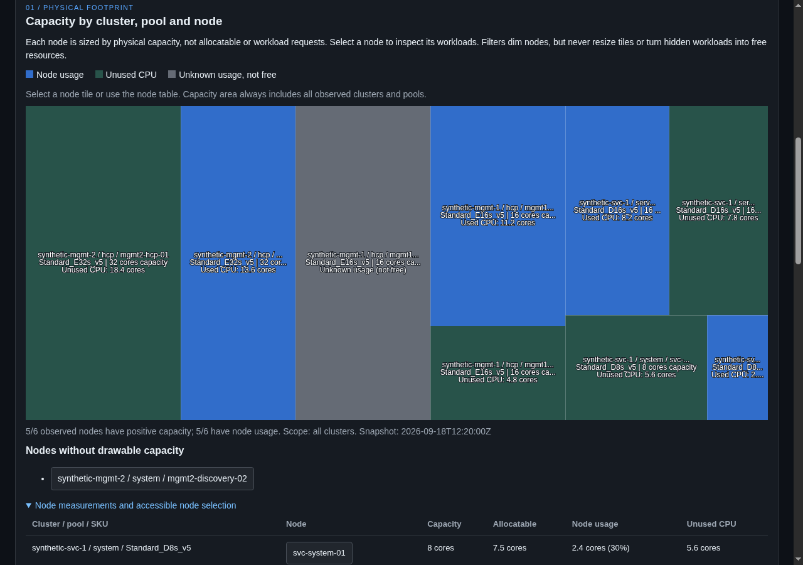
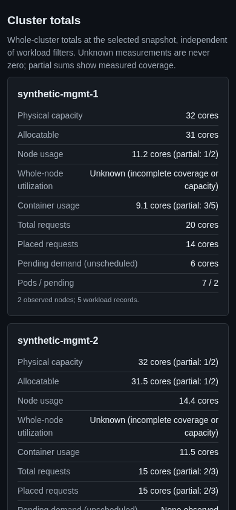
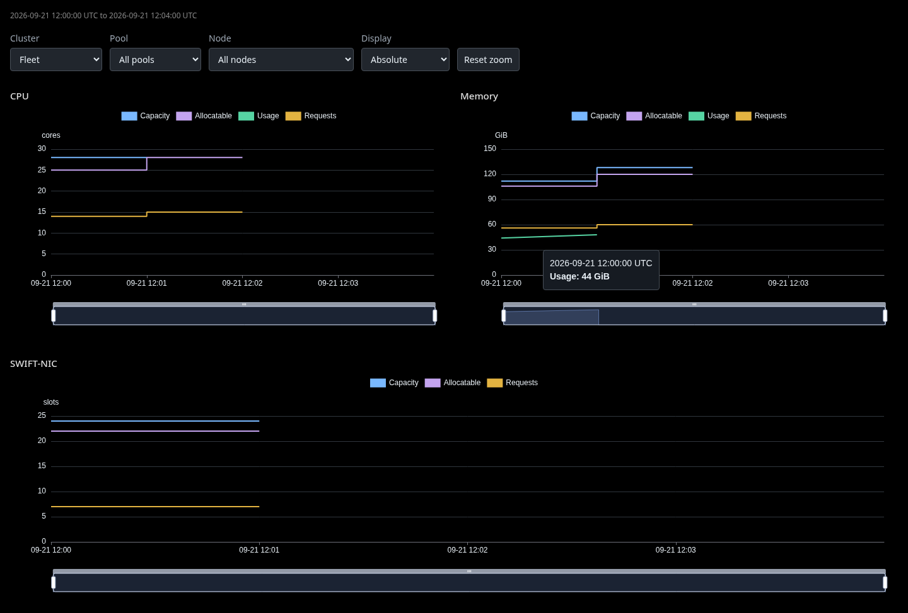
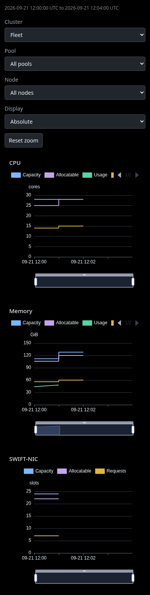

# CI Operations

This is the operator and maintainer view of ARO HCP CI: how to look at a run that failed, how to change the CI configuration, and where to start when something is wrong.

For DEV CI PagerDuty and Slack alerts, start with [DEV CI Monitoring and Alert Response](dev-ci-monitoring.md); for a regional provision-health incident, use [DEV CI Regional Load Management](dev-region-load-management.md). The execution model and cross-tenant request flow are in [CI Execution](execution.md), and contributor-facing usage, including how to trigger jobs, is in [E2E Testing In CI](e2e-testing.md).

## Inspecting Runs

Start from the PR's **Checks** tab, open the job in the [Prow dashboard](https://prow.ci.openshift.org/?repo=Azure%2FARO-HCP), and read the logs and artifacts of the failing step. Then work out which target environment and execution mode the job ran in, because that decides what the job could realistically have caught (see [CI Execution](execution.md)). The Prow job history shows whether the failure is new, and build-farm-side failures and repeated infrastructure problems are discussed in [`#forum-ocp-testplatform`](https://redhat.enterprise.slack.com/archives/CBN38N3MW).

Jobs that lease a slot publish `aro-hcp-slot-state.yaml` as an artifact, recording the region, slot, and assets the run was given. It is the first place to look when a failure might depend on which slot or subscription the job landed on.

### Post-Job Observability Artifacts

DEV E2E runs end with an `aro-hcp-gather-observability` post step that runs before the environment is deleted. It queries the run's time window from the regional Azure Monitor workspaces and uploads the results, so you can see what the cluster was doing during the failure after it no longer exists. Open its artifacts before hunting for a Grafana dashboard. The step is implemented in `test/cmd/aro-hcp-tests/gather-observability`, and its query catalog is [`queries.yaml`](../../test/cmd/aro-hcp-tests/gather-observability/queries.yaml); the chart descriptions and copyable PromQL in the report are the source of truth for what each signal means. The step also gathers an Azure Monitor workspace platform view, described in [AMW Platform Observability](amw-platform-observability.md).

The artifacts are:

- `observability-summary.html`, the report itself, with fired-alert details and charts for the Frontend, Backend, Fleet, Maestro, service containers, and management clusters. It needs no Azure credentials to view, though charts load ECharts from a CDN; expressions and diagnostics stay readable without it.
- `alerts.json` and `alert-diagnostics.json`, the alert data and the query results behind each alert's metric history.
- `utilization.json`, the data behind the Utilization and Resource History tabs.
- `junit_alerts.xml`, which reports unexpected fired alerts to Prow as test failures.

The uploaded report keeps the selected chart samples after the ephemeral environment is gone, for as long as OpenShift CI retains artifacts. It is not a raw metrics store for comparing runs. Each tab and artifact is collected independently, so an unavailable workspace or chart does not suppress the rest. If alert collection itself is incomplete, the step fails with an explicit JUnit failure rather than reporting that no alerts fired.

#### Known alert firings

An alert that fires in CI but is understood and tolerated can be excluded from the gate in [`knownIssues.yaml`](../../test/cmd/aro-hcp-tests/gather-observability/known-issues/knownIssues.yaml). Each entry needs an alert name and a reason, and optional label patterns narrow the match. An optional `expiresAfter: "YYYY-MM-DD"` turns the exception into a timebomb: it applies through that UTC date, and from the next day a matching firing fails the step again. When the underlying issue is fixed, delete the entry instead of extending the date, and review whether the issue is really still open before renewing one. This only changes how CI classifies the alert; Azure Monitor firing and notification routing are unaffected.

#### Alert metric history

Every alert in the report, including known issues, has an expandable **Metric history** pane showing the signal the alert evaluates, across all matching series rather than only the ones that fired. It is collected automatically for PromQL alerts.







Some things to keep in mind when reading it. The shaded band is the firing interval Azure recorded for that alert card, not a threshold crossing inferred from the data, and not a claim that every plotted series fired. Missing samples are gaps, not zeros. The graph is a historical query rather than a replay of the alert's evaluations, so ingestion delay and later rule changes can make it differ slightly from what fired. An expression the extractor cannot take apart safely is queried unchanged and labelled as fallback output, and alerts without PromQL, empty results, and query errors get an explanation instead of disappearing. All returned series are kept, so alerts over high-cardinality labels can produce large pages.

If you change alert expressions, the extractor and its repository-wide golden fixture live in [`test/util/alertdiagnostics`](../../test/util/alertdiagnostics). Regenerate the fixture from `test/`, review the diff by reading the extracted signals, and then run the tests:

```sh
UPDATE=1 go test ./util/alertdiagnostics -run '^TestRepositoryCorpus$' -count=1
go test ./util/alertdiagnostics ./cmd/aro-hcp-tests/gather-observability
```

Syntactic validity does not prove that an extracted signal explains its alert, which is why the diff needs a human.

#### Utilization and resource history

The Utilization tab shows how much of the underlay nodes' CPU and memory is actually used and by which workloads. It exists to support a human decision about whether node SKUs are oversized; it is evidence, not a recommendation to remove capacity.





The report picks a handful of snapshots across the run: each cluster's CPU and memory peak minute, plus the overall CPU and memory peaks weighted by capacity. Every snapshot shows all clusters at that same instant, so these are not independent per-node or per-pool peaks. In the treemap each node's area is proportional to its physical capacity, and unused or unknown capacity is shown explicitly. Collection covers the underlay clusters the regional workspace advertises, not customer worker clusters. DEV CI workspaces belong to a single job, but in shared environments the numbers show regional load during the test interval, not load caused by this run.

The Resource History tab keeps every evaluated minute instead of only the peaks, for the fleet or a chosen cluster, pool, or node, and plots CPU, memory, and SWIFT-NIC capacity against usage and assigned requests.





Requests here are sums of declared container requests, not the scheduler's effective reservations, so they say nothing certain about whether new pods would fit, and container working set does not reconcile exactly with whole-node load. Anything the collector could not measure is shown as a gap or flagged as unknown, never filled with zero or interpolated. Where request totals are incomplete the chart draws a separate dashed "Partial requests (lower bound)" series instead of discarding what was observed. Warnings about incomplete data appear in a collapsed **Data quality** section.

To iterate on the UI against saved data, render an existing `utilization.json` locally without Azure access:

```bash
./test/aro-hcp-tests gather-observability render-utilization \
  --input utilization.json --output /tmp/utilization-preview
```

This writes `utilization-summary.html` and `resource-history-summary.html`. The synthetic fixtures `utilization-synthetic.json` and `utilization-history-synthetic.json` in `test/cmd/aro-hcp-tests/gather-observability/testdata/` work as input if you have no real artifact at hand.

## Modifying CI Configuration

ARO HCP Prow job definitions live in `openshift/release`, not in this repository. Under `ci-operator/config/Azure/ARO-HCP/` are the ci-operator configs, and the step registry is under `ci-operator/step-registry/aro-hcp/`. The Prow job manifests under `ci-operator/jobs/Azure/ARO-HCP/` are generated from the configs and must not be edited by hand; after changing a config, run `make update` in the release repo so the generated files stay in sync.

Two things on the ARO HCP side have to move together with job names. `config/config.msft.clouds-overlay.yaml` maps public-cloud environments to the `prowJobName` of their EV2 gating job, and `test/e2e-pipeline.yaml` passes `PROW_JOB_NAME` into EV2 gating. Renaming a job on one side only leaves the rollout path pointing at a job that no longer exists, even though each YAML file still looks valid on its own. See [CI EV2 Integration](ev2-integration.md) for how that gating works and [CI Image Lifecycle](image-lifecycle.md) for the image build jobs.

Changes to the slots and subscriptions that E2E jobs run against are not made in `openshift/release`. To add or change slot assets and their catalog entries, see [Managing Slot Assets](slot-assets.md#managing-slot-assets); to change how many concurrent runs a subscription can support, see [Changing Capacity](e2e-capacity.md#changing-capacity).

## Troubleshooting

### Job stuck pending

Check for general OpenShift CI load or incidents first, and confirm the job landed on the build-farm cluster you expect. If the problem is widespread or unrelated to ARO HCP configuration, escalate to the OpenShift CI team.

If the job is running but sitting in its first step, it may be waiting for a slot. Jobs that lease slots wait for capacity when every candidate pool is exhausted; how acquisition, waiting, and failure behave is described in [Acquire, persist, fail, release](../../test/cmd/aro-hcp-tests/slot-manager/DESIGN.md#acquire-persist-fail-release), and the `aro-hcp-lease-acquire` log shows what it is waiting on. A slot that is admitted but then fails is covered in [When Admission Fails](slot-assets.md#when-admission-fails).

### Test failures in E2E jobs

First identify which execution mode failed (DEV PR, higher-environment PR, EV2 gating, or periodic), then decide whether the failure looks like product behaviour, environment drift, slot exhaustion, or a flaky test. [CI Execution](execution.md) says what each job could realistically validate, which often settles the first question.

### Cleanup failures

First separate strict per-test cleanup, where a failure is meant to be loud, from periodic cleanup, where it is best-effort; [CI Cleanup](cleanup.md) explains the difference. Before concluding the cleanup code is wrong, check for deny assignments on managed resource groups, resource locks, and an RP or other owner that is missing.

### Getting help

- Build-farm or Prow infrastructure issues: [`#forum-ocp-testplatform`](https://redhat.enterprise.slack.com/archives/CBN38N3MW).
- ARO HCP test failures: the development or SRE owners of the affected component.
- CI configuration changes: a PR to `openshift/release`, with the OpenShift CI reviewers involved as needed.

## Key Job Families And Source Of Truth

All configs are under `ci-operator/config/Azure/ARO-HCP/` in `openshift/release`. The file name suffix after `Azure-ARO-HCP-main` is the variant, and it appears in the Prow job name. This list is only an orientation aid; the configs are authoritative.

| Family | Job names | Config |
| --- | --- | --- |
| PR checks and image builds | `pull-ci-Azure-ARO-HCP-main-{images,test-unit,lint,verify,...}` | `Azure-ARO-HCP-main.yaml` |
| DEV PR E2E | `pull-ci-Azure-ARO-HCP-main-e2e-parallel*` (workflows `aro-hcp-local-e2e`, `aro-hcp-local-e2e-upgrade`) | `Azure-ARO-HCP-main.yaml` |
| Higher-environment PR E2E | `pull-ci-Azure-ARO-HCP-main-{integration,stage,prod}-e2e-parallel*` (workflow `aro-hcp-persistent-e2e`) | `Azure-ARO-HCP-main.yaml` |
| Postsubmit image promotion, global and dev-ci infrastructure | `branch-ci-Azure-ARO-HCP-main-{images,images-push-postsubmit,ci-images-push-postsubmit,global-pipeline-postsubmit,dev-ci-pipeline-postsubmit}` | `Azure-ARO-HCP-main.yaml` |
| CI base images | `*-baseimage-generator-*` | `Azure-ARO-HCP-main__baseimage-generator.yaml` |
| EV2 gating E2E | `branch-ci-Azure-ARO-HCP-main-e2e-*` | `Azure-ARO-HCP-main__e2e.yaml` |
| Periodic E2E | `periodic-ci-Azure-ARO-HCP-main-periodic-*` | `Azure-ARO-HCP-main__periodic.yaml` |
| Periodic cleanup | `periodic-ci-Azure-ARO-HCP-main-periodic-cleanup-*` | `Azure-ARO-HCP-main__periodic-cleanup.yaml` |
| Periodic provision health checks | `periodic-ci-Azure-ARO-HCP-main-periodic-healthcheck-*` | `Azure-ARO-HCP-main__periodic-healthcheck.yaml` |
| Image updater | `periodic-ci-Azure-ARO-HCP-main-image-updater-*` | `Azure-ARO-HCP-main__image-updater.yaml` |

## See Also

- [CI Overview](README.md)
- [CI Execution](execution.md)
- [CI Cleanup](cleanup.md)
- [CI Image Lifecycle](image-lifecycle.md)
- [CI EV2 Integration](ev2-integration.md)
- [E2E Testing In CI](e2e-testing.md)
