# Controller and Resource Data Flow

This reference covers every concrete controller in the current checkout: backend,
fleet, kube-applier, management-agent, sessiongate, and shared informer management.
It maps their inputs, decisions and effects across Cosmos DB, Azure, Cluster Service
and Kubernetes. The authoritative source revision for this reconciliation is
`07f208d9688b8285b51e51df70a7dca6476ed739` (frozen): controller registrations,
endpoint/storage attribution, ownership and lifecycle edges are reconciled with
the accumulated implementation review at that revision. No live Azure or
Kubernetes resources were contacted. The following baselines describe earlier
updates, not additional source revisions imported into this inventory.

Historical source review revision: `09f1fd39bcde35748b73693bd7322c8637900744`;
scope: all controller registrations, endpoint writes, external effects, shared
ownership and lifecycle graphs; child-event delivery, admission-generated cluster
UIDs, exact-version pins and stable capacity publication are included. Historical targeted baselines follow. Source baseline: `7997fa34a240560a792c3dd410396cd7651a9f39`.
Targeted capacity, kube-applier and shared storage review baseline:
`07f208d9688b8285b51e51df70a7dca6476ed739`; scope: stale-report mirroring versus
current-report aggregation, canonical resource-ID sets, unchanged-write suppression,
explicit Kubernetes deletion polling, read-desire lifecycle/redaction, union
informer startup, shared CRUD preconditions and Fleet readiness aggregation.
That earlier targeted review alone did not establish a new full-catalog source-review baseline.
Targeted update baseline: `4c1bf7d74e714d2ce24a8175a0d4846cc78d7113`;
scope: ContainerRegistry pull-credential validation and Cosmos snapshots moved from periodic dump controllers to informer lists.
Frontend admission-cache update baseline: `d9a1b9a4e2bf2298763bf7e1924f117678bdc2ba`
plus working-tree changes; scope: four-resource frontend admission informer bundle,
aggregate startup sync, cached admission inventories/provider state and affected
lifecycle views. Targeted integration-test cache waits remain deferred.
RU budget update baseline: `e50c6077a32b443e8ccb8d6a01a858b3a4c3d595`;
scope: unrestricted backend informer clients and logging each RU refill wait.
Rollout update baseline: main `5ee98fa7c2` plus the progressive-version-rollout
commits; scope: seven backend rollout controllers, version/operation consumers,
shared ownership, and cluster create/update and rollout diagrams, including the experimental
Immediate z-stream update policy. Review fixes cover
rollout membership, initial-assignment ownership, input-event queue metrics,
field annotations, and the recency-only selection contract.
Rollout version migration baseline: `720ee0705` plus working-tree changes;
scope: structured version profiles, shared read compatibility, and independent
Fleet rollout migration.
External-auth operation update baseline: `51851bfabe`, rebased on main `08987b4eba`;
scope: frontend create acceptance without a parent Cluster Service ID, empty
create/update operation `InternalID`, and the corresponding lifecycle diagrams.
Targeted update baseline: `5d8333306a2e7f795ea1f985dc3b5d9eb883ee69` plus working-tree
changes; scope: new persisted leaf field `CustomerProperties.Etcd.DataEncryption.CustomerManaged.Kms.KeyVaultType`
(KeyVault | ManagedHSM). It is customer intent written by PUT Cluster (Create) and forwarded to
Cluster Service by [ClusterClusterServiceCreate](#clusterclusterservicecreate); it adds no
controller, endpoint, external effect, lifecycle edge, or multi-writer/gating field, so it is
covered by the existing `CustomerProperties` ownership row and `CustomerProperties.*` create bullet
without catalog or diagram changes.
Ingress-certificate update baseline: `aac7f68f368798143d25c593bc9e3f20d92437f9`
plus working-tree changes; scope: backend IngressCertificate registration,
service-tenant configuration, paired kube-applier desires and owner-managed teardown.
Certificate-observation update baseline: `9a4006d51`; scope: separate read-only
TLSCertificates controller, per-certificate pending/confirmed references and ingress delivery gate.
Review-batch baseline: `c32a6156e`; scope: CS operation-status observation, reference identity,
deletion gates, exact-name teardown, vault validation and namespace-specific SSA ownership.
Authoritative follow-up: retain the default kube-applier field manager (CS ingress objects
are in `open-cluster-management-policies`, not the HostedCluster namespace); register
TLSCertificates alongside other cluster controllers in `cluster/registration.go`.
Certificate-review update baseline: `9556b62a11`; scope: non-nil certificate confirmation
for CREATE, string vault URLs matching fleet status, and observed-reference validation errors.
Review14 update baseline: `17f28e03`; scope: reuse certificate clients per Key Vault,
parse management-cluster-validated vault URLs, and pass the configured Azure cloud
name into ingress SecretProviderClass parameters. SecretSync paths are unchanged.
Deletion-verification update baseline: `6f47ca9ed`; scope: TLSCertificates now confirms
each certificate is actually gone from Key Vault (404 on GET) before clearing its
reference during cluster deletion, independently per certificate and without
requiring Cluster Service ID; certificate readiness also treats a present
certificate whose pending operation has since disappeared (404) as ready.
Controller-split update baseline: `b8d945350` plus working-tree changes; scope: split
TLSCertificates into two independent controllers, KubeAPIServerTLSCertificate and
IngressTLSCertificate, sharing one `tlsCertificateSyncer`/`tlsCertificateField`
implementation so each certificate's creation/deletion observation progresses on its
own; removed the per-vault Key Vault client cache (a fresh client is built per call);
unified the certificate name/label fields; and moved the ingress `SecretProviderClass`
and `SecretSync` kube-applier desire specs from hand-built `map[string]any` literals to
the real `secrets-store-csi-driver`/`secrets-store-sync-controller` Go API types.
Added a new `OperationClusterCreate` gate (`serviceProviderDefaultIngressServingCertificateStatus`)
that blocks CREATE completion until the ingress wildcard certificate's `SecretSync`
ReadDesire reports a successful observation and the `SecretSync` object's own status
carries a True `SecretCreated` condition — i.e. the TLS secret has actually been
synced into the HostedCluster namespace at least once, not just that the Key Vault
certificate reference was confirmed.
Review-fix baseline: `8a3c49af4` plus working-tree changes; scope: the ingress
`SecretProviderClass`/`SecretSync` Kubernetes object name (and thus the delivered TLS
secret name) is the fixed `controllerutils.ServiceProviderDefaultIngressWildcardServingCertName`,
not a Cluster-Service-ID-suffixed name, matching what `HostedCluster.Spec.OperatorConfiguration.
IngressOperator.DefaultCertificate.Name` expects; `serviceProviderDefaultIngressServingCertificateStatus`
checks only the `SecretSync` status's `SecretCreated` condition (secrets-store-sync-controller's
actual condition type — its own `secretsyncv1alpha1` API package's doc comments are stale and
still describe "Create"/"Update"); and `sigs.k8s.io/secrets-store-sync-controller` is bumped
v0.0.2 -> v0.0.5 (also bumping `sigs.k8s.io/secrets-store-csi-driver` v1.4.8 -> v1.6.0 transitively).
Mutator-safety baseline: `897dada03` plus working-tree changes; scope: `tlsCertificateField.get`
now returns a deep copy (mutations must be written back via `set`) rather than the live
`AzureResources` pointer, fixing a review-flagged mutation hazard; wraps two previously bare Key
Vault client errors in `utils.TrackError`; and drops two now-redundant `persistIfChanged` calls
from error paths that could never have anything to persist. No controller behavior changed.
Catalog-count correction baseline: `44d8bcf45`; scope: no controller behavior change, but the
backend registry's zone/instance/launch totals in [Complete Controller Catalog](#2-complete-controller-catalog)
had drifted stale (109/110/111/136) relative to `TestControllerRegistryManifest` and
`TestControllerRegistryNamedZoneRegistrations`'s actual current counts; corrected to 113 zone
instances, 114 backend instances, 115 total launches and 140 catalog entries.

Update-deadline baseline: `a0f232352a2e933142f2f2dfb61f2870aed7a26f` plus working-tree changes; scope: cluster/node-pool update admission, create/update timeout error codes and diagnostics, and their lifecycle views.

Cluster teardown update baseline: `d453011603d357d8fa8938acef97eec5d00818c4`
plus working-tree fixes; scope: ordered ApplyDesire removal, ReadDesire cleanup,
concurrent Cluster Service delete dispatch, and the cluster-delete diagram.
Repository-retirement update baseline: `624620420` with the
repository-retirement implementation; scope: BackupCleanup and
RepositoryCleanup, their registration, Kubernetes/Azure effects and cluster-delete
lifecycle. Other controller entries retain their prior audit scope.

Legacy credential-request removal baseline: `5bfaafa51` plus working-tree changes;
scope: removal of the two unreachable legacy credential controllers from the backend catalog.
The CSR-based credential lifecycle and diagrams are unchanged.

Backend input-filter update baseline: `3b3a5248bd` plus working-tree changes;
scope: explicit resource interests in all 75 eligible backend constructors and
shared fixed desire-name constants. See [the input audit](../backend-controller-inputs.md).

Snapshot PVC cleanup update baseline: `e8dff36c2e806a8189de15da4935ac1f613f4c4a`;
scope: management-agent snapshot PVC finalizer cleanup, external ownership and
the conditional control-plane namespace teardown path in the cluster-delete view.

The generation instructions are maintained in [controller-data-flow.md](../prompts/controller-data-flow.md).
The generated reference lives at `docs/generated/service-provider-control-flow.md`.

Fleet registration update baseline: `42a6fcfd9` plus working-tree changes;
scope: Fleet's twelve controller launch entries now use the shared typed
`controllerregistry.Registration` mechanism. Constructor wiring, worker counts,
node-pool enablement, and the leader-election/cache-sync startup barrier are
preserved; resource effects and lifecycle diagrams are unchanged.

- [Cosmos request attribution](#request-unit-ru-attribution)
- [Endpoint writes](#1-frontend-endpoint-writes)
- [Controller catalog](#2-complete-controller-catalog)
- [External effects and ownership](#external-effects-and-ownership)
- [Resource lifecycle digraphs](#3-resource-lifecycle-digraphs)
- [Shared fields and ownership](#4-shared-fields-and-ownership)

Cosmos persistence spans the **Resources**, **Billing**, **Fleet**, and
**per-management-cluster kube-applier** containers. Resource replacements generally
use ETag optimistic concurrency and advance `InstanceVersion`; creates, deletes
and transactional batches have their own semantics. A successful Cosmos write of
an intent does not establish that an Azure or Kubernetes resource exists.

The [shared CRUD helpers](../../internal/database/cosmosstorage/cosmosstorageutils/crud_helpers.go)
require a zero `InstanceVersion` on create, and a nonempty ETag plus nonzero
`InstanceVersion` on replace; replacements increment the version and use
`IfMatchEtag`. Transactional replacements additionally require the object's
partition key to match the batch. Generic resource deletion is an ETag-protected
soft delete with a 30-second TTL, not an immediate physical removal; ordinary
GET/list paths hide the tombstone. These storage semantics do not execute a
Kubernetes Delete intent.

The shared `PrepareForCreate` and `PrepareForReplace` helpers also derive
`CosmosMetadata.ParentResourceID` (a `*azcorearm.ResourceID`) from the resource
ID's parent on every successful preparation. The parent is lower-cased before it
is re-parsed, so stored resource names and the provider namespace are lower-cased
while the Azure SDK keeps reserved segment keywords such as `resourceGroups`
canonical. A nil resource ID, a nil parent, or a subscription-level resource
(whose parent is the SDK root sentinel with an empty string form) clears the
field to nil, and any stale value is always reset first; a nil field is omitted
from JSON. Legacy documents may omit it; it is populated when they are next
written through these helpers. This metadata does not change controller
dependencies or the resource lifecycle diagrams.

## Cosmos snapshots from informer lists

Sources: [shared list/watch](../../internal/database/informers/informerutils/changefeed_list_watch.go),
[snapshot logging](../../internal/database/informers/informerutils/snapshot.go), and
[polling informers](../../internal/database/informers/coreinformers/informers.go).

Every initial list and relist emits a snapshot for each returned object, including
unchanged objects. Resources, Fleet, and kube-applier change feeds continue to emit
snapshots as documents change. Billing and management-cluster-content polling lists
also emit snapshots. Logging reuses the objects already read by the informer and
makes no additional Cosmos queries. The backend Cosmos dump controllers and Fleet's
StampDataDump controller have been removed; Clusters Service state dumps and explicit
frontend/admin request-triggered dumps remain.

Snapshots retain `snapshotType=cosmos`, `currentResourceID`, `objectMetadata`, and
`content`, plus the inherited context fields and per-item `subscription_id`,
`resource_group`, `resource_id`, `resource_type`, `resource_name`, `hcp_cluster_name`,
and `cluster_id` where applicable. Operations derive their cluster and resource group
from `ExternalID`; kube-applier desires carry `managementCluster`. List snapshots
use the Cosmos document envelope already used by change-feed snapshots; billing
keeps its existing billing document shape. System-data caller identities are redacted
on a detached serialized copy. Snapshot failures are logged without exposing content
or interrupting the list, and cached objects are never redacted in place.

Snapshot cadence now follows the existing informer relist intervals: typically
30 minutes for Resources and kube-applier, 2 minutes for Fleet, and 30 seconds for
billing and management-cluster contents, with change-feed updates between relists.
Informer resyncs that replay the cache do not produce additional snapshots.
No resource lifecycle edges change.

## Request Unit (RU) attribution

Sources: [Cosmos metrics policy](../../internal/database/cosmosstorage/cosmosmetrics/policy.go),
[client wiring](../../internal/database/cosmosstorage/cosmosclient/database.go), and
[informer attribution](../../internal/database/informers/informerutils/context.go).

Clients constructed through `cosmosclient.NewCosmosDatabaseClient` record two
shared, process-wide counters through the same per-retry pipeline policy:

- `cosmos_request_units_total` sums the `x-ms-request-charge` response header
  once per HTTP attempt, including charged failures, query pages, and idle
  changefeed responses. Missing, malformed, negative, or non-finite charges
  are ignored, so this measures reported RUs, not request count.
- `cosmos_requests_total` counts every HTTP attempt that received a response,
  regardless of whether a charge was reported. It exists because a `429` is
  typically rejected before Cosmos DB does any work and usually reports a
  zero or absent charge — `cosmos_request_units_total` alone cannot answer
  "how often was this source throttled", only "how much RU did its throttled
  attempts happen to cost" (usually ~0 regardless of frequency).

Neither instruments credential requests. Both share the same labels:

| Label | Meaning |
|-------|---------|
| `source_kind` | `controller`, `informer`, or `unattributed` |
| `source` | Explicit informer name, otherwise the existing controller context name, otherwise `unknown` |
| `cosmosdb_container` | Actual Cosmos container name, preserving casing; `unknown` when the request has no identifiable container |
| `operation` | `read`, `create`, `upsert`, `replace`, `patch`, `delete`, `query`, `query_plan`, `batch`, `change_feed`, `feed_ranges`, `metadata`, or `unknown` |
| `status_code` | HTTP response status, including failures and `304` |

Cosmos requests made by an informer’s List/Watch operations are attributed to that
informer, even if the context also contains a controller name. Initial lists,
relists, query pages, and asynchronous feed polls belong to the informer, not
to each consuming controller. `ActiveOperations` and `AllOperations` have separate
identities. Controller CRUD, including controller-status persistence, retains
the controller's existing context.

Background SDK requests without an informer or controller identity land in
`unattributed` / `unknown`, as do other callers without identity. Their RU share
depends on the workload; the instrumentation does not establish that it is small.
Requests whose responses
never reach the client cannot contribute to either counter; compare with Cosmos
platform metrics when investigating discrepancies.

Average RU/s by source, deduplicating HA scrapes before summing targets:

```promql
sum by (source_kind, source) (
  max without (prometheus_replica) (
    rate(cosmos_request_units_total[5m])
  )
)
```

Rate of `429` responses by source — a request count, not RU cost:

```promql
sum by (source_kind, source) (
  max without (prometheus_replica) (
    rate(cosmos_requests_total{status_code="429"}[5m])
  )
)
```

### RU rate limiting and storage construction

The backend derives storage consumer names from its controller launch registry,
using the registry's lowercase keys for RU budgets. Metrics controllers and the
Azure SKU cache do not receive storage clients. Each remaining controller receives
a copy of the shared context with its own Resources, Billing, Fleet, and
kube-applier clients. Shared informer clients are constructed separately.

Each container storage constructor (`NewResourcesDBClient`, `NewBillingDBClient`,
`NewFleetDBClient`, and `NewKubeApplierDBClient`) requires a
[`cosmosratelimit.TokenBucket`](../../internal/database/cosmosstorage/cosmosratelimit/bucket.go)
and creates its own Cosmos client and HTTP pipeline. The shared
[`NewCosmosDatabaseClient`](../../internal/database/cosmosstorage/cosmosclient/database.go)
helper installs metrics and a policy bound directly to that bucket. Connection
options can be reused; constructed database clients are not passed between
container interfaces. `NewKubeApplierDBClients` retains the connection options and a bucket provider.
Once Fleet resolves a management cluster's actual container name, the registry
asks the provider for that container's bucket and constructs its client. It caches
those clients for subsequent lookups.

The bucket starts full and refills continuously up to capacity. Requests may
start while its RU balance is **at least zero**. After each HTTP attempt, the
[`cosmosratelimit` policy](../../internal/database/cosmosstorage/cosmosratelimit/policy.go)
subtracts the response's `x-ms-request-charge`, including fractional charges and
charged failures. Negative balances hold subsequent requests until refill repays
the debt. A charge larger than capacity is retained in full. Invalid charges are
ignored using the same rules as metrics. In-flight requests can overshoot the
budget because their actual costs are only known on completion.

All requests through a container client use its bucket: CRUDs, nested clients,
transaction execution, global queries, change feeds, individual pages, and SDK
retries. No token bucket is carried in context. Context still supplies cancellation,
logging, and source attribution. Canceled waits return the context error without
dispatching. Blocked calls log the bucket name, RU balance, refill rate, and an
estimated wait on every wait iteration; later in-flight charges can extend that
estimate and produce another log. Wait metrics count the entire blocked call
once. A transaction pays the batch's reported RU charge once per HTTP attempt,
independently of its step count.

[CRUD layers](../../internal/database/cosmosstorage/cosmosstorageutils/crud_layer.go)
remain available for `ResourceCRUD` and `ValidatingResourceCRUD`; a bucket can
provide an optional earlier admission check. `List` remains lazy and uses the
`Items` context when iterated. The
[`transaction layer`](../../internal/database/cosmosstorage/cosmosstorageutils/transaction_layer.go)
applies a layer to `Execute` while preserving step assembly, callbacks, options,
and results. Charge accounting always belongs to the bucket bound to the client.

### Per-controller and per-container RU budgets

[`BackendOptions.StorageFactory`](../../backend/pkg/app/cosmos_wiring.go) requires a
controller name for every Resources, Billing, Fleet, or kube-applier client lookup.
It owns a separate `ControllerRateLimits` instance for each physical Cosmos
container and passes the corresponding controller's bucket to each container
constructor. Repeated lookups return the same clients and buckets. CRUDs,
transactions, and workers share debt only when both their controller and container
match. Different containers, including different management clusters' kube-applier
containers, have independent allocations and debt.

The factory initializes Resources, Billing, and Fleet clients for the
[registered storage consumers](../../backend/pkg/app/storage_controller_names.go)
before startup. Shared backend, Fleet, and union kube-applier informers use
unlimited buckets for their lists, change-feed polls, and Fleet discovery reads.
These informer clients retain request metrics but do not reserve a controller
budget share or wait for RU refill. Only limited consumers count toward the
per-controller allocation; the FPA-only controller is included only when enabled.
Each MC container's limiter set is created lazily and cached when its name is
resolved through Fleet. Fleet lookups themselves use the controller's Fleet bucket.

The allocations are hardcoded in `BackendStorageFactoryOptions` and the
[kube-applier startup](../../kube-applier/cmd/root.go), using these container maxima:

| Container | Maximum RU/s | Backend share | Kube-applier binary share |
|---|---:|---:|---:|
| Resources | 19,000 | 80% = 15,200 RU/s | — |
| Billing | 4,000 | 80% = 3,200 RU/s | — |
| Fleet | 4,000 | 80% = 3,200 RU/s | — |
| Each kube-applier MC container | 19,000 | 30% = 5,700 RU/s | 50% = 9,500 RU/s |

For the backend, each container's share is divided by the number of registered
limited storage consumers. Both bucket capacity (RUs) and refill rate (RU/s) equal
that per-controller allocation, allowing one second of burst capacity. The
kube-applier binary shares its 9,500 RU bucket across its controllers and informers.
The 30% and 50% limited shares together leave 20% headroom for unrestricted informer
and other traffic; no additional 80% factor is applied to those shares.
There are no rate-allocation flags.

The backend reduces orphaned Cosmos, orphaned billing, placement pending, orphaned
managed resource group, and revoked credential garbage collection budgets to 10%
of a normal controller's share in **each** container. Customer deletion controllers
retain normal shares. Unused shares are not redistributed. Use controller name
constants for lookups and metric identity. Invalid names, duplicate registrations,
unknown fraction overrides, and invalid rates are rejected at construction.
Looking up an unregistered controller name panics as a wiring error.

These are process-local budgets, so additional active processes can multiply the
allocation. Frontend, Fleet, and admin currently pass explicit unlimited buckets,
preserving their existing throughput behavior while emitting request metrics.
Controller field ownership and lifecycle graph edges are unchanged by this wiring.

### Limiter metrics

[Limiter metrics](../../internal/database/cosmosstorage/cosmosratelimit/metrics.go)
use exactly the same base labels and source precedence as `cosmosmetrics`:
`source_kind`, `source`, `cosmosdb_container`, `operation`, and `status_code`.
Informer identity takes precedence over controller identity. Wait metrics have
`status_code="unknown"` because no response exists yet. Optional early CRUD or
transaction waits also have unknown container and operation labels. HTTP policy
waits classify the pending request's container and operation.

| Metric | Meaning |
|---|---|
| `cosmos_rate_limiter_requests_total` | HTTP attempts dispatched, counted by outcome after completion; includes retries and unlimited clients. A transport failure has unknown status. |
| `cosmos_rate_limiter_waits_total` | Calls that begin waiting for a bucket, including subsequently canceled waits; rechecking or extending the same wait does not count again. |
| `cosmos_rate_limiter_waiting_requests` | Calls currently blocked on a bucket; returns to zero after admission or cancellation. |
| `cosmos_rate_limiter_wait_duration_seconds` | Histogram of time spent waiting, including canceled waits; excludes network time and calls that never waited. |

Metrics are exposed through the services' metrics endpoints, including the admin
server's private registry. A canceled wait increments waiting metrics but does not
count as a dispatched HTTP attempt. Local budget waits are separate from Cosmos
HTTP 429 responses.

Request rate by controller:

```promql
sum by (source) (
  max without (prometheus_replica) (
    rate(cosmos_rate_limiter_requests_total{source_kind="controller"}[5m])
  )
)
```

An alert expression identifying controllers that started waiting in the last five
minutes (choose the duration and threshold to match the controller's latency needs):

```promql
sum by (source) (
  max without (prometheus_replica) (
    increase(cosmos_rate_limiter_waits_total{source_kind="controller"}[5m])
  )
) > 0
```

To detect controllers currently blocked, including a single long wait:

```promql
sum by (source) (
  max without (prometheus_replica) (
    cosmos_rate_limiter_waiting_requests{source_kind="controller"}
  )
) > 0
```

---

## 1. Frontend Endpoint Writes

Request-body merging and response helpers live under
[coreapihelpers](../../internal/apihelpers/coreapihelpers/); resource-ID and Cosmos
metadata helpers live under [metadataapihelpers](../../internal/apihelpers/metadataapihelpers/),
[fleetapihelpers](../../internal/apihelpers/fleetapihelpers/) and
[kubeapplierapihelpers](../../internal/apihelpers/kubeapplierapihelpers/).
The helper-package move does not change endpoint ownership or transactional boundaries.

### Admission Caches and Startup

The frontend owns exactly four read-only, in-memory admission caches backed by the
**Resources** container: `Clusters` (`Cluster`), `NodePools` (`NodePool`),
`ServiceProviderClusters` (`ServiceProviderCluster`, SPC) and
`ServiceProviderNodePools` (`ServiceProviderNodePool`, SPNP).
[Command wiring](../../frontend/cmd/cmd.go) constructs the
[`FrontendInformers` bundle](../../internal/database/informers/coreinformers/frontend.go),
not the backend informer bundle. Its [core informers](../../internal/database/informers/coreinformers/informers.go)
use initial global lists, Cosmos changefeed
updates and periodic relists (30-minute default); the one-hour informer resync is
not a live database refresh. Cluster subscription lookup uses a lower-cased
subscription index across resource groups; node-pool inventory uses the owning
cluster index. Cached objects are read-only inputs, not mutation targets.

[`Frontend.Run`](../../frontend/pkg/frontend/frontend.go) starts the informer bundle and
the metrics server, then waits for the bundle's aggregate `HasSynced` (**all four** caches) through
`cache.WaitForNamedCacheSyncWithContext` before serving the API. Aborted warmup
returns an error without serving API requests; shutdown cancels and joins the
informer/server goroutines and closes listeners, including an unserved API listener.

| Admission consumer | Cached inputs | Live inputs / effects retained |
|---|---|---|
| Cluster PUT create and deployment preflight | `newClusterAdmissionContext` lists clusters in the request subscription, then node pools under those cached clusters. [Collision checks](../../internal/admission/admit_cluster.go) use these inventories for managed-resource-group name, subnet and NSG reuse. | Subscription and request-target existence reads remain live. Preflight does not persist resources. |
| Cluster PUT/PATCH update | The same [context builder](../../frontend/pkg/frontend/cluster.go) gets SPC and lists the cluster's node pools, pairing every cached pool, including deleting pools, with its cached SPNP for version-skew admission. | Subscription and target-cluster reads remain live; the resource/operation transaction is unchanged. |
| Node-pool PUT create | [Node-pool admission setup](../../frontend/pkg/frontend/node_pool.go) gets the parent SPC for control-plane version state; no SPNP is required for create. | Subscription, parent-cluster and target-existence reads remain live; the resource/operation transaction is unchanged. |
| Node-pool PUT/PATCH update | The same node-pool context builder gets the parent SPC and target SPNP for version validation. | Subscription, parent-cluster and target-node-pool reads remain live; the resource/operation transaction is unchanged. |
| Explicit node-pool DELETE | [DeleteNodePool](../../frontend/pkg/frontend/node_pool.go) lists sibling pools for the [best-effort last-pool check](../../internal/admission/admit_nodepool.go), which rejects inventories of at most one pool. | The target node pool, provisioning-state conflict checks and operation handling remain live; the delete transaction is unchanged. |

All SPC/SPNP reads for admission come from the caches. Admission setup does not
call GetOrCreate, create provider documents, or fall back to a live parent-resource
read on a cache miss. A missing required SPC/SPNP fails setup with a contextual
internal error (HTTP 500), not an ARM target NotFound (HTTP 404); the diagnostic
identifies the dependency and admission context. Provider document creation remains
with backend [CreateServiceProviderCluster](#createserviceprovidercluster) and
[CreateServiceProviderNodePool](#createserviceprovidernodepool), not an admission
side effect of the endpoint writes listed below.

Cluster-update admission includes cached node pools whose
`ServiceProviderProperties.DeletionTimestamp` is non-nil: deletion intent does not
mean the pool is gone, so its version still constrains admission.
Any cached pool with missing SPNP is an error, even if its parent
node-pool resource has already disappeared from Cosmos.

These inputs are **best effort and eventually consistent**, not uniqueness
locks or a consistent snapshot across the four caches and direct resource reads.
Initial sync prevents admission against cold caches; it imposes **no ongoing
freshness limit** or request-time freshness gate. Cache lag and concurrent requests
can miss conflicts or temporarily reject valid requests. All other frontend reads
remain live, including ordinary GET/LIST responses, subscriptions, target-resource
and existence checks, operations, credentials (including SPC reads outside admission), and
cluster/subscription cascade-deletion inventories. The frontend still obtains
management-cluster observations only through backend-mirrored service-provider
state, never through management-cluster or kube-applier access.

Integration tests retain the existing
[`WaitForFrontendCaches`](../../test-integration/utils/integrationutils/frontend_cache.go)
convergence helper, now comparing all four caches against global database lists
for membership, versions and serialized content, not just initial synchronization.
The targeted per-resource test-wait redesign is **deferred**; this test helper is
not a production request-time freshness gate.

### Why management-cluster state is mirrored onto ServiceProviderCluster

The frontend and admission have no management-cluster or kube-applier access.
[ActualHostedCluster](#actualhostedcluster) and
[ControlPlaneActiveVersions](#controlplaneactiveversions) mirror observed
HostedCluster fields into the Resources service-provider document. The frontend
loads that document into admission context; [admission](../../internal/admission/admit_cluster.go)
uses the mirrored observations, not `Spec.DesiredHostedCluster` as proof that
configuration exists. A missing observation fails safety-critical admission closed;
a retained observation can lag reality while Kubernetes reads fail.

### Read-Only Create Fields

For cluster, node-pool and external-auth creates in every supported API version,
the frontend calls `ClearReadOnlyFields()` after successful JSON unmarshaling and
before `ConvertToInternal(nil)`. Supplied `readOnly` fields are discarded rather
than converted or persisted: resource `id`, `type`, `systemData`, provisioning
state, status/conditions where exposed, cluster API/console/issuer URLs and DNS
`baseDomain`, and managed-identity principal/tenant IDs and user-assigned identity
client/principal IDs. `name` is retained for the existing request-path mismatch
check; persisted resource identity still comes from the request path. JSON decode
errors retain their existing handling; clearing does not bypass unmarshaling.

Deployment preflight applies the same clearing before conversion for all three
resource types. It retains `name` for resource routing and restores `type` from
the preflight envelope before validation; it does not persist resources.

Writable customer inputs and their defaulting/validation are unchanged, including
DNS `baseDomainPrefix`, external-auth issuer URL/client IDs, and managed-identity
type/resource-ID selections. The frontend still generates resource metadata,
operation records, active-operation references and initial `Accepted` provisioning
state. Backend controllers remain authoritative for observed endpoints, resolved
identity values and status. This is preventive create-input handling, not a repair
or migration of existing Cosmos documents; PUT-update/PATCH read-only preservation
is unchanged.

### PUT Subscription

**Path:** `PUT /subscriptions/{subscriptionId}`
**Handler:** `ArmSubscriptionPut` ([frontend.go](../../frontend/pkg/frontend/frontend.go))
**Write method:** Standalone `Create()` or `Replace()` (not transactional)

| Object | Fields Written |
|--------|---------------|
| `Subscription` | <ul><li>Writable fields from request body (`State`, `Properties.*`)</li><li>Supplied `CosmosMetadata` is zeroed after unmarshal, before deriving `ResourceID` and `PartitionKey` from the request path</li><li>On create: server-owned storage metadata</li><li>On replace: preserves `CosmosMetadata` from existing doc, including its ETag</li></ul> |

Side effect: if `State == Deleted`, calls `DeleteAllResourcesInSubscription` which
transitively deletes all clusters (and their children) via transactional batches.

---

### PUT Cluster (Create)

**Path:** `PUT .../hcpOpenShiftClusters/{name}` (resource does not exist)
**Handler:** `createHCPCluster` ([cluster.go](../../frontend/pkg/frontend/cluster.go))
**Write method:** Transactional batch (`AddCreateToTransaction` x2)

[Admission](../../internal/admission/admit_cluster.go) generates
`ServiceProviderProperties.ClusterUID` as a UUID when absent on CREATE; static
validation requires it on CREATE and makes it immutable. It is persisted in the
same cluster create transaction. UPDATE preserves the value and does not repair
legacy missing UIDs. Billing only consumes this identifier.

For CREATE and UPDATE, `CustomerProperties.Version.ID` is a bare `MAJOR.MINOR`
release line; a patch-bearing value is rejected by
[static validation](../../internal/validation/validate_cluster.go). With the
experimental AFEC enabled, the `aro-hcp.experimental.cluster.control-plane-exact-version`
tag is the only customer source of `ExperimentalFeatures.ControlPlaneExactVersion`;
an empty/invalid tag is rejected, a valid value must match the requested release
line, and removing it clears the experimental override. Without the AFEC,
experimental features are zeroed. SRE `Spec.PinnedVersion` remains a separate
admin-owned override and takes precedence during assignment and completion.

| Object | Fields Written |
|--------|---------------|
| `Cluster` | <ul><li>`CustomerProperties.*` from request body (unmarshaled, read-only fields cleared before conversion to internal, `EnsureDefaults()` applied)</li><li>`TrackedResource.ID` (from URL resource ID)</li><li>`TrackedResource.Name` (from URL resource ID)</li><li>`TrackedResource.Type` (from URL resource ID)</li><li>`TrackedResource.Location` = `azureLocation`</li><li>`Tags`</li><li>`SystemData.CreatedAt`, `SystemData.CreatedBy`, `SystemData.CreatedByType`</li><li>`SystemData.LastModifiedAt`, `SystemData.LastModifiedBy`, `SystemData.LastModifiedByType`</li><li>`CosmosMetadata.ResourceID`, `CosmosMetadata.PartitionKey`</li><li>`ServiceProviderProperties.ManagedIdentitiesDataPlaneIdentityURL` (from `X-Ms-Identity-Url` header)</li><li>`Identity.UserAssignedIdentities` (cleared then rebuilt via `completeClusterIdentity` from `CustomerProperties.Platform.OperatorsAuthentication.UserAssignedIdentities.ControlPlaneOperators` and `.ServiceManagedIdentity`, without supplied client/principal IDs)</li><li>`ServiceProviderProperties.ExperimentalFeatures.ZStreamUpdatePolicy` = `Immediate` when the experimental AFEC is registered and `aro-hcp.experimental.cluster.z-stream-update-policy=Immediate` is present; otherwise unset (other supplied values are rejected when gated on)</li><li>`ServiceProviderProperties.ActiveOperationID` = new operation's `ResourceID.Name`</li><li>`ServiceProviderProperties.ProvisioningState` = `Accepted`</li></ul> |
| `Operation` | <ul><li>`Request` = `Create`</li><li>`ExternalID` = cluster ARM resource ID</li><li>`InternalID` = empty</li><li>`Status` = `Accepted`</li><li>`TenantID` (from `X-Ms-Home-Tenant-Id` header)</li><li>`ClientID` (from `X-Ms-Client-Object-Id` header)</li><li>`NotificationURI` (from `X-Ms-Async-Notification-Uri` header)</li><li>`StartTime` = now</li><li>`LastTransitionTime` = now</li><li>`OperationID` = generated ARM resource ID</li><li>`ResourceID` = generated ARM resource ID</li><li>`ClientRequestID`, `CorrelationRequestID` (from correlation data)</li></ul> |

---

### PUT Cluster (Update)

**Path:** `PUT .../hcpOpenShiftClusters/{name}` (resource exists)
**Handler:** `updateHCPClusterInCosmos` ([cluster.go](../../frontend/pkg/frontend/cluster.go))
**Write method:** Transactional batch (`AddCreateToTransaction` + `AddReplaceToTransaction`)

| Object | Fields Written |
|--------|---------------|
| `Cluster` | <ul><li>`CustomerProperties.*` (from request body; `DNS.BaseDomainPrefix` and `Platform.ManagedResourceGroup` carried from old if empty)</li><li>`Tags` (nil in request = keep old; non-nil = replace)</li><li>`SystemData.LastModifiedAt`, `LastModifiedBy`, `LastModifiedByType`</li><li>Read-only fields copied from old via `CopyReadOnlyClusterValues`: `TrackedResource`, `CosmosMetadata`, `Identity` (PrincipalID, TenantID, non-nil UserAssignedIdentity values), `ServiceProviderProperties` (entire deep copy), `Status` (entire deep copy)</li><li>`Identity.UserAssignedIdentities` (cleared then rebuilt via `completeClusterIdentity` with old identity data)</li><li>`ServiceProviderProperties.ExperimentalFeatures.ZStreamUpdatePolicy` = `Immediate` when the experimental AFEC is registered and `aro-hcp.experimental.cluster.z-stream-update-policy=Immediate` is present; otherwise unset (other supplied values are rejected when gated on)</li><li>`ServiceProviderProperties.UpdateOperationCompletionDeadline` = admission clock + 60m (experimental `max-update-duration` override when enabled); reset for each update</li><li>`ServiceProviderProperties.ActiveOperationID` = new operation's `ResourceID.Name`</li><li>`ServiceProviderProperties.ProvisioningState` = `Accepted`</li></ul> |
| `Operation` | <ul><li>`Request` = `Update`</li><li>`ExternalID` = cluster ARM resource ID</li><li>`InternalID` = empty</li><li>`Status` = `Accepted`</li><li>`TenantID`, `ClientID`, `NotificationURI` (from headers)</li><li>`StartTime`, `LastTransitionTime`, `OperationID`, `ResourceID`, `ClientRequestID`, `CorrelationRequestID`</li></ul> |

---

### PATCH Cluster (Update)

**Path:** `PATCH .../hcpOpenShiftClusters/{name}`
**Handler:** `updateHCPClusterInCosmos` ([cluster.go](../../frontend/pkg/frontend/cluster.go))
**Write method:** Transactional batch (`AddCreateToTransaction` + `AddReplaceToTransaction`)

| Object | Fields Written |
|--------|---------------|
| `Cluster` | <ul><li>`CustomerProperties.*` (old resource used as base, PATCH body overlaid, then converted to internal; `Platform.ContainerRegistry` dispatched to CS via `clusterUpdateDispatchConfig` for day-2 set/change/clear)</li><li>`Tags` (nil in request = keep old; non-nil = replace)</li><li>`SystemData.LastModifiedAt`, `LastModifiedBy`, `LastModifiedByType`</li><li>Read-only fields copied from old via `CopyReadOnlyClusterValues`: `TrackedResource`, `CosmosMetadata`, `Identity`, `ServiceProviderProperties`, `Status`</li><li>`Identity.UserAssignedIdentities` (cleared then rebuilt via `completeClusterIdentity` with old identity data)</li><li>`ServiceProviderProperties.ExperimentalFeatures.ZStreamUpdatePolicy` = `Immediate` when the experimental AFEC is registered and `aro-hcp.experimental.cluster.z-stream-update-policy=Immediate` is present; otherwise unset (other supplied values are rejected when gated on)</li><li>`ServiceProviderProperties.UpdateOperationCompletionDeadline` = admission clock + 60m (experimental `max-update-duration` override when enabled); reset for each update</li><li>`ServiceProviderProperties.ActiveOperationID` = new operation's `ResourceID.Name`</li><li>`ServiceProviderProperties.ProvisioningState` = `Accepted`</li></ul> |
| `Operation` | <ul><li>`Request` = `Update`</li><li>`ExternalID` = cluster ARM resource ID</li><li>`InternalID` = empty</li><li>`Status` = `Accepted`</li><li>`TenantID`, `ClientID`, `NotificationURI`</li></ul> |

---

### DELETE Cluster

**Path:** `DELETE .../hcpOpenShiftClusters/{name}`
**Handler:** `addDeleteClusterToTransaction` ([cluster.go](../../frontend/pkg/frontend/cluster.go))
**Write method:** Single transactional batch containing the cluster and its operation. Children without initialized backend deletion are also initialized in that batch.

Each accepted DELETE uses the current time plus `DeleteOperationCompletionTimeout` (12 hours by default) for `ServiceProviderProperties.DeleteOperationCompletionDeadline`. Existing `DeletionTimestamp` and `ClusterServiceDeletionTimestamp` values are preserved.

Each child with a `DeletionTimestamp` already set is left untouched, including its operation. Children without a `DeletionTimestamp` are initialized, including children created while the parent operation was failed. Child-list errors abort the transaction. An accepted retry renews parent operation monitoring without redispatching an already dispatched Cluster Service deletion. The frontend returns HTTP 409 without modifying the deadline when `ProvisioningState == Deleting`; a retained `DeletionTimestamp` alone does not reject a retry after the provisioning state becomes `Failed`.

| Object | Fields Written |
|--------|---------------|
| `Cluster` | <ul><li>`ServiceProviderProperties.DeletionTimestamp` = now (if nil)</li><li>`ServiceProviderProperties.DeleteOperationCompletionDeadline` = now + configured timeout</li><li>`ServiceProviderProperties.ActiveOperationID` = new operation's `ResourceID.Name`</li><li>`ServiceProviderProperties.ProvisioningState` = `Deleting`</li></ul> |
| `Operation` | <ul><li>`Request` = `Delete`</li><li>`ExternalID` = cluster ARM resource ID</li><li>`InternalID` = empty</li><li>`Status` = `Deleting`</li><li>`TenantID`, `ClientID`, `NotificationURI` (if from user request)</li></ul> |
| Child `NodePool`s (each) | <ul><li>`ServiceProviderProperties.DeletionTimestamp` = now (if nil)</li><li>`ServiceProviderProperties.ActiveOperationID` = new per-NP delete operation's `ResourceID.Name`</li><li>`Properties.ProvisioningState` = `Deleting`</li></ul> |
| Child `NodePool` `Operation`s (each) | <ul><li>`Request` = `Delete`, `ExternalID`, `Status` = `Deleting`</li></ul> |
| Child `ExternalAuth`s (each) | <ul><li>`ServiceProviderProperties.DeletionTimestamp` = now (if nil)</li><li>`ServiceProviderProperties.ActiveOperationID` = new per-EA delete operation's `ResourceID.Name`</li><li>`Properties.ProvisioningState` = `Deleting`</li></ul> |
| Child `ExternalAuth` `Operation`s (each) | <ul><li>`Request` = `Delete`, `ExternalID`, `Status` = `Deleting`</li></ul> |
| Canceled `Operation`s | <ul><li>Active operations on the cluster get `Status` = `Canceled`, `LastTransitionTime` = now</li></ul> |

---

### PUT NodePool (Create)

**Path:** `PUT .../nodePools/{name}` (resource does not exist)
**Handler:** `createNodePool` ([node_pool.go](../../frontend/pkg/frontend/node_pool.go))
**Write method:** Transactional batch (`AddCreateToTransaction` x2)

Unlike external-auth create, node-pool create requires the live parent cluster's
`ServiceProviderProperties.ClusterServiceID` to be non-nil before admission and
before the resource/operation transaction. A missing ID returns an internal error;
the cached parent SPC supplies additional admission inputs, not a substitute ID.

| Object | Fields Written |
|--------|---------------|
| `NodePool` | <ul><li>Writable `Properties.*` from request body (unmarshaled, read-only fields cleared before conversion to internal, `EnsureDefaults()` applied)</li><li>`TrackedResource.ID`, `TrackedResource.Name`, `TrackedResource.Type`, `TrackedResource.Location`</li><li>`Tags`, `SystemData`</li><li>`CosmosMetadata.ResourceID`, `CosmosMetadata.PartitionKey`</li><li>`ServiceProviderProperties.ActiveOperationID` = new operation's `ResourceID.Name`</li><li>`Properties.ProvisioningState` = `Accepted`</li></ul> |
| `Operation` | <ul><li>`Request` = `Create`</li><li>`ExternalID` = node pool ARM resource ID</li><li>`InternalID` = empty</li><li>`Status` = `Accepted`</li><li>`TenantID`, `ClientID`, `NotificationURI`</li></ul> |

---

### PUT/PATCH NodePool (Update)

**Path:** `PUT/PATCH .../nodePools/{name}` (resource exists)
**Handler:** `updateNodePoolInCosmos` ([node_pool.go](../../frontend/pkg/frontend/node_pool.go))
**Write method:** Transactional batch (`AddCreateToTransaction` + `AddReplaceToTransaction`)

| Object | Fields Written |
|--------|---------------|
| `NodePool` | <ul><li>`Properties.*` (from request; `Version.ID` carried from old if empty, `Platform.SubnetID` carried from old if nil)</li><li>`Tags` (nil in request = keep old; non-nil = replace)</li><li>`SystemData.LastModifiedAt`, `LastModifiedBy`, `LastModifiedByType`</li><li>Read-only fields copied from old via `CopyReadOnlyNodePoolValues`: `TrackedResource`, `CosmosMetadata`, `Identity`, `Properties.ProvisioningState`, `ServiceProviderProperties`, `Status`</li><li>`ServiceProviderProperties.UpdateOperationCompletionDeadline` = admission clock + 60m (experimental `max-update-duration` override when enabled); reset for each update</li><li>`ServiceProviderProperties.ActiveOperationID` = new operation's `ResourceID.Name`</li><li>`Properties.ProvisioningState` = `Accepted`</li></ul> |
| `Operation` | <ul><li>`Request` = `Update`</li><li>`ExternalID` = node pool ARM resource ID</li><li>`InternalID` = empty</li><li>`Status` = `Accepted`</li></ul> |

---

### DELETE NodePool

**Path:** `DELETE .../nodePools/{name}`
**Handler:** `addDeleteNodePoolToTransaction` ([node_pool.go](../../frontend/pkg/frontend/node_pool.go))
**Write method:** Transactional batch

| Object | Fields Written |
|--------|---------------|
| `NodePool` | <ul><li>`ServiceProviderProperties.DeletionTimestamp` = now (if nil)</li><li>`ServiceProviderProperties.ActiveOperationID` = new operation's `ResourceID.Name`</li><li>`Properties.ProvisioningState` = `Deleting`</li></ul> |
| `Operation` | <ul><li>`Request` = `Delete`</li><li>`ExternalID`, `Status` = `Deleting`</li></ul> |
| Canceled `Operation`s | <ul><li>Active operations on the node pool get `Status` = `Canceled`, `LastTransitionTime` = now</li></ul> |

---

### PUT ExternalAuth (Create)

**Path:** `PUT .../externalAuths/{name}` (resource does not exist)
**Handler:** `createExternalAuth` ([external_auth.go](../../frontend/pkg/frontend/external_auth.go))
**Write method:** Transactional batch (`AddCreateToTransaction` x2)

The frontend live-reads the parent cluster and checks provisioning-state conflicts,
but does not require the parent's `ServiceProviderProperties.ClusterServiceID`.
It can persist the external-auth resource and create operation before Cluster
Service has created the parent. Backend creation still requires that parent ID
and retries until it is available.

| Object | Fields Written |
|--------|---------------|
| `ExternalAuth` | <ul><li>Writable `Properties.*` from request body (unmarshaled, read-only fields cleared before conversion to internal, `EnsureDefaults()` applied)</li><li>`ProxyResource.ID`, `ProxyResource.Name`, `ProxyResource.Type`</li><li>`SystemData`</li><li>`CosmosMetadata.ResourceID`, `CosmosMetadata.PartitionKey`</li><li>`ServiceProviderProperties.ActiveOperationID` = new operation's `ResourceID.Name`</li><li>`Properties.ProvisioningState` = `Accepted`</li></ul> |
| `Operation` | <ul><li>`Request` = `Create`</li><li>`ExternalID` = external auth ARM resource ID</li><li>`InternalID` = empty</li><li>`Status` = `Accepted`</li></ul> |

---

### PUT/PATCH ExternalAuth (Update)

**Path:** `PUT/PATCH .../externalAuths/{name}` (resource exists)
**Handler:** `updateExternalAuthInCosmos` ([external_auth.go](../../frontend/pkg/frontend/external_auth.go))
**Write method:** Transactional batch (`AddCreateToTransaction` + `AddReplaceToTransaction`)

The operation always has an empty `InternalID`, including updates of legacy
resources with a stored Cluster Service ID. The resource's
`ServiceProviderProperties.ClusterServiceID` is preserved for backend dispatch
and completion. The operation poller locates the resource by `Operation.ExternalID`.

| Object | Fields Written |
|--------|---------------|
| `ExternalAuth` | <ul><li>`Properties.*` (from request)</li><li>`SystemData.LastModifiedAt`, `LastModifiedBy`, `LastModifiedByType`</li><li>Read-only fields copied from old via `CopyReadOnlyExternalAuthValues`: `ProxyResource`, `CosmosMetadata`, `Properties.ProvisioningState`, `ServiceProviderProperties`, `Status`</li><li>`ServiceProviderProperties.ActiveOperationID` = new operation's `ResourceID.Name`</li><li>`Properties.ProvisioningState` = `Accepted`</li></ul> |
| `Operation` | <ul><li>`Request` = `Update`</li><li>`ExternalID` = external auth ARM resource ID</li><li>`InternalID` = empty</li><li>`Status` = `Accepted`</li></ul> |

---

### DELETE ExternalAuth

**Path:** `DELETE .../externalAuths/{name}`
**Handler:** `addDeleteExternalAuthToTransaction` ([external_auth.go](../../frontend/pkg/frontend/external_auth.go))
**Write method:** Transactional batch

| Object | Fields Written |
|--------|---------------|
| `ExternalAuth` | <ul><li>`ServiceProviderProperties.DeletionTimestamp` = now (if nil)</li><li>`ServiceProviderProperties.ActiveOperationID` = new operation's `ResourceID.Name`</li><li>`Properties.ProvisioningState` = `Deleting`</li></ul> |
| `Operation` | <ul><li>`Request` = `Delete`</li><li>`ExternalID`, `Status` = `Deleting`</li></ul> |
| Canceled `Operation`s | <ul><li>Active operations on the external auth get `Status` = `Canceled`, `LastTransitionTime` = now</li></ul> |

---

### POST RequestAdminCredential

**Path:** `POST .../requestadmincredential`
**Handler:** `ArmResourceActionRequestAdminCredential` ([frontend.go](../../frontend/pkg/frontend/frontend.go))
**Write method:** Transactional batch (single item)

| Object | Fields Written |
|--------|---------------|
| `Operation` | <ul><li>`Request` = `RequestCredential`</li><li>`ExternalID` = parent cluster ARM resource ID</li><li>`InternalID` = empty</li><li>`Status` = `Accepted`</li><li>`TenantID`, `ClientID`, `NotificationURI` (from headers)</li></ul> |

No resource document is modified.

---

### POST RevokeCredentials

**Path:** `POST .../revokecredentials`
**Handler:** `ArmResourceActionRevokeCredentials` ([frontend.go](../../frontend/pkg/frontend/frontend.go))
**Write method:** Transactional batch (canceled ops + operation + cluster replace)

| Object | Fields Written |
|--------|---------------|
| `Cluster` | <ul><li>`ServiceProviderProperties.RevokeCredentialsOperationID` = new operation's `OperationID.Name`</li></ul> |
| `Operation` | <ul><li>`Request` = `RevokeCredentials`</li><li>`ExternalID` = parent cluster ARM resource ID</li><li>`InternalID` = `*cluster.ServiceProviderProperties.ClusterServiceID`</li><li>`Status` = `Accepted`</li></ul> |
| Canceled `Operation`s | <ul><li>Active `RequestCredential` operations get `Status` = `Canceled`, `LastTransitionTime` = now</li></ul> |

### Admin API: GET BackupSchedule

**Path:** `GET /admin/v1/hcp/subscriptions/{subscriptionId}/resourcegroups/{resourceGroupName}/providers/microsoft.redhatopenshift/hcpopenshiftclusters/{resourceName}/backupschedules`
**Handler:** `HCPGetBackupScheduleHandler` ([backups.go](../../admin/server/handlers/hcp/backups.go))

| | Object | Fields |
|---|--------|--------|
| Read | `ServiceProviderCluster` | <ul><li>`Spec.BackupScheduleState` (returned as schedule state; defaults to `Enabled` if empty)</li><li>`Status.ManagementClusterResourceID` (precondition: must not be nil)</li></ul> |
| Read | `ReadDesire` (kube-applier DB) | <ul><li>`Tags[backupschedule]` (filter), `ResourceID.Name` (schedule prefix stripped)</li><li>`Status.KubeContent` (Velero `Schedule` status: `LastBackup`, `Phase`, `Paused`)</li></ul> |

No writes to Cosmos Resources container.

### Admin API: PATCH BackupSchedule

**Path:** `PATCH /admin/v1/hcp/subscriptions/{subscriptionId}/resourcegroups/{resourceGroupName}/providers/microsoft.redhatopenshift/hcpopenshiftclusters/{resourceName}/backupschedules`
**Handler:** `HCPPatchBackupScheduleHandler` ([backups.go](../../admin/server/handlers/hcp/backups.go))

| Object | Fields Written |
|--------|---------------|
| `ServiceProviderCluster` | <ul><li>**`Spec.BackupScheduleState`** = `Enabled` or `Disabled` (from request body; other values rejected)</li></ul> |

Live-reads the cluster and provider document, then replaces the provider with its read ETag; there is no cross-document transaction or retry loop in this handler. GET backup endpoints require placement and an available kube-applier client, list tagged ReadDesires, decode mirrored Velero objects, and check iterator errors. PATCH does not require placement or a non-deleting cluster.

### Admin API: GET OnDemandBackups

**Path:** `GET /admin/v1/hcp/subscriptions/{subscriptionId}/resourcegroups/{resourceGroupName}/providers/microsoft.redhatopenshift/hcpopenshiftclusters/{resourceName}/backups`
**Handler:** `HCPGetOnDemandBackupsHandler` ([backups.go](../../admin/server/handlers/hcp/backups.go))

| | Object | Fields |
|---|--------|--------|
| Read | `Cluster` | <ul><li>`ResourceID` (resolves the target cluster context)</li></ul> |
| Read | `ServiceProviderCluster` | <ul><li>`Status.ManagementClusterResourceID` (precondition: must not be nil)</li></ul> |
| Read | `ReadDesire` (kube-applier DB) | <ul><li>`Tags` (filtered to `ondemandbackup`)</li><li>`ResourceID.Name` (on-demand backup name, prefix trimmed)</li><li>`Status.KubeContent` (Velero `Backup` status: `Phase`, `StartTimestamp`, `CompletionTimestamp`; plus the `hcp-cluster-kms-key-fingerprint` annotation)</li></ul> |

No writes to Cosmos Resources container.

### Admin API: POST ControlPlaneVersionPin

**Path:** `POST /admin/v1/hcp/subscriptions/{subscriptionId}/resourcegroups/{resourceGroupName}/providers/microsoft.redhatopenshift/hcpopenshiftclusters/{resourceName}/controlplaneversionpin`
**Handler:** `HCPVersionPinHandler` ([controlplaneversionpin.go](../../admin/server/handlers/hcp/controlplaneversionpin.go))

| | Object | Fields |
|---|--------|--------|
| Read | `Cluster` | <ul><li>`ServiceProviderProperties.DeletionTimestamp` (rejects requests for deleting clusters)</li><li>`CustomerProperties.Version.ID` (cluster release line, used to reject cross-minor pins)</li><li>`CustomerProperties.Version.ChannelGroup` (used to reject an auto-release threshold for nightly clusters)</li></ul> |
| Read | `ServiceProviderCluster` | <ul><li>`Status.ControlPlaneVersionHistory` (newest-first control-plane history; pins at or above the latest entry are allowed, while lower targets require the immediately previous distinct `Completed` version)</li><li>Full document for preservation of other fields; never created by this endpoint</li></ul> |

| Object | Fields Written |
|--------|---------------|
| `ServiceProviderCluster` | <ul><li>**`Spec.PinnedVersion.ExactVersion`** = parsed semver from request, or nil to clear</li><li>**`Spec.PinnedVersion.UntilExactVersion`** = parsed semver from request, or nil</li></ul> |

The request body must contain exactly one JSON object. Top-level `null`, other
non-object values, unknown fields and trailing data return HTTP 400 before any
database access. Whitespace around the object and explicit null version fields
inside a clear request are accepted.

Both setting and clearing a pin return HTTP 409 if the cluster is being deleted
or its provider document is missing; neither operation creates that document.
Setting a pin on a nightly cluster is allowed without `untilExactVersion`;
nightly channels have no fleet best version to trigger auto-release, so a
threshold returns HTTP 400 and the pin must be cleared explicitly. Setting a
pin equal to or above the latest control-plane history version holds or
advances the cluster. A lower target requires the immediately previous distinct
`Completed` version and otherwise returns HTTP 400 before any write. Partial
attempts and repeated latest-version entries are skipped when selecting that
rollback target. Without mirrored control-plane history, the pin is accepted
because there is no observed version against which to classify a rollback.
The latest observed history entry and each `Completed` entry examined for a
rollback must not contain build metadata; these entries return HTTP 400 because
semantic-version comparisons ignore `+build`.
Neither guest version history nor `Status.ControlPlaneVersion.ActiveVersions`
substitutes for control-plane history. Clearing a pin does not require
observed history. The field is present in HyperShift 4.22 and was backported to
[release-4.20](https://github.com/openshift/hypershift/pull/9055) and
[release-4.21](https://github.com/openshift/hypershift/pull/9054). These backports
appear in OpenShift 4.20.33 and 4.21.28 release payloads. The field may be
absent before observation or when the deployed management-cluster HyperShift
operator predates support. The hosted cluster's minor version alone does not
establish which rollback targets are safe once control-plane history is available.

All other `Spec` and `Status` fields are preserved via `DeepCopy`
before modification; replacement uses the read document's ETag. If another writer
changes the document before replacement, the handler returns HTTP 409 `Conflict`
with a retry message, preserving the concurrent update. Both set and clear
requests leave retrying to the caller.

### Admin API: POST FleetControlPlaneVersionPin

**Path:** `POST /admin/v1/versionrollouts/{channel}/controlplaneversionpin`
**Handler:** `FleetControlPlaneVersionPinHandler` ([fleetcontrolplaneversionpin.go](../../admin/server/handlers/hcp/fleetcontrolplaneversionpin.go))

| | Object | Fields |
|---|--------|--------|
| Read | `Cluster` (all regional partitions) | `ID`, `ServiceProviderProperties.DeletionTimestamp`, `CustomerProperties.Version.ChannelGroup` determine live channel membership; `CustomerProperties.Version.ID` validates each changed pin's requested release line. |
| Read | `ServiceProviderCluster` (all regional partitions) | `ResourceID.Parent` joins the backing cluster; `Spec.ControlPlaneVersion.DesiredVersion`, or the oldest completed `Status.ControlPlaneVersion.ActiveVersions` entry, determines the effective minor. `Spec.PinnedVersion` identifies unchanged pins. `Status.ControlPlaneVersionHistory` validates changed rollback pins. The full document and ETag are retained for replacement. |

| Object | Fields Written |
|--------|---------------|
| `ServiceProviderCluster` | **`Spec.PinnedVersion.ExactVersion`** and **`Spec.PinnedVersion.UntilExactVersion`** = parsed request versions, or nil to clear. Identical pins are not rewritten. No provider or fleet rollout document is created. |

The handler consumes all list pages and validates every changed pin before any
write. Invalid JSON/channel/version inputs fail with HTTP 400. Per-cluster
validation failures return HTTP 400 with cluster resource IDs in error details
and leave all documents unchanged. Listing failures, a provider document with
no cluster resource ID, or a completed active-version entry without a version
also make no writes; the malformed active-version entry returns HTTP 500.
Deleting clusters, orphaned documents, and unknown channel groups/minors are
excluded using the same membership rules as rollout controllers. Active versions
are used only for membership; they do not authorize rollback targets.

Changed pins use the [single-cluster version-pin rules](#admin-api-post-controlplaneversionpin).
An already identical pin is a no-op even after rollback has completed or history
has become unavailable. Clear operations require no observed history.

Each write preserves other fields with `DeepCopy` and uses the selected ETag.
Writes are independent, not a transaction: a failure preserves that cluster's
concurrent update, subsequent writes continue, and the response counts successful,
unchanged, and failed documents and lists failed cluster IDs. HTTP 409 represents
ETag conflicts; any other write failure takes precedence with HTTP 500. No
automatic retries or compensating writes occur. Counts describe pin persistence,
not rollback completion. Selection covers existing regional resources only and
is recomputed on each request; this creates no policy for future clusters.

---

### Other admin writes and external actions

The [admin router](../../admin/server/server/admin.go) wires these actions in
addition to backup and version-pin handlers above. Cluster-scoped suffixes use
the [HCP resource route prefix](../../admin/server/middleware/hcpresourceid.go).
None creates an ARM operation record or a cross-container transaction.

| Method/path | Handler, writes and downstream intent |
|---|---|
| POST HCP `/desiredcontrolplanesize` | [Handler](../../admin/server/handlers/hcp/desiredcontrolplanesize.go) validates the optional tier (an explicit empty string is rejected), gets or creates the Resources `ServiceProviderCluster`, then separately replaces `Spec.DesiredHostedClusterControlPlaneSize`. Omitting size clears the SRE override; update dispatch applies effective configuration to Cluster Service and `DesiredControlPlaneSize` records confirmation. |
| POST `/admin/v1/stamps/{stampIdentifier}/approval` | [Handler](../../admin/server/handlers/stamp/stamp_approval.go) replaces Fleet `Stamp.Status.Conditions[Approved]` with the requested boolean, reason and message; unchanged requests are no-ops. ETag conflicts return 409. Fleet registration controllers consume approval; the action does not create Azure infrastructure. |
| PUT `/admin/v1/stamps/{stampIdentifier}/managementclusters/{managementClusterName}/schedulingpolicy` | [Handler](../../admin/server/handlers/stamp/managementclusterschedulingpolicy.go) validates the enum and ETag-replaces Fleet `ManagementCluster.Spec.SchedulingPolicy`. Placement and provision-shard registration consume the new policy; no immediate AKS mutation. |
| POST HCP `/breakglass` | [Handler](../../admin/server/handlers/hcp/breakglass/create.go) reads the cluster and live Cluster Service details/shard, validates the access group and TTL, and directly creates a Kubernetes Session with HCP, management-cluster and owner references. Returns 202 with a kubeconfig location; sessiongate asynchronously reconciles credentials. No Cosmos write. |
| PUT/DELETE `/admin/v1/alertprocessingrules/{name}` | [Handlers](../../admin/server/handlers/alertmanagement/alertprocessingrules.go), registered only with an alert-processing client, directly create/update or delete Azure alert-processing rules in the configured resource group. This is an admin external effect, not a controller or Cosmos write. |

## 2. Complete Controller Catalog

The catalog contains **143 concrete controller entries**: 114 backend instances, 11 fleet controllers,
three kube-applier controller types, 12 management-agent controllers/watchers,
two sessiongate controllers and one shared union-informer controller. Dynamic
validation and metrics instances are listed individually; dynamically created
Kubernetes read controllers are described once. Optional, legacy and example
controllers remain in the inventory. External operators are boundaries, not counted
as in-repo controllers. Generic watching/operation wrappers, HTTP servers, informer
factories, leader election and Prometheus collectors are infrastructure rather than
additional business controllers.
This is an inventory count, not a claim that 143 goroutines run in each deployment:
feature gates can suppress launches, the shared union type runs in two services,
and the kube-applier read-controller type can have multiple runtime instances.
The four [frontend admission informers](#admission-caches-and-startup) are likewise
infrastructure, not additional controller catalog entries.

The source census is reconciled against the backend's
[launch manifest and named-zone checks](../../backend/pkg/app/controller_registry_test.go),
the [Fleet registry](../../fleet/pkg/manager/controller_registry.go), and the
startup paths below, rather than counting Markdown headings (some field-level
entries are expanded again in the lifecycle catalog).

| Source inventory | Concrete count and exclusions |
|---|---|
| Backend zones | Billing 2; cluster 66; clusterresources 1; cosmosmigration 2; datadump 1; external auth 13; metrics 6; mismatch 3; node pool 19: **113**. Validation and metrics runtime instances are counted separately. |
| Backend supporting controller | Azure SKU cached reader: **1**. Union informer management is counted once in the shared row, not again here. |
| Fleet | **11** service-specific entries; the twelfth launch entry is the shared union controller. Node-pool planning is feature-gated. |
| Kube-applier | **3** controller types: ApplyDesire, read-informer manager and dynamically instantiated Kubernetes reader. Desire-metric collectors are instrumentation, not additional reconcilers. |
| Management-agent | **12** controller/watcher types, including optional KSM, AMA network policy and monitor translation. |
| Sessiongate | **2** controllers; servers, proxy handlers and leader election are excluded. |
| Shared | **1** union kube-applier informer controller type, instantiated by backend and Fleet. |

Removed dump/credential/UID-backfill implementations are not counted as live or
optional controllers. Generic watching, operation, cache-sync and single-worker
adapters remain wrappers; external operators remain boundary nodes.

### Registration and trigger conventions

| Service | Startup evidence |
|---|---|
| Backend | [backend.go](../../backend/pkg/app/backend.go) launches the unordered [controller registry](../../backend/pkg/app/controller_registry.go), including conditional deny-assignment registration and all validation/metrics instances; [ControllerContext](../../backend/pkg/controllers/controllerconfig/context.go) owns shared dependencies |
| Fleet | [controller_registry.go](../../fleet/pkg/manager/controller_registry.go), per-package `registration.go` files under [controllers](../../fleet/pkg/controllers/), and [manager.go](../../fleet/pkg/manager/manager.go) for leader election |
| Kube-applier | [kube_applier.go](../../kube-applier/pkg/app/kube_applier.go); read manager creates target read controllers dynamically |
| Management-agent | [options.go](../../mgmt-agent/cmd/options.go) |
| Sessiongate | [options.go](../../sessiongate/cmd/options.go) |

The backend registry represents **115 launches**: 113 instances in the billing,
cluster, clusterresources, cosmosmigration, datadump, externalauth, metrics,
mismatch, and nodepool zones, the Azure SKU cached-reader controller, and the
shared union kube-applier informer controller. This matches the catalog's 114
backend instances plus the separately counted shared union controller.
`ClusterDenyAssignment` is instantiated and launched only when `HasRealFPA` is
true; otherwise 114 controllers run. The flag is also passed to cluster creation.

Each top-level controller package owns a `registration.go` file and a `Register`
function: [billing](../../backend/pkg/controllers/billing/registration.go),
[cluster](../../backend/pkg/controllers/cluster/registration.go),
[clusterresources](../../backend/pkg/controllers/clusterresources/registration.go),
[cosmosmigration](../../backend/pkg/controllers/cosmosmigration/registration.go),
[datadump](../../backend/pkg/controllers/datadump/registration.go),
[externalauth](../../backend/pkg/controllers/externalauth/registration.go),
[metrics](../../backend/pkg/controllers/metrics/registration.go),
[mismatch](../../backend/pkg/controllers/mismatch/registration.go), and
[nodepool](../../backend/pkg/controllers/nodepool/registration.go).
The [SKU](../../backend/pkg/azure/cachedreader/registration.go) and
[union](../../internal/database/unioninformers/kubeapplier/registration.go) packages
register their existing shared supporting-controller instances. The app only
aggregates these registrations. Keys lowercase the name constants in the actual
controller implementation packages; there are no app-owned controller constants
or construction/launch order lists.

Controller construction precedes leader election. Once leading, backend and
fleet informer factories, the union and SKU controllers, and all consumers launch
from one unordered map. Each consumer's existing `Run` waits for cache sync after
installing its queue-shutdown defer and before starting workers or periodic
reconciliation. Registration-time factory adapters track every informer/lister
accessor used by constructors, including lister-only dependencies; union consumers
also wait on the union surface's authoritative `HasSynced` signal. These adapters
return the original informers and listers; they create no caches or queues.

Backend and fleet factories also expose aggregate `HasSynced` methods. Backend
startup uses the per-consumer dependency gates instead of waiting on these
aggregate signals before launching controllers: unrelated caches do not delay a
consumer, and all cache producers can start regardless of map iteration order.

The union controller waits for the management-cluster cache and delivery of its
initial handler events, then independently runs its workers and per-MC informers.
Union readiness requires registration for every discovered MC identity and initial
sync of both desire caches for those MCs. Empty fleet discovery must complete before
an empty union becomes ready. Unavailable factories retry through the workqueue;
failed initial lists remain unready while the informers retry. Waits honor leader
context cancellation and do not hold topology locks. Producers never wait on their
own readiness. This is a startup barrier, not dynamic-membership read-error gating:
later MC additions/removals retain existing eventual-consistency behavior. Per-MC
relist durations are unchanged. Both VM validators still share the launched SKU
cached reader, whose cache-miss wait already honors cancellation.

`ControllerContext` carries the shared informer factories rather than individual
informers or listers. Each named instantiation adapter obtains only the
informer/lister pairs its constructor needs through those factories' accessors;
it does not create new factories or caches. The context's
`AsyncOperationNotificationClient` remains `http.DefaultClient`, used by
operation controllers to POST status notifications to `Operation.NotificationURI`.

Registry entries retain the existing worker counts: 20 by default, one for each
of the six metrics controllers and the union informer controller, five for
`PendingCleanup`, `CosmosMigration` and `CosmosRolloutVersionMigration`, and ten for
`DeleteOrphanedCosmosResources`. `CreateBillingDoc` retains its 60-second resync.
The former `BackfillClusterUID` controller and its registration are removed; it is
not a legacy runnable in this checkout. Registry keys are lowercased existing
controller names; log, metric, and persisted controller identities are unchanged.
These startup gates do not change the catalog's reconciliation effects or the
field/condition edges in the lifecycle DOT sources and PNGs below.

“Cluster”, “node pool”, “external auth”, “credential request” and “credential
revocation” in Trigger identify the resource key passed to the shared watching
wrapper. These wrappers also map related document events onto the owning key;
where supplied, union kube-applier informers add mirrored-resource events.
Watching-controller constructors expose `AddInterestingResource` through their
returned controller API; calls are handled by the underlying generic controller.
The shared filter is opt-in; all 75 backend watching-controller constructor sites
now explicitly register the resource types and names read by their reconciliation
(case-insensitive, with `*` matching any name of a registered type). See the
[complete backend input inventory](../backend-controller-inputs.md) for exact names,
collection wildcard rationale, and inputs that still rely on resync. Fleet and
other callers without registrations continue accepting their configured events.
Interests filter existing informer events; they do not add subscriptions or
parent-to-child fan-out. The filter applies once to the incoming
event before resolving its owning key, so an accepted child event can traverse
unregistered ancestors while respecting the maximum depth. Explicit enqueues and
error retries bypass resource-event filtering; accepted resync events still obey
cooldowns. These registrations do not change domain writes, gates, informer wiring or lifecycle diagram edges.
The default active-operation cooldown gates equal-ETag notifications at 10s
with an active operation and five minutes without one; operation-list errors
use the active timer. These are not absolute execution-rate limits: adds,
deletes, changed ETags, explicit enqueues and returned-error retries bypass this
queue-side gate. See [cooldown.go](../../backend/pkg/utils/controllerutils/cooldown.go).
The [shared cooldowns](../../internal/controllerutils/cooldown.go) keep
process-local LRU timestamps, not durable scheduling state; eviction or restart
forgets them. Eligibility requires strictly later than the recorded time. The
fixed checker stamps on acceptance; the settable checker stamps only when set.
See [backend controller wrappers](../../backend/pkg/utils/controllerutils/) and the
[shared queue implementation](../../internal/controllerutils/generic_watching_controller.go).
The current [generic watch implementation](../../internal/controllerutils/generic_watching_controller.go)
also enqueues deletes, including informer tombstones. Interests filter the
original resource before bounded owner-key mapping; malformed tombstones are
ignored. Successful registrations contribute both source and event-handler cache
sync barriers where available. Backend resource wrappers apply periodic resync
only to their primary resource informer; provider, management-cluster-content and
union desire watches use zero resync while still delivering add/update/delete
events. Credential request/revocation wrappers watch both ApplyDesire and ReadDesire.

| Explicit child/descendant event consumer | Sources and owner mapping |
|---|---|
| ClusterDegradedAggregator, NodePoolDegradedAggregator, ExternalAuthDegradedAggregator | Child `Controller` records enqueue their parent resource, including record deletion. |
| ClusterCredentialDeletionMarkerController | Child credential requests and revocations retrigger deletion marking. |
| ClusterChildResourcesCleanupController, ClusterDeletionController | Child node pools, external auths, credential requests and revocations retrigger cleanup; union ApplyDesire/ReadDesire events also drive their checks. |
| ClusterResources | Child node-pool events retrigger desired manifests and ordered teardown. Its constructor passes no union informer: desire completion is observed on the 30s primary resync or another subscribed input, not a direct union notification. Declared interests alone do not subscribe to a source. |
| MinorUpgradeNormalClusterDesiredVersion | Node pools and their nested ServiceProviderNodePools map up at most two levels; changes/deletions retrigger version-skew checks. |
| CreateClusterScopedReadDesires, CreateNodePoolScopedReadDesires | Union desire events now reach the existing resource-key reconciliation; missing reads can be repaired without waiting for primary resync. |

These events enable reconciliation; they do not satisfy cleanup, ownership or
version-skew gates themselves. Constructor links in the corresponding entries
provide the subscriptions; periodic resync and error retry still apply.

Intervals below are periodic resyncs unless explicitly called cooldowns, polls or
expiry timers. Returned errors normally cause rate-limited retries; a no-work
return waits for another event/resync. An earliest-recheck gate can suppress work
on a queued key. Fleet stamp wrappers default to a five-minute informer resync.
The generic `Run` waits for registered cache barriers before starting workers;
each dequeued attempt increments the optional reconcile counter, including
no-ops and retries. Success forgets queue retry history; failure requeues with
rate limiting, without a retry-count ceiling. This counter does not prove any
domain effect occurred. Backend [cache tracking](../../backend/pkg/controllers/controllerconfig/cache_sync.go)
collects informer/lister dependencies during construction (plus an explicitly
requested union barrier); it does not discover later accesses or guarantee
fresh cross-resource observations after startup.

The wrappers can create/update child `Controller` records for reconciliation
conditions and bookkeeping, even when a syncer has **no domain writes**. In the
backend [status helpers](../../backend/pkg/utils/controllerutils/util.go),
`ReportSyncError` records `Degraded` (`NoErrors` or `Failed`), not `IntentFailed`
or domain validation. `WriteController` skips semantically unchanged records,
otherwise performs one replacement with no conflict retry. Status persistence
is separate from domain effects; a status-write error can retry already-successful
domain work. Get-or-create handles a create conflict by rereading and allows one
context-cancellable soft-delete-TTL wait/retry after a repeated not-found result.
Panic-status recording is best effort, not guaranteed recovery. These writes are
wrapper-specific: the per-rollout wrapper directly delegates without a child
`Controller` record. The
[subscription wrapper](../../backend/pkg/utils/controllerutils/subscription_watching_controller.go)
also delegates without inherited status writes. Cluster,
[node-pool](../../backend/pkg/utils/controllerutils/nodepool_watching_controller.go)
and [external-auth](../../backend/pkg/utils/controllerutils/external_auth_watching_controller.go)
wrappers skip reconciliation on a cached resource 404, but delegate other lookup
errors to the syncer; all three return a nil queue-side cooldown checker.
[Credential-request](../../backend/pkg/utils/controllerutils/system_admin_credential_request_watching_controller.go)
and [revocation](../../backend/pkg/utils/controllerutils/system_admin_credential_revocation_watching_controller.go)
wrappers also use no queue-side cooldown, but have no wrapper-level existence
precheck: they invoke the syncer and then attempt status persistence even when
the syncer found no remaining resource. The backend
[management-cluster wrapper](../../backend/pkg/utils/controllerutils/management_cluster_watching_controller.go)
likewise has no existence precheck and writes status, but delegates cooldown
selection to its syncer. Fleet
[stamp](../../fleet/pkg/controllers/base/stamp_watching_controller.go) and
[management-cluster](../../fleet/pkg/controllers/base/management_cluster_watching_controller.go)
wrappers have the analogous role. Operation controllers watch active operations
and require matching request/resource type and nonterminal status; create/update
pollers also check the resource's active-operation reference. Their
[status helper](../../backend/pkg/utils/operationutils/utils.go)
updates operation/resource state transactionally and handles async notification.
`UpdateOperationStatus` batches the operation replacement with an eligible live
cluster/node-pool/external-auth replacement in the same subscription partition.
A missing resource, mismatched `ActiveOperationID`, absent `ExternalID`, or an
already-matching nonterminal resource state skips only the resource update;
unknown resource types and other read errors abort. Terminal resource updates
clear the matching active-operation reference. Both replacements enforce ETags;
the helper does not retry conflicts internally. `PatchOperation` instead replaces
only the operation, also with ETag protection despite its obsolete overwrite
comment. Both stamp `LastTransitionTime` whenever they write and preserve the
existing `Error` when the supplied error is nil, even for a successful status.
`NeedToPatchOperation` compares error pointers rather than deep content and also
permits a rewrite of unchanged terminal status while `NotificationURI` remains.

Notification is **after** persistence, not part of the transaction. The helper
POSTs ARM status JSON only for terminal operations with a URI and a supplied
callback; HTTP status below 400 is accepted. On success it re-reads the operation
and separately replaces it with an empty URI using the refreshed ETag. It does
not compare that refreshed URI with the URI just posted. POST, re-read and URI
clear failures are logged, not returned to the reconciliation queue. A crash
between delivery and clearing can duplicate delivery if invoked again, but this
is not a durable delivery guarantee: the
[active-operation informer](../../internal/database/informers/coreinformers/informers.go)
filters terminal operations regardless of a remaining URI. ARM completion and
notification delivery must therefore not be treated as the same success gate.

`SetDeleteOperationAsCompleted` has a different boundary: it soft-deletes the
resource, lists only direct children, skips cluster/node-pool/external-auth
Controller records, and soft-deletes the other listed children before a standalone
Succeeded operation replacement and notification. It checks iterator errors and
refuses a child without a typed `ResourceID`; it does not recursively sweep
grandchildren or atomically couple cleanup to operation completion. It also does
not clear an existing operation error when passing nil to `PatchOperation`.
The [generic operation wrapper](../../backend/pkg/utils/controllerutils/generic_operation.go)
queues active-operation adds/updates (including resync), not deletes; it ignores
missing `ExternalID` and calls the domain `ShouldProcess` before enqueueing.
It does not compare ETags or apply a cooldown. A queued retry calls
`SynchronizeOperation` without rerunning `ShouldProcess`, so fresh execution
guards belong to the domain implementation. Startup waits for dependency cache
barriers supplied by registration; unlike generic resource watchers, this
constructor does not retain the event-handler registration's sync barrier.
Its inherited status is a child of the target cluster/node pool/external auth,
keyed by controller name rather than operation ID: concurrent operations for
the same target/controller share that record, not independent histories.
Create/update pollers select the worst provisioning state, then choose an error
code only from sources reporting that state: `Invalid*` codes take precedence,
other codes rank next, and `InternalServerError` is the default for non-successful
states. Successful states have no error code. Equal-priority codes keep the first
source in the stable provisioning-state/message sort.
The selected code is persisted in the operation error. In all cluster/node-pool
create/update timeout paths, `OperationState.CloudErrorCode` is preserved unless
it is `InternalServerError`; only that code is replaced with `DeadlineExceeded`.
Timeout messages retain the merged pending reasons. Existing customer-safe error
messages and details are retained for already-failed observations.

Validation instances use the [cluster wrapper](../../backend/pkg/controllers/cluster/validation/cluster_validation_controller.go)
or [node-pool wrapper](../../backend/pkg/controllers/nodepool/validation/nodepool_validation_controller.go).
They reconcile one named condition in `Status.Validations` (removing it for Skipped),
respect result-specified `EarliestRetryAfter` with outcome-dependent delayed enqueue/cooldown,
and suppress repeated Unknown results when a previous condition exists. See the
[validation wrapper details](#clustervalidation--nodepoolvalidation); the validators'
Azure calls are checks, not provisioning.

### Backend: cluster provisioning and Azure resources

#### CreateServiceProviderCluster

[Source](../../backend/pkg/controllers/cluster/creation/create_service_provider_cluster_controller.go) · **Trigger:** Cluster; 1m.

Creates the missing `ServiceProviderCluster` document; subsequent controllers own its version, placement and Azure-resource fields. Cached cluster absence or deletion skips work; an existing cached provider also skips work. On cached provider absence, the live get-or-create helper reads, creates the empty singleton, and re-reads on create conflict. A soft-delete conflict permits one context-cancellable TTL+1 wait/retry. Initialization itself does not recheck live parent deletion or establish readiness.

#### ClusterPendingClusterServiceIDAssign

[Source](../../backend/pkg/controllers/cluster/creation/cluster_pending_cluster_service_id_assign_controller.go) · **Trigger:** Cluster; 1m.

For a cached nondeleting cluster with a nil pending ID and nil/empty confirmed ID, live-reads the cluster and persists a newly generated `ServiceProviderProperties.PendingClusterServiceID` before dependent Azure/Cluster Service work. It does not repeat that predicate after the live read: intervening deletion or ID changes can therefore be overwritten using the newly read ETag. A subsequent replacement conflict is deferred without an error. The ID uses the ARO-HCP cluster path and a lower-case base32 KSUID.

#### Placement

[Source](../../backend/pkg/controllers/cluster/placement/placement_controller.go) · **Trigger:** Cluster; 5m resync, explicit 29s retry when no fit exists.

Requires both cached cluster documents, unresolved `Spec.ManagementClusterResourceID`, no deletion timestamp and a nonterminal provisioning state. Reads fleet scheduling policy, `Ready`, `CapacityDataCurrent` and `ScalingDataCurrent`. For SWIFT HCPs, selects the eligible management cluster with the most available SWIFT NICs (resource-ID order breaks ties); needs zero NICs for non-SWIFT HCPs (`CustomerProperties.Platform.VnetIntegrationSubnetID` is nil), one for SWIFT SingleReplica and three for other SWIFT HCPs. Available capacity subtracts the greater of observed usage/requests, plus reservations for not-ready and pending HCPs, from the scale ceiling. Existing `NotReadyResourceIDs` and `PendingAssignedClusters` reservations use the same per-HCP networking-mode and control-plane-availability rules, conservatively reserving three NICs when the HCP cannot be read from the cache. Zero-NIC requests still require eligible management clusters with nonnegative NIC headroom and retain pending assignment records.

For zero-NIC demand only, prefers lower dominant CPU/memory contention: the maximum across CPU and memory of `max(ObservedResources.Requests, ObservedResources.Usage) / ObservedResources.Capacity`. The denominator is current capacity, not the scale ceiling; scores above 100% remain rankable. A score requires both resource keys in all three maps, finite values, positive capacities, nonnegative requests/usage, and a nonzero `ObservedResources.LastReportedAt` no more than five minutes old and not in the future. Known scores (including zero) beat unknown scores. Equal known scores prefer fewer distinct non-nil pending assignment IDs (case-insensitive), then resource-ID order. If all fitting candidates have unknown scores, legacy NIC ordering is retained. This is an approximate HCP-only numerator, not total worker workload utilization. Pending counts only break equal known scores and do not guarantee balancing with lagging caches or concurrent decisions; no CPU/memory reservation or aggregate HCP demand estimate is introduced.

Reserves `ManagementClusterScheduling.Status.PendingAssignedClusters` before replacing `ServiceProviderCluster` with both `Spec.ManagementClusterResourceID` and `Status.Placement.Conditions[CapacityAvailable]=True`. If no fit exists, records False for known blockers/exhaustion or Unknown for incomplete evaluation and enqueues a retry after 29s. The create-operation poller owns the overall deadline and customer-visible failure.

Write semantics, optimistic-concurrency handling, eligibility gates and condition statuses are unchanged. Scores and pending counts are transient evaluation data, not persisted fields; recorded placements are not rebalanced.

#### FetchMSIIdentitiesInfo

[Source](../../backend/pkg/controllers/cluster/identity/fetch_msi_identities_info.go) · **Trigger:** Cluster and ServiceProviderCluster interests; 1m resync, jittered 12h recheck.

Skips deleting clusters, missing provider documents, and empty Managed Identities Data Plane identity URLs. Reads service-managed and control-plane operator credentials from that data plane; deduplicates control-plane IDs case-insensitively and matches returned credentials by ResourceID rather than order. A changed desired ID set bypasses the cooldown; matching IDs honor the future recheck even when stored client/principal IDs are nil. Collection, request, count, or response-ID failures return without writing: errors are **not** stored under `Status.MSIManagedIdentities`. Successful responses replace both identity groups, including nil/empty client/principal IDs, and set the jittered recheck. Cached-ETag precondition failures are ignored without persisting the replacement. Observes identities; does not create them.
| | Object | Fields |
|---|--------|--------|
| Read | `HCPOpenShiftCluster` | <ul><li>`ServiceProviderProperties.DeletionTimestamp` (NeedsWork)</li><li>`ServiceProviderProperties.ManagedIdentitiesDataPlaneIdentityURL`</li><li>`CustomerProperties.Platform.OperatorsAuthentication.UserAssignedIdentities.ControlPlaneOperators`</li><li>`CustomerProperties.Platform.OperatorsAuthentication.UserAssignedIdentities.ServiceManagedIdentity`</li></ul> |
| Read | `ServiceProviderCluster` | <ul><li>`Spec.EarliestRecheckTimesByController["FetchMSIIdentitiesInfo"]` (NeedsWork)</li><li>`Status.MSIManagedIdentities.ControlPlaneOperatorsIdentities` (deep-equal before write)</li><li>`Status.MSIManagedIdentities.ServiceManagedIdentity` (deep-equal before write)</li></ul> |
| Read | Managed Identities Data Plane | <ul><li>`GetUserAssignedIdentitiesCredentials`</li></ul> |
| **Write** | **`ServiceProviderCluster`** | <ul><li>**`Status.MSIManagedIdentities.ControlPlaneOperatorsIdentities`** = map keyed by lowercased resource ID (`ResourceID`, `ClientID`, `PrincipalID`)</li><li>**`Status.MSIManagedIdentities.ServiceManagedIdentity`** = `ResourceID`, `ClientID`, `PrincipalID`</li><li>**`Spec.EarliestRecheckTimesByController["FetchMSIIdentitiesInfo"]`** = now + jittered 12h interval</li></ul> |

---

### Other Controllers

#### PlacementController

**File:** [placement_controller.go](../../backend/pkg/controllers/cluster/placement/placement_controller.go)
**Trigger:** Cluster informer, 5-minute resync (20 workers); unresolved capacity decisions schedule a retry after 29 seconds
**Gate (needsWork on ServiceProviderCluster and Cluster):**
- `ServiceProviderCluster.Spec.ManagementClusterResourceID` == nil
- Both `ServiceProviderCluster` and `HCPOpenShiftCluster` are present in the informer caches
- `HCPOpenShiftCluster.ServiceProviderProperties.DeletionTimestamp` == nil
- `HCPOpenShiftCluster.ServiceProviderProperties.ProvisioningState.IsTerminal()` == false

Resolves the scheduler's *desired* placement (`Spec.ManagementClusterResourceID`) from cached management-cluster and scheduling observations. Eligible management clusters are `Schedulable`, have `Ready=True`, and have a scheduling document with both `CapacityDataCurrent=True` and `ScalingDataCurrent=True`. Available SWIFT-NIC capacity is `ScaleCeiling.Capacity - max(ObservedResources.Usage, ObservedResources.Requests)`, reduced by each non-nil `NotReadyResourceIDs` and `PendingAssignedClusters` entry's NIC reservation. Non-SWIFT HCPs need zero NICs; SWIFT SingleReplica needs one and other SWIFT HCPs need three. Cache-missing reservations conservatively need three. SWIFT selection prefers most available NICs, then lowest resource ID. Zero-NIC selection instead prefers a known CPU/memory contention score over unknown, lowest score, then fewest distinct pending assignments and lowest resource ID; only when all scores are unknown does it use NIC ordering. Scores require valid CPU/memory capacity, request and usage values and a nonfuture report at most five minutes old; the score is the maximum of max(request, usage)/current capacity for CPU and memory. It excludes non-HCP work and pending CPU/memory demand. Zero-NIC placements still require nonnegative NIC headroom.

Each completed selection records `Status.Placement.Conditions[CapacityAvailable]`:
- `True` / `Available`: a suitable management cluster was found, even if other candidates have incomplete observations.
- `False` / `InsufficientCapacity`: eligible candidates were evaluated, but none had enough capacity.
- `False` / `NoEligibleManagementCluster`: all candidates were evaluated and none were eligible, or there were no candidates.
- `Unknown` / `EvaluationIncomplete`: no fit was found and at least one candidate could not be assessed because required observations or configuration were unavailable.

When no fit is found, the controller persists the condition with internal per-candidate diagnostics and schedules a 29-second retry without returning a reconciliation error. Operational failures, including read/write errors and write conflicts, still return errors for workqueue backoff. When a fit is found, it first reserves capacity using the exact evaluated cached scheduling snapshot and its ETag, not a fresh live read. An already-listed reservation skips that write. It then records `Spec.ManagementClusterResourceID` and `CapacityAvailable=True` in one separate SPC `Replace` using the cached provider's ETag. A crash/conflict can leave an unused reservation; these cross-container writes are not atomic. Unchanged SPC state does not trigger a write. There are no rollout backfills from observed Status or Cluster Service.

| | Object | Fields |
|---|--------|--------|
| Read | `ServiceProviderCluster` | <ul><li>`Spec.ManagementClusterResourceID` (NeedsWork: must be nil)</li><li>`Status.Placement.Conditions` (merge the capacity condition; skip unchanged state)</li></ul> |
| Read | `HCPOpenShiftCluster` | <ul><li>`ServiceProviderProperties.DeletionTimestamp` (skip deleting clusters)</li><li>`ServiceProviderProperties.ProvisioningState` (skip terminal clusters)</li><li>`ServiceProviderProperties.ExperimentalFeatures.ControlPlaneAvailability` (new HCP's NIC requirement; also read for existing NotReady/Pending HCP reservations)</li></ul> |
| Read | `ManagementCluster` (all, cached) | <ul><li>`Spec.SchedulingPolicy`, `Status.Conditions[Ready]`, `ResourceID` (including parent stamp identifier)</li></ul> |
| Read | `ManagementClusterScheduling` (cached for evaluation; live for reservation) | <ul><li>`Status.Conditions[CapacityDataCurrent]`, `Status.Conditions[ScalingDataCurrent]`</li><li>`Status.ScaleCeiling.Capacity`, `Status.ObservedResources.Usage`, `Status.ObservedResources.Requests`, `Status.NotReadyResourceIDs`, `Status.PendingAssignedClusters`</li></ul> |
| **Write** | **`ManagementClusterScheduling`** | <ul><li>**`Status.PendingAssignedClusters`** += chosen HCP cluster resource ID (idempotent capacity reservation; conflicts retry the reconcile)</li></ul> |
| **Write** | **`ServiceProviderCluster`** | <ul><li>**`Status.Placement.Conditions[CapacityAvailable]`** = selection result</li><li>**`Spec.ManagementClusterResourceID`** = chosen management cluster resource ID, when a fit is found (same `Replace` as the condition; conflicts retry the reconcile)</li></ul> |

#### PendingCleanupController

**File:** [pending_cleanup_controller.go](../../backend/pkg/controllers/cluster/placement/pending_cleanup_controller.go)
**Trigger:** ManagementCluster informer, 10-minute resync (5 workers)

Garbage-collects stale entries from each management cluster's `Status.PendingAssignedClusters`. Effective placement uses the provider's observed `Status.ManagementClusterResourceID`, falling back to desired `Spec.ManagementClusterResourceID`. A matching effective placement retains the reservation even for a deleting/terminal HCP; a different placement or missing provider removes it. With unresolved placement, a cached deleting or terminal HCP releases the reservation; a nondeleting nonterminal HCP or missing cluster retains it. Nil reservation entries are removed. Other cache-read errors abort the sweep. The controller replaces the cached scheduling snapshot only if changed; conflicts retry, with no fresh live read. It subscribes to the MC informer, not every declared interest, so scheduling/cluster/provider changes can wait for MC events or the ten-minute resync. CapacityReportingController separately clears reservations once observed.

| | Object | Fields |
|---|--------|--------|
| Read | `ManagementClusterScheduling` | <ul><li>`Status.PendingAssignedClusters`</li></ul> |
| Read | `ServiceProviderCluster` (per pending entry) | <ul><li>`Status.ManagementClusterResourceID` (effective placement; preferred when set)</li><li>`Spec.ManagementClusterResourceID` (fallback when Status unset)</li></ul> |
| Read | `HCPOpenShiftCluster` (per unresolved pending entry) | <ul><li>`ServiceProviderProperties.ProvisioningState` (release only when known terminal; a cluster cache miss retains the reservation)</li></ul> |
| **Write** | **`ManagementClusterScheduling`** | <ul><li>**`Status.PendingAssignedClusters`** = stale entries removed (conflict-retried)</li></ul> |

#### ManagementClusterPlacementSync

**File:** [management_cluster_placement_sync.go](../../backend/pkg/controllers/cluster/placement/management_cluster_placement_sync.go)
**Trigger:** Cluster informer, 5-minute resync
Records the observed placement (`Status.ManagementClusterResourceID`) from the Cluster Service provision shard. Cluster Service is queried **only while the observed placement is unknown** (`Status` unset); once a shard has been observed and recorded, the CS lookup is skipped on subsequent syncs.

| | Object | Fields |
|---|--------|--------|
| Read | `ServiceProviderCluster` | <ul><li>`Status.ManagementClusterResourceID` (when already set, the CS lookup is skipped)</li></ul> |
| Read | `HCPOpenShiftCluster` | <ul><li>`ServiceProviderProperties.ClusterServiceID` (skip when unset)</li></ul> |
| Read | Cluster Service | <ul><li>`GetClusterProvisionShard` (only when `Status` is unset)</li></ul> |
| Read | `ManagementCluster` | <ul><li>`ResourceID` (via `GetByCSProvisionShardID`)</li></ul> |
| **Write** | **`ServiceProviderCluster`** | <ul><li>**`Status.ManagementClusterResourceID`** = observed management cluster resource ID (written only when previously unset)</li></ul> |

#### CreateBillingDoc

**File:** [create_billing_doc.go](../../backend/pkg/controllers/billing/create_billing_doc.go)
**Trigger:** Cluster informer, 60-second cooldown
**Gate (NeedsWork on Cluster):**
- `len(Cluster.ServiceProviderProperties.ClusterUID)` > 0
- `len(Cluster.ServiceProviderProperties.BillingDocumentCosmosID)` == 0
- `Cluster.ServiceProviderProperties.ProvisioningState` == `Succeeded`

| | Object | Fields |
|---|--------|--------|
| Read | `HCPOpenShiftCluster` | <ul><li>`ServiceProviderProperties.ClusterUID` (NeedsWork: must be non-empty)</li><li>`ServiceProviderProperties.BillingDocumentCosmosID` (NeedsWork: must be empty)</li><li>`ServiceProviderProperties.ProvisioningState` (NeedsWork: must be `Succeeded`)</li><li>`SystemData.CreatedAt`</li><li>`CustomerProperties.Platform.ManagedResourceGroup`</li><li>`ID`</li></ul> |
| Read | `Subscription` | <ul><li>`Properties.TenantId`</li></ul> |
| **Write** | **`BillingDocument`** | <ul><li>`ClusterUID`, `CreationTime`, `Location`, `TenantID`, `ManagedResourceGroup`, `ResourceID`</li></ul> |
| **Write** | **`HCPOpenShiftCluster`** | <ul><li>**`ServiceProviderProperties.BillingDocumentCosmosID`** = billing doc ID</li></ul> |

#### OrphanedBillingCleanup

**File:** [orphaned_billing_cleanup.go](../../backend/pkg/controllers/billing/orphaned_billing_cleanup.go)
**Trigger:** Time-based, 60-minute jitter (no informer — queues work directly)
**Gate:**
- `BillingDocument.DeletionTime` == nil (skip already-deleted docs)
- Corresponding `HCPOpenShiftCluster` must not exist (orphan detection)

| | Object | Fields |
|---|--------|--------|
| Read | `BillingDocument` | <ul><li>All billing docs via lister (list scan)</li><li>`DeletionTime` (skip if non-nil)</li></ul> |
| Read | `HCPOpenShiftCluster` | <ul><li>Existence check only (if cluster exists, billing doc is not orphaned)</li></ul> |
| **Write** | **`BillingDocument`** | <ul><li>**`DeletionTime`** = now (via `PatchByID`)</li></ul> |

#### DeleteOrphanedCosmosResources

**File:** [delete_orphaned_cosmos.go](../../backend/pkg/controllers/mismatch/delete_orphaned_cosmos.go)
**Trigger:** Time-based, 60-minute jitter (no informer — queues all subscriptions)
**Gate:**
- Resource is not a cluster (clusters own themselves)
- Resource is inside a resource group (resources outside RG have TTL)
- Parent resource does not exist (orphan detection)

| | Object | Fields |
|---|--------|--------|
| Read | All resources | <ul><li>`ListRecursive` per subscription (untyped scan)</li><li>`ResourceID` (parent existence check)</li></ul> |
| Read | `ManagementCluster` | <ul><li>All management clusters (for kube-applier desire cleanup)</li></ul> |
| Read | Kube-applier desires | <ul><li>`ListRecursive` per management cluster container (ReadDesire, ApplyDesire, DeleteDesire)</li></ul> |
| **Write** | Orphaned resources | <ul><li>**DELETES** resources whose parent no longer exists (via `DeleteByCosmosID`)</li></ul> |
| **Write** | Orphaned desires | <ul><li>**DELETES** kube-applier desire documents whose parent resource no longer exists (via `DeleteByCosmosID`)</li></ul> |

---

#### ClusterValidation / NodePoolValidation

**File:** [cluster_validation_controller.go](../../backend/pkg/controllers/cluster/validation/cluster_validation_controller.go), [nodepool_validation_controller.go](../../backend/pkg/controllers/nodepool/validation/nodepool_validation_controller.go)
**Trigger:** Cluster/NodePool informer, 1-minute resync
**Gate:** Live Cluster must exist and not be deleting; node-pool validation also live-reads a nondeleting NodePool. Requires the cached provider singleton and a live Subscription. A previously True validation is **not** a permanent completion gate: validations rerun after their result-based cooldown.

[ValidationResult](../../backend/pkg/utils/validationutils/validation_result.go) must have exactly one matching outcome payload, a nonempty reason and a nonnegative optional retry delay. Passed/Failed/Unknown map to True/False/Unknown with the user message; Skipped removes the named condition. With an existing condition, the first ten observed Unknown results preserve it and the eleventh may replace it; an absent condition is written immediately. Passed/Failed reset the process-local counter; Skipped bypasses it without resetting it. The 50,000-entry LRU and process restarts can reset suppression history. Only changed provider documents are replaced; a 412 defers **before** installing the next cooldown or reporting the Unknown error policy.

All nonnil result retry delays install a process-local gate. Failed/Unknown also schedule a delayed retry at delay + 1s; Passed/Skipped depend on later events/resync. An event during cooldown requeues for its remaining duration + 1s. Default result constructors use 12h plus up to 50% jitter for Passed, 60s plus up to 50% for all other outcomes. Unknown's reporting policy independently selects reconcile error versus log-only after scheduling; Failed is a validation result, not itself a reconcile error. No provider initialization or Azure mutation is performed by this wrapper.

| | Object | Fields |
|---|--------|--------|
| Read | `ServiceProviderCluster` | <ul><li>`Status.Validations[<name>]` (previous condition for comparison and Unknown suppression)</li></ul> |
| Read | `ServiceProviderNodePool` | <ul><li>`Status.Validations[<name>]` (previous condition for comparison and Unknown suppression)</li></ul> |
| Read | `HCPOpenShiftCluster` | <ul><li>`ServiceProviderProperties.DeletionTimestamp` (SyncOnce: must be nil)</li></ul> |
| Read | `HCPOpenShiftClusterNodePool` | <ul><li>`ServiceProviderProperties.DeletionTimestamp` (SyncOnce: must be nil)</li></ul> |
| **Write** | **`ServiceProviderCluster`** | <ul><li>**`Status.Validations[<name>]`** = condition (True/False/Unknown), or removed for Skipped</li></ul> |
| **Write** | **`ServiceProviderNodePool`** | <ul><li>**`Status.Validations[<name>]`** = condition (True/False/Unknown), or removed for Skipped</li></ul> |

#### DegradedAggregators (Cluster / NodePool / ExternalAuth)

**File:** [cluster_degraded_aggregator.go](../../backend/pkg/controllers/cluster/status/cluster_degraded_aggregator.go), [nodepool_degraded_aggregator.go](../../backend/pkg/controllers/nodepool/status/nodepool_degraded_aggregator.go), [externalauth_degraded_aggregator.go](../../backend/pkg/controllers/externalauth/status/externalauth_degraded_aggregator.go)
**Trigger:** Resource informer, 1-minute resync

| | Object | Fields |
|---|--------|--------|
| Read | Controller docs | <ul><li>All `Status.Conditions[Degraded]` under the resource</li></ul> |
| Read | Node-pool-scoped ApplyDesire / ReadDesire docs | <ul><li>`Status.Conditions[Degraded]` also contributes to the NodePool aggregate; not DeleteDesires</li></ul> |
| **Write** | **`HCPOpenShiftCluster`** | <ul><li>**`Status.Conditions[Degraded]`** = aggregated union</li></ul> |
| **Write** | **`HCPOpenShiftClusterNodePool`** | <ul><li>**`Status.Conditions[Degraded]`** = aggregated union</li></ul> |
| **Write** | **`HCPOpenShiftClusterExternalAuth`** | <ul><li>**`Status.Conditions[Degraded]`** = aggregated union</li></ul> |

#### ClusterRequirementsValidAggregator

**File:** [cluster_requirements_valid_aggregator.go](../../backend/pkg/controllers/cluster/status/cluster_requirements_valid_aggregator.go)
**Trigger:** Cluster / ServiceProviderCluster informer, 1-minute resync
**Gate (SyncOnce preconditions):**
- `Cluster.ServiceProviderProperties.DeletionTimestamp` == nil
- `ServiceProviderCluster` exists

| | Object | Fields |
|---|--------|--------|
| Read | `HCPOpenShiftCluster` | <ul><li>`ServiceProviderProperties.DeletionTimestamp` (SyncOnce: must be nil)</li><li>`Status.UserFacingConditions` (skip write when unchanged)</li></ul> |
| Read | `ServiceProviderCluster` | <ul><li>`Status.Validations` (non-True = Status False or Unknown)</li></ul> |
| **Write** | **`HCPOpenShiftCluster`** | <ul><li>**`Status.UserFacingConditions[RequirementsValid]`** = True/Valid when no failures; False/Degraded with unioned failed validation messages otherwise</li></ul> |

#### NodePoolRequirementsValidAggregator

**File:** [nodepool_requirements_valid_aggregator.go](../../backend/pkg/controllers/nodepool/status/nodepool_requirements_valid_aggregator.go)
**Trigger:** NodePool / ServiceProviderNodePool informer, 1-minute resync
**Gate (SyncOnce preconditions):**
- `NodePool.ServiceProviderProperties.DeletionTimestamp` == nil
- `ServiceProviderNodePool` exists

| | Object | Fields |
|---|--------|--------|
| Read | `HCPOpenShiftClusterNodePool` | <ul><li>`ServiceProviderProperties.DeletionTimestamp` (SyncOnce: must be nil)</li><li>`Status.UserFacingConditions` (skip write when unchanged)</li></ul> |
| Read | `ServiceProviderNodePool` | <ul><li>`Status.Validations` (non-True = Status False or Unknown)</li></ul> |
| **Write** | **`HCPOpenShiftClusterNodePool`** | <ul><li>**`Status.UserFacingConditions[RequirementsValid]`** = True/Valid when no failures; False/Degraded with unioned failed validation messages otherwise</li></ul> |

#### ExternalAuthOIDCClientsDegradedController

**File:** [externalauth_oidc_clients_degraded_controller.go](../../backend/pkg/controllers/externalauth/status/externalauth_oidc_clients_degraded_controller.go)
**Trigger:** ExternalAuth / ServiceProviderExternalAuth informer, 1-minute resync
**Gate (SyncOnce preconditions):**

- `ExternalAuth.ServiceProviderProperties.DeletionTimestamp` == nil
- `ExternalAuth.ServiceProviderProperties.ClusterServiceID` != nil
- `ServiceProviderExternalAuth` exists (created by CreateServiceProviderExternalAuth)
- Parent HostedCluster ReadDesire is successful and has content; otherwise retains the last condition
- Parent `ServiceProviderCluster` exists and reports nonempty `Status.ControlPlaneVersion.ActiveVersions`

|           | Object                             | Fields |
| --------- | ---------------------------------- | ------ |
| Read      | `HCPOpenShiftClusterExternalAuth`  | <ul><li>`ServiceProviderProperties.DeletionTimestamp` (needsWork: must be nil)</li><li>`ServiceProviderProperties.ClusterServiceID` (needsWork: must not be nil)</li><li>`Properties.Clients` (component name, namespace, type — Public vs Confidential)</li></ul> |
| Read      | `ServiceProviderExternalAuth`      | <ul><li>`Status.Conditions` (compared to skip no-op writes)</li></ul> |
| Read      | ReadDesire (HostedCluster)         | <ul><li>`Status.Conditions[Successful]` and decoded HostedCluster `Status.Configuration.Authentication.OIDCClients` (ComponentName, ComponentNamespace, Conditions — Available, Degraded)</li></ul> |
| Read      | `ServiceProviderCluster`           | <ul><li>`Status.ControlPlaneVersion.ActiveVersions[0].Version` (first entry, not a minimum across the list)</li></ul> |
| **Write** | **`ServiceProviderExternalAuth`**  | <ul><li>**`Status.Conditions[OIDCClientsDegraded]`** — False/AsExpected for no declared clients; otherwise Unknown/ExternalAuthObservabilityUnsupported when the first active version is below 4.20.41; on supported versions, True/OIDCClientDegradation when any client is degraded and False/AsExpected when all healthy.</li></ul> |

Client lookup uses case-insensitive component name/namespace. Public and confidential clients are both evaluated: healthy requires `Degraded=False` **and** `Available=True`; missing status/conditions or Unknown is degraded. Known secret/issuer reasons map to customer-safe messages, other reasons to a generic message; only degraded clients appear in the composite message. The version gate uses full semver comparison even if status is already populated. Writes skip unchanged conditions and defer ETag conflicts; these health observations do not gate create/update operation completion.


#### CreateServiceProviderExternalAuth

**File:** [create_service_provider_externalauth_controller.go](../../backend/pkg/controllers/externalauth/creation/create_service_provider_externalauth_controller.go)
**Trigger:** ExternalAuth / ServiceProviderExternalAuth informer, 1-minute resync
**Gate (SyncOnce preconditions):**

- `ExternalAuth` exists and not deleting
- `ServiceProviderExternalAuth` not yet in lister

|           | Object                             | Fields |
| --------- | ---------------------------------- | ------ |
| Read      | `HCPOpenShiftClusterExternalAuth`  | <ul><li>`ServiceProviderProperties.DeletionTimestamp` (must be nil — skip when deleting)</li></ul> |
| Read      | `ServiceProviderExternalAuth`      | <ul><li>existence check only (skip when already exists)</li></ul> |
| **Write** | **`ServiceProviderExternalAuth`**  | <ul><li>Creates the document via `GetOrCreateServiceProviderExternalAuth` (all default fields)</li></ul> |


#### ExternalAuthUserFacingDegradedAggregator

Runtime name: `ExternalAuthUserFacingConditionsDegradedAggregator`.

**File:** [externalauth_userfacing_conditions_degraded_aggregator.go](../../backend/pkg/controllers/externalauth/status/externalauth_userfacing_conditions_degraded_aggregator.go)
**Trigger:** ExternalAuth / ServiceProviderExternalAuth informer, 1-minute resync
**Gate (SyncOnce preconditions):**

- `ExternalAuth` exists and is not deleting
- `ServiceProviderExternalAuth` exists
- Aggregated Degraded condition differs from `ExternalAuth.Status.UserFacingConditions`

|           | Object                             | Fields |
| --------- | ---------------------------------- | ------ |
| Read      | `HCPOpenShiftClusterExternalAuth`  | <ul><li>`Status.UserFacingConditions` (compared to skip no-op writes)</li></ul> |
| Read      | `ServiceProviderExternalAuth`      | <ul><li>`Status.Conditions` (only allowlisted condition types contribute; currently `OIDCClientsDegraded`)</li></ul> |
| **Write** | **`HCPOpenShiftClusterExternalAuth`** | <ul><li>**`Status.UserFacingConditions[Degraded]`** — True/ExternalAuthDegraded when any allowlisted condition is True; Unknown/ExternalAuthDegradedStateUnknown when non-False conditions exist but none is True; False/AsExpected when all present allowlisted conditions are False. No allowlisted conditions yields Unknown/EvaluationIncomplete, not healthy. Non-False messages are sorted and prefixed by condition type.</li></ul> |


#### BackupScheduleSyncer

**File:** [schedule_controller.go](../../backend/pkg/controllers/cluster/backups/schedule_controller.go)
**Trigger:** Cluster, ServiceProviderCluster, cluster-scoped ApplyDesire/ReadDesire interests and explicit ApplyDesire informer; 5-minute resync
**Gate (needsWork on Cluster):**
- `Cluster.ServiceProviderProperties.DeletionTimestamp` == nil
- `Cluster.ServiceProviderProperties.BillingDocumentCosmosID` != ""

For normal schedule reconciliation, Cluster `ResourceID`, provider placement, and both hosted-cluster/control-plane namespaces must be populated. There is no ClusterServiceID or DNS-prefix gate. Deletion instead requires the cluster deletion timestamp and placement, bypassing the normal billing/namespace gates. Missing per-management-cluster kube-applier client defers work. Read desires are ensured before apply desires; stale schedules are switched to Delete and their desires retired only after `SuccessfullyDeleted=True`. Read desires are removed once their paired apply desire is absent. Deletion handles one tagged desire per pass, schedules before reads.

| | Object | Fields |
|---|--------|--------|
| Read | `HCPOpenShiftCluster` | <ul><li>`ServiceProviderProperties.DeletionTimestamp` (normal reconciliation: must be nil)</li><li>`ServiceProviderProperties.BillingDocumentCosmosID` (normal reconciliation: must be non-empty)</li><li>`ResourceID` (required; backup annotation)</li><li>`CustomerProperties.Etcd.DataEncryption.CustomerManaged.Kms.ActiveKey.Version` (enables observing the HostedCluster key fingerprint)</li></ul> |
| Read | `ServiceProviderCluster` | <ul><li>`Spec.BackupScheduleState` (determines whether per-cluster schedules are paused)</li><li>`Status.ManagementClusterResourceID` (SyncOnce: must not be nil)</li></ul> |
| **Write** | `ApplyDesire` (kube-applier DB) | <ul><li>Creates/replaces one Velero `Schedule` ApplyDesire per configured backup schedule; sets `Spec.Paused` based on global pause config or `Spec.BackupScheduleState == Disabled`</li></ul> |
| **Write** | `ReadDesire` (kube-applier DB) | <ul><li>Creates/replaces one ReadDesire per schedule to observe `Schedule` status on the management cluster</li></ul> |

No writes to the Cosmos Resources container.

#### KeyRotationBackupSyncer

**File:** [key_rotation_controller.go](../../backend/pkg/controllers/cluster/backups/key_rotation_controller.go)
**Trigger:** Cluster, ServiceProviderCluster, cluster-scoped ApplyDesire/ReadDesire interests and explicit ApplyDesire informer; 5-minute resync
**Gate (needsWork on Cluster, plus KMS + rotation checks):**
- `Cluster.ServiceProviderProperties.DeletionTimestamp` == nil
- `Cluster.ServiceProviderProperties.BillingDocumentCosmosID` != ""
- `ServiceProviderCluster.Status.ManagementClusterResourceID` != nil
- customer-managed KMS configured with a non-empty active key version; Cluster ResourceID and both provider namespace fields must be populated
- observed HostedCluster has nonempty `Status.SecretEncryption.History`, newest entry `Completed`, and empty target Azure key version

The fingerprint hashes the observed active key's vault/name/version, not the requested customer key. New backups reuse the first configured schedule's TTL. A paused rotation without an existing ApplyDesire records the same fingerprint as skipped; an in-flight desire continues. Completion records the fingerprint with a cached-ETag provider Replace and defers purge until the informer sees that record; conflicts do not persist it. Superseded apply desires are retired without waiting for completion. Read cleanup requires nil observed content plus `Successful=True`, and for the current rotation also the recorded fingerprint. Cluster deletion bypasses rotation/normal gates and retires all tagged desires without requesting deletion of Backup CRs.

| | Object | Fields |
|---|--------|--------|
| Read | `HCPOpenShiftCluster` | <ul><li>`ServiceProviderProperties.DeletionTimestamp` (needsWork: must be nil)</li><li>`ServiceProviderProperties.BillingDocumentCosmosID` (needsWork: must be non-empty)</li><li>`CustomerProperties.Etcd.DataEncryption.CustomerManaged.Kms.ActiveKey` (KMS configuration gate; fingerprint instead comes from the observed HostedCluster active Azure key)</li><li>`ResourceID` (annotated onto the Velero `Backup`)</li></ul> |
| Read | `ServiceProviderCluster` | <ul><li>`Status.ManagementClusterResourceID` (SyncOnce: must not be nil)</li><li>`Status.HostedClusterNamespace`, `Status.ControlPlaneNamespace` (backup target namespaces)</li><li>`Status.KeyRotationBackupFingerprint` (skip re-creating the on-demand backup once it already matches the active key's fingerprint)</li></ul> |
| Read | `ReadDesire` (kube-applier DB) | <ul><li>`Status.KubeContent` of the HostedCluster ReadDesire (`Status.SecretEncryption`: `History`, `ActiveKey`, `TargetKey` — determines rotation completion and the active-key fingerprint)</li></ul> |
| **Write** | `ServiceProviderCluster` | <ul><li>**`Status.KeyRotationBackupFingerprint`** = the active key's fingerprint, recorded as durable per-fingerprint completion state once the companion ReadDesire reports the Velero Backup phase `Completed` (not merely ApplyDesire success), strictly before that ApplyDesire document is purged. This record is what stops the backup from being re-created on later resyncs after its desires are cleaned up.</li></ul> |
| **Write** | `ApplyDesire` (kube-applier DB) | <ul><li>Creates the on-demand Velero `Backup` ApplyDesire for the post-rotation key fingerprint; once it succeeds the ApplyDesire document is **purged** (soft-deleted through the generic Cosmos CRUD, tolerating NotFound). Deleting the desire document stops kube-applier reconciliation **without** deleting the Velero `Backup`, so the restore point is retained until its own TTL. ApplyDesires from superseded rotations are purged the same way.</li></ul> |
| **Write** | `ReadDesire` (kube-applier DB) | <ul><li>Creates the companion ReadDesire to observe the Backup status; the ReadDesire is **retained** after the ApplyDesire is purged so the admin API can keep listing the backup, and is deleted only once Velero/kube-applier confirm there's nothing left to observe (`Status.KubeContent` nil and `Successful`, i.e. the Backup was GC'd at its TTL), whether it belongs to the current rotation or a superseded one</li></ul> |

#### CreateClusterScopedReadDesires / CreateNodePoolScopedReadDesires

**File:** [create_cluster_scoped_read_desires_controller.go](../../backend/pkg/controllers/cluster/readdesires/create_cluster_scoped_read_desires_controller.go), [create_nodepool_scoped_read_desires_controller.go](../../backend/pkg/controllers/nodepool/readdesires/create_nodepool_scoped_read_desires_controller.go)
**Trigger:** Cluster/NodePool informer, 1-minute resync
**Gate (SyncOnce preconditions + ReadDesire spec drift):**
- `Cluster.ServiceProviderProperties.DeletionTimestamp` == nil
- `Cluster.ServiceProviderProperties.ClusterServiceID` != nil
- `ServiceProviderCluster.Status.ManagementClusterResourceID` != nil
- `len(Cluster.CustomerProperties.DNS.BaseDomainPrefix)` > 0
- Existing `ReadDesire` == nil, or `ReadDesire.Spec.ManagementCluster` differs, or `ReadDesire.Spec.TargetItem` differs (both controllers reconcile via the shared `kubeapplierhelpers.EnsureReadDesire` helper, consulting the ReadDesire informer lister)

| | Object | Fields |
|---|--------|--------|
| Read | `HCPOpenShiftCluster` | <ul><li>`ServiceProviderProperties.DeletionTimestamp` (SyncOnce: must be nil)</li><li>`ServiceProviderProperties.ClusterServiceID` (SyncOnce: must not be nil)</li><li>`CustomerProperties.DNS.BaseDomainPrefix` (SyncOnce: must be non-empty)</li></ul> |
| Read | `ServiceProviderCluster` | <ul><li>`Status.ManagementClusterResourceID` (SyncOnce: must not be nil)</li></ul> |
| Read | Existing `ReadDesire` | <ul><li>`Spec.ManagementCluster` (spec drift: compared to desired)</li><li>`Spec.TargetItem` (spec drift: compared to desired)</li></ul> |
| **Write** | `ReadDesire` (kube-applier DB) | <ul><li>Creates or replaces `ReadDesire` documents (not Resources container)</li></ul> |

#### FetchDataPlaneOperatorsManagedIdentitiesInfo

[Source](../../backend/pkg/controllers/cluster/identity/fetch_data_plane_operators_managed_identities_info.go) · **Trigger:** Cluster and ServiceProviderCluster interests; 1m resync, jittered 12h recheck.

Skips deleting clusters and missing provider documents. Deduplicates desired data-plane operator ResourceIDs case-insensitively; nil IDs fail before writing. The desired ID set, not resolved client/principal values, determines whether a future recheck is honored. Requires an SMI and builds an SMI-authenticated ARM client even for an empty desired set. Rebuilds `Status.DataPlaneOperatorsManagedIdentities.Identities`, pruning obsolete entries; each ARM GET records returned IDs (including nil/empty values). `ResourceNotFound` clears IDs and records `RetrievalError` without failing the sync. Other GET failures clear IDs, persist errors truncated to 1024 runes, clear the recheck, and return joined errors after the partial update. Malformed IDs or nil response properties abort without writing. Only a pass without accumulated errors sets the jittered 12h recheck. Cached-ETag conflicts do not persist the replacement; accumulated source errors are still returned. No Azure mutation.

#### FetchManagedIdentitiesInfo

[Source](../../backend/pkg/controllers/cluster/identity/fetch_managed_identities_info.go) · **Trigger:** Cluster; 1m, jittered 1h recheck.

Skipped when `ServiceProviderProperties.DeletionTimestamp` is set. Honors `Spec.EarliestRecheckTimesByController["FetchManagedIdentitiesInfo"]` only while the lowercased ResourceID set on `Status.ManagedIdentityDetails` still matches the desired set from `CustomerProperties.Platform.OperatorsAuthentication.UserAssignedIdentities` (control-plane operators, data-plane operators, and the service managed identity). Any mismatch queries sources immediately. When the sets match, waits while that recheck time is in the future.

Resolves ClientID, PrincipalID, and TenantID for every unique identity into `Status.ManagedIdentityDetails`, keyed by lowercased resource ID. Control-plane operators and the service managed identity are filled from the Managed Identities Data Plane, or from the hardcoded identity where that service is absent. Control-plane and data-plane operator identities are also read once per ResourceID through an SMI-authenticated ARM User Assigned Identities client. SMI-only identities skip ARM. A resource ID that is also an operator still uses ARM. Each applicable source starts as an empty `IdentityMetadataValue` and is filled when that source resolves it. Source failures are accumulated and processing continues so resolved sources are still persisted; the joined error is returned for workqueue retry. ARM `ResourceNotFound` stores `RetrievalError` on `MetadataFromARMUserAssignedIdentitiesAPI` and still counts as source success. Other ARM Get failures persist `RetrievalError` and are accumulated. Malformed customer identity entries (nil ResourceID or empty operator name) return before any write, so a partial collect cannot prune stored identities. Identities no longer present are pruned on a successful collect. The recheck time is set to now plus a jittered 1h interval when every applicable source succeeded, and left absent when any source error is accumulated so the next pass re-queries. Observes Azure and the Managed Identities Data Plane; does not create identities.

#### ActualHostedCluster

**File:** [actual_hosted_cluster_controller.go](../../backend/pkg/controllers/cluster/hostedcluster/actual_hosted_cluster_controller.go)
**Trigger:** Cluster, ServiceProviderCluster, cluster-scoped ManagementClusterContent,
ReadDesire, and ApplyDesire informers; 5-minute resync.

Mirrors the observed HostedCluster's image content sources and control-plane version history so API handlers have management-cluster
state it is allowed to read (see [Why management-cluster state is mirrored onto
ServiceProviderCluster](#why-management-cluster-state-is-mirrored-onto-serviceprovidercluster)).
Copies `spec.imageContentSources` verbatim into `Status.ImageContentSources`,
a pointer to a slice. A nil pointer means unavailable observed state; a non-nil pointer,
including an empty list, means the HostedCluster was observed. Empty lists are stored as
non-nil slices so JSON serialization preserves the observation signal. Admission uses
only this field, with no fallback. A missing ServiceProviderCluster or nil pointer
fails closed as unavailable; an observed list without the v5 source fails the upgrade
gate as missing the required mirror. The full HostedCluster is not stored on the
ServiceProviderCluster.

Also copies `status.controlPlaneVersion.history` verbatim, newest first, into
`Status.ControlPlaneVersionHistory` using the same pointer-to-slice observation semantics.
This is not guest `status.version.history`. The single-cluster and regional fleet
admin version pin endpoints use it to validate rollback targets. As before, missing
or empty history permits a pin because no observed version can classify a rollback.

Leaves both fields `nil` until the HostedCluster is observed, and only writes when the
image content sources or control-plane version history change. Changes to unrelated HostedCluster spec, status or metadata
do not cause writes. A missing or unsuccessful ReadDesire observation leaves the published
mirror in place — those states also cover a cold union informer, so clearing on them would wipe
and rewrite every mirror on each backend restart. A successful empty observation clears the
mirror because it proves the HostedCluster is absent. Deletion does not gate mirroring:
successful observations continue updating both fields while the cluster is deleting, and a
successful empty observation retracts both to `nil` for active and deleting clusters.

| | Object | Fields |
|---|--------|--------|
| Read | `HCPOpenShiftCluster` | Existence only; no deletion gate |
| Read | ReadDesire (HostedCluster) | <ul><li>`Status.Conditions[Successful]` — gates all mirror updates, including clearing empty content</li><li>`Status.KubeContent` — the observed HostedCluster, whole object (`Spec` + `Status`)</li></ul> |
| **Write** | **`ServiceProviderCluster`** | **`Status.ImageContentSources`** = a pointer to the observed `Spec.ImageContentSources`, preserving source and mirror entries; **`Status.ControlPlaneVersionHistory`** = a pointer to `Status.ControlPlaneVersion.History`; both nil when retracted |

#### EnsureManagedResourceGroup

[Source](../../backend/pkg/controllers/cluster/azureresources/managed_resource_group_controller.go) · **Trigger:** Cluster, provider and subscription interests; 5m; 10s while provisioning.

Records pending managed resource group intent, gets/creates the Azure resource group with ownership metadata, and confirms `Status.AzureResources.ManagedResourceGroup.AzureResource` only after provisioning succeeds. During deletion it observes absence and clears tracking. If the managed resource group has been orphaned (Cluster Service deletion completed, Cluster Service ID cleared, and the Azure resource group still exists and is not deleting), it initiates Azure deletion of the orphaned group.

A confirmed reference suppresses normal drift checks. Adoption accepts absent/empty `ManagedBy`; a different or malformed owner rejects adoption and, during deletion, clears tracking without deleting that group. Accepted/Creating/Updating/Deleting provisioning states defer; missing or other states error. The pending-reference Replace uses the cached ETag, but its conflict helper returns the old document without error, so Azure GET/create can still proceed after that conflict. Orphan deletion requires both deletion timestamps and nil/empty ClusterServiceID; BeginDelete is not polled here, and references remain until a later GET reports absence. Subscription tenant metadata supplies the FPA client.

#### ClusterDenyAssignment

[Source](../../backend/pkg/controllers/cluster/denyassignments/deny_assignment_controller.go) · **Trigger:** Cluster, provider and subscription interests; 1m, randomized 6–18h recheck; optional registration.

Requires a pending/confirmed Cluster Service ID, confirmed managed resource group and resolved identities. Gets, creates/updates and removes stale Azure deny assignments; tracks pending/confirmed IDs and recheck time in the service-provider cluster. Enabled with the real FPA client; skips deleting clusters.

Live gets or creates the provider document. Initial readiness requires nonempty CP/DP desired and observed identity maps, nonnil desired IDs/SMI and a managed-group name; individual principals resolve later per assignment. Pending entries or no confirmed entries bypass cooldown, but an identity/configuration change alone does not bypass an existing future cooldown. Definitions derive deterministic IDs from Cluster Service ID plus assignment type, configured permission groups and operator exclusions; KMS adds its operator exclusion conditionally. Reconciliation removes stale confirmed/pending types, rechecks existing definitions, persists new pending references, then ensures them with GET or polled generic-resource PUT. Comparison covers actions/notActions/dataActions and excluded principal IDs, not all Azure fields (such as scope/system protection). Stale DELETE polls to completion and tolerates HTTP404. Each phase persists progress separately with ETag protection: conflicts stop the pass; accumulated external errors are returned when no write occurs or a write fails, but a successful progress Replace consumes those errors. Future recheck is set only after pending entries are empty.

#### IdentityRoleAssignments

[Source](../../backend/pkg/controllers/cluster/roleassignments/role_assignments_controller.go) · **Trigger:** Cluster, provider and subscription interests; 5m, jittered 6h recheck.

Requires the confirmed managed resource group and resolved principals. Gets expected Azure role assignments, persists pending/confirmed IDs, then creates missing assignments. A successful PUT stays pending until a later GET confirms it. Previously confirmed assignments no longer expected are retained; skips deletion and relies on resource-group cleanup.

Uses legacy MSI/data-plane identity status, not `ManagedIdentityDetails`, and requires configured roles for every operator and the SMI. Assignment UUIDs derive from managed-group scope, principal ID and role definition; duplicate IDs are removed and output sorted. Pending/missing expected references bypass cooldown. GET success confirms by ID without comparing returned properties; any unexpected GET error aborts before persistence or creation. Missing assignments are durably marked pending before creates, and a provider ETag conflict stops creation. Only an all-confirmed pass schedules the next recheck; creates collect errors without removing pending state. An empty expected set returns without clearing old tracking. No stale Azure role assignments are explicitly deleted.

#### ClusterClusterServiceCreate

[Source](../../backend/pkg/controllers/cluster/creation/cluster_cluster_service_create_controller.go) · **Trigger:** Cluster; 1m.

Live-rechecks a nondeleting cluster with a pending ID and no confirmed ID. Requires desired version, selected management cluster/provision shard and deny-assignment precondition when enabled. Adopts by Azure identity metadata or POSTs to Cluster Service; confirms `ClusterServiceID` and clears `PendingClusterServiceID`.

Both cached and live cluster checks consult cached provider placement; desired-version and deny gates then use the live get-or-created provider. Deny readiness requires no pending entries, at least one observed assignment and a nonnil recheck time, not a fresh Azure validation. Subscription tenant ID must be present. Adoption searches and re-filters subscription/RG/resource name in lower case, with exact tenant/MRG casing; multiple matches or iterator errors fail. Adoption does not revalidate the matched cluster's shard or pending ID. Only the POST path resolves the selected cached MC's provision-shard ID and verifies the returned ID matches the pending UID. Final cluster replacement is separate from the CS effect; conflicts defer and a later pass can adopt the created cluster. Declared subscription/MC interests do not add watches, so changes to those cached inputs can wait for cluster/provider events or the primary resync.

#### ManagementClusterPlacementSync

[Source](../../backend/pkg/controllers/cluster/placement/management_cluster_placement_sync.go) · **Trigger:** Cluster; 5m.

After Cluster Service placement is visible, maps its provision shard to the fleet management cluster and records actual `Status.ManagementClusterResourceID`. This is observed placement, not the scheduler's pre-create `Spec` decision.

Runs only while cached and then live ServiceProviderCluster placement is nil, using a cached cluster's nonempty ClusterServiceID. An empty shard HREF waits; malformed HREF or a missing/ambiguous cached fleet shard match errors. This is a one-time fill, not continuous migration detection: an existing observed placement is never refreshed. There is no deletion guard; the live provider replacement propagates conflicts as reconcile errors.

#### ClusterResources

[Source](../../backend/pkg/controllers/clusterresources/cluster_resources_controller.go) · **Trigger:** Cluster and child NodePool events; 30s resync. This constructor passes no union informer to its wrapper: declaring interesting desire names does not subscribe it to desire events. Desire completion is revisited by resync rather than immediate desire-event delivery.

Requires observed `Status.ManagementClusterResourceID`; live reconciliation also requires `ClusterServiceID`. Fetches Cluster Service manifests and reconciles tagged `ApplyDesire` documents for namespaces, HostedCluster, node pools, SWIFT networking and supporting objects. Unconditionally stamps the HostedCluster ingress `defaultCertificate.name` as `controllerutils.ServiceProviderDefaultIngressWildcardServingCertName`, matching the Kubernetes secret name [IngressCertificate](#ingresscertificate) delivers, preserving unrelated fields. This stamp lasts only for this controller's lifetime, until the backend crafts the Desired HostedCluster CR. Separately, the per-subscription experimental AFEC `Microsoft.RedHatOpenShift/ExperimentalReleaseFeatures` suppresses the ManagedCluster, DefaultIngressConfigMap, default-ingress SecretSync and default-ingress SecretProviderClass desires only when the desired control-plane version is 5.1 or newer. Without the registered flag, with an unset desired version, or below that version threshold, all four ACM-path desires are emitted. This intentional temporal shim is not the end state and will be removed when the ACM-path ingress bits are retired. Skips absent/deleting node pools; stale intents during live reconciliation use an explicit Delete request and wait for confirmed deletion before document removal.

Classifies external-auth client Secrets and CA ConfigMaps labeled `api.openshift.com/type=ext-auth` into separate ApplyDesires from the pull Secret and default-ingress ConfigMap. The external-auth Secret is an empty management-cluster placeholder; the client credential is supplied in the hosted cluster.

The eligibility checks use cached Cluster and ServiceProviderCluster documents: missing either is a no-op, placement must be nonnil, and only nondeleting clusters require a nonnil ClusterServiceID. A nil Cluster Service resources response skips processing and stale cleanup; a nonnil empty resource map instead makes every owned ApplyDesire stale. Manifest errors are aggregated without preventing the stale sweep: an item that fails parsing, mapping or classification before its desire ID is recorded does not protect its previous intent from deletion. Conversely, a recorded ID protects that intent even if its subsequent persistence fails. Missing/deleting cached node pools are skipped and their intents become stale.

The [hardcoded mapper](../../internal/restmapper/restmapper.go) resolves GVK without API discovery; classification then switches on kind, labels and selected name fragments. Stable desire names distinguish classifications/scopes, not arbitrary object names: multiple manifests with the same classification and scope are not independently represented. HostedCluster normalization also removes null OIDC username prefixes. Apply payloads request SSA with field manager `work-agent`; [EnsureApplyDesire](../../backend/pkg/kubeapplierhelpers/desire_helpers.go) compares target, type, management-cluster ID, JSON content and tags, resetting status on replacement. Its spec equality does not compare SSA field manager, so a manager-only difference is not repaired.

During manifest processing, sets the `hypershift.openshift.io/machine-health-check-node-startup-timeout` annotation. This controls how long the machine health check waits until it starts to auto-repair an unhealthy node during node startup. This is set to `10m` on all HostedCluster resources.

On cluster deletion, stops fetching manifests and runs the [removal chain](../../backend/pkg/controllers/clusterresources/apply_desire_removal_chain.go). First drops NodePool and supporting configuration ApplyDesires to stop reconciliation while leaving their Kubernetes objects for HostedCluster or namespace cleanup. Then explicitly requests deletion, waiting for kube-applier confirmation at each stage: ManagedCluster → ingress manifests in the shared policy namespace → HostedCluster → PodNetworkInstance → PodNetwork → cluster namespaces. A pending deletion or error blocks subsequent stages. HyperShift owns NodePool cleanup during HostedCluster deletion; if the HostedCluster is absent, remaining NodePools depend on namespace deletion and their finalizers. Dropping a NodePool document alone is not evidence that machines were removed.

Creates owned ReadDesires for ManagedCluster, SWIFT resources and the cluster namespaces during live reconciliation; dedicated cluster/node-pool controllers provide HostedCluster and NodePool observations. [Explicit removal](../../backend/pkg/kubeapplierhelpers/desire_deletion.go) live-reads the ApplyDesire, changes it to Delete and clears its SSA payload/conditions, then waits specifically for `SuccessfullyDeleted=True` before purging its document; `Successful` alone is insufficient. It subsequently deletes the same-name ReadDesire without a separate ownership check. During live stale cleanup, a pending item does not block other stale removals. A failed paired ReadDesire deletion after ApplyDesire purge has no independent live-path orphan sweep.

The deletion chain's final sweep retries owned orphan ReadDesire cleanup after every known step drains. Both its ApplyDesire and ReadDesire lists are cached, and orphan detection compares lowercased trailing desire names rather than full scoped IDs: stale cache entries or a same-name ApplyDesire in another child scope can retain a read. Unknown owned ApplyDesire names are logged but retained, not deleted by a fallback stage; draining the known chain is therefore not proof that all intents or Kubernetes objects are gone. Both namespace desires share one stage without an ordering between them. Cluster Service delete dispatch runs independently of this chain.

#### IngressCertificate

[Source](../../backend/pkg/controllers/cluster/k8sresources/ingress_certificate_controller.go) · **Trigger:** Cluster and ServiceProviderCluster events, plus only the `IngressCertificateSecretProviderClass` and `IngressCertificateSecretSync` cluster-scoped ApplyDesire/ReadDesire names; 30s resync. `AddInterestingResource` filters unrelated desire events, not reconciliation gates or the periodic resync.

Requires observed management-cluster placement, HostedCluster namespace and Cluster Service ID. Reads the management cluster's hosted-cluster secrets Key Vault URL and managed identity client ID, plus the backend service tenant configuration. Creates or repairs two owner-tagged cluster-scoped `ApplyDesire`/`ReadDesire` pairs: an Azure `SecretProviderClass` and a `SecretSync` in the HostedCluster namespace. The Key Vault object is `ingress-tls-cert-<CS-ID>`; both Kubernetes resources and the resulting TLS secret are named `controllerutils.ServiceProviderDefaultIngressWildcardServingCertName`, matching the name this controller (and [ClusterResources](#clusterresources)'s temporary ACM-path stamp) sets on `HostedCluster.Spec.OperatorConfiguration.IngressOperator.DefaultCertificate.Name` — the ingress operator looks up the delivered secret by that exact name. Read desires mirror the supporting resources; certificate/private-key contents are not placed in Cosmos. Missing placement or certificate inputs defer reconciliation; malformed vault URLs and missing service tenant configuration produce errors.

The `needsWork` predicate requires observed management-cluster placement for both delivery and deletion. Delivery additionally requires a nonempty `ServiceProviderCluster.Status.AzureResources.IngressCertificate.AzureReference` and the HostedCluster namespace; KAS observation does not gate ingress delivery. The observed reference supplies the certificate name and vault URL. An empty fleet vault URL or managed-identity client ID is an error. The observed URL is parsed, but its scheme, hostname and extracted vault-name format are not validated here. Both resources retain the default kube-applier SSA field manager: they are in the HostedCluster namespace, while legacy CS ingress resources are in `open-cluster-management-policies`, so they do not share object ownership. On cluster deletion, bypasses the certificate and namespace gates and deletes ApplyDesires and ReadDesires by their two known names (`IngressCertificateSecretProviderClass`, `IngressCertificateSecretSync`), without listing. This works even if certificate references, the Cluster Service ID, namespace or fleet configuration are no longer available. It does not request Kubernetes resource deletion: namespace cleanup removes the certificate resources. Generic child cleanup skips owner-tagged ApplyDesires and relies on this teardown. The controller initializes `Spec.DesiredHostedCluster` when nil and always sets `spec.operatorConfiguration.ingressOperator.defaultCertificate.name` to the delivered secret name. It replaces ServiceProviderCluster only when changed, preserving unrelated fields and retrying optimistic-concurrency conflicts on a later reconciliation. ClusterResources alone suppresses ManagedCluster, DefaultIngressConfigMap and default-ingress SecretSync/SecretProviderClass desires when the subscription has the experimental AFEC `Microsoft.RedHatOpenShift/ExperimentalReleaseFeatures` registered and a resolved desired version has major/minor at least 5.1, as checked by [the suppression helper](../../backend/pkg/controllers/clusterresources/ingress_default_certificate.go). Without both gates, all four desires remain. CS emits all four for every version.

#### KubeAPIServerTLSCertificate and IngressTLSCertificate

[Source](../../backend/pkg/controllers/cluster/azureresources/tls_certificate_sync.go) ([KubeAPIServerTLSCertificate wiring](../../backend/pkg/controllers/cluster/azureresources/kube_apiserver_tls_certificate_controller.go), [IngressTLSCertificate wiring](../../backend/pkg/controllers/cluster/azureresources/ingress_tls_certificate_controller.go)) · **Trigger:** Cluster, ServiceProviderCluster and cluster-scoped ManagementClusterContent; 30s. Does not watch kube-applier ApplyDesire/ReadDesire events because certificate observation does not read desires.

Two separate read-only observer controllers, one per certificate, sharing a single `tlsCertificateSyncer` implementation parameterized by a `tlsCertificateField` (`label: "kube-apiserver"` or `label: "ingress"`) that selects which `AzureResources` pointer (`KubeAPIServerCertificate` or `IngressCertificate`) the instance reads/writes and derives the Key Vault certificate name (`<label>-tls-cert-<CS-ID>`). They observe certificates created by Cluster Service's `tls_certificates_provision_step.go`. CS `utils.GetApiTlsCertName` names the KAS Key Vault certificate/backing secret `kube-apiserver-tls-cert-<CS-ID>`; `utils.GetIngressTlsCertName` names ingress `ingress-tls-cert-<CS-ID>`. Their Kubernetes secret names are `kube-apiserver-tls-cert` and `controllerutils.ServiceProviderDefaultIngressWildcardServingCertName` respectively. Each builds a Key Vault certificates client on demand per call (no cross-reconciliation client cache) from the backend identity's `CertificatesClient(vaultURL)` factory and uses it to GET certificate metadata from `ManagementCluster.Status.HostedClustersSecretsKeyVaultURL`; neither ever creates certificates or retrieves private-key material.

`Status.AzureResources.KubeAPIServerCertificate` and `Status.AzureResources.IngressCertificate` follow the deny-assignment placement under `Status.AzureResources` and each optionally point to a `TLSCertificate` with `PendingReference` and `AzureReference` value objects (`KeyVaultURL`/JSON `keyVaultURL`, `CertificateName`/JSON `certificateName`). `CertificateName` uses a required JSON tag; the pending/confirmed fields use `omitempty`. `KeyVaultURL` uses `string` and `json:"keyVaultURL,omitempty"`, matching the plain-string URL and omission format of `fleetapi.ManagementClusterStatus.HostedClustersSecretsKeyVaultURL`. Ingress delivery parses this observed URL and wraps parse errors without re-validating its scheme, host, or vault-name format. `SyncOnce` splits into `syncCreationObservationWork` and `syncDeletionObservationWork`; each instance's `needsWork` only considers its own field, so KAS and ingress observation progress independently. A controller TODO records that a management-cluster placement change must remove old references and create new ones. Before Azure reads, persists the unconfirmed identity as `PendingReference`. Creation observation uses the current fleet vault URL with the stored pending certificate name, then promotes that stored reference; a vault/placement change while pending is not reconciled into the reference. Matches CS readiness: GET certificate to confirm existence, then GET certificate operation; `completed` moves the pending reference to `AzureReference` and clears pending, `inProgress` waits, while nil/failed/cancelled/unknown statuses are errors. Key Vault can return 200 OK from GetCertificate while a concurrent or later GetCertificateOperation 404s, since pending operations are transient resources managed separately from the certificate object; a present certificate is still treated as ready in that case, while a certificate that is also absent remains pending. A missing certificate remains pending; errors do not discard independent progress. Missing fleet vault URL is an error. Writes use `ServiceProviderClusters(...).Replace(...)` with ETag protection via the shared `persistIfChanged` helper; conflicts defer to the next reconciliation. No certificate material enters Cosmos. Outside deletion, `needsWork` skips missing CS ID and a fully confirmed own certificate. During deletion (`syncDeletionObservationWork`), each instance independently resolves its own certificate's stored reference (preferring `AzureReference`, falling back to `PendingReference`) and issues a GET against that reference's own Key Vault URL/name — not the management cluster's current vault — so deletion needs neither a CS ID nor a resolvable management cluster; the pointer is cleared when Key Vault returns 404, or immediately if the TLSCertificate contains neither a confirmed nor a pending reference. A Key Vault error leaves that certificate's reference in place without blocking the other controller's progress. Both provider-document cleanup and final cluster deletion wait for both certificate pointers to be nil, so a stuck Key Vault deletion for either certificate blocks cluster teardown. This is initial-provisioning observation, not renewal monitoring. Cluster Service retains certificate creation/deletion ownership; these controllers only observe Key Vault state, never deleting a certificate themselves.

#### CreateClusterScopedReadDesires

[Source](../../backend/pkg/controllers/cluster/readdesires/create_cluster_scoped_read_desires_controller.go) · **Trigger:** Cluster; 1m.

Live-reads a nondeleting cluster with a nonnil Cluster Service ID and nonempty base-domain prefix, then requires cached observed placement and an available per-MC client. Creates or repairs owner-tagged ReadDesires for the HostedCluster and the `cluster-autoscaler` ControlPlaneComponent (not a HostedControlPlane object); adds the `kube-apiserver-tls-cert` Secret read only when observed ControlPlaneNamespace is nonempty. Desired reads are reconciled independently with joined errors, so earlier writes can survive a later failure. It does not prune obsolete targets here. The kube-applier supplies observed content.

#### ServiceProviderClusterPropertiesSync

[Source](../../backend/pkg/controllers/cluster/properties/serviceprovidercluster_properties_sync.go) · **Trigger:** Cluster and mirrored reads; 5m.

Reads cached ServiceProviderCluster and mirrored HostedCluster content; requires nonempty HostedCluster namespace/name. Writes `Status.HostedClusterNamespace` and derives `ControlPlaneNamespace` as namespace plus HostedCluster name with dots replaced by hyphens. Copies nonempty serving-CA Secret `tls.crt` into `Status.ServingCABundle`; missing/empty CA content retains the previous bundle, while a decode/read error prevents the whole replacement. These are its domain writes, not arbitrary observed properties. It ignores the HostedCluster helper's Successful boolean, and the [CA helper](../../backend/pkg/kubeapplierhelpers/serving_ca.go) checks content but not read conditions: retained content can be consumed without a fresh successful observation. No deletion guard; equal state skips writes and ETag conflicts defer to informer updates.

#### ClusterPropertiesSync

[Source](../../backend/pkg/controllers/cluster/properties/cluster_properties_sync.go) · **Trigger:** Cluster; 5m.

Reads mirrored HostedCluster state and synchronizes cluster service-provider API/console URLs, DNS base domain and issuer URL. These values are not taken from create request bodies. Does not submit a Cluster Service configuration change.

Requires a cached cluster with nonempty customer `DNS.BaseDomainPrefix` and nonnil decoded HostedCluster content, but ignores the helper's Successful boolean and has no deletion guard. Console URL uses HostedCluster `Spec.DNS.BaseDomain`; the ARM DNS base domain instead strips the required `api.<BaseDomainPrefix>.` prefix from `Spec.KubeAPIServerDNSName` (mismatch errors). API URL uses that spec DNS name and the observed endpoint port, not the endpoint host; port zero retains the old URL. Issuer URL is copied from spec. Equal documents skip replacement; cached-ETag conflicts defer.

#### ClusterBaseDomainPrefixSync

[Source](../../backend/pkg/controllers/cluster/properties/cluster_base_domain_prefix_sync.go) · **Trigger:** Cluster; 5m.

Fills customer `DNS.BaseDomainPrefix` only when empty and ClusterServiceID is nonempty, checking both cached and live Cluster before a live Cluster Service GET. Copies `DomainPrefix()` without additional nonempty validation; an empty result leaves the field eligible for later retries. No deletion guard or refresh of an already-set prefix. Equal state skips replacement; ETag conflicts defer.

#### ClusterIdentitySync

[Source](../../backend/pkg/controllers/cluster/identity/cluster_identity_sync.go) · **Trigger:** Cluster; 60m.

Copies resolved client/principal IDs from cached ServiceProviderCluster MSI identities into the cached Cluster's existing `Identity.UserAssignedIdentities` entries. Skips deleting clusters and nil/empty identity maps; missing provider waits. Preserves original map keys/casing, matching lowercased resource IDs first against control-plane operator identities, then the service managed identity. Missing matches clear stale values to an empty identity entry rather than removing the key; this controller neither adds identity keys nor creates Azure identities. Equal identity state skips replacement; cached-ETag conflicts defer. Cluster and ServiceProviderCluster events plus 60m resync revisit the mirror.

#### ControlPlaneActiveVersions

[Source](../../backend/pkg/controllers/cluster/version/control_plane_active_version_controller.go) · **Trigger:** Cluster and mirrored reads; 5m.

Reads cached cluster/provider documents and mirrored HostedCluster history. Writes exact versions with Completed/Partial state and `LastTransitionTime` into `ServiceProviderCluster.Status.ControlPlaneVersion.ActiveVersions` (retaining existing times while version/state match and backfilling zero times at observation), and copies desired update channels into `Status.DesiredVersionChannels`. Separately replaces `Cluster.Status.ActiveVersions` with distinct major.minor strings for customer responses. Prefers `status.controlPlaneVersion.history`, falling back to `status.version.history`; collects history through the first completed entry. These are observations, not desired-version changes. ETag conflicts wait for a later reconcile; the two document writes are not transactional.

Skips deleting clusters and absent documents/content, but ignores the HostedCluster helper's Successful boolean when content remains. History order is preserved, not sorted; strict SemVer parse failures are skipped, including invalid Completed entries, so only a parseable Completed entry ends collection. Nonempty control-plane history prevents fallback even if every entry is invalid. Decoded HostedCluster with empty/invalid history clears active versions, unlike an absent HostedCluster, which leaves previous values. Channels always come from `status.version.desired.channels` independently of the chosen history source; missing version status clears them. A provider replacement conflict returns before the customer write; an already-equal provider still permits customer-state repair.

#### TriggerControlPlaneUpgrade

[Source](../../backend/pkg/controllers/cluster/version/trigger_control_plane_upgrade_controller.go) · **Trigger:** Cluster; 1m.

Uses cached cluster/provider state; skips deleting clusters, nil ClusterServiceID, nil desired version and empty active-version lists. Compares only the first active version to desired, without requiring Completed or checking older active entries; malformed nil version pointers are not guarded. Cluster, provider and operation interests plus 1m resync revisit the decision. A cluster at most two hours old is held while its referenced active operation is a nonterminal Create. Missing creation time or age strictly greater than two hours bypasses this hold. Operation lookup errors are logged and **fail open**; the helper checks the referenced operation's kind/status, not its ExternalID, despite its comment describing a cluster-only check.

When desired differs, lists control-plane upgrade policies ordered by `creation_timestamp desc` and considers only the latest policy's exact version string. A matching policy suppresses POST regardless of policy state; otherwise posts the desired version. There is no domain Cosmos write or explicit IntentFailed condition here: list/POST errors return to the wrapper's reconciliation status. Policy creation is not upgrade completion and list-plus-POST is not atomic. The [real paginated iterator](../../internal/ocm/iterators.go) does not stop its outer page loop after the caller stops at the first item; a subsequent page can call the stopped Go range iterator and panic. Simple test iterators do not exercise this multi-page limitation.

#### ClusterClusterServiceUpdateDispatch

[Source](../../backend/pkg/controllers/cluster/update/cluster_cluster_service_update_dispatch_controller.go) · **Trigger:** Cluster; 1m.

Uses an explicit per-key 1m cooldown, then cached and live checks for a nondeleting cluster with nonempty Cluster Service ID. Requires a cached subscription with tenant ID and a live service-provider cluster; missing subscription/provider waits, malformed subscription state errors. Compares canonical desired configuration against a live Cluster Service GET and PATCHes differences. It does **not** read or persist recorded dispatch configuration/hash in Cosmos; the wrapper still maintains Controller status. A recognized 400 response for a non-updatable cluster defers to another sync; other errors retry. Version upgrades have their own controller.

The curated projection covers drain minutes, authorized CIDRs, ordered image mirrors, four autoscaler fields, experimental availability/size/CPO image, provider size override, KMS active-key version and pull identity. Canonical JSON sorts object keys, not arrays. CS drain values not in minutes project to zero; absent/non-allow-list CIDRs project to nil. Payload construction preserves unrelated CS properties but adds/removes dispatch-owned feature keys. Removing a previously configured pull identity sends an empty string. Create-only immutable fields (including version, placement shard, network and operator identities) are not sent by this update projection. Projection equality is not full CS resource equality or operation completion.

#### DesiredControlPlaneSize

[Source](../../backend/pkg/controllers/cluster/properties/desired_control_plane_size_sync.go) · **Trigger:** Cluster and ServiceProviderCluster; 5m.

An observation-only domain controller: it never PATCHes Cluster Service. Runs when cached provider `Spec.DesiredHostedClusterControlPlaneSize` differs from `Status.DesiredHostedClusterControlPlaneSize`, including set-to-unset, and a cached cluster has nonempty ClusterServiceID. Live-GETs Cluster Service and waits until its size-override property's presence and value match [the effective conversion](../../internal/ocm/convert.go): lowercased nonnil provider override takes precedence, otherwise experimental Minimal yields `e2e_minimal`, otherwise the property must be absent. Update dispatch performs the mutation. Once confirmed, mirrors the original provider Spec pointer value into Status, not the merged/lowercased CS value. No deletion guard; ETag conflicts defer. When Spec and Status already agree, it does not check CS drift or changes solely to the experimental setting.

#### BackupSchedule

[Source](../../backend/pkg/controllers/cluster/backups/schedule_controller.go) · **Trigger:** Cluster and mirrored reads; 5m.

Uses `Spec.BackupScheduleState`, placement and namespaces to reconcile Velero schedule ApplyDesires and observed status. Handles pause and deletion; kube-applier performs the Kubernetes writes. Default retention is two days for six-hourly backups, 30 days for daily backups and 90 days for weekly backups; [configuration](../../backend/pkg/controllers/cluster/backups/config.go) also supports a short-retention mode.

#### KeyRotationBackup

[Source](../../backend/pkg/controllers/cluster/backups/key_rotation_controller.go) · **Trigger:** Cluster and mirrored reads; 5m.

Observes encryption-key rotation and creates an on-demand Velero Backup ApplyDesire/ReadDesire for the post-rotation key fingerprint, then records completion/cleanup state and retains completed backups until their TTL. Starting a *new* backup for a not-yet-recorded rotation requires both `BackupConfig.BackupScheduleState` (fleet-wide) and `ServiceProviderCluster.Spec.BackupScheduleState` (per-cluster) to be non-`Disabled`; a rotation observed while paused with no ApplyDesire yet is recorded as skipped (never retried after resume, only a later rotation is eligible), while an ApplyDesire already in flight is never abandoned once pause takes effect. During cluster deletion, directly purges its desires without deleting Backup CRs; [BackupCleanup](#backupcleanup) may request earlier deletion after the HostedCluster disappears.

### Backend: fleet control-plane version rollout

These seven controllers are registered in the [cluster registry](../../backend/pkg/controllers/cluster/registration.go)
and run under [backend leader election](../../backend/pkg/app/backend.go),
replacing the removed per-cluster `ControlPlaneDesiredVersion` controller. Fleet
`ControlPlaneVersionRollout` documents are keyed by y-stream channel (for example,
`stable-4.21`) in the provider-namespace partition. Cluster requested versions,
service-provider desired versions, and externally observed active versions remain
separate. [Membership](../../backend/pkg/controllers/cluster/version/rollout/membership.go)
uses the cluster's channel group plus the desired minor, falling back to the oldest
completed active minor; it does not fall back to customer-requested versions.
All assignment writes use optimistic concurrency. Conflicts are logged before
waiting for an informer update, including conflicts reserving a rollout batch.
Seeding skips existing rollout documents without logging that steady-state case.
Per-cluster wrappers can persist
child Controller bookkeeping; the [per-rollout wrapper](../../backend/pkg/utils/controllerutils/control_plane_version_rollout_watching_controller.go)
writes no child Controller document. These controllers select versions in Cosmos;
Cluster Service and HyperShift perform the upgrades.

Rollouts store `Spec.Version` as a `coreapi.VersionProfile`: canonical major.minor
`ID` and `ChannelGroup` (for example, `4.21` and `stable` for `stable-4.21`). Create
and update validation require the profile to match the channel name. Existing
consumers continue parsing channel names; this storage migration does not migrate
them to `Spec.Version` or add discovery, new floor policy, or catalog retirement.
Shared [Cosmos conversion](../../internal/database/cosmosstorage/cosmosstorageutils/convert_generic.go)
fills an absent/zero profile from a valid name before Get/List results reach
callers or informer caches. Reads alone do not persist it; ordinary rollout
replacements and [CosmosRolloutVersionMigration](#cosmosrolloutversionmigration) do.
Partial or mismatched profiles are not repaired by conversion.

#### ControlPlaneVersionRolloutSeeding

[Source](../../backend/pkg/controllers/cluster/version/rollout/rollout_seeding_controller.go) · [Startup](../../backend/pkg/app/backend.go) · **Trigger:** Cluster and service-provider cluster informers; cluster key, 5m resync; no kube-applier watch.

Reads cached `CustomerProperties.Version.ID`/`ChannelGroup` and `ServiceProviderProperties.DeletionTimestamp`. Skips missing/deleting clusters, nightly channels, empty channel groups and unparseable requested versions. A nonempty unsupported channel group instead reaches canonical-name validation and errors when creating a missing rollout. Creates a missing Fleet rollout with `Spec.Version` populated and no best version or status for the requested minor, and also for `Spec.PinnedVersion.ExactVersion`'s minor when pinned. Requested-channel seeding happens before reading the provider, so it can succeed even if the later provider lookup or pin-channel create fails; the two creates are not transactional. Existing rollout documents are left unchanged; create conflicts count as another seeder winning. The rollout informer then enables best-version selection and status/assignment reconciliation.

#### ControlPlaneVersionBestVersionSelection

[Source](../../backend/pkg/controllers/cluster/version/rollout/best_version_controller.go) · [Startup](../../backend/pkg/app/backend.go) · **Trigger:** Rollout informer; channel key, 5m resync; no additional cooldown.

Requires an existing rollout. Reads its `Spec.BestExactVersion`, queries the update graph through the [Cincinnati selector](../../backend/pkg/controllers/cluster/version/rollout/cincinnati_selector.go), and combines the selectable version with the configured per-channel minimum. The graph request has a 30-second overall deadline, including retries and response-body reads; a timeout returns an error without changing the stored best version. Stable holds one z-stream back; other graph-backed channels take the latest. Selection uses recency; evaluating Cincinnati conditional-update risks is a follow-up. Nightly skips the graph and relies on exact-version overrides. Writes only `Spec.BestExactVersion` when a non-nil different version is selected; no selectable version or an unchanged result produces no write. Assignment controllers consume the target independently; this write does not mean any cluster upgraded.

Production [configuration](../../backend/pkg/controllers/cluster/version/rollout/config.go) currently supplies an empty minimum-version map. Selection takes the greater of graph result and configured floor, not the greater of those and the previously stored best: a lower newly selected version can replace a higher old best. A selector error returns before considering the floor; nil selection leaves existing state unchanged. Writes use cached rollout ETags and defer conflicts. This controller sets a target, never a cluster's desired version directly.

The shared [graph helper](../../backend/pkg/controllers/controlplaneversion/cincinnati.go) requests `arch=multi` and the channel, sorts all graph nodes by descending SemVer, then [filters to the requested major.minor before applying the offset](../../backend/pkg/controllers/controlplaneversion/recency_based_control_plane_version_selection.go). Insufficient matching releases errors rather than falling back to an older minor. Edges and conditional risks are not evaluated. Sorting uses `semver.MustParse`, so malformed graph versions reaching the comparator can panic before the later tolerant filtering. Fetch retries temporary transport failures, HTTP 5xx and body-read errors with five backoff steps; other non-200 statuses fail immediately.

#### ControlPlaneVersionStatusCollector

[Source](../../backend/pkg/controllers/cluster/version/rollout/status_collector_controller.go) · [Watch mapping](../../backend/pkg/controllers/cluster/version/rollout/status_collector_watches.go) · [Startup](../../backend/pkg/app/backend.go) · **Trigger:** Rollout informer, 5m resync; relevant cluster/service-provider add, delete and field-change events also enqueue affected channels without periodic resync on those extra handlers.

Requires an existing rollout. Reads cached cluster channel groups, deletion timestamps, and provider desired/active versions and transition times. Missing or deleting backing clusters are excluded from every count. Provider changes enqueue both old/new membership minors across existing channel groups; unknown membership and cluster membership changes conservatively enqueue all applicable rollouts. A cluster becoming marked for deletion also triggers recomputation. Input events enqueue immediately without incrementing workqueue retry metrics; unrelated updates are ignored. Replaces `Status.ClusterCountByDesiredExactVersion`, `MismatchedClusterCountByDesiredExactVersion`, `FailedClusterCountByDesiredExactVersion`, `ClusterCountByAchievedExactVersion` and `SuccessfulClusterCountByAchievedExactVersion`, skipping unchanged aggregates. Only Completed entries count as achieved; partial-only history remains mismatched. Success requires the achieved entry's nonzero transition time to be older than 1h; failure requires a mismatch whose desired transition time exceeds the minor's maximum duration (2h by default). These are rollout accounting states, not ARM provisioning-state writes.

Achieved/successful counts use the last nonnil Completed entry in stored history independently of current desired version: a cluster progressing to a new target can still count as successful at its old base. They do not check ARM health, validation conditions or a live HostedCluster. Missing/zero timestamps suppress age-based successful/failed counts; equality with the age threshold does not qualify. Empty aggregate maps are normalized to nil. One cached-ETag Fleet replacement writes all five maps; conflicts defer, and the input caches are not an atomic cross-document snapshot. Age thresholds are revisited through events/resync, not individually scheduled timers. Watch-list errors are logged and rely on rollout events/resync for recovery.

#### InitialNormalClusterDesiredVersion

[Source](../../backend/pkg/controllers/cluster/version/rollout/initial_normal_desired_version_controller.go) · [Startup](../../backend/pkg/app/backend.go) · **Trigger:** Cluster and service-provider cluster informers; cluster key, 1m resync; missing rollout/best retries after 10s.

Requires a provider document with nil `Spec.ControlPlaneVersion.DesiredVersion` or a missing/zero `DesiredVersionLastTransitionTime`. An existing desired version only receives a timestamp backfill, including for pinned clusters. New assignment excludes SRE pins and experimental exact versions, derives a requested channel from cached cluster `Version.ID`/`ChannelGroup`, and reads that rollout's non-nil `Spec.BestExactVersion`. Writes desired version and transition time without canary/rolling gates or rollout-condition writes. Initial desired state enables cluster creation; external convergence is checked separately. Empty channel groups or unparseable requested versions return errors during new assignment.

There is no domain deletion guard. Timestamp backfill precedes the syncer's own Cluster lookup, although the shared cluster wrapper skips invocation on a cached Cluster NotFound. New assignment reads the cached Cluster again but does not check its deletion timestamp. It trusts the rollout's best version without independently validating its minor or node-pool skew. The channel helper only requires a nonempty group and a tolerantly parseable version; unsupported groups can therefore wait on a nonexistent rollout rather than immediately erroring. Replacements use the cached provider ETag and defer conflicts. This controller has no direct rollout-informer subscription; its declared rollout interest does not replace the 1m resync and explicit 10s missing-target retries.

#### MinorUpgradeNormalClusterDesiredVersion

[Source](../../backend/pkg/controllers/cluster/version/rollout/minor_upgrade_normal_desired_version_controller.go) · [Startup](../../backend/pkg/app/backend.go) · **Trigger:** Cluster and service-provider cluster informers; cluster key, 1m resync; missing rollout/best retries after 10s.

Requires cached cluster/provider documents, no SRE pin or experimental exact version, and a non-nil desired version whose major/minor differs from parsed customer `Version.ID`. Resolves the requested `Version.ChannelGroup`/minor rollout and writes its non-nil best version plus `DesiredVersionLastTransitionTime`. Patch-only changes do not trigger assignment. Empty channel groups or unparseable requested versions return errors before the NeedsWork check; unsupported nonempty groups can instead wait for a missing rollout. This selection bypasses progressive gates and leaves rollout conditions alone; upgrade dispatch and operation completion observe the new provider target.

Before assigning a minor-upgrade target, checks every cached node pool’s requested and observed active versions using the shared admission skew rules. Deleting pools remain inputs until they leave the inventory. Missing provider state or incompatible versions return an error without changing the desired version.

No domain deletion guard or independent forward-only version check is applied. A channel-only change with the same requested major/minor does not trigger this controller. NodePool and ServiceProviderNodePool descendant events explicitly enqueue the parent cluster. The [skew helper](../../internal/admission/utils.go) aggregates errors for requested versions and lowest/highest observed versions: within one major it limits how far the control plane is ahead, but does not reject a node pool ahead of the target; cross-major combinations use the explicit allowlist. The backend requires every pool's provider record before invoking that helper. Empty observed lists add no constraint; malformed nil version pointers are not universally guarded by the extrema helper. Assignment uses a cached provider replacement with conflict deferral, not an atomic snapshot of all skew inputs.

#### ZStreamProgressiveDesiredVersionRollout

[Source](../../backend/pkg/controllers/cluster/version/rollout/zstream_progressive_desired_version_rollout_controller.go) · [Watch mapping](../../backend/pkg/controllers/cluster/version/rollout/zstream_progressive_desired_version_rollout_watches.go) · [Startup](../../backend/pkg/app/backend.go) · **Trigger:** Rollout informer; channel key, 5m resync. Candidate-channel changes on cluster events and provider events with nil desired version enqueue additional work; unrelated/patch-only cluster updates do not. Extra handlers have no periodic resync and enqueue input changes immediately without incrementing retry metrics.

Requires an existing rollout; a missing `Spec.BestExactVersion` yields the NoBestVersion condition outcome rather than assignments. Requeues for the remainder of the persisted 60s `Status.LastAssignmentTime` cooldown, before recalculating membership or conditions. Reads cached membership and recomputes progress counts and eligibility from the same provider snapshot, rather than trusting delayed status-collector aggregates. Missing or deleting backing clusters are excluded from both counts and candidates. Candidates require a non-nil desired version below best; initial assignment exclusively owns nil desired versions, including clusters with active history in another minor. Candidates must have no held pin; a pin is eligible once best reaches `Spec.PinnedVersion.UntilExactVersion`. Experimental exact-version and `ZStreamUpdatePolicy=Immediate` clusters belong to forced assignment and are excluded from assignment, but remain in membership/counts. No eligible clusters means no assignments, not proof of external convergence.

[Policy](../../backend/pkg/controllers/cluster/version/rollout/config.go) stops normal assignment when failures exceed `max(2, 5% of clusters desiring best)`. Canary selection fills `ceil(6% of channel members) + 2` slots, then waits for `ceil(6%)` successful clusters. Rolling selection fills a `ceil(12%)` window, freeing slots as clusters become successful. Before assigning a random bounded batch, reserves `Status.LastAssignmentTime` with an ETag-guarded Fleet write; conflicts stop the batch. Selected provider documents receive best and the current desired-version transition time. Writes rollout `Status.Conditions[Progressing]`/`[Degraded]`; partial assignment errors are collected and reported as degraded. It never persists the temporary decision-count maps. Actual upgrade progress returns through active-version observation.

The failure-budget check precedes the no-candidate Stable outcome. Canary occupancy is `mismatched[best] + achieved[best]`; rolling occupancy is `max(0, occupancy - successful[best])`, with the selection count capped by eligible candidates. Reservation, individual provider assignments and condition persistence are separate writes: a reserved batch consumes its cooldown even if every provider conflicts or errors. Provider ETag conflicts are treated as deferred no-ops, not AssignmentFailed errors; other assignment errors are joined while remaining candidates continue. Assignment updates desired version/time but does not clear a released pin (the forced controller owns clearing it), reread cluster deletion/override state, or independently validate best's minor. Cached provider ETags protect provider changes, not concurrent Cluster changes.

Progressing is True for Canary/Rolling/Progressing decisions; a failure-budget outcome sets Degraded=True, while Stable/NoBestVersion set both False. Non-conflict assignment errors override Degraded's reason to AssignmentFailed; condition-write conflicts defer and do not undo prior assignments. These conditions describe the decision, not verified external convergence or how many writes succeeded. The extra candidate watches have no deletion handlers and do not react to initialized-provider progress or cluster override/deletion-only updates; status-collector rollout writes and periodic resync provide additional triggers. The per-rollout wrapper writes no child Controller status document.

#### ForcedClusterDesiredVersion

[Source](../../backend/pkg/controllers/cluster/version/rollout/forced_desired_version_controller.go) · [Startup](../../backend/pkg/app/backend.go) · **Trigger:** Cluster/service-provider and mirrored-resource events; cluster key, 1m resync.

Requires cached cluster/provider documents and an SRE `Spec.PinnedVersion.ExactVersion` or experimental `ServiceProviderProperties.ExperimentalFeatures.ControlPlaneExactVersion` or `ZStreamUpdatePolicy=Immediate`. Precedence is SRE pin, then exact override, then Immediate. A pin holds its exact version until its channel's `Spec.BestExactVersion` reaches `UntilExactVersion`, then adopts best and clears `Spec.PinnedVersion`. Missing release threshold or best keeps the pin. Unpinned experimental exact versions hold indefinitely and need no rollout lookup. Writes `Spec.ControlPlaneVersion.DesiredVersion` and its transition time on changes, independently of normal rollout gates; no change means no provider write. For Immediate, reads the best version from the desired minor's channel and advances only when desired/best are non-nil, major/minor match and best is newer. It bypasses canary, rolling-window, failure-budget and batch-cooldown gates so production e2e automatic z-stream upgrade tests do not depend on fleet progress. It never downgrades or changes minor, and leaves initial/minor assignment with their existing controllers. Cluster Service dispatch observes the desired target; this controller does not claim upgrade completion.

The no-downgrade/same-minor restriction applies to **Immediate**, not pins or exact overrides. Those authoritative inputs are assigned without a local rollback/skew check, even on deleting clusters; admission is a separate boundary. Pin lookup uses the pinned minor and current cluster channel group; missing rollout still permits holding the pin, while other lookup errors prevent assignment. Releasing a pin adopts best and clears the entire pin in one provider replacement even if desired already equals best; a remaining experimental exact override can take effect on a subsequent reconciliation. Equal desired state without pin release does not backfill a missing timestamp here (initial assignment owns that repair). Cached ETag conflicts defer.

### Backend: cluster deletion and operations

#### ClusterClusterServiceDeleteDispatch

[Source](../../backend/pkg/controllers/cluster/deletion/cluster_cluster_service_delete_dispatch_controller.go) · **Trigger:** Cluster; 1m.

Requires deletion intent and no dispatch timestamp, checked in cache and live. When no confirmed CS ID exists but a nonempty pending ID is persisted, first promotes the pending ID to the deletion target, clears the pending field and returns. This recovers CS creates whose response or subsequent Cosmos ID write was lost. The following reconciliation calls Cluster Service DELETE and stamps `ClusterServiceDeletionTimestamp` independently of ClusterResources teardown; the normal ID clearer then requires CS absence. A nil/empty ID without a pending target, or external 404, waits until 120s from this process's first observation of deletion to cover creation races, not from the stored timestamp. Other DELETE errors prevent stamping. The timer is removed after successful stamping; stamping conflicts defer, while pending-ID recovery write errors are returned.

#### ClusterDeletionClusterServiceIDClearer

[Source](../../backend/pkg/controllers/cluster/deletion/cluster_cluster_service_id_clearer.go) · **Trigger:** Cluster; 1m.

Requires both deletion timestamps and a nonempty Cluster Service ID, checked in cache and live. Polls `GetClusterStatus`; only a 404 clears `ServiceProviderProperties.ClusterServiceID`. Existing status waits, other errors retry, and ETag conflicts defer. An empty-but-nonnil ID without a recoverable pending target is not normalized here: dispatch may stamp it after the grace period, but downstream nil-only cleanup gates remain unsatisfied.

#### ClusterChildResourcesCleanupController

[Source](../../backend/pkg/controllers/cluster/deletion/cluster_child_resources_cleanup_controller.go) · **Trigger:** Cluster; 1m.

Requires both deletion timestamps and a **nil** Cluster Service ID, checked in cache and live. Live lists must show node pools, external auth, credential requests and revocations gone before any cluster-scoped cleanup. Leaves controller-tagged ApplyDesires to their owners, ClusterResources-owned ReadDesires to paired cleanup, and backup-schedule-prefixed desires to BackupSchedule; removes other eligible directly cluster-scoped intents. Recursive Resources cleanup excludes cluster Controller documents and the entire node-pool, external-auth and credential subtrees, whose own pipelines own deletion. Missing resource IDs and iterator errors stop cleanup.

The provider-document gate requires both confirmed/pending managed-resource-group references cleared, the entire KAS and ingress certificate fields nil, and no Maestro readonly bundles. Tracked deny assignments deliberately do not block: they disappear with the managed resource group and their controller does not clear the references on deletion. Cluster-scoped kube-applier documents also block **when actual placement and a client are available**; missing provider/actual placement or unavailable client skips desire cleanup, and missing placement/client permits the provider's desire gate. That fallback does not certify external deletion. The final cluster controller waits for an unavailable client if its cached provider still supplies placement.

#### ClusterDeletionController

[Source](../../backend/pkg/controllers/cluster/deletion/cluster_deletion_controller.go) · **Trigger:** Cluster; 1m.

Requires both deletion timestamps and nil Cluster Service ID in cache and live. Explicitly checks the live provider for nil KAS/ingress certificate fields and no Maestro readonly bundles; absent provider passes those checks. Requires no live node-pool, external-auth, credential-request or revocation documents, and no other recursive Resources children except cluster Controller documents and those four excluded child subtrees. Checks all cluster-scoped ApplyDesires using cached provider placement: missing cached provider/placement bypasses, known placement with no client waits. ReadDesires are not independently checked here.

Before deleting the cluster document, [MarkBillingDocumentDeleted](../../backend/pkg/utils/controllerutils/cosmos.go) sets billing `DeletionTime`. [PatchByClusterID](../../internal/database/cosmosstorage/billingcosmosstorage/crud_billing.go) queries the subscription partition case-insensitively for matching resource IDs without a deletion time and patches **all** active matches, sequentially without ETag preconditions or a cross-container transaction. No matches is treated as success; partial work can be retried. The controller logs and proceeds on `ErrAmbiguousResult` (although this current helper patches duplicates rather than producing that error); other billing errors prevent cluster deletion.

#### OperationClusterCreate

The TLS certificate check contributes Provisioning until both KAS and ingress certificates have non-nil `AzureReference` pointers, and Succeeded once both are set. It does not validate the reference URL, certificate name, or pending-reference state. Like role assignments, this check participates in the overall operation-state aggregation; other checks can still prevent CREATE completion.

The `serviceProviderDefaultIngressServingCertificateStatus` check (source-labelled `defaultIngressServingCertificate`) is a separate, stricter gate on the same certificate: it reads the ingress wildcard certificate's `SecretSync` object via its cluster-scoped `ReadDesire` (`kubeapplierhelpers.GetCachedIngressSecretSyncForCluster`, name `kubeapplierhelpers.IngressSecretSyncDesireName`, written by [IngressCertificate](#ingresscertificate)). It contributes Provisioning until the `ReadDesire` itself has been successfully observed and the decoded `SecretSync.Status.Conditions` contains a True `SecretCreated` condition — secrets-store-sync-controller's actual condition type once it has synced the TLS secret into the HostedCluster namespace (its own `secretsyncv1alpha1` API package's doc comments are stale and still describe this as "Create"/"Update") — and Succeeded once it is True. The underlying condition reason/message is logged for diagnostics but intentionally not copied into the operation-facing message.

[Source](../../backend/pkg/controllers/cluster/operations/operation_cluster_create.go) · **Trigger:** Active operation; 10s.

Combines cluster validations, selected placement, Cluster Service state, mirrored HostedCluster readiness/version, API endpoint, serving CA, confirmed role assignments (nonempty confirmed list, none pending), and the two TLS-certificate-related checks above. Placement is checked even before a Cluster Service ID exists. Unresolved placement remains Provisioning until `CreateOperationCompletionDeadline`; without a deadline it keeps waiting. At/after the deadline, `Status.Placement.Conditions[CapacityAvailable]=False` produces the customer-safe `AROHCPCapacityHeavyUse` error; missing/Unknown placement state produces `InternalServerError`. Assigned `Spec.ManagementClusterResourceID` satisfies this check despite a stale condition; other completion checks still apply.

The [validation check](../../backend/pkg/controllers/cluster/operations/operation_cluster_validation.go) reads `ServiceProviderCluster.Status.Validations`. All recorded conditions True (or no recorded conditions) contributes Succeeded; any non-True condition contributes Provisioning with a sorted message containing its name, reason and message. Every non-True condition, including Unknown, sets `InvalidResource`; the check contributes Failed when at least one such condition has a nonzero `LastTransitionTime` at least ten minutes old and the operation's nonzero `StartTime` is also at least ten minutes old. A zero or future timestamp does not satisfy its age check; missing timestamps do not start a synthetic timer, while future timestamps must first age past the same ten-minute threshold. Recovery resets the timer through the condition transition time. These results participate in the normal worst-state selection alongside other Provisioning sources, including their messages and error codes.

The HostedCluster check requires a successful ReadDesire with decodable, nonempty content and an endpoint with nonempty host and nonzero port. `hostedClusterOperationStatus` applies `Available=True` and at least one `CompletedUpdate` history entry only when some parseable history version meets `minVersionsWithValidSuccessCondition`: 4.20.15, 4.21.1 or 4.22.0 in those respective release lines; a parseable version in any unlisted release line also enables the checks. That qualifying entry need not itself be completed. With no qualifying version (including empty/unparseable history or only older versions in the listed lines), those two readiness checks are skipped, not the endpoint checks. Ingress delivery separately requires a successful ReadDesire, a present SecretSync and `SecretCreated=True`; its internal condition diagnostics are logged, not exposed on the operation.

For the matching nonterminal operation, writes status/error/transition time and ARM provisioning state, clears the active-operation reference on terminal state, and sends the async notification. Structured errors supplied as `OperationState.Error` are preserved (multiple such failures retain their original errors in `Details`, with the worst code at the top level); the Cluster Service adapter passes only the converted code/message, not its structured `Details`. Internal placement diagnostics are not copied into the capacity error. Pending HostedCluster version diagnostics describe incomplete history entries and their elapsed time.

#### OperationClusterUpdate

[Source](../../backend/pkg/controllers/cluster/operations/operation_cluster_update.go) · **Trigger:** Active operation; 10s.

Checks the resolved provider desired version against the customer request, rejects incompatible SRE/exact overrides, and waits up to 129s from first observed mismatch for assignment (tracked in memory per operation). When a forced version is set (SRE `Spec.PinnedVersion.ExactVersion`, else `ServiceProviderProperties.ExperimentalFeatures.ControlPlaneExactVersion`), the resolved version must equal it exactly, not merely share its release line, because `Version.ID` only ever carries `MAJOR.MINOR`; otherwise `Version.ID`'s major/minor is compared. It no longer reads or creates status for the removed per-cluster `ControlPlaneDesiredVersion` controller. Combines Cluster Service state/spec, mirrored HostedCluster configuration, autoscaler component readiness, and the same cluster validation check and ten-minute failure grace period as [OperationClusterCreate](#operationclustercreate). Requires a matching active operation, a nondeleting cluster and a Cluster Service ID. Writes operation status/error/transition time and ARM provisioning state, clears the active-operation reference on terminal state, and sends the async notification.

The [state-calculation helpers](../../backend/pkg/controllers/cluster/operations/operation_cluster_update_state_calculation.go) check HostedCluster authorized CIDRs, availability policies, size/operator-image annotations, autoscaling, image mirrors, KMS active-key version and registry pull identity. They do **not** check HostedCluster status/readiness or installed-version completion; the version-resolution check confirms assignment, not rollout. CIDR matching permits extra HostedCluster entries because internal addresses cannot yet be distinguished from stale customer entries; a separate Cluster Service check requires the desired allow mode and exact ordered customer CIDR list. Cluster Service also supplies node-drain timeout and registry identity comparisons. Image-mirror checks permit extra platform-managed sources; encryption checks support customer-managed KMS only. HostedCluster and autoscaler helpers can consume retained mirror content without requiring the ReadDesire's latest `Successful=True`.

`hypershiftControlPlaneClusterAutoscalerState` waits for reported active control-plane versions. If their lowest major/minor is below 4.20, it skips the component check; otherwise the mirrored cluster-autoscaler `ControlPlaneComponent` must have both `Available=True` and `RolloutComplete=True`. This includes 4.20 prereleases. The operation does not directly read `TriggerControlPlaneUpgrade` controller failure status.

After determining state, a still-pending operation past `ServiceProviderProperties.UpdateOperationCompletionDeadline` becomes Failed with the selected `OperationState.CloudErrorCode` (replacing only `InternalServerError` with `DeadlineExceeded`) and the merged, source-labelled pending reasons, including Cluster Service progress messages. Already successful/failed observations retain their result. A missing deadline (older stored resources) preserves the previous behavior. State-evaluation errors remain reconcile errors, as in creation.

#### OperationClusterDelete

[Source](../../backend/pkg/controllers/cluster/operations/operation_cluster_delete.go) · **Trigger:** Active operation; 10s.

Live-reads the nonterminal Delete operation and cluster. Resource absence invokes shared delete completion and async notification, without an initial active-ID check. If the document still exists and the clock is strictly past `DeleteOperationCompletionDeadline`, fails with **InternalServerError**, not DeadlineExceeded, before normal CS-dispatch/ID guards or status evaluation. A missing deadline disables this check. Otherwise requires both deletion timestamps and nonnil CS ID before polling Cluster Service: 404 or Ready waits for independent document cleanup; other states use [ConvertClusterStatus](../../backend/pkg/utils/operationutils/utils.go), including CS Error failure with its provision code/message (or translated failed inflight checks). Shared resource-status persistence enforces the active-operation ID and clears it on terminal state; background deletion controllers continue independently.

Timeout diagnostics combine five sources: deletion dispatch/ID, live CS status, filtered recursive Resources and kube-applier descendants, retained mirrored HostedCluster content, and cached ClusterResources-owned ApplyDesire teardown groups. These are diagnostic observations, not additional completion gates. Counts exclude Controller, ManagementClusterContent and ReadDesire types, plus Delete-type ApplyDesires. Ordinary diagnostic errors are logged and remaining sources still form the message. A source limitation remains in `remainingDescendantResources`: when actual placement exists it dereferences the kube-applier client without a nil check, although client discovery can return nil; that unavailable-client path can interrupt timeout reporting rather than produce the intended failure update.

#### ClusterDegradedAggregator

[Source](../../backend/pkg/controllers/cluster/status/cluster_degraded_aggregator.go) · **Trigger:** Cluster; 1m.

Aggregates cached child Controller **and node-pool-scoped ApplyDesire/ReadDesire** conditions into `Status.Conditions[Degraded]`; DeleteDesires are not included. No deletion guard or external mutation. Child Controller events (including removal) and union desire events enqueue the node pool. [CollectDegradedConditions](../../backend/pkg/utils/statusutils/helpers.go) omits healthy False sources, preserves explicit Unknown and synthesizes missing conditions as True with a process-local first-observed timestamp. Controller names identify Controller sources; desire sources use kind prefixes plus full lowercased resource IDs. Nil resource IDs are skipped.

[UnionCondition](../../backend/pkg/utils/statusutils/union_condition.go) defaults to False/AsExpected when no sources exist. Once any bad source is strictly older than 30s, all bad sources contribute (including younger ones), with True taking precedence over Unknown; before that, status stays False/AsExpected although messages may describe bad sources. Messages/reasons are sorted and message lines deduplicated per source. The 50,000-entry missing-condition cache forgets an entry when any explicit condition appears; eviction/restart resets that observation timer. Unchanged status skips Replace; 404/412 write errors defer.

#### ClusterRequirementsValidAggregator

[Source](../../backend/pkg/controllers/cluster/status/cluster_requirements_valid_aggregator.go) · **Trigger:** Cluster; 1m.

Requires a cached nondeleting NodePool and provider singleton. [AggregateRequirementsValidCondition](../../backend/pkg/utils/statusutils/requirements_valid.go) writes `Status.UserFacingConditions[RequirementsValid]`: empty/all-True validations yield True/Valid; any non-True validation yields False/Degraded with messages sorted by validation type and unique lines per source. This is an immediate union without inertia, freshness or expected-validator-count checks, not proof every validator ran. Unchanged conditions skip Replace; 412 defers, other write errors propagate. Does not execute Azure validation or provisioning itself.

### Backend: node pools

#### CreateServiceProviderNodePool

[Source](../../backend/pkg/controllers/nodepool/creation/create_service_provider_nodepool_controller.go) · **Trigger:** Node pool; 1m.

For a cached, nondeleting node pool, creates the missing singleton `ServiceProviderNodePool` for version and validation state; an existing cached singleton is a no-op. The [GetOrCreateServiceProviderNodePool](../../internal/database/cosmosstorage/corecosmosstorage/service_provider_nodepool.go) helper validates the parent resource type, live-reads before creating and initializes the child resource ID and lowercased subscription partition key, not a resolved version or successful validations. Create conflict triggers another GET. A NotFound/Conflict/NotFound sequence waits for soft-delete TTL plus one second (context-cancellable), then retries once; a second such sequence errors.

#### NodePoolVersion

[Source](../../backend/pkg/controllers/nodepool/version/nodepool_version_controller.go) · **Trigger:** Node pool; 1m.

Watches NodePool, provider node-pool/cluster, Subscription and HostedCluster mirror
interests; provider-cluster events also fan out to node pools. Requires cached
NodePool, both provider singletons, a nonempty requested version and nonempty
control-plane active versions. Missing prerequisites wait for later events.
`NeedsWork` compares tolerantly parsed customer intent with stored desired version;
equality skips revalidation, while the actual write path uses strict semver parsing.
This is exact-version validation, not automatic latest-patch selection. There is
no domain-level deletion or operation-kind gate in this syncer.

[Version validation](../../internal/validation/validators.go) accepts an already
active exact node-pool version before skew checks. Otherwise desired major/minor
must not exceed the lowest active control-plane major/minor (higher patches are
allowed), must satisfy the highest control-plane's two-minor skew on the same
major, and ordinarily cannot jump more than two minors from the lowest active
node-pool version. Experimental-release AFEC registration gates cross-major
changes/coexistence, with explicit [path/skew maps](../../internal/api/metadataapi/utils.go),
not arithmetic across major boundaries. Min/max helpers assume valid nonnil
version pointers; malformed stored arrays are not defensively sanitized here.

Then queries Cincinnati for the exact version's existence in
`<channelGroup>-<major>.<minor>` with architecture `multi`, not an upgrade edge.
The `nightly` group uses the CI graph endpoint; others use the production graph.
HostedCluster UUID is best-effort cached identity; missing/malformed identity
logs and proceeds with the empty UUID. VersionNotFound or non-Cincinnati errors
persist `IntentFailed=True / VersionUpgradeNotAccepted`; other typed Cincinnati
errors retry without marking rejected intent. Strict parse errors return before
this condition-writing path. Successful validation replaces
`ServiceProviderNodePool.Spec.NodePoolVersion.DesiredVersion`, then separately
writes `IntentFailed=False`. ETag conflicts on the provider replacement defer;
these two writes are not transactional, and equality can skip a later condition
repair if only the condition write failed. No Cluster Service/Kubernetes mutation.

#### NodePoolActiveVersions

[Source](../../backend/pkg/controllers/nodepool/version/nodepool_active_version_controller.go) · **Trigger:** Node pool and mirrored reads; 5m.

Requires a service-provider node pool and populated mirrored NodePool content. Deduplicates valid `status.nodesInfo.nodeVersions[].ocpVersion` values and sorts newest first into `ServiceProviderNodePool.Status.NodePoolVersion.ActiveVersions`. Separately writes full version strings into `NodePool.Status.ActiveVersions` for customer responses, using the cached node-pool document. ETag conflicts defer reconciliation; the two writes are not transactional.

The [mirror helper](../../backend/pkg/kubeapplierhelpers/nodepools.go) does not
require a Successful condition or freshness/generation match before decoding
cached content. Empty/missing content, no node-version rows, or entirely invalid
versions leave old active-version fields intact, not cleared. Deduplication uses
the original version strings before tolerant parsing; differently spelled strings
that normalize to one semver can therefore produce duplicate normalized versions.
No readiness/count/deletion gate filters individual rows. Provider replacement
conflict returns before the customer-visible write; otherwise that second write
can run even when the provider list was already equal. These are observations,
not rollout completion or current mirror-health guarantees.

#### TriggerNodePoolUpgrade

[Source](../../backend/pkg/controllers/nodepool/version/trigger_node_pool_upgrade_controller.go) · **Trigger:** Node pool; 5m.

Reads cached NodePool and provider state. Skips deleted/deleting NodePools,
nil/empty Cluster Service IDs, missing provider state, nil desired version and
empty active-version lists. Compares desired only with the **first/newest** active
version; equality skips even while older versions remain in the list. Otherwise
lists Cluster Service upgrade policies ordered by creation timestamp descending
and compares only the newest policy's version string, not its state or success.
A match suppresses POST; a mismatch/absent version/empty list causes a POST with
the exact desired version. This is request deduplication, not proof of rollout,
and list-plus-POST is not atomic. No domain Cosmos write (the wrapper still owns
Controller reconcile status).

The [local iterator adapter](../../internal/ocm/iterators.go) does not propagate
the caller's first-item stop to its outer pagination loop. With multi-page
results it can attempt another yield after the caller stopped, causing a Go
range-function panic rather than the intended clean first-policy comparison.
This source limitation is not a claim that a live request exhibited it.

#### CreateNodePoolScopedReadDesires

[Source](../../backend/pkg/controllers/nodepool/readdesires/create_nodepool_scoped_read_desires_controller.go) · **Trigger:** Node pool; 1m.

Live-reads a nondeleting NodePool with a nonempty Cluster Service ID, requires cached parent provider `Status.ManagementClusterResourceID` (actual placement), then live-reads the parent Cluster for a nonempty DNS base-domain prefix. Missing resource/provider/parent or unavailable per-management-cluster client defers. The injected active-operation lister is unused: no active-operation gate applies. The wrapper does not subscribe to parent Cluster or ServiceProviderCluster events despite the declared interests; periodic node-pool resync or another subscribed event retries these dependencies.

`nodePoolTarget` observes `hypershift.openshift.io/v1beta1` NodePool `<baseDomainPrefix>-<lowercase ARM node-pool name>` in `ocm-<environment>-<CS cluster ID>`. `buildNodePoolReadDesire` creates a node-pool-scoped ID, lowercases the management-cluster resource ID for the partition key, and tags controller ownership. [EnsureReadDesire](../../backend/pkg/kubeapplierhelpers/desire_helpers.go) creates an absent cached desire (409 defers), or replaces changed spec/tags and clears all prior observed status (412 defers); equal spec/tags is a no-op. Kube-applier subsequently fills observed status.

#### NodePoolClusterServiceCreate

[Source](../../backend/pkg/controllers/nodepool/creation/node_pool_cluster_service_create_controller.go) · **Trigger:** NodePool; 1m.

Cached and live checks require a nondeleting resource without `ClusterServiceID`; the cached parent must have a nonempty Cluster Service ID (absence is an error). Looks up the deterministic lowercased-name Cluster Service node pool and adopts it without comparing payload, or POSTs on typed OCM 404. Persists the constructed ID, not the POST response ID; POST and Cosmos Replace are not atomic. A Replace 412 defers, allowing later adoption; POST errors, including logged 400 responses, remain reconcile errors.

[BuildCSNodePool](../../internal/ocm/convert.go) create mode supplies lowercased ID/resource name, customer version/channel, subnet, VM size, encryption-at-host, OS disk, availability zone and auto-repair, plus the shared labels/taints/scaling/drain-timeout projection. It does not wait for provider desired version, validation success or placement. Disk conversion rejects unsupported/empty enum values and dereferences the defaulted OS-disk size. [NewOpenShiftVersionXYZ](../../internal/ocm/client.go) preserves an explicit patch and prerelease and appends a nonstable channel; its minor-only fallback map is not latest-patch discovery. Get/Post also resolve linked version objects: errors during that extra request prevent ID persistence even after a successful POST. `findCSNodePool` treats any typed OCM 404 from GetNodePool, including linked-version resolution, as absence and may attempt POST again; this is a source-level limitation, not evidence of an observed live failure.

#### NodePoolClusterServiceUpdateDispatch

[Source](../../backend/pkg/controllers/nodepool/update/node_pool_cluster_service_update_dispatch_controller.go) · **Trigger:** NodePool; 1m.

After a per-key 1m cooldown, cached and live checks require a nondeleting resource with a nonempty Cluster Service ID. Live-reads Cluster Service, compares dispatchable customer configuration and PATCHes only changes; it does **not** persist a dispatched configuration or hash in Cosmos (the wrapper still maintains Controller status). Unchanged configuration is a no-op. Recognized 400 responses for a parent cluster or node pool not being updatable defer until another sync; other errors retry.

[BuildCSNodePool](../../internal/ocm/convert.go) in update mode supplies labels, taints, scaling/replicas and optional drain timeout, not the version (upgrades are separate). [NodePoolUpdateDispatchConfigDiffJSON](../../internal/ocm/node_pool_update_dispatch_config.go) sorts object keys but preserves array order. When the customer drain-timeout override is nil, it ignores the stored Cluster Service timeout: PATCH cannot clear it to re-inherit a parent default. The operation observer likewise uses the existing node-pool timeout rather than the latest parent default.

#### NodePoolClusterServiceDeleteDispatch

[Source](../../backend/pkg/controllers/nodepool/deletion/node_pool_cluster_service_delete_dispatch_controller.go) · **Trigger:** NodePool; 1m.

Cached and live checks require deletion intent and no dispatch timestamp. Calls Cluster Service DELETE and stamps `ClusterServiceDeletionTimestamp`. A nil/empty ID or external 404 waits until 120s from this process's first observation of deletion to cover creation races; this is not a dispatch interval or the age of the stored deletion timestamp. A recognized 400 response saying the parent cluster is already uninstalling also permits stamping immediately. Other errors prevent stamping. The first-observed cache entry is removed after a successful replace; ETag conflicts defer.

#### NodePoolDeletionClusterServiceIDClearer

[Source](../../backend/pkg/controllers/nodepool/deletion/node_pool_cluster_service_id_clearer.go) · **Trigger:** NodePool; 1m.

Requires both deletion timestamps and a nonempty Cluster Service ID, checked in cache and live. Polls `GetNodePool`; only a 404 clears `ServiceProviderProperties.ClusterServiceID`. Existing resources wait, other errors retry, and ETag conflicts defer. An empty-but-nonnil ID is not normalized here, although dispatch accepts it after the grace period; the later nil-only cleanup gates would remain unsatisfied for such a stored value.

#### NodePoolChildResourcesCleanupController

[Source](../../backend/pkg/controllers/nodepool/deletion/node_pool_child_resources_cleanup_controller.go) · **Trigger:** NodePool; 1m.

Requires both deletion timestamps and a **nil** Cluster Service ID, checked in cache and live. First attempts node-pool-scoped kube-applier cleanup: preserves every controller-tagged ApplyDesire for its owner's teardown, and preserves ClusterResources-owned ReadDesires for paired cleanup; deletes other ReadDesires and untagged ApplyDesires. Then recursively deletes Resources descendants except node-pool Controller documents. Missing resource IDs and iterator errors stop cleanup rather than being ignored.

The service-provider singleton has an extra gate: no recorded Maestro readonly bundles, and no directly node-pool-scoped kube-applier documents when the live parent provider has an actual management-cluster ID and a client is available. Missing parent provider, missing actual placement or unavailable client skips desire cleanup and permits this provider-document gate; that fallback is **not** proof that external objects are gone. The final resource controller has a stricter unavailable-client gate.

#### NodePoolDeletionController

[Source](../../backend/pkg/controllers/nodepool/deletion/node_pool_deletion_controller.go) · **Trigger:** NodePool; 1m.

Cached and live checks require both deletion timestamps and a nil Cluster Service ID. Before deleting the ARM document, requires all node-pool ApplyDesires gone, no live provider Maestro readonly bundles, and no recursive Resources children except node-pool Controller documents. The ApplyDesire check uses cached parent-provider placement: missing provider or missing actual management-cluster ID bypasses it, but a known placement with no kube-applier client **waits**. ReadDesires are not independently checked here; provider cleanup normally waits for them. The operation poller observes the missing document to finish the request.

#### OperationNodePoolCreate

[Source](../../backend/pkg/controllers/nodepool/operations/operation_node_pool_create.go) · **Trigger:** Active operation; 10s.

Requires a matching nonterminal Create operation and a nondeleting cached node pool with nonnil Cluster Service ID before evaluating state or deadline. Combines live Cluster Service status with mirrored NodePool spec/status; no direct provider validation-condition or desired-version-resolution gate. [Create calculations](../../backend/pkg/controllers/nodepool/operations/operation_node_pool_create_state_calculation.go) require desired labels/taints as subsets (extra observed entries accepted), exact fixed replicas with autoscaling absent or exact autoscale bounds, and observed replicas equal to the fixed count or within the inclusive autoscale range. `AllNodesHealthy=True` and `AllMachinesReady=True` are required except when the desired fixed replica count is zero and autoscaling is unset; autoscale minimum zero does not skip health. All failing status checks are reported together. Create does not check node-drain timeout or installed-version completion.

The shared [GetCachedNodePoolForNodePool helper](../../backend/pkg/kubeapplierhelpers/nodepools.go) uses retained ReadDesire content without requiring `Successful=True`; missing content waits and malformed content errors. Desired label checks use map value lookup, so an absent key with desired empty value is indistinguishable from a present empty-valued label. These observation limits also apply to the update mirror checks.

After successful state evaluation, a still-pending operation strictly past `CreateOperationCompletionDeadline` fails with source-labelled pending reasons, replacing only `InternalServerError` with `DeadlineExceeded`; an already terminal result is preserved. A missing deadline preserves prior behavior. Evaluation errors return before deadline classification. Shared persistence writes operation status/error/transition time and ARM provisioning state, clears the active-operation reference on terminal state, and sends the async notification; ETag conflicts defer.

#### OperationNodePoolUpdate

[Source](../../backend/pkg/controllers/nodepool/operations/operation_node_pool_update.go) · **Trigger:** Active operation; 10s.

Requires a matching nonterminal Update operation and a nondeleting node pool with nonnil Cluster Service ID. Combines desired-version resolution, live Cluster Service state/configuration and mirrored NodePool spec/status. A missing provider singleton or nil resolved desired version is a reconcile error. Exact requested/resolved semver equality satisfies version resolution; this does **not** prove the installed version has rolled out. On mismatch, live-reads the `NodePoolVersion` Controller document, not `TriggerNodePoolUpgrade`: missing document errors; absent `IntentFailed` remains Accepted without starting a timer; `IntentFailed=True / VersionUpgradeNotAccepted` fails immediately with `InvalidRequestContent`. Any other present condition starts a process-local per-operation timer, remaining Accepted through 129s and failing after that interval. Equality and failure clear the timer.

[Update calculations](../../backend/pkg/controllers/nodepool/operations/operation_node_pool_update_state_calculation.go) apply the create mirror's label/taint subset and replica/health rules, including the fixed-zero-only health exception. Live Cluster Service labels must additionally match as a complete map and taints as an ordered list, detecting removals. Drain timeout uses the customer override or the stored Cluster Service node-pool timeout (minutes only): missing/non-minute fallback or an explicit observed zero duration remains pending; effective desired zero requires an absent observed timeout, otherwise durations must match exactly. No mirrored installed-version equality check exists. Shared persistence writes status/error/transition time and ARM provisioning state, clears the active-operation reference on terminal state, and sends the async notification.

After determining state, a still-pending operation past `ServiceProviderProperties.UpdateOperationCompletionDeadline` becomes Failed with the selected `OperationState.CloudErrorCode` (replacing only `InternalServerError` with `DeadlineExceeded`) and the merged, source-labelled pending reasons, including Cluster Service progress messages. Already successful/failed observations retain their result. A missing deadline (older stored resources) preserves the previous behavior. State-evaluation errors remain reconcile errors, as in creation.

#### OperationNodePoolDelete

[Source](../../backend/pkg/controllers/nodepool/operations/operation_node_pool_delete.go) · **Trigger:** Active operation; 10s.

Live-reads the nonterminal Delete operation and node pool. Absence invokes shared delete completion and async notification; there is no active-ID check before that absence path. While the resource exists, requires both deletion timestamps and nonnil Cluster Service ID before querying live Cluster Service status. A 404 or Ready state waits for independent cleanup rather than succeeding early. Other states use [ConvertNodePoolStatus](../../backend/pkg/utils/operationutils/utils.go): Uninstalling becomes Deleting, while both Error and RecoverableError become Failed/InternalServerError with any Cluster Service message. Unknown states or incompatible pending states return reconcile errors. Shared resource-status persistence enforces the active-operation ID. This controller has no local deletion deadline.

#### NodePoolDegradedAggregator

[Source](../../backend/pkg/controllers/nodepool/status/nodepool_degraded_aggregator.go) · **Trigger:** NodePool; 1m.

Aggregates child Controller conditions into the ARM resource `Status.Conditions` Degraded condition; no external mutation.

#### NodePoolRequirementsValidAggregator

[Source](../../backend/pkg/controllers/nodepool/status/nodepool_requirements_valid_aggregator.go) · **Trigger:** NodePool; 1m.

Aggregates service-provider validation conditions into the ARM RequirementsValid condition; does not execute Azure validation or provisioning itself.

### Backend: external auth

#### ExternalAuthClusterServiceCreate

[Source](../../backend/pkg/controllers/externalauth/creation/external_auth_cluster_service_create_controller.go) · **Trigger:** ExternalAuth; 1m.

For a live resource without `ClusterServiceID`, live-reads the resource and requires the cached parent cluster's nonempty `ServiceProviderProperties.ClusterServiceID`. A missing parent ID returns a retryable error; frontend acceptance does not satisfy this backend prerequisite. Adopts the deterministic Cluster Service resource (lowercased ARM name) or POSTs it, then persists its ID on the external-auth document. [CreateServiceProviderExternalAuth](#createserviceproviderexternalauth) independently creates the provider singleton for health conditions; updates use the parent cluster's HostedCluster ReadDesire, not an external-auth-scoped read pipeline.

#### ExternalAuthClusterServiceUpdateDispatch

[Source](../../backend/pkg/controllers/externalauth/update/external_auth_cluster_service_update_dispatch_controller.go) · **Trigger:** ExternalAuth; 1m.

For a nondeleting resource with a nonempty Cluster Service ID, checks cached then live resource state and compares canonical desired configuration against a live Cluster Service GET. PATCHes only when they differ. It does **not** persist a dispatched configuration/hash; only inherited Controller reconcile status is written to Cosmos. An explicit per-key one-minute cooldown limits live CS calls in addition to informer resync. Recognized CS 400 responses for a non-updatable parent or console clients lacking a ready node pool wait until the next sync; other errors retry. [Canonical projections](../../internal/ocm/external_auth_update_dispatch_config.go) include issuer URL/audiences/CA, client type/component/scopes, claims and rules; JSON object keys are sorted, array order is preserved.

#### ExternalAuthClusterServiceDeleteDispatch

[Source](../../backend/pkg/controllers/externalauth/deletion/external_auth_cluster_service_delete_dispatch_controller.go) · **Trigger:** ExternalAuth; 1m.

Requires deletion intent and no dispatch timestamp, rechecked on a live resource read. Calls Cluster Service DELETE and stamps `ClusterServiceDeletionTimestamp`. A missing/empty ID or external 404 waits until at least 120s from first observed deletion to cover creation races; the timer is process-local, not based on the stored deletion timestamp or a dispatch interval. A specific CS 400 indicating the parent is already uninstalling also permits stamping because parent deletion owns the external cleanup. Successful DELETE need not wait 120s. Other errors retry; a Cosmos precondition conflict defers to the next event.

#### ExternalAuthDeletionClusterServiceIDClearer

[Source](../../backend/pkg/controllers/externalauth/deletion/external_auth_cluster_service_id_clearer.go) · **Trigger:** ExternalAuth; 1m.

With both deletion timestamps set and a nonempty Cluster Service ID, rechecks live and polls Cluster Service; only a not-found result clears `ServiceProviderProperties.ClusterServiceID`. Other errors retry.

#### ExternalAuthChildResourcesCleanupController

[Source](../../backend/pkg/controllers/externalauth/deletion/external_auth_child_resources_cleanup_controller.go) · **Trigger:** ExternalAuth; 1m.

Requires deletion timestamp, dispatched deletion and a nil Cluster Service ID, rechecked live. Recursively deletes nested Cosmos resources, including `ServiceProviderExternalAuth`, but explicitly skips ExternalAuth Controller status documents. A child without a resource ID fails cleanup rather than being blindly deleted; iterator errors propagate.

#### ExternalAuthDeletionController

[Source](../../backend/pkg/controllers/externalauth/deletion/external_auth_deletion_controller.go) · **Trigger:** ExternalAuth; 1m.

Once both deletion timestamps are set and Cluster Service ID is nil, rechecks live and requires no remaining non-controller descendants before deleting the ARM resource document. ExternalAuth Controller status documents do not block deletion. The operation poller observes the missing document to finish the request.

#### OperationExternalAuthCreate

[Source](../../backend/pkg/controllers/externalauth/operations/operation_external_auth_create.go) · **Trigger:** Active operation; 10s.

Uses `Operation.ExternalID` to find the cached external-auth resource and waits for its `ServiceProviderProperties.ClusterServiceID`; it does not use `Operation.InternalID`. A successful Cluster Service GET of external auth is the completion check; this does not wait for downstream authentication rollout readiness. For the matching nonterminal operation, writes operation status/error/transition time and ARM provisioning state, clears the active-operation reference on terminal state, and sends the async notification.

#### OperationExternalAuthUpdate

[Source](../../backend/pkg/controllers/externalauth/operations/operation_external_auth_update.go) · **Trigger:** Active operation; 10s.

Uses `Operation.ExternalID` to find the cached external-auth resource and waits for its `ServiceProviderProperties.ClusterServiceID`; it does not use `Operation.InternalID`. Combines desired-versus-observed Cluster Service configuration with the parent HostedCluster spec from its ReadDesire (issuer, clients, claims and validation rules). HostedCluster authentication status is not checked. Updates operation and ARM provisioning state, clears the terminal active-operation reference and sends the notification.

Both create/update pollers require a nondeleting resource and matching active operation; neither implements an operation deadline. Update compares canonical Cluster Service configuration plus HostedCluster issuer URL/ordered audiences, ordered client IDs/components/scopes, username/groups mappings and ordered RequiredClaim rules. CA and client type are covered by the CS projection, not the HostedCluster comparison. Provider-name matching is case-insensitive. The HostedCluster helper can return retained content despite an unsuccessful latest ReadDesire; this poller ignores the observed-success boolean. Comparison mismatches remain Updating, while malformed content, unsupported conversion values and API failures are reconcile errors rather than automatically terminal failures.

#### OperationExternalAuthDelete

[Source](../../backend/pkg/controllers/externalauth/operations/operation_external_auth_delete.go) · **Trigger:** Active operation; 10s.

Live-reads the operation and external-auth resource. A missing resource invokes `SetDeleteOperationAsCompleted`: idempotent document deletion, non-controller child cleanup, then a standalone Succeeded operation replacement and notification, not one atomic transaction. While the resource remains, both deletion timestamps and a nonnil CS ID gate the live CS status read. CS 404 and Ready wait for the deletion controllers; Uninstalling maps to Deleting and Error to Failed/InternalServerError with the CS message. Other CS states/read failures are reconcile errors. Resource status changes use the shared active-operation-ID check; this poller itself does not require an active-ID match before observing absence. There is no local delete deadline.

#### ExternalAuthDegradedAggregator

[Source](../../backend/pkg/controllers/externalauth/status/externalauth_degraded_aggregator.go) · **Trigger:** ExternalAuth; 1m.

Aggregates cached child Controller conditions into the ARM resource `Status.Conditions[Degraded]`, separately from customer-facing provider health. Also watches child Controller events. Healthy False conditions are omitted; missing conditions synthesize True with a process-local first-observed timestamp, while explicit Unknown retains its reported timestamp. [UnionCondition](../../backend/pkg/utils/statusutils/union_condition.go) waits until at least one bad source is strictly older than the default 30s inertia, then includes all bad-source messages (True takes precedence over Unknown); no sources defaults to False/AsExpected. No deletion guard or external mutation; unchanged values skip writes, and not-found/precondition write errors defer.

### Backend: credential and orphan cleanup

#### ClusterCredentialDeletionMarkerController

[Source](../../backend/pkg/controllers/cluster/deletion/cluster_credential_deletion_marker_controller.go) · **Trigger:** Cluster; 1m.

On cached cluster deletion intent, lists cached credential requests/revocations, then live-reads each unmarked child and stamps `Status.DeletionTimestamp` so its own controller can clean up before cluster child-resource deletion. Already-marked or missing children are skipped; per-child ETag conflicts are deferred, other errors stop the pass. One timestamp is shared across the pass; the parent itself is not live-rechecked. Child informer events also enqueue the cluster.

#### CleanOrphanedClusterManagedResourceGroup

[Source](../../backend/pkg/controllers/cluster/deletion/clean_orphaned_cluster_managed_resource_group_controller.go) · **Trigger:** Subscription; 10m.

Lists regional Azure managed resource groups and live HCP resource references; considers only orphan groups. Default mode only reports them. With `CLEAN_ORPHANED_MANAGED_RESOURCE_GROUPS_MODE=readwrite`, rechecks then begins Azure group deletion and polls it. Skips already-deleting groups; no Cosmos domain write.

### Backend: system-admin credentials

#### SystemAdminCredentialDispatchRequestCredential

[Source](../../backend/pkg/controllers/cluster/credentialrequest/operations/dispatch_request_credential.go) · **Trigger:** Active operation; 10s.

For any nonterminal RequestCredential operation with its request payload but no request reference, live-rechecks the operation and reads the cluster cache. A nonempty revoke sentinel cancels it. Otherwise live-lists requests to adopt one with matching operation ID, or creates a randomly named request containing the CSR (not private key), creation time and 24-hour expiry, then separately records its reference on the operation. The two writes are not atomic; later retries can adopt an earlier creation. No explicit cluster-deletion gate; operation ETag conflicts defer.

#### SystemAdminCredentialOperationRequestCredentialPoll

[Source](../../backend/pkg/controllers/cluster/credentialrequest/operations/operation_request_credential.go) · **Trigger:** Active operation; 10s.

Live-reads the operation and referenced request; does not construct a credential response. Pending (none of Issued/Failed/AwaitingRevocation/Revoked true) maps to Provisioning, then Issued takes precedence over Failed, which takes precedence over revocation cancellation. Failed copies the condition message into the operation error. Uses the shared operation-status/optional notification helper; request NotFound is an error, not success. Provider/cluster deletion and request expiration are not separate polling gates.

#### SystemAdminCredentialDesiresCreator

[Source](../../backend/pkg/controllers/cluster/credentialrequest/creation/desires_creator.go) · **Trigger:** Credential request and mirrored reads; 1m.

For a pending request, waits for cluster ID, actual management cluster and control-plane namespace. Creates CSR/CSRApproval ApplyDesires and a CSR ReadDesire nested under the request.

Uses cached nondeleting Cluster with nonnil CS ID and live request; pending is condition-based and does not check request deletion/expiration. Missing provider placement/namespace or kube-applier client defers. Writes CSR apply, namespaced approval apply, then CSR read sequentially (not atomically). The cluster-scoped CSR uses the control-plane namespace's HyperShift customer-break-glass signer, 86400-second expiration, client-auth/digital-signature usages and lowercased cluster owner annotation; approval is in that namespace. These are intents executed by kube-applier, not direct Kubernetes writes.

#### SystemAdminCredentialIssuanceObserver

[Source](../../backend/pkg/controllers/cluster/credentialrequest/creation/issuance_observer.go) · **Trigger:** Credential request and mirrored reads; 1m.

Reads mirrored CSR approval/certificate; writes request `Status.SignedCertificate` and Issued or Failed condition.

Live request must be pending; absent/empty CSR mirror defers, decode/lister errors retry. Denied=True or Failed=True on the CSR fails the request before examining certificate data. Nonempty certificate bytes suffice for Issued and are base64-encoded; no separate Approved condition, ReadDesire Successful condition, expiry, or deletion check is required. ETag conflicts defer without persisting.

#### SystemAdminCredentialPostIssuanceCleanup

[Source](../../backend/pkg/controllers/cluster/credentialrequest/deletion/post_issuance_cleanup.go) · **Trigger:** Credential request; 1m.

For Issued or Failed requests, changes desires to Delete, waits for application and removes desire documents; retains the credential request for its consumers.

Requires cached provider placement and available kube-applier client. Shared teardown live-lists all request-scoped applies, clears SSA/conditions while changing to Delete, and waits specifically for `SuccessfullyDeleted=True`; only after all applies are gone are reads soft-deleted. Iterator/deletion errors are accumulated. The same helper governs cluster-deletion and revocation teardown; no field-manager/tag filter is applied within the selected parent scope.

#### SystemAdminCredentialClusterDeletionCleanup

[Source](../../backend/pkg/controllers/cluster/credentialrequest/deletion/cluster_deletion_cleanup.go) · **Trigger:** Credential request; 1m.

When `Status.DeletionTimestamp` is set, requests Kubernetes deletion through ApplyDesires, waits, removes reads and deletes the request document.

#### SystemAdminCredentialRevokedGC

[Source](../../backend/pkg/controllers/cluster/credentialrequest/deletion/revoked_gc.go) · **Trigger:** Credential request; 1h.

Deletes request documents at least 48h after `Spec.CreationTimestamp`, irrespective of current status. Missing creation timestamps are skipped.

This is generic Cosmos soft-delete, not certificate revocation or desire teardown; it does not wait for the cleanup actors or use `ExpirationTimestamp`.

#### SystemAdminCredentialDispatchRevokeCredentials

[Source](../../backend/pkg/controllers/cluster/credentialrevocation/operations/dispatch_revoke_credentials.go) · **Trigger:** Active operation; 10s.

For the accepted revoke operation matching the cluster sentinel, creates a revocation document, references it from the operation and advances the operation to Deleting.

#### SystemAdminCredentialRevocationMarkRequests

[Source](../../backend/pkg/controllers/cluster/credentialrevocation/creation/revocation_mark_requests.go) · **Trigger:** Credential revocation; 1m.

For a live revocation not yet marked, live-lists credential requests and stamps deletion timestamps. Sets CredentialsMarkedForDeletion only after the marking succeeds.

Skips already-stamped requests; individual request Replace conflicts abort/retry the pass, while the final revocation-condition conflict is ignored. This records marking, not confirmed removal, and does not set request AwaitingRevocation/Revoked conditions.

#### SystemAdminCredentialRevocationDesires

[Source](../../backend/pkg/controllers/cluster/credentialrevocation/creation/revocation_desires.go) · **Trigger:** Credential revocation; 1m.

Waits for parent placement/namespace and creates CertificateRevocationRequest ApplyDesire and ReadDesire using the revoke-operation suffix.

Skips a revocation with DeletionTimestamp, but does not separately reject a deleting cluster. Requires cached cluster with nonnil CS ID, observed placement, control-plane namespace and available kube-applier client; apply is ensured before read. The dispatcher derives a deterministic suffix from the operation ID (hyphens removed, truncated to 16 characters), tolerates create conflict, then separately stores the reference/Deleting status and transition time on the operation.

#### SystemAdminCredentialRevocationCompletion

[Source](../../backend/pkg/controllers/cluster/credentialrevocation/deletion/revocation_completion.go) · **Trigger:** Credential revocation and mirrored reads; 1m.

Observes the Kubernetes revocation result, records CertificatesRevoked and combines it with CredentialsMarkedForDeletion to set Complete and the deletion timestamp.

Requires mirrored CRR `PreviousCertificatesRevoked=True`, not ApplyDesire success; the mirror helper does not require ReadDesire Successful. The CRR targets the control-plane namespace and customer-break-glass signer class. A first Replace records CertificatesRevoked; completion uses another ETag-protected Replace (a stale ETag can defer it to the next pass). Completion waits for requests to be marked, not for all request documents to disappear.

#### SystemAdminCredentialRevocationDeletion

[Source](../../backend/pkg/controllers/cluster/credentialrevocation/deletion/revocation_deletion.go) · **Trigger:** Credential revocation; 1m.

For deletion-marked revocations, tears down Kubernetes objects through Delete desires, removes the intents and deletes the revocation document.

#### SystemAdminCredentialOperationRevokeCredentialsPoll

[Source](../../backend/pkg/controllers/cluster/credentialrevocation/operations/operation_revoke_credentials.go) · **Trigger:** Active operation; 10s.

Waits for the referenced revocation document to disappear, then clears cluster `RevokeCredentialsOperationID` and completes the operation.

Only Deleting operations are polled. Revocation NotFound is completion evidence regardless of why it disappeared. Sentinel equality is checked in cluster cache; if matched, a live cluster is read and replaced with an empty sentinel without rechecking that equality against the live value. Sentinel clearing and operation success/notification are separate writes. Revocation deletion waits for provider placement and desire teardown; missing placement is an error there, unlike credential-request deletion's wait.

### Backend: validation instances

#### ClusterValidationAlwaysSuccessValidation

[Source](../../backend/pkg/utils/validationutils/always_success_validation.go) · **Trigger:** Cluster; 1m; result-based retry.

Registered cluster validation instance, not an excluded example: always returns Passed/AsExpected without Azure access. The shared wrapper writes the named provider validation and applies the normal Passed cooldown; it is not evidence that other validations passed.

#### ClusterValidationAzureResourceProvidersRegistrationValidation

[Source](../../backend/pkg/utils/validationutils/azure_rp_registration_validation.go) · **Trigger:** Cluster; 1m; result-based retry.

Uses FPA clients for the cluster subscription to GET `Microsoft.Authorization`, `Microsoft.Compute`, `Microsoft.Network` and `Microsoft.Storage` in that order. Only exact `Registered` passes; nil/other states are collected into `ResourceProvidersNotRegistered`. A client/GET error immediately returns Unknown/ReportError, even if an earlier provider was unregistered. Assumes stored subscription Properties/TenantId are nonnil. The wrapper writes the named provider validation; this controller does not register providers or perform Azure mutation.

#### ClusterValidationAzureClusterResourceGroupExistenceValidation

[Source](../../backend/pkg/utils/validationutils/azure_cluster_resource_group_existence_validation.go) · **Trigger:** Cluster; 1m; result-based retry.

FPA GET of the cluster resource's own customer resource group, not the managed resource group. [IsResourceGroupNotFoundErr](../../backend/pkg/azure/client/errors.go) recognizes the exact Azure `ResourceGroupNotFound` error code, not every HTTP 404: that code yields Failed/ResourceGroupNotFound; other client/GET errors yield Unknown/ReportError. Successful GET passes without additional property checks. Assumes stored subscription Properties/TenantId are nonnil. The wrapper writes the named provider validation; no resource-group creation or Azure mutation.

#### ClusterValidationAzureClusterManagedIdentitiesExistenceValidation

[Source](../../backend/pkg/utils/validationutils/azure_cluster_mis_existence_validation.go) · **Trigger:** Cluster; 1m; result-based retry.

Builds a UAI client as the cluster's Service Managed Identity (SMI), obtaining its credentials through the cluster MI dataplane URL. The specific SMI-identity-not-found sentinel yields Failed/ManagedIdentitiesNotFound and prevents checking other identities; other client errors yield Unknown/ReportError. GETs the stored control-plane and data-plane operator identities using the cluster-subscription client. Azure `ResourceNotFound` or typed HTTP 404 entries are collected; another error immediately returns Unknown, even after missing identities were found. Any collected missing identities fail; otherwise passes. This walks identities present in the maps, not an expected-operator inventory, and does not include the optional registry-pull identity (checked separately). Missing-identity message ordering follows map iteration. The wrapper writes the provider validation; no identity creation or Azure mutation.

#### ClusterValidationAzureClusterVnetIntegrationSubnetSizeValidation

[Source](../../backend/pkg/utils/validationutils/azure_cluster_vnet_integration_subnet_size_validation.go) · **Trigger:** Cluster; 1m; result-based retry.

Skips when no integration subnet is configured. Otherwise uses the cluster's Service Managed Identity to GET it: typed Azure HTTP 404 yields Failed/SubnetNotFound; other client/read/prefix errors yield Unknown/ReportError. [Subnet helpers](../../backend/pkg/utils/validationutils/subnet_helpers.go) prefer nonnil plural prefixes, falling back to the singular prefix, and reject missing/invalid CIDRs. `totalUsableIPs` sums `max(0, 2^hostBits - 5)` **per prefix**, saturating at uint64 maximum; total below 6 fails `VnetIntegrationSubnetTooSmall`. This checks configured address-space size, not free IP availability, and does not subtract allocated IPs or deduplicate overlapping prefixes. The wrapper reconciles the provider validation; no Azure mutation.

#### ClusterValidationControlPlaneIdentitiesPermissionsClusterValidation

[Source](../../backend/pkg/utils/validationutils/control_plane_identities_permissions_cluster_validation.go) · **Trigger:** Cluster; 1m; result-based retry.

Builds CheckAccessV2 for the subscription tenant and reads the cluster subnet as SMI, requiring subnet properties. For each stored control-plane operator, fetches configured role definitions and mints an operator token through MI dataplane using the cloud-specific CheckAccess scope. Checks the configured NSG, parent VNet, cluster subnet and optional attached route table; it does not check every Azure resource used by that operator. NSG/VNet/subnet use curated read/write/join actions; the route-table set contains only join/action. The CheckAccess subject is the operator JWT. Returned API/role/token errors yield Unknown/ReportError; collected missing permissions yield Failed/MissingRequiredPermissions, otherwise Passed. The wrapper writes the provider validation; no role assignment or network mutation.

Both control-plane and data-plane permission validators use [role helpers](../../backend/pkg/azure/azurehelpers/role_definitions.go): union raw Actions/DataActions, then **exact, case-sensitive set intersection** with each resource's curated list. There is no wildcard expansion or NotActions/NotDataActions subtraction. Current curated data-action lists are empty, so none are checked. Zero selected actions skip that resource's CheckAccess call. [Role-definition cache](../../backend/pkg/azure/cachedreader/role_definitions.go) uses exact resource-ID keys, 6h success/5m error TTL and singleflight refresh under the initiating caller's context, not the separate SKU worker context.

The helpers reject nil responses and unexpected response counts, but [collectNotAllowedAndDeniedActions](../../backend/pkg/utils/validationutils/identity_authorization_result.go) collects only exact NotAllowed/Denied decisions: it does not require every other decision to be Allowed or verify returned action identities. Thus same-count malformed responses, wildcard-only configured actions or omitted operators are not comprehensive authorization checks. Both validators inspect only identities present in the stored operator maps; maps/config, subscription tenant and resource pointers are assumed valid in several paths. Missing-permission JSON order follows map/set iteration. These implementation limits do not prove arbitrary Azure actions are authorized.

#### ClusterValidationDataPlaneIdentitiesPermissionsValidation

[Source](../../backend/pkg/utils/validationutils/data_plane_identities_permissions_validation.go) · **Trigger:** Cluster; 1m; result-based retry.

Builds CheckAccessV2 for the subscription tenant, reads the cluster subnet and each stored data-plane UAI as SMI, and requires UAI properties plus nonnil PrincipalID. Unlike the control-plane JWT path, requests identify the subject by **PrincipalID/ObjectId only**, with no group claims; group-derived grants are not evaluated by this request path. Uses the shared role/intersection/decision behavior described [above](#clustervalidationcontrolplaneidentitiespermissionsclustervalidation) for NSG, parent VNet, subnet and optional attached NAT gateway/route table, each with curated read/write/join actions. Missing attachment or attachment ID skips its check; malformed IDs error. Missing operator config, lookup/check errors or nil/wrong-count responses yield Unknown/ReportError; missing permissions fail, otherwise passes. No permissions are granted and no Azure resource is mutated; the wrapper writes the provider validation.

#### NodePoolValidationAzureVMSizeSupportsEphemeralOSDiskValidation

[Source](../../backend/pkg/utils/validationutils/azure_nodepool_ephemeral_os_disk_validation.go) · **Trigger:** Node pool; 1m; result-based retry.

Skips non-ephemeral disks. Requires subscription tenant ID and a SKU from [FPAVirtualMachineResourceSKUsCachedReader](#fpavirtualmachineresourceskuscachedreader). Missing tenant, lookup failure or absent capability yields Unknown/ReportError. [Capability lookup](../../backend/pkg/utils/validationutils/resource_sku_capabilities.go) ignores nil entries and compares names case-insensitively; only a case-insensitive `True` value passes, any other present value fails `EphemeralOSDiskNotSupported`. It does not validate disk capacity/placement or reserve capacity. The validation wrapper persists/removes the provider condition; no Azure mutation.

#### NodePoolValidationAzureNodePoolVMQuotaValidation

[Source](../../backend/pkg/utils/validationutils/azure_nodepool_vm_quota_validation.go) · **Trigger:** Node pool; 1m; result-based retry.

Uses autoscaling **Max**, otherwise fixed replicas; nonpositive count skips. Requires subscription tenant, SKU family and positive parsed `vCPUs` capability. FPA Compute Usage pages are searched for case-insensitive family and regional `cores` entries, skipping malformed entries and stopping once both are found. Missing/error data yields Unknown/ReportError. Checks the **full requested count × vCPUs**, not incremental growth, against each `Limit - CurrentValue`; either shortfall fails `InsufficientVMQuota` with both shortfalls combined. Already-running node-pool usage is not subtracted from the request, so this is not a scale-delta or capacity-reservation check. The wrapper writes the provider validation; no Azure mutation.

#### NodePoolValidationAzureNodePoolNSGBasedRequiredConnectivityValidation

[Source](../../backend/pkg/utils/validationutils/azure_nodepool_nsg_based_required_connectivity_validation.go) · **Trigger:** Node pool; 1m; result-based retry.

Uses the parent cluster's Service Managed Identity, MI dataplane identity URL and subscription for subnet/NSG clients. Worker subnet is the NodePool subnet if set, otherwise the cluster subnet. Reads worker prefixes even without an attached NSG; when present, checks outbound TCP 443/6443 from worker to the parent cluster subnet. If an integration subnet is configured and has an NSG, checks inbound TCP 8443/443 from worker to integration. Missing integration subnet configuration skips only that inbound check; no attached NSG skips that side's rules. The NSG client is acquired lazily and reused within the validation, but separate subnet/NSG client construction can each perform an SMI credential exchange. Client/read/prefix/evaluation errors yield Unknown/ReportError, even after earlier outbound violations; otherwise any violations yield Failed/AzureNodePoolNSGBlocksRequiredConnectivity, none Passed. The shared wrapper reconciles the provider condition; no rules or other Azure resources are mutated.

`listNSGSecurityRules` combines custom and default rules. `convertSecurityRules` ignores nil/wrong-direction entries, defaults missing access to Deny and protocol to wildcard, and prefers plural fields. The [evaluator](../../backend/pkg/utils/validationutils/nsg_evaluator.go) checks all source/destination port syntax, builds every worker-prefix × destination-prefix × required-port path and walks rules in stable ascending priority. A matching Allow covering the destination succeeds; partial destination Allows can union-cover it before a matching Deny. Otherwise the Deny fails the path; exhausting rules without covering Allow also fails. IPv4/IPv6 range helpers merge overlapping/adjacent destination ranges. Diagnostics identify direction, path, ports and blocking rule/priority, or missing Allow.

This is a **limited static rule model, not an end-to-end connectivity probe**: TCP/wildcard only; source prefixes need only overlap the worker subnet, not cover it, and source ports are syntax-checked/reported but not used to match traffic. Any/VirtualNetwork are recognized; Internet and other unparsed service tags do not match these subnet paths. Application security groups are not represented, invalid rule address strings are ignored, and cross-family prefix pairs are not filtered from the path product. An Allow limited to a source-address subset or source port can therefore satisfy this model without establishing access from every worker/source port. Routes, NIC-level NSGs and runtime traffic are not observed. These source-level limits do not establish that a particular live network is reachable or blocked.

#### ClusterValidationContainerRegistryPullCredentialsPermissionValidation

[Source](../../backend/pkg/utils/validationutils/container_registry_pull_credentials_permission_validation.go) · **Trigger:** Cluster; 1m; result-based retry.

Validates that the CAPZ control-plane operator identity has `Microsoft.ManagedIdentity/userAssignedIdentities/assign/action` permission on the customer's container registry pull managed identity. Skipped if no pull MI is configured; fails if pull MI is in a different subscription than the cluster (cross-subscription not yet supported). Uses Azure CheckAccess V2 API to verify permission. Writes the corresponding service-provider `Status.Validations` condition through its controller-specific Resources storage client and RU budget; no Azure mutation.

Requires a configured CAPZ identity. Reads the pull MI and CAPZ MI as SMI using their respective subscription clients. **Any pull-MI GET error**, not just 404, becomes Failed/ManagedIdentityNotFound (“not found or not accessible”); client creation, CAPZ read/missing PrincipalID, missing tenant or CheckAccess errors become Unknown/ReportError. The request identifies CAPZ by ObjectId, not its JWT, and checks only assign/action on the pull MI—not registry image-pull permission. Any returned exact assign/action + Allowed decision succeeds; no response-count/duplicate-decision validation is performed. A nonnil response without that decision fails PermissionDenied and supplies a role-assignment command as advice, but does not execute it.

### Backend: billing, repair, diagnostics and caches

#### CreateBillingDoc

[Source](../../backend/pkg/controllers/billing/create_billing_doc.go) · **Trigger:** Cluster; 1m.

Requires Succeeded provisioning, a ClusterUID and no billing reference. Creates a Billing-container document and sets cluster `BillingDocumentCosmosID`.

Rechecks those gates after a live cluster GET; there is no separate deletion guard. Looks up the UID in billing cache then live storage before creation. New documents use cluster CreatedAt (or clock fallback), configured location, subscription tenant and managed-group name (falling back to the cluster's resource group). Billing creation and cluster ETag Replace are separate writes, not an atomic transaction; retries can adopt the already-created billing document. Existing documents are not rewritten. Subscription changes also enqueue this actor; its wrapper uses a 60-second cooldown.

The Billing document also exposes optional `lastBillingTimeOfVMEvent` (compute
batch-processing watermark) and `lastBillingTimeOfMngtEvent` (hosting interval end)
timestamps. The external HCP Billing service owns and patches these fields after
successful usage processing; ARO-HCP preserves them in typed reads, informer deep
copies and diagnostic snapshots. An absent watermark remains nil.

#### OrphanedBillingCleanup

[Source](../../backend/pkg/controllers/billing/orphaned_billing_cleanup.go) · **Trigger:** Global billing sweep; 60m.

Compares billing references against clusters; stamps `DeletionTime` for orphaned billing documents.

Uses billing and cluster informer caches only: cluster NotFound triggers the timestamp PATCH without a live recheck or ClusterUID comparison. Skips already-marked documents and nil resource IDs. The patch is not ETag-conditional and does not physically delete billing history. A recreated cluster at the same resource path counts as present. Runs an immediate/hourly jittered global queue after cache sync; failures use rate-limited retries, not a separate event watch.

#### PendingCleanup

[Source](../../backend/pkg/controllers/cluster/placement/pending_cleanup_controller.go) · **Trigger:** Management cluster; 10m.

For management clusters with pending reservations, removes entries whose service-provider cluster disappeared or whose effective placement points elsewhere (observed placement takes precedence over Spec). For unresolved placement, releases reservations when the cached cluster is deleting or terminal; keeps them while creation is active or the cluster is missing from cache. `CapacityReportingController`, separately, removes reservations once observed.

#### CosmosMigration

[Source](../../backend/pkg/controllers/cosmosmigration/cosmos_migration.go) · **Trigger:** Subscription; once per process/key.

Live-reads and reserializes subscription and operation documents, clusters and their Controller/ManagementClusterContent/provider documents, node pools and the same child types, external auth and its Controller documents, plus cluster/node-pool kube-applier desires when their client resolves. This is an explicit traversal, not every possible descendant: credential subtrees, provider external-auth documents and other desire scopes are not traversed here. Positive-TTL documents are skipped to avoid resetting expiry; GET NotFound is skipped and conflicts/precondition failures re-read/retry up to three attempts. List/item errors are joined while other branches continue. Missing provider placement/client, or even a provider GET error while resolving that client, skips desire migration without failing the subscription; successful completion is remembered in-process, so those skipped desires are not retried for that subscription until restart. Five workers, 5m resync/cooldown; one-shot `MigrateAllSubscriptionsOrDie` is not the production launch path.

#### CosmosRolloutVersionMigration

[Source](../../backend/pkg/controllers/cosmosmigration/rollout_version_migration.go) | [Startup](../../backend/pkg/controllers/cosmosmigration/registration.go) | **Trigger:** Rollout informer via `NewControlPlaneVersionRolloutWatchingController`; channel key, five workers, 5m resync/cooldown.

Independently live-reads and replaces each Fleet rollout to persist the normalized
`Spec.Version`, even if already present. It has no subscription dependency and
leaves the subscription-scoped `CosmosMigration` unchanged. ETag-guarded replacement
preserves selection and status; conflicts/precondition failures re-read and retry
up to three attempts per reconcile. Not-found is a no-op, not a recreation.
Only successful replacement records in-memory completion for that key, once per
process; other errors retry. No child Controller documents or external writes.

An older writer can drop the unknown field after migration. Read compatibility
still fills it, but this controller does not rewrite an already-completed key
again in the same process; a later ordinary replacement or process restart can
persist it again.

#### DeleteOrphanedCosmosResources

[Source](../../backend/pkg/controllers/mismatch/delete_orphaned_cosmos.go) · **Trigger:** Subscription; 60m.

Scans Resources and kube-applier documents and deletes orphaned children using a stateless, crash-safe snapshot-and-grace guard. The injected passive clock captures `sweepStart` once immediately before the subscription's `ListRecursive` snapshot. Documents whose parent is in that snapshot are kept. The document's reference timestamp is `systemData.createdAt` whenever available, regardless of resource type; otherwise it is Cosmos `_ts`. Because `_ts` is at least the creation time, the fallback is strictly more conservative and can only delay deletion. Documents newer than `sweepStart - 2 hours` are kept, since their parent may post-date the snapshot. Older documents (including those exactly at the cutoff) whose parent is absent from the snapshot are deleted without another parent read. Time arithmetic does not convert the clock reading to UTC; UTC is used only for logging.

No process-local observations or timers are needed: every sweep uses fresh Cosmos data, so eligible orphans can be deleted in a single sweep even across controller restarts or crash-loops. An unavailable per-management-cluster client remains an expected transient condition: its scan is skipped without a reconciliation error or immediate subscription requeue. Unexpected client, list, iterator, recheck, or delete errors are still returned. Invalid documents without a resource ID retain their separate cleanup path; sweep cadence is unchanged.

Resources scanning excludes Cluster roots, resources outside the subscription's resource-group prefix and foreign provider namespaces; it visits deeper IDs first without changing the parent snapshot. Invalid Resources documents are logged/skipped here, whereas invalid kube-applier documents with no ResourceID are directly deleted by Cosmos ID without the age guard. Desire retirement uses generic soft-delete and does not delete Kubernetes targets. Hourly subscription enqueueing spreads work over 48 minutes; incomplete scans return collected errors for rate-limited retries.

#### MissingResourceID

[Source](../../backend/pkg/controllers/mismatch/missing_resource_id.go) · **Trigger:** Global sweep; 60m.

Logs documents missing resource IDs; deletes only those whose nonempty resource type contains controller or operation. Reports sweep errors and waits for the next sweep instead of immediate requeue.

#### ClusterServiceMatchingClusters

[Source](../../backend/pkg/controllers/mismatch/cluster_service_cluster_matching.go) · **Trigger:** Global sweep; 60m.

Finds Cluster Service clusters absent from the Cosmos inventory. Requires a creation timestamp at least one hour old and a live Cosmos not-found recheck using Azure metadata before calling Cluster Service DELETE; missing metadata/errors skip deletion. No Cosmos domain write.

#### CSStateDump

[Source](../../backend/pkg/controllers/datadump/cs_state_dump.go) · **Trigger:** Cluster; 1m.

Reads cluster and node-pool records from informer-backed listers to obtain their Cluster Service IDs, then logs Cluster Service state with a cluster GET and a node pool List. No domain mutation.

Cluster and NodePool interests enqueue it; kube-applier informers are intentionally absent. The active-operation-prioritizing cooldown gates each pass. Missing cluster/CS ID skips; fetch, serialization and list errors are logged best-effort and SyncOnce returns nil rather than triggering error retries. CS node pools are indexed by lowercased HREF; only cached node pools with CS IDs are logged. No external-auth fetch is made by this controller despite the shared serializer supporting that type.

#### FPAVirtualMachineResourceSKUsCachedReader

[Source](../../backend/pkg/azure/cachedreader/virtual_machine_resource_skus_cached_reader.go) · **Trigger:** On-demand cache miss; 20 registered workers.

Uses lowercased tenant/subscription keys in a 30-entry expiring LRU. Successful lists remain for 1h, errors for 5m; hits neither refresh nor extend TTL. Misses enqueue and poll every 100ms under the caller's context; the shared Azure fetch uses the worker's Run context, so cancelling a caller does not cancel that fetch. The controller must be running to fill a cold cache. SyncOnce skips a now-warm entry and caches both success and errors, returning nil even on list failure.

Requires caller location to match the deployed region case-insensitively, sends a region-filtered FPA Resource SKUs list, and retains only exact `virtualMachines` resource types. VM-size lookup is case-sensitive and returns shared cached objects. No proactive periodic refresh, Cosmos domain write, Controller status record or Azure mutation; worker reconciliation increments its reconcile metric. This cache's freshness is distinct from a validator's longer Passed cooldown.

### Backend: metrics instances

All six registrations run one worker and the shared informer controller: add/update/delete events enqueue lowercased resource-ID keys, including bounded tombstone unwrapping (32 levels). Cache sync precedes processing; a missing or wrong-typed indexed object invokes handler deletion. Indexer errors retry with rate limiting; handler Sync methods return no error. None writes Cosmos domain state or mutates Azure/Cluster Service/Kubernetes. ClusterVersionMetrics additionally waits for kube-applier cache sync but watches only provider-cluster events, not ReadDesire events directly.

Cluster/NodePool/ExternalAuth handlers replace the provisioning-phase gauge and expose CreatedAt as Unix seconds, removing the creation-time series when absent/zero. Operation metrics use ExternalID, request type, status, start/transition timestamps; missing ExternalID or OperationID suppresses emission. Multiple operation documents share resource/type series: whichever is processed last supplies values (not a latest-time selection), and deletion removes series only after the last tracked document for that pair disappears. Cluster version metrics emit at most the first three active entries (deduplicated by version) plus a missing desired version; UUID comes from the cached HostedCluster and falls back to empty on missing/error. Cluster info uses observed placement for its management-cluster label but desired placement for Initializing/Scheduled phase; prior labels are cleared before replacement.

#### OperationPhaseMetrics

[Source](../../backend/pkg/controllers/metrics/metrics_controller.go) · **Trigger:** All operations informer.

Maintains Prometheus series for operation phases and removes stale series on deletion. No Cosmos domain write or external mutation.

#### ClusterMetrics

[Source](../../backend/pkg/controllers/metrics/metrics_controller.go) · **Trigger:** Cluster informer.

Maintains Prometheus series for cluster provisioning and removes stale series on deletion. No Cosmos domain write or external mutation.

#### ClusterVersionMetrics

[Source](../../backend/pkg/controllers/metrics/metrics_controller.go) · **Trigger:** Service-provider cluster informer.

Maintains Prometheus series for versions, using mirrored reads and removes stale series on deletion. No Cosmos domain write or external mutation.

#### ClusterInfoMetrics

[Source](../../backend/pkg/controllers/metrics/metrics_controller.go) · **Trigger:** Service-provider cluster informer.

Maintains Prometheus series for cluster identity/placement information and removes stale series on deletion. No Cosmos domain write or external mutation.

#### NodePoolMetrics

[Source](../../backend/pkg/controllers/metrics/metrics_controller.go) · **Trigger:** Node pool informer.

Maintains Prometheus series for node-pool provisioning and removes stale series on deletion. No Cosmos domain write or external mutation.

#### ExternalAuthMetrics

[Source](../../backend/pkg/controllers/metrics/metrics_controller.go) · **Trigger:** External auth informer.

Maintains Prometheus series for external-auth provisioning and removes stale series on deletion. No Cosmos domain write or external mutation.

### Fleet controllers

Fleet uses the same generic [registration type](../../internal/controllerregistry/registry.go)
as the backend, with a Fleet-specific [controller context](../../fleet/pkg/controllers/controllerconfig/context.go).
The [registry](../../fleet/pkg/manager/controller_registry.go) contains twelve entries,
including the shared union kube-applier informer controller, counted only once in
the cross-service census rather than again among the 11 Fleet-specific entries. The node-pool entry
is enabled only when a profile is configured. Registration constructs controllers
before leader election; the leader callback starts Fleet informers, waits for the
Stamp and ManagementCluster caches, then launches registered controllers.
Clusters Service registration, Maestro registration, and node-pool controllers
use four workers; union informer management uses two; the other entries use one.
HCP resource requirements and AMW scaling retain their own polling loops through
the `SingleWorker` adapter. The union informer controller is constructed once in
the context so its consumers and its registration share the same informer surfaces.

For Fleet's stamp-watching controllers, the [generic event adapter](../../internal/controllerutils/generic_watching_controller.go) applies cooldown only to unchanged-ETag notifications. Adds, deletes and changed-ETag updates enqueue immediately; rate-limited error retries also bypass this notification gate. A stated cooldown is therefore **not** a minimum interval between all reconciliations. The wrapper waits for registered informer/handler caches and counts reconciles, but does not write backend-style child Controller documents.

#### ClustersServiceRegistrationController

[Source](../../fleet/pkg/controllers/clustersserviceregistration/controller.go) · **Trigger:** Management-cluster and Stamp informers; stamp key, 5m resync, four workers. Unchanged-event cooldown is 10s until cached Ready=True (also on lookup failure), then 5m.

Live-reads the management cluster and cached parent Stamp; missing either waits. External registration requires `Approved=True`. Requires AKS resource ID and Maestro consumer name even when adopting a shard. A recorded shard is GET-verified against case-insensitive AKS ID and exact consumer name; 404 or identity mismatch errors rather than recreating it. Without a recorded ID, scans all shards: partial matches and duplicates error, a unique full match is adopted, otherwise POSTs. [Creation helpers](../../fleet/pkg/controllers/clustersserviceregistration/provision_shard.go) additionally require public DNS zone, both hosted-cluster vault URLs, secrets-vault managed-identity client ID, Maestro REST/gRPC endpoints, region and valid scheduling policy. Existing shards receive **only status** updates: Schedulable→active, Unschedulable→maintenance; unknown policy errors. POST defaults to maintenance in CS, so a separate status PATCH may precede recording the created ID.

Writes `Status.ClusterServiceProvisionShardID` after successful reconciliation and `ClustersServiceRegistered` using [SetRegistrationCondition](../../fleet/pkg/controllers/base/registration_condition.go). Registration is sticky: success sets True/Registered; later errors (including an unapproved Stamp) retain True with reason CheckFailed, while initial failures set False/RegistrationFailed. Same status/reason suppresses message-only changes. Changed management-cluster state is replaced before returning any reconciliation error; unapproved Stamp itself returns no error. Thus True is not proof that current external checks pass.

#### MaestroRegistrationController

[Source](../../fleet/pkg/controllers/maestroregistration/controller.go) · **Trigger:** Management-cluster and Stamp informers; stamp key, 5m resync, four workers. Same registration-aware unchanged-event cooldown as Clusters Service registration.

Live-reads the management cluster and cached Stamp; missing either waits. With `Approved=True`, creates a client from the recorded Maestro REST URL, searches for the recorded consumer name and POSTs only if absent. The [consumer adapter](../../fleet/pkg/controllers/maestroregistration/consumer_client.go) validates DNS-1123 names before constructing its search and accepts the first returned match; it does not detect duplicate matches or reconcile existing consumer attributes. Writes only the `MaestroRegistered` condition, not the consumer name or endpoint. Uses the same sticky registration condition and no-op persistence rules as Clusters Service registration; ordinary external errors are persisted then returned for retry. An unapproved Stamp updates the condition without calling Maestro or returning a sync error.

#### ManagementClusterLifecycleController

[Source](../../fleet/pkg/controllers/lifecycle/controller.go) · [Registration](../../fleet/pkg/controllers/lifecycle/registration.go) · **Trigger:** Management-cluster informer mapped to a stamp key; 5m resync, one worker. The registration-aware cooldown is 10s until cached Ready=True (also on cache lookup failure), then 5m.

Reads the management cluster live; missing documents are a no-op. Aggregates `ClustersServiceRegistered`, `MaestroRegistered` and `SharedIngressAvailable` into `ManagementCluster.Status.Conditions[Ready]`. Preserves existing Ready until all three conditions exist; thereafter True requires all three True, otherwise Ready becomes False. It checks status, not registration reason: sticky True/CheckFailed registrations can still satisfy this gate. Replaces changed management-cluster state with ETag protection. Placement consumes Ready. No Azure mutation.

#### EnsureCapacityReadDesireController

[Source](../../fleet/pkg/controllers/capacityreporting/create_capacity_report_read_desire_controller.go) · **Trigger:** Management-cluster informer, stamp key; 10m resync, 5m unchanged-event cooldown, one worker.

With a per-management-cluster kube-applier client available, live-GETs the `capacity` ReadDesire targeting cluster-scoped `mgmtagent.aro-hcp.azure.com/v1alpha1` CapacityReport `cluster`. Creates if absent (create conflict defers), or repairs only Spec when management-cluster identity/target differs, preserving status. Unlike the shared-ingress ensure controller, replacement precondition failures are returned for retry rather than swallowed. Missing client waits. No Stamp approval or Ready condition gate, Kubernetes mutation, or desire cleanup path is implemented here.

#### CapacityReportingController

[Source](../../fleet/pkg/controllers/capacityreporting/capacity_reporting_controller.go) · **Trigger:** Management-cluster and mirrored-read events, stamp key; 10m resync, 5m unchanged-event cooldown, one worker.

Requires a ReadDesire with non-nil mirrored CapacityReport content; missing intent or content leaves scheduling unchanged. `GetCapacityReport` does not require the ReadDesire's Successful condition or the report's `ReportCurrent` condition to be True. Mirrors observed resources and ready/not-ready resource IDs even when `ReportCurrent` is not True, but sets `CapacityDataCurrent=False` with reason `ReportNotCurrent`; a current report sets it True with reason `DataCollected`. Drops pending reservations found in either observed ID set. Parsed ID lists are lowercased, deduplicated and sorted; empty or invalid IDs are skipped. Replaces the scheduling document only when `NeedsUpdate` detects a change. This differs from [HCPResourceRequirementsController](#hcpresourcerequirementscontroller), which skips non-current reports before aggregation; mirrored capacity is not itself proof of freshness.

[ComputeObservedResources](../../fleet/pkg/controllers/capacityreporting/capacity.go) sums allocatable CPU, memory and SWIFT NICs across **all nodes in the report**, without an additional node-ready filter; usage/requests are filtered to those three resource names, and `LastReportedAt` comes from the report rather than reconciliation time. Non-nil content with empty or malformed raw JSON is an error (unlike shared-ingress's empty-raw handling). [GetOrCreateManagementClusterScheduling](../../internal/database/cosmosstorage/fleetcosmosstorage/management_cluster_scheduling.go) creates the `default` singleton in the lowercased stamp partition and rereads after a create conflict. Observed-state replacement errors, including ETag conflicts, are returned for retry. These controllers do not reserve or place new HCPs; capacity reporting only removes reservations already found in the report.

#### EnsureSharedIngressReadDesireController

[Source](../../fleet/pkg/controllers/sharedingress/create_shared_ingress_read_desire_controller.go) · **Trigger:** Management-cluster informer, stamp key; 10m resync, 5m cooldown.

With a per-management-cluster kube-applier client available, creates or repairs the management-cluster-scoped `sharedingress` ReadDesire targeting Service `hypershift-sharedingress/router`. Compares cached intent and writes Spec only when needed; conflict/precondition races defer to later reconciliation. It observes the router, not provisions it.

#### SharedIngressReportingController

[Source](../../fleet/pkg/controllers/sharedingress/shared_ingress_reporting_controller.go) · **Trigger:** ReadDesire and management-cluster events, stamp key; 10m resync, 5m cooldown.

Reads mirrored router Service content and the cached management cluster. A missing ReadDesire leaves status unchanged. Existing intent without mirrored content clears `Status.SharedIngressIPAddresses` and sets `SharedIngressAvailable=False` with reason `SharedIngressIPsNotMirrored`; an observed Service without nonempty IPs uses `SharedIngressIPsUnavailable`. Otherwise copies nonempty load-balancer IPs in order and sets True with `SharedIngressIPsAvailable`. Replaces changed management-cluster status with ETag protection; lifecycle readiness reacts. ReadDesire Successful is diagnostic, not an extra gate on populated content.

#### ManagementClusterScaleCeilingReportingController

[Source](../../fleet/pkg/controllers/capacityreporting/scale_ceiling_controller.go) · [Registration](../../fleet/pkg/controllers/capacityreporting/registration.go) · **Trigger:** Management-cluster informer, stamp key; 5m resync and 10m cooldown for unchanged-ETag notifications (not changed documents or error retries).

Reads Azure AKS worker-pool limits and mirrored CapacityReport samples. Prefers live per-node allocatable values when ready nodes exist; otherwise uses cached SKU metadata for CPU/memory and only the pool's `aks-nic-secondary-count` tag for secondary NICs. An absent tag or a valid `0` tag contributes zero secondary NICs, never the SKU NIC maximum. Uses autoscaling MaxCount when enabled, otherwise Count, to write scheduling `Status.ScaleCeiling.Capacity`, `LastReportedAt` and conditions. Before advancing `LastReportedAt`, compares capacity and condition state with the existing document. An unchanged result with an existing timestamp produces no Cosmos replacement or timestamp advance; an absent timestamp is initialized. `LastReportedAt` is the time of the last published result, not a polling heartbeat. Condition transition time uses the supplied publication time and is retained when status is unchanged. New pool-spec/compute helpers do not add a provisioning controller; this controller does not scale AKS.

The live ManagementCluster GET must succeed; missing `Status.AKSResourceID` or a missing capacity ReadDesire defers without changing existing scheduling data. An existing ReadDesire without mirrored content can still use SKU fallback. Neither `ReportCurrent` nor management-cluster `Ready`/deletion state gates this calculation. [Capacity helpers](../../fleet/pkg/controllers/capacityreporting/scale_ceiling_capacity.go) use only worker-labelled pools with non-nil properties, VM size and Count; autoscaling without MaxCount falls back to Count. A nonempty CPU/memory/SWIFT sample divided by its Ready count takes precedence as a whole, without filling missing dimensions from SKU data. Binary quantities round down to Ki; decimal quantities retain milli precision. Otherwise, malformed/negative NIC tags are ignored, and pools without any resource data are skipped. [SKU metadata](../../fleet/pkg/azure/skucache/skucache.go) is region-filtered, cached per subscription for one hour, and is not allocation/quota approval. Successful computation publishes `ScalingDataCurrent=True/DataCollected`, even for an empty capacity result; read/API errors leave the previous condition intact and retry. The stamp-scoped scheduling singleton is created if absent; replacement uses its ETag and conflicts propagate.

#### HCPResourceRequirementsController

[Source](../../fleet/pkg/controllers/hcpresourcerequirements/controller.go) · [Registration](../../fleet/pkg/controllers/hcpresourcerequirements/registration.go) · **Trigger:** One global queue key, immediate enqueue then 5m polling with 10% jitter; errors use rate-limited retries.

Lists cached stamps and reads mirrored CapacityReports, skipping missing content, per-stamp read/decode errors, reports without `ReportCurrent=True`, and reports without ready HCP IDs. There is no additional management-cluster readiness or deletion gate. [Calculation](../../fleet/pkg/controllers/hcpresourcerequirements/compute.go) sums each eligible report's CPU/memory/SWIFT usage and requests and divides by the total length of its ready-ID lists, not by the number of reports; it does not deduplicate IDs or filter aggregate usage to individual ready HCPs. Division rounds down at each summed quantity's decimal scale. Zero samples publishes nil averages, zero sample size and `DataCurrent=False/NoData`; positive samples publishes `True/Computed`, even if resource maps are empty.

Live [get-or-create](../../internal/database/cosmosstorage/fleetcosmosstorage/hcp_resource_requirements.go) initializes the fleet-wide named singleton with its lowercase-name partition, rereading after a create conflict. Every successful cycle replaces `Status.AverageUsage`, `AverageRequests`, `SampleSize`, `LastReportedAt` and the condition using the fetched ETag, even if averages are unchanged; persistence failures retry. This differs from scale-ceiling timestamp suppression. No Azure/Kubernetes mutation or per-controller Cosmos status document is performed by this standalone queue loop.

#### AMWIngestionScaling

[Source](../../fleet/pkg/controllers/amwscaling/controller.go) · **Trigger:** Periodic; configured interval.

Runs once immediately, then on the configured ticker; no configured workspaces makes `Run` return without Azure clients or requests. Each configured workspace is processed sequentially, and an error is logged without preventing the others or scheduling a separate queue retry. Reads the maximum of each utilization metric across all returned datapoints over twice the polling interval (missing values leave zero), then GETs current metrics-container limits. [Proposal helpers](../../fleet/pkg/controllers/amwscaling/propose.go) unconditionally raise each dimension below 2,000,000 to that baseline, even at zero utilization. At or above that baseline, only utilization strictly above 85% can propose an increase: 175% of current absolute usage, rounded down to 10,000 and capped at 20,000,000; limits never decrease.

Only a changed proposal triggers the workspace-location GET and [REST PUT](../../fleet/pkg/controllers/amwscaling/metrics_containers_client.go) to `/metricsContainers/default?api-version=2025-10-03-preview`, with location and both limits. The cloud-configured ARM endpoint/audience are used. GET requires HTTP 200; PUT accepts 200/201, with no asynchronous poller or immediate read-back. HTTP 400 `InvalidRequest` is treated as a deferred retry on the next cycle; other errors are logged likewise by the outer loop. A successful PUT is request acceptance, not proof of observed effective limits. No Cosmos domain or inherited Controller-status writes, Kubernetes effects, read-only mode or cleanup loop exist here.

#### NodePoolController

[Source](../../fleet/pkg/controllers/nodepool/controller.go) · [Registration](../../fleet/pkg/controllers/nodepool/registration.go) · **Trigger:** Management-cluster informer, stamp key; four workers, 30m resync, no cooldown; errors retry through the rate-limited queue. Enabled only when `fleet.nodePoolPlanning.profile` is set. The projected one-minute wait hint is not a delayed enqueue.

Shadow observer. Resolves the configured tier profile into a desired AKS node pool set using cached SKU metadata and per-family subscription vCPU quota. Tiers select a reusable `PoolClass` (`SystemPools`, `InfraPools`, `WorkerPools`, or custom) owning the role, labels, taints, AKS `System`/`User` mode, and Swift/secondary-NIC policy; the role label is derived from the class.

[Startup validation](../../fleet/cmd/controller/options.go) resolves a known profile, validates tier names/classes/bounds/modes, and requires at least three region zones; planning considers all region zones, preserving existing zones per role. [Budget strategies](../../fleet/pkg/compute/budget.go) differ: integration/production read regional subscription usage; CI/development use a synthetic 1,000,000-vCPU limit per family without querying quota. [Resolution](../../fleet/pkg/compute/resolve.go) allocates desired pools from total family limits, reserving one largest-SKU surge node per family across processed tiers. Transition growth instead uses remaining quota minus existing unused autoscaler reservations; simulated running-node changes adjust that remaining quota. [Allocation](../../fleet/pkg/compute/desired.go) requires exact core counts, unrestricted-region/non-constrained SKUs and sufficient ephemeral disk; NIC-attaching classes also require positive secondary-NIC capacity. Regional tiers prefer narrower zone coverage; zonal tiers keep required zones and choose additional zones maximizing equal per-zone node counts, then fill using family priority. Pool identity hashes immutable policy fields; labels/taints are mutable drift, not replacement identity.

Projects the live agent pools, then simulates the planner's convergence sequence (create, scale, freeze, drain, delete) against a capacity floor tracked per `(role, zone)`, folding zero- and multi-zone pools into a shared non-zonal bucket. Fully allocated plans protect the per-resource minimum of current and desired capacity; partial plans preserve current capacity, and no existing bucket may disappear. AKS system-pool safeguards use the actual agent-pool mode, independent of the role label. Logs the resulting trace, including rejected projections.

Rejects invalid desired capacity before invoking the planner. Observed in-progress operations still take precedence over floor-policy rejection. Deletion preserves even an empty protected role-zone bucket until another pool occupies it, so a quota-blocked replacement produces a blocked projection rather than skipping the shadow report.

The cached management cluster must have an AKS resource ID. A live AKS GET must show no `aro-hcp-provisioning=true` marker and `ProvisioningState=Succeeded`; there is no additional Fleet Ready or deletion gate. [Current-state projection](../../fleet/pkg/controllers/nodepool/current.go) considers only role-labelled pools and rejects incomplete managed-pool configuration/capacity, unresolved SKUs, explicitly non-ephemeral disks, or invalid configured NIC tags. Live pool listing and quota reads are refreshed each sync; SKU metadata uses the one-hour cache. A failed required tier reports rejected (or waiting if an observed pool is transitioning); optional-tier failure can still produce a partial projection.

The [planner](../../fleet/pkg/controllers/nodepool/plan.go) prioritizes observed transitions, failed desired-pool reconciliation, bound/unfreeze corrections, mutable config drift, growth, then protected shrink/delete. Its [simulator](../../fleet/pkg/controllers/nodepool/simulation.go) stops at waits/failure-reconciliation without inventing their outcome, and caps projections at 1,000 actions. No safe action means **blocked**, unless the independent configuration comparison proves convergence; projected convergence does not prove live workload readiness. The role-zone floor is fixed only within one simulation and recomputed from fresh observations on the next sync: no capacity baseline is persisted. Only hypothetical successful ordinary actions change simulator-owned state.

No ARM mutation or scheduling-capacity/domain write occurs; actions remain advisory descriptors. However, the [management-cluster wrapper](../../fleet/pkg/controllers/base/management_cluster_watching_controller.go) writes a Fleet `Controller` child under the management cluster (lowercase stamp partition). [Status helpers](../../fleet/pkg/controllers/base/utils.go) report `Degraded=False/NoErrors` for nil errors, including waiting, blocked, rejected or step-limit outcomes; source/read/computation errors report `True/Failed`. They GET/create and ETag-replace only changed status, and persistence failures join the reconcile error. Panic handling attempts a degraded-status write. Thus a healthy observer is not proof that the proposed pool configuration is feasible or deployed.

### Kube-applier and shared informer management

[Startup](../../kube-applier/pkg/app/kube_applier.go) constructs the apply controller
and read-desire manager, starts both Cosmos informers only after acquiring the
leader lease, and waits for both caches before launching the controllers and the
desire metrics collector. The manager constructs per-read Kubernetes controllers
dynamically; these are not additional startup registrations.

The [per-management-cluster client registry](../../internal/database/cosmosstorage/kubeappliercosmosstorage/kube_applier_client.go)
uses the observed management cluster's `Status.KubeApplierCosmosContainerName` and
caches clients by lowercased management-cluster resource ID. Missing inventory,
container configuration or an unavailable client/RU budget leaves the client
unavailable for callers to retry. The [partition strategy](../../internal/database/cosmosstorage/cosmosstorageutils/crud_nested_resource.go)
uses the lowercased management-cluster resource ID, not the Maestro consumer name;
write objects must already carry their partition metadata. [Validated desire scopes](../../internal/database/cosmosstorage/kubeappliercosmosstorage/desire_scope.go)
include clusters, node pools, admin credential requests/revocations and management
clusters. Each controller derives the CRUD parent from the desire's resource ID.

#### ApplyDesireController

[Source](../../kube-applier/pkg/controllers/apply_desire/controller.go) · **Trigger:** ApplyDesire; 10m.

Executes requested apply/delete operations against the target Kubernetes API and records ApplyDesire success/error and observed execution state in the per-management-cluster container. Missing intent is a no-op. Server-side apply uses the target GVR/name/namespace, forced ownership and the default field manager unless overridden by the desire; it records the returned Kubernetes generation and SuccessfullyApplied/Degraded conditions. Transient apply errors use rate-limited retries; permanent input failures are status-only unless the status write fails.

For a Delete intent, GET NotFound confirms SuccessfullyDeleted; otherwise it issues DELETE only when the object has no deletion timestamp, then GETs again. A still-present object records WaitingForDeletion and its UID/deletion timestamp, with an explicit delayed retry between 5s and 30s (one quarter of elapsed termination time, clamped to those bounds). This polling is separate from the 10m resync because a Kubernetes finalizer completing does not emit a Cosmos desire event. Removing an intent document is not equivalent to executing a Delete intent.

#### ReadDesireInformerManagingController

[Source](../../kube-applier/pkg/controllers/read_desire_manager/controller.go) · **Trigger:** ReadDesire; 10m.

Queues ReadDesire add/update/delete events and 10m resyncs; errors use rate-limited retries. Fetches the live desire from Cosmos. A missing desire stops and joins its per-read controller; an unchanged target leaves the running instance alone, while a target change stops the old instance before building a replacement. Construction failure writes the ReadDesire's Successful condition through the shared status writer; a successful launch does not write a WatchStarted condition. Steady-state content/status belongs to the per-read controller. Shutdown stops all child watches. It manages watches and Cosmos observation status, not target Kubernetes mutations.

#### ReadDesireKubernetesController

[Source](../../kube-applier/pkg/controllers/read_desire_kubernetes/controller.go) · **Trigger:** Target Kubernetes events; 60s.

Uses the requested GVR, namespace and name to build a single-object LIST/WATCH, without discovery through a RESTMapper. Requires version/resource/name and waits for the Kubernetes informer to sync before publishing any observation. Add/update/delete events, an initial queue seed and a 60s tick reconcile the read; the tick also detects absence when there is no object event. Fetches the desire live from Cosmos, but reads the target from its Kubernetes informer cache. Successful=True with nil KubeContent means observed absence, not failure; read/marshal errors update the condition without replacing the last content. No target Kubernetes writes occur.

For core/v1 Secrets, [redaction](../../kube-applier/pkg/controllers/read_desire_kubernetes/redact.go) operates on a copy: only `data["tls.crt"]` is retained; stringData, binaryData and the last-applied-configuration annotation are removed, with malformed data/annotations removed entirely. The [status writer](../../kube-applier/pkg/controllers/desirestatuswriter/desirestatuswriter.go) re-fetches the desire, deep-copies it, skips semantically unchanged writes and propagates ETag conflicts for workqueue retry. Missing desires are a no-op. Instances are created dynamically for requested reads and supply feedback to backend and Fleet.

#### union-kube-applier-informers-controller

[Source](../../internal/database/unioninformers/kubeapplier/controller.go) · **Trigger:** Management-cluster informer; backend and fleet.

Queues management-cluster add/update/delete events, waits for the inventory cache and handler to sync, and reconciles each key against the cached management-cluster list. A present cluster starts its per-container ApplyDesire/ReadDesire informer set once; an unavailable client/factory returns an error for rate-limited retry. An absent cluster removes its union entry and cancels/joins its informers, without deleting desires or Kubernetes objects. The initial-sync barrier waits until both desire informers exist and have synced for every currently listed management cluster; it is distinct from the inventory-cache barrier. Provides union listers to backend/Fleet; no domain mutation.

### Management-agent controllers and watchers

[Startup](../../mgmt-agent/cmd/options.go) constructs 12 concrete controller/watcher
types and launches them under leader election. `KSMImage` enables KSM;
`MonitoringAPIGroup == "azmonitoring.coreos.com"` enables the monitor translator
and AMA network-policy controller independently of KSM. PodWatcher is always
constructed; its launch also has a defensive nil check. These management-agent actors do not write
Cosmos reconcile-status documents; their Kubernetes and Azure effects are listed below. The node-health controller is instantiated
even when its dynamic configuration disables detection.

There are nine unconditional types and three optional types, not twelve always-running
controllers. The leader callback starts informer factories before launching each
controller; individual controllers own their cache barriers. A failed `Run` is logged,
not restarted by a supervisor. The metrics/health HTTP servers and leader-election
loop are supporting infrastructure, not extra controllers; health endpoints returning
200 do not certify reconciliation readiness.

#### BackupCleanup

[Source](../../mgmt-agent/pkg/controller/backupcleanup/controller.go) - [Startup](../../mgmt-agent/cmd/options.go). Registered unconditionally, runs under leader election after all three informer caches sync; no Cosmos reads or writes, including controller-status records.

**Trigger:** `velero/<backup>` keys from all Backup add/update/delete events. HostedCluster events route by HC namespace; BackupRepository events route by `spec.volumeNamespace`, using an included-namespace index over all backups, independent of eligibility. Updates route both old and current objects, including HC 10m resyncs. Startup also enqueues all backups. Velero informers have no label filters or periodic resync. Pending work polls after 1m; errors use rate-limited retries. DeleteBackupRequests, DataUploads, Restores and DataDownloads have no informer here.

**Recognition and gates:** Live-reads the Backup; requires a nonempty label-valid UID, `spec.storageLocation`, a valid HCP cluster ARM resource ID in `azure.microsoft.com/hcp-cluster-azure-resource-id`, and exactly the two ARO namespaces (either order): HC namespace matching `^ocm-[a-z][a-z0-9]{0,9}-[a-z0-9]{32}$` and a DNS-label-valid control-plane namespace formed as `<hcNamespace>-<suffix>` with a DNS-label-valid suffix. See the [backup builder](../../internal/backup/backup.go). Nonconforming backups are left for operator intervention; no HC name is guessed from the suffix. Any HC in the HC namespace, even terminating, preserves the backup. Only a successful, complete live HC list with no items authorizes cleanup, never an informer cache miss or API error.

Presence of `mgmt-agent.aro-hcp.azure.com/preserve-backup`, regardless of value, opts out a Backup or a BackupRepository whose `spec.volumeNamespace` matches either namespace and whose `spec.backupStorageLocation` matches the backup. Repository protection is checked before scanning requests or operations; protected backups wait for informer events without polling. Before each mutation, rechecks the Backup UID/resourceVersion/scope/phase, repository opt-outs and HC absence using live reads; incomplete lists do not authorize mutation.

Backup phases `Completed`, `PartiallyFailed`, `Failed`, `FailedValidation` and `Deleting` permit cleanup. DataUploads are selected by `velero.io/backup-name` using Velero's normalized backup name, not by UID. Restores match `spec.backupName`, or, while that field is empty, `spec.scheduleName` matching the Backup's `velero.io/schedule-name` label; pending schedule-selected restores therefore protect candidate backups. Restores must be `Completed`, `PartiallyFailed`, `Failed` or `FailedValidation`, but even terminal Restores can leave active DataDownloads. Downloads match an associated Restore's name/UID labels or the same source namespace (HC or control-plane) and backup storage location, including when the Restore is gone. Uploads/downloads must be `Completed`, `Failed` or `Canceled`; missing/unknown phases are active and defer cleanup.

**Effects and completion:** A pure planner requests live observations and produces actions; the handler gathers/plans twice before mutations. Non-forced SSA creates a deterministic UID-derived `DeleteBackupRequest` in `velero` with `spec.backupName` and Velero backup-name/UID labels, without a Backup owner reference; status belongs to Velero. Velero, not mgmt-agent, deletes the Backup and its associated backup data. Existing requests are polled; conflicting requests cause error retries. If its matching request is `Processed` but the Backup remains, deletes that request with UID/resourceVersion preconditions, then rechecks eligibility before recreating it on a later pass. A live Backup GET returning NotFound ends work for that key; request success or elapsed time does not prove repository GC completed.

This controller never directly deletes Backups, repositories or blobs; [RepositoryCleanup](#repositorycleanup) handles retirement separately. Both are independent of ARM deletion completion and backup TTL. Opt-outs cannot cancel requests already handed to Velero; labels are not a server-side UID fence (Velero resolves `spec.backupName`), and live rechecks cannot eliminate concurrent name reuse or new HCs/opt-outs/operations. A DBR stuck `InProgress` is not repaired here: its Backup remains and blocks repository retirement.

#### RepositoryCleanup

[Plans](../../mgmt-agent/pkg/controller/repositorycleanup/plan.go) - [API handler](../../mgmt-agent/pkg/controller/repositorycleanup/controller.go) - [Types](../../mgmt-agent/pkg/controller/repositorycleanup/types.go) - [Startup](../../mgmt-agent/cmd/options.go). Registered unconditionally under leader election; no Cosmos reads/writes or inherited controller-status records.

**Trigger and inputs:** Startup enqueues all repositories/cleanup CRs after cache sync. Unfiltered `velero` informers watch repositories, cleanup CRs, BSLs, Backups, Schedules, Restores, DataUploads/DataDownloads, PodVolumeBackups/PodVolumeRestores, Jobs and Pods; the shared all-namespace HC informer resyncs at 10m. Events route related keys through namespace/repository/maintenance indexes; BSL and ambiguous-consumer events fan out broadly. Workers read inventories from these caches; maintenance indexes select own and same-volume Jobs plus label/owner-associated Pods without status filtering. Repository/cleanup targets and handoff records use direct GETs. Before lifecycle mutations and after a sweep, targeted live checks confirm HC absence, the retiring repository's BSL and label-selected maintenance Jobs/Pods. Pure `PlanRepository`/`PlanCleanup` consume these observations and produce actions. Pending/blocked work rechecks at 1m, completed tombstones at 10m; errors use rate-limited retries, not a GC deadline.

**Gates:** Recognized ARO Kopia volume namespace and a resolvable current public-Azure BSL target. No HC in the base namespace (even terminating), matching/unscoped Backups or Schedules (even paused), potentially associated active transfers/restores/pod-volume operations, or overlapping/ambiguously aliased repositories. Unknown phases/scopes and incomplete observations block. `preserve-backup` on a repository or cleanup CR blocks retirement; any retained Backup also blocks. Identity conflicts block handoff; SSA field-manager ownership is not an eligibility gate. See [operator semantics](../backups.md#repository-retirement).

`Canceled` is terminal for DataUploads, DataDownloads, PodVolumeBackups and PodVolumeRestores; `Canceling`, missing and unknown phases remain blocking. Finalizer release uses SSA omission; if another manager retains the entry, the controller observes the remaining object rather than assuming the apply deleted it.

**Handoff:** Adds `mgmtagent.aro-hcp.azure.com/repository-cleanup` by default to supported, non-preserved repositories before deletion; already-terminating unprotected repositories are not retroactively finalized. Once gates pass, requests repository deletion, then SSA-applies `velero/repo-<repository-UID>` as a `BackupRepositoryCleanup`. Its [CRD](../../mgmt-agent/deploy/templates/backuprepositorycleanup-crd.yaml) enforces whole-spec immutability for repository name/UID/volume namespace and resolved account URL/container/prefix. The intent has the same finalizer by default and no owner reference. A subsequent live GET must verify the protected matching intent before releasing the repository finalizer: **handoff only, not a hold during storage cleanup**.

**External effects:** After repository-name absence (any UID blocks) and fresh consumer checks, waits for active/ambiguous maintenance to finish. Active foreign same-volume maintenance blocks regardless of the current BSL, since workers may have loaded an older target. Terminal foreign Jobs are ignored and never deleted; their active same-volume Pods still block independently. Only recognized terminal Jobs and associated terminal Pods are deleted and awaited, one object per pass with Jobs first. Non-forced SSA uses separate repository/intent/status field managers; existing-object updates and deletes carry UID/resourceVersion safeguards. The agent then directly invokes the [Azure prefix deleter](../../mgmt-agent/pkg/controller/repositorycleanup/storage/delete.go), authenticated with its own identity, for exactly `<BSL-prefix>/kopia/<volumeNamespace>/`. [Resolution](../../mgmt-agent/pkg/controller/repositorycleanup/storage/target.go) supports only the current public Azure endpoint/configuration and nonempty base prefix; no broader fallback. Container-scoped Storage Blob Data Contributor must be deployed before the agent; see [prerequisites](../backups.md#authentication).

**Status and completion:** Only cleanup keys write `status.conditions[Complete]`, with reasons `Blocked`, `WaitingForRepository`, `DrainingMaintenance`, `DeletingBlobs`, `SweepFailed`, or `CleanupComplete`. Repository-key blockers are logged. Bounded Azure sweeps retry, delete live blobs/versions/snapshots through normal APIs, and verify a fresh empty listing; they do not permanently purge retained soft-deleted history. `Complete=True` requires a successful sweep plus refreshed cached inventories and targeted live checks, not fully live reads of every dependency, a stored condition or elapsed time. Completed CRs retain their finalizer and no owner references, monitoring events and re-sweeping at 10m for late writers. Explicit CR deletion requires a fresh sweep/check before finalizer release and ends that protection. No atomic Kubernetes/Azure writer fence exists; opt-outs cannot cancel an underway sweep. Keep tombstones by default and prohibit namespace/CRD removal until obligations, including late-writer risk, are settled.

**Delegated safety limits:** Backups/Schedules block by included namespace,
independent of phase or paused state; malformed, absent or wildcard scopes also
block. Active Restores/PodVolumeRestores block every target when their source
cannot be safely excluded. Repository alias checks positively exclude AWS/GCP
BSLs or disjoint recognized Azure scopes; unresolved Azure shapes fail closed.
Maintenance association uses repository labels, Job names/UIDs and volume args;
recognition requires a single `velero-repo-maintenance-container` running
`/velero repo-maintenance` with matching Kopia/volume args. It is not an inventory
of arbitrary writers hidden outside these associations.

The driver applies status separately, then re-observes and compares the complete
lifecycle action before mutation; a changed action defers for 1s. Backups,
Schedules, transfers, aliases and foreign maintenance remain informer-derived;
live confirmation does not replace every inventory with a namespace-wide LIST.
A successful blob sweep is an in-memory receipt only. Post-sweep verification
checks cleanup UID/spec again; explicit intent deletion persists completion
before a later fresh sweep can release its finalizer. Stored `Complete=True`
never substitutes for that receipt and may remain True during a new re-sweep.
Azure work has a 2m timeout, at most 256 delete calls and 16 listing pages per
pass; exhaustion is retryable partial work. A second listing starts from the
prefix beginning to detect remaining live versions/snapshots. Only a matching
BlobNotFound/ContainerNotFound code **and** HTTP 404 counts as absence; generic
endpoint 404 or authorization failures do not. No account/container deletion or
permanent soft-delete purge is attempted.

#### SnapshotPVCFinalizerCleanupController

Runtime name: `snapshot-pvc-finalizer-cleanup`.

[Source](../../mgmt-agent/pkg/controller/snapshotpvcfinalizercleanup/controller.go) · [Startup](../../mgmt-agent/cmd/options.go). Unconditionally constructed and run under leader election after PVC and VolumeSnapshot informer caches sync; no Cosmos reads or writes.

**Trigger:** Namespaced PVC keys on PVC add/update when deleting with `snapshot.storage.kubernetes.io/pvc-as-source-protection`; VolumeSnapshot delete (including tombstones) queues the named source PVC regardless of namespace state. PVC and snapshot informers have 10m resync; no separate periodic sweep. A candidate still within the one-minute PVC deletion grace period is requeued with `AddAfter` for the remaining time. Errors, including API/list/update conflicts, use rate-limited retries. A snapshot that still references the PVC leaves it unchanged, waiting for snapshot deletion or another informer event rather than polling.

**Gate and inputs:** Reconciliation checks the cached PVC's deletion timestamp, snapshot finalizer and grace period without reading or watching Namespace objects. Both cached and live VolumeSnapshot lists must have no snapshot whose `spec.source.persistentVolumeClaimName` matches the PVC. A cached match blocks even if the API no longer has it; a live match blocks if the cache missed it. An incomplete live list or read error cannot authorize removal. There is no live PVC GET; a stale cached PVC update uses its cached UID and resource version, so API conflicts or NotFound are retried.

**Effect and completion:** Updates a copy of the cached PVC's `metadata.finalizers` with its cached resource version, removing only `snapshot.storage.kubernetes.io/pvc-as-source-protection`; it neither deletes the PVC nor changes snapshots or other finalizers. Kubernetes and other controllers can then complete PVC deletion, including PVCs that block namespace teardown; [ClusterResources](#clusterresources) waits for kube-applier to observe namespace absence during cluster deletion. Cleanup applies to deleting PVCs in any namespace, not only terminating control-plane namespaces. It is not a prerequisite for every cluster delete or an ARM-operation completion gate.

#### SwiftNICController

Runtime workqueue name: `SwiftNIC`.

[Source](../../mgmt-agent/pkg/controller/controller.go) · [Startup](../../mgmt-agent/cmd/options.go).

**Trigger/gate:** Node add/update and 10m informer resync; waits for the Node cache.
Any existing `status.capacity["aro.openshift.io/swift-nic"]`, including zero, skips
work. Empty or malformed `spec.providerID` also skips without an active retry;
all Node lister errors are treated as no-ops. Azure lookup and status-apply errors
use rate-limited retries. There is no Node Ready or deletion gate.

**Inputs/effects/completion:** Parses an `azure:///` VMSS-instance provider ID and
GETs that Azure VM (clients are cached, VM responses are not). Counts NIC
configurations whose `Primary` is nil or false, skipping nil configurations;
missing network configuration yields zero. This is a configuration count, not
a NIC health probe. Non-forced status SSA with field manager `mgmt-agent-swift-nic`
sets only Node capacity, not allocatable. Successful apply ends the pass and the
existing-field gate prevents automatic correction of stale or zero counts.
No Azure mutation or Cosmos write.

#### node-health

[Source](../../mgmt-agent/pkg/controller/nodehealth/controller.go) · [Startup](../../mgmt-agent/cmd/options.go). **Trigger:** Node add/update, Pod add/update/delete and Pod-involved Event add/update; Node-name queue with rate-limited errors. A 30s sweep queues the union of SWIFTv2 nodes and already-wedged nodes, so lost applicability can retire a stale label. Node, Pod and Event caches must synchronize; there is no extra warm-up interval.

Runs the compiled detector registry on cached Node/Pod/Event evidence for nodes labeled `kubernetes.azure.com/podnetwork-swiftv2-enabled=true`. Ready nodes use the `swift-vf-teardown` and [cni-plugin-not-initialized](../../mgmt-agent/pkg/controller/nodehealth/detectors/cni_plugin_not_initialized.go) pod detectors; non-Ready nodes use `never-ready`. The CNI detector requires at least three distinct nonterminating, nonterminal pods, each with `PodReadyToStartContainers=False` for at least 20 minutes, correlated by UID with matching `NetworkNotReady` events in the last 20 minutes. A qualifying recent sandbox success prevents it firing; event repetition alone does not increase the pod count.

**Delegated gates:** [SWIFT teardown](../../mgmt-agent/pkg/controller/nodehealth/detectors/swift_vf.go)
requires two pods each stuck for 10m, matching `FailedCreatePodSandBox` network
interface/unreachable/mtpnc/DHCP-timeout signatures within 10m. Only successes
from Pods requesting or limiting the SWIFT NIC resource (regular or init
containers) suppress this detector; the CNI detector considers all Pods.
The [shared evaluator](../../mgmt-agent/pkg/controller/nodehealth/detectors/signature_detector.go)
excludes host-network Pods from success evidence. It accepts a recent
`PodReadyToStartContainers=True` transition, or a terminal Pod's latest qualifying
first-run container start (terminated regular/init container, restart count zero).
Terminating Pods may still supply success evidence. Success timestamps must be
within the window in absolute distance from now, including small future skew.
Events are indexed by emitting `Source.Host`, then matched by Pod UID; missing
UIDs are ignored. Failures use latest Event timestamp with fallback, not Event
counts. Unlike the success-time check, failure Events have only a lower time
cutoff, so future-dated Events are not explicitly rejected. A False Pod condition's
zero transition time is not rejected either; dwell uses that value as supplied.
Evidence is limited to objects still in the informer caches.

[Never-ready](../../mgmt-agent/pkg/controller/nodehealth/detectors/never_ready.go)
uses a Node-only heuristic: a non-True Ready condition, nonzero creation and
transition times, transition between creation and creation+2m, and age at least
30m. It does not read a full readiness history or Azure VM provisioning state.
[Decide](../../mgmt-agent/pkg/controller/nodehealth/detectors/decide.go) checks
applicability before readiness; the first firing detector wins. Without a firing
detector, a Ready node needs positive success evidence to be Healthy; a quiet or
NotReady node remains Unknown rather than proving recovery. The three detector
instances are pure helpers inside this controller, not separately run controllers.

Labels/annotates wedged nodes and emits events/metrics; removes labels on healthy/not-applicable verdicts and leaves them unchanged when evidence is Unknown. It does not cordon, evict or delete nodes. The watched [configuration](../../mgmt-agent/pkg/controller/nodehealth/config.go) controls only `enabled` (default false); detector definitions and thresholds are compiled, not runtime-configurable. No Cosmos domain write.

**Persistence/disable behavior:** Missing config keys or invalid strict YAML retain
the last configuration; ConfigMap deletion restores disabled defaults. Disabled
mode retains informer observation but skips enqueue/reconcile and resets gauges;
it does **not** remove existing Node labels. Hot enable uses current cached
evidence on the next event/sweep. The ConfigMap is not a fourth cache barrier.
The [labeler](../../mgmt-agent/pkg/controller/nodehealth/labeler.go) writes
`node-health.aro-hcp.azure.com/status=wedged` plus detector/reason/signature/observed-at
annotations with JSON merge patch, not status SSA. A complete same-detector
record is a cache-only no-op; otherwise a live Node GET rechecks record presence
before patch. Annotation completeness checks presence, not continuously updated
evidence values; the same detector preserves a nonempty observed-at timestamp.
Unlabel removes only an exact `wedged` value and its owned annotations, leaving
foreign label values untouched. GET/patch NotFound is a no-op; other failures
retry. The patch carries no UID/resourceVersion precondition, and the live GET
does not recompute the cached detector verdict. Successful patch emits an Event
and action metrics; label-record repairs can increment detection counts too.
Gauges are rebuilt from cached labels each sweep, not a proof of mitigation.

#### capacity-reporting

[Source](../../mgmt-agent/pkg/controller/capacityreporting/controller.go) · [Startup](../../mgmt-agent/cmd/options.go). **Trigger:** Immediate pass after startup, then 30s between passes; no event workqueue. The 25s timeout covers collection, not the report GET or status apply.

After Node, Pod, Namespace and HCP informer sync, creates the singleton CapacityReport `cluster` (AlreadyExists is accepted). Other create errors exit `Run`; subsequent passes GET the existing report rather than recreating it if deleted. Each pass uses cached worker nodes, HCPs, namespace mappings and Pod requests, plus a live cluster-wide PodMetrics list, then force-applies status: per-SKU allocatable capacity, requested/used resources, ready/not-ready HCP resource IDs, `LastReportedAt` and `ReportCurrent`. Collection failure retains the last payload/timestamp and attempts to write `ReportCurrent=False`; successful collection writes True. GET or apply failure cannot guarantee a failure-condition update. Errors are logged/counted and retried on the next periodic pass. Kube-applier mirrors the report for fleet consumers; this actor has no Cosmos or Azure mutation.

**Aggregation gates:** Only nodes labeled `aro-hcp.azure.com/role=worker` with
a nonempty instance-type label enter the SKU counts; only `Ready=True` nodes
contribute allocatable resources. Unschedulable or deleting nodes are not excluded
by separate gates. Requests sum regular containers of Running/Pending Pods in
any cached HCP namespace, not Unknown Pods, init containers or Pod overhead.
Usage sums returned PodMetrics containers in those namespaces without joining
Pod phase or checking metric freshness; SWIFT NIC usage is replaced by requested
NIC count. HCP grouping uses `Available=True` and the namespace's ARM annotation;
missing namespace/annotation silently omits the ID rather than failing collection.
IDs are sorted/deduplicated within each readiness list, not across both lists.
Deleting HCPs are not separately excluded. Thus `ReportCurrent=True` records
successful collection, not complete ID mapping or a freshness guarantee for
every metric. The condition retains transition time when its status is unchanged
and uses observedGeneration zero.

Request and usage aggregation always includes CPU, memory and `aro.openshift.io/swift-nic` quantities, with zero values when no matching workload exists. This stable nonempty map avoids null status writes during server-side apply. The [CRD](../../mgmt-agent/deploy/templates/capacityreport-crd.yaml) makes `status.hostedControlPlanes` optional and atomic: the sole writer replaces the complete ready/not-ready grouping on each apply, including transitions to empty lists.

#### KSMHCPController

Runtime workqueue name: `KSMHCP`.

[Source](../../mgmt-agent/pkg/controller/ksmhcp/controller.go) · **Trigger:** HostedControlPlane informer.

Registered only with a nonempty `KSMImage`. Requires a non-deleting HostedControlPlane with `KubeAPIServerAvailable=True`; watches the HCP and owned Deployment, Service, ConfigMap and selected-group ServiceMonitor with 10m informer resync and rate-limited error retries. Force-applies a per-HCP ConfigMap, Deployment, Service and ServiceMonitor using the service-network-admin-kubeconfig secret. Writes the monitor directly in the configured monitoring API group and deletes the same-name stale monitor from the other group. Successful writes complete reconciliation; HCP owner references handle deletion. No Cosmos write or proof of successful metric ingestion.

All five caches must synchronize. Child informers select the KSM app label;
events enqueue an owner with the exact HCP kind/API version. A missing HCP
skips, other HCP read errors retry, and unavailable KAS waits for another event
or resync. Reconciliation applies ConfigMap, Deployment, Service and monitor
in that order, stopping on the first error; this is not an atomic transaction.
The [builders](../../mgmt-agent/pkg/controller/ksmhcp/resources.go) mount the
existing kubeconfig and custom IngressController metric configuration into a
single-replica KSM Deployment. The controller neither creates nor reads/watches
the credential Secret and does not gate apply on its existence. KSM, not this
controller, reads customer-cluster Nodes and IngressControllers using that Secret.
Stale-monitor deletion follows successful target apply, uses name only (no
UID/owner precondition), and tolerates NotFound/NoMatch. Disabling KSM stops
reconciliation without proactively deleting the existing HCP-owned resources.

#### monitor-translator

[Source](../../mgmt-agent/pkg/controller/monitortranslator/controller.go) · [Startup](../../mgmt-agent/cmd/options.go).

**Trigger/gate:** Source `monitoring.coreos.com/v1` ServiceMonitor/PodMonitor add,
update and delete events; resource/namespace/name keys, 10m informer resync and
rate-limited error retry after both caches synchronize. Registered only for the
`azmonitoring.coreos.com` monitoring API group. Requires a HostedControlPlane
owner reference. The informer excludes KSM-labeled monitors and reconciliation
checks that exclusion again; KSM owns its target-group monitor directly.

The HCP owner-reference check matches kind/API version only: no live HCP read,
availability gate or source deletion-timestamp gate. A source that loses the
owner reference or gains the KSM label is skipped, not explicitly pruned.

**Effects/completion:** Copies the source spec, name, namespace and labels into
the corresponding `azmonitoring.coreos.com/v1` monitor, adding the
`microsoft_metrics_include_label=hcp` metric relabeling only where absent. Uses
forced server-side apply with its own field manager and a source-monitor owner
reference. A successful patch completes the reconcile, not confirmation of
metric ingestion. A source cache lookup error leaves the target untouched;
Kubernetes garbage collection handles source deletion via the owner reference.
No Cosmos or Azure mutation and no target-monitor watch.

Translation copies neither annotations nor source status. Include-label detection
checks only the target label name, so an existing rule with another value/action
is retained rather than corrected. An unreadable source spec is logged but does
not itself fail translation; the resulting metadata-only apply is still attempted.

Switching back to `monitoring.coreos.com` stops the translator; it does not
actively remove previously translated AMA monitors. Those remain until their
source monitor is deleted (including transitive HCP garbage collection). This
differs from KSM's explicit stale-monitor deletion across monitoring API groups.

#### ama-network-policy

[Source](../../mgmt-agent/pkg/controller/amanetpolicy/controller.go) · [Startup](../../mgmt-agent/cmd/options.go).

**Trigger/gate:** HostedControlPlane and controller-labeled NetworkPolicy events
enqueue the HCP namespace/name; 10m informer resync and rate-limited error retry
after both caches synchronize. Registered only for the `azmonitoring.coreos.com`
monitoring API group. Missing or deleting HCPs skip apply and leave owner-reference
garbage collection to Kubernetes; HCP availability is not an additional gate.

**Effects/completion:** Force-applies `ama-metrics-allow` in the HCP namespace,
owned by that HCP. The ingress policy selects all namespace pods and permits
traffic from `kube-system` pods labeled `rsName=ama-metrics`, without a port
restriction. It therefore isolates selected pods for ingress; other network
policies must still allow required control-plane traffic. Successful SSA completes
this reconcile, not a connectivity probe. No Cosmos or Azure mutation.

Switching away from AMA disables this controller, not its existing policies;
there is no explicit rollback deletion. HCP owner-reference garbage collection
remains the cleanup path.

#### ConfigMapWatcher

Implementation type name; no separate named controller workqueue.

[Source](../../mgmt-agent/pkg/controller/cmwatcher.go) · [Startup](../../mgmt-agent/cmd/options.go).

Watches ConfigMaps named `router` across all namespaces, with zero periodic resync.
`Run` waits for cache synchronization; add/update/delete callbacks log full snapshots;
delete handles tombstones. Updates are not filtered for data changes. There is
no workqueue or controller-level retry, no Cosmos write and no API mutation
(the logging helper sets GVK on the informer object in memory).

#### PodWatcher

Implementation type name; no separate named controller workqueue.

[Source](../../mgmt-agent/pkg/controller/podwatcher.go) · [Startup](../../mgmt-agent/cmd/options.go).

Always watches Pods cluster-wide, independently of KSM, with zero periodic
resync and a cache-sync barrier. Add/delete log snapshots, including tombstone
deletes. Updates log only changes to the name-to-state-type maps for regular,
init or ephemeral containers: Running, Waiting, Terminated or unknown. Changes
to reasons, readiness or restart counts alone do not qualify. Logging sets GVK
on a shallow copy; no workqueue, Cosmos write or API mutation.

#### ResourceWatcher

The per-resource informer names concatenate `resource-watcher/` and `GVR.String()`;
these dynamic informer instances belong to this one watcher type.

[Source](../../mgmt-agent/pkg/controller/resourcewatcher.go) · **Trigger:** Configured Kubernetes resources and CRDs.

Logs initial lists and watch snapshots through reflectors whose stores retain no object cache and perform no periodic resync replay. Watches discovered matching CRD groups plus explicit namespaces, nodes, config maps, endpoints, PVCs, services, workload controllers, jobs/cronjobs, PodMonitors/ServiceMonitors, SecretProviderClasses/SecretSyncs, network policies and disruption budgets. Newly matching CRDs cause process restart so watches can be rebuilt; no Cosmos domain write.

Discovery accepts partial results when resource lists are available; complete
failure returns an error. Discovered resources must support both list and watch,
must not be subresources, and must match the configured group suffixes. Watches
are cluster-wide; initial `Replace` signals synchronization, while reconnect
relists can log snapshots again. CRD add/update discovering an unknown served
version in a matching group flushes logs and exits the process with status 1;
it does not wait for CRD Established. CRD deletion does not trigger that restart.
No Kubernetes mutation; process termination is the direct non-logging effect.

### Sessiongate controllers

[Startup](../../sessiongate/cmd/options.go) constructs exactly two controllers. Both wait for namespace-scoped Session and managed-by-labelled Secret caches (5m resync); the control plane runs only under the leader lease, while the dataplane runs on every replica. Each has configurable workers (default five); the control plane also runs one management-cluster inventory worker. The HTTP server, proxy registry, provider informer factories, metrics and leader-election loop support these controllers and are not additional catalog entries. Neither controller writes Cosmos, including inherited Controller-status documents.

#### SessionControlPlaneController

Runtime workqueue name: `SessionControlPlaneController`. Its
`ManagementClusterInventory` queue is supporting work inside the same controller,
not a third sessiongate controller.

[Source](../../sessiongate/pkg/controller/sessioncontroller.go) · **Trigger:** Session and owned Secret events; provider CSR/annotated CSRApproval events; HCP add/delete or Available-status changes; Session resync and expiry timer. Errors use rate-limited queues.

The ordered steps are expiration, HCP availability, credentials, public network endpoint, then finalization, with at most one mutating action per sync. Expiration is creation time plus `spec.ttl`; strictly after that time the action deletes the Session. A registered management-cluster provider is required before even this step runs. [Provider management](../../sessiongate/pkg/controller/hcpprovider.go) is driven by the Session index, not a Fleet ManagementCluster watch: [AKS user-credential discovery](../../sessiongate/pkg/mc/kubeconfig.go) builds target clients, then HCP/CSR/CSRApproval caches must sync within 30s before registration and requeue. HCP lookup requires exactly one object in the requested namespace and `Available=True`; unavailable state waits for events, permission/not-found errors publish NotReady without active retries, and other retryable errors update conditions before retrying. Provider cache reads are not live HCP GETs.

[Credential helpers](../../sessiongate/pkg/controller/credssecret.go) first publish `status.credentialsSecretRef`, then apply a managed-by-labelled, Session-owned Secret with a 2048-bit RSA key. [CSR helpers](../../sessiongate/pkg/controller/csr.go) create a management-cluster CSR for the HCP-specific break-glass signer, owner common name and access group, requesting a lifetime of at least 600s. Existing CSR validation checks request signature, RSA key and subject; invalid/mismatched CSRs are deleted for regeneration. An unsigned, unapproved CSR causes an HCP-namespace CSRApproval request; external signing supplies the certificate, which is copied to the local Secret. Already-present nonempty certificate bytes satisfy the control-plane credential check without certificate expiry/key validation. The approval object created here has no session annotation, so its event alone does not map back through the annotation-based handler; CSR events and Session resync provide subsequent observations.

The network step only records `https://<hcp.spec.kubeAPIServerDNSName>` and `NetworkPathAvailable=True` when the backend URL is empty: it does not establish private connectivity or probe reachability. Finalization writes the public proxy endpoint and `Ready=True`; it does not await dataplane registration. [Status comparison](../../sessiongate/pkg/controller/status.go) avoids unchanged writes and preserves timestamps when condition status/reason/message/generation are unchanged. Session status uses SSA without force; Secret/CSR/CSRApproval applies use the `sessiongate-controller` manager with force. Events accompany selected actions.

**Cleanup limits:** expiry deletes the Session, allowing Kubernetes owner-reference GC of its local Secret; no Session finalizer or cross-cluster CSR/CSRApproval expiry-cleanup path is implemented here. `DeleteCSR` is only invalid-credential regeneration, not general session teardown. When the Session index has no entries for a management cluster, its provider stop channel is closed and both informer factories are joined/removed. Registration failure retries, and provider unavailability can delay Session expiration processing; the dataplane has no independent TTL cutoff. Controller `Run` itself does not explicitly unregister all remaining providers on shutdown. These are source limitations, not guarantees of synchronous cleanup.

#### DataplaneController

[Source](../../sessiongate/pkg/controller/dataplanecontroller.go) · **Trigger:** Session and credential-secret events.

Reads cached Sessions and credential Secrets. Session absence, a deletion timestamp, or `Ready != True` unregisters the name from the local proxy registry. Other Session read errors return nil without unregistering or actively retrying. Registration requires nonempty private-key/certificate bytes; Secret or transport failures retry but do not remove an existing entry. Readiness checks neither expiry nor observed generation. The backend REST config uses the recorded URL and client certificate/key with server-certificate verification disabled; this is separate from management-cluster client authentication.

The [server registry](../../sessiongate/pkg/server/server.go) is keyed by Session name. Registering an existing name is a no-op, so Secret events do not rotate a registered transport without unregister/re-register. [Proxy authorization](../../sessiongate/pkg/server/middleware/authorization.go) compares the owner to the injected UPN/OID claim header, rather than verifying a JWT itself. [Unregistration](../../sessiongate/pkg/server/proxy.go) cancels the per-session context and closes tracked backend connections, including upgraded streams. No Kubernetes/Cosmos mutation occurs; a published Ready endpoint alone is not proof that this replica has registered a usable connection.

### External effects and ownership

| Resource / system | Actual mutator | Intent, observation and cleanup |
|---|---|---|
| Azure managed resource group | [EnsureManagedResourceGroup](#ensuremanagedresourcegroup) creates; [CleanOrphanedClusterManagedResourceGroup](#cleanorphanedclustermanagedresourcegroup) deletes confirmed orphans only in readwrite mode | Pending reference is persisted before creation; provisioning success confirms it. Normal deletion relies on external teardown; EnsureManagedResourceGroup observes absence and clears references. EnsureManagedResourceGroup also initiates Azure deletion for orphaned MRGs (where Cluster Service deletion completed, Cluster Service ID cleared, but Azure resource group still exists) |
| Azure deny assignments | [ClusterDenyAssignment](#clusterdenyassignment) gets/creates/updates/deletes stale assignments | Tracks pending/confirmed IDs. Cluster creation requires no pending entries, a nonempty confirmed list and `EarliestRecheckTime` when enabled. Cluster deletion skips direct assignment cleanup; resource-group deletion cascades. |
| Azure role assignments | [IdentityRoleAssignments](#identityroleassignments) gets and creates missing assignments | Persists intent before PUT; later GET confirms existence. Old confirmed assignments are retained. Cluster creation requires a nonempty confirmed list and no pending assignments. |
| Azure identities, VM SKUs, quota, NSGs, container registry pull MI access and access checks | Identity/validation controllers and SKU cache **observe** | Store resolved identities, validation conditions or memory cache; these checks do not create identities, change NSGs, raise quota or modify managed identities. [ClusterValidationContainerRegistryPullCredentialsPermissionValidation](#clustervalidationcontainerregistrypullcredentialspermissionvalidation) checks CAPZ assign/action permission on pull MI using CheckAccess V2. |
| Azure VMSS NICs / AKS pool ceilings | [SwiftNICController](#swiftniccontroller) and [ManagementClusterScaleCeilingReportingController](#managementclusterscaleceilingreportingcontroller) **observe** | The former changes Kubernetes Node capacity; the latter writes Cosmos scheduling capacity. Neither changes Azure VM/pool size. |
| Azure Monitor metrics-container ingestion limits | [AMWIngestionScaling](#amwingestionscaling) reads utilization and updates Azure limits | Periodic fleet controller, outside any single cluster's lifecycle. |
| AKS management-cluster agent pools / subscription quota | Fleet [NodePoolController](#nodepoolcontroller) **observes** and simulates proposed transitions | No ARM action execution or persisted capacity baseline. Only its inherited Fleet Controller health document is written; simulated success is not live capacity or workload readiness. |
| OpenShift update graph | [ControlPlaneVersionBestVersionSelection](#controlplaneversionbestversionselection) **observes** | Selects the channel target in Fleet Cosmos; assignment writes provider intent, while Cluster Service and HyperShift execute upgrades. |
| Cluster Service cluster/node pool/external auth | Create, update-dispatch, upgrade and delete-dispatch controllers call the external API | ID clearers observe 404; operation pollers observe completion. [ClusterServiceMatchingClusters](#clusterservicematchingclusters) also deletes aged, live-rechecked orphan clusters. |
| Cluster Service provision shards / Maestro consumers | Fleet registration controllers ensure external registrations | Fleet management-cluster conditions record readiness for placement. Maestro/work-agent and HyperShift are external components, not repository controllers in this catalog. |
| Kubernetes desired manifests | [ApplyDesireController](#applydesirecontroller) applies/deletes objects | Backend `ClusterResources`, backup and credential controllers write intent documents. An ApplyDesire **Delete request** executes a Kubernetes deletion; removal of the Cosmos intent alone does not. |
| AMA monitor CRs and ingress NetworkPolicy | [monitor-translator](#monitor-translator) translates HCP-owned monitors; [ama-network-policy](#ama-network-policy) applies HCP-owned ingress policy | Enabled only for `azmonitoring.coreos.com`. KSM owns its own monitor directly; Kubernetes owner-reference GC performs cleanup. Apply success does not prove ingestion or connectivity. |
| Velero Backups and DeleteBackupRequests | [BackupCleanup](#backupcleanup) SSA-applies deletion requests and deletes its processed requests for retry; external Velero performs backup/data deletion | Live HC absence, recognized backup scope, terminal phases, no active uploads/restores/downloads and no matching opt-outs gate requests. No direct Backup deletion. Backup absence ends this controller's work, not repository GC. |
| BackupRepositories, BackupRepositoryCleanups, maintenance Jobs/Pods and Azure Kopia prefixes | [RepositoryCleanup](#repositorycleanup) handles repository-finalizer handoff, immutable intent/status SSA, terminal maintenance removal and direct scoped Azure deletion | Requires absent HCs/consumers and unambiguous storage, then repository absence and drained maintenance before sweeping. Completed intents remain monitored tombstones. Normal Azure APIs delete live versions/snapshots but retain soft-deleted history. Neither cleanup controller writes Cosmos or gates ARM success. |
| PVC snapshot source-protection finalizer | [SnapshotPVCFinalizerCleanupController](#snapshotpvcfinalizercleanupcontroller) updates PVC finalizers; Kubernetes/external snapshot controllers handle normal PVC/snapshot lifecycle | Deleting PVCs in any namespace after a 1m grace period and no cached or live referencing VolumeSnapshot. Removes the snapshot finalizer, not the PVC, other finalizers or snapshots; during cluster teardown kube-applier observes namespace deletion for ClusterResources. Independent of ARM completion. |
| Shared-ingress router Service | External management-cluster provisioning creates the Service/load balancer | [EnsureSharedIngressReadDesireController](#ensuresharedingressreaddesirecontroller) creates observation intent; [SharedIngressReportingController](#sharedingressreportingcontroller) mirrors IPs and availability into Fleet. Admin management-cluster responses expose those IPs; these controllers do not create ingress resources. |
| Kubernetes observation | [ReadDesireKubernetesController](#readdesirekubernetescontroller) reads targets | Writes mirrored Cosmos status; never provisions the observed target. The manager and union controller maintain the watches. |
| Kubernetes CapacityReport, Node labels/capacity, monitoring objects | Management-agent controllers | Direct Kubernetes writes; fleet consumes mirrored capacity. [node-health](#node-health) labels/annotates detected SWIFTv2 failures and emits events; mitigation is outside this controller. [capacity-reporting](#capacity-reporting) preserves zero resource quantities and atomically replaces the HCP readiness grouping. |
| Kubernetes Session/CSR/approval/credential secrets | [SessionControlPlaneController](#sessioncontrolplanecontroller) | Direct sessiongate control-plane writes; external signing issues certificates. Expiry deletes the Session and owner-reference GC covers its local Secret, not cross-cluster CSRs/approvals. The dataplane removes proxy state on observed Session absence/deletion/NotReady, not an independent TTL timer. |

## 3. Resource Lifecycle Digraphs

These are **causal directed graphs, not execution schedules or DAGs**. Controllers
run independently, and observations/retries form cycles. Blue nodes are in-repo
controllers, purple nodes are API actions, orange nodes are external systems or
collapsed external convergence paths, and green nodes are recorded states/results.
A node containing several names is an explicitly collapsed subflow. Solid arrows
show a write/effect or required observation; dashed arrows show feedback/retry.
Multiple prerequisite arrows into a controller must all be satisfied unless marked
conditional. Background validators, diagnostics, backups and metrics are cataloged
above rather than repeated in every typical lifecycle.

Pending operations keep reconciling; errors retry,
and operation-specific failure checks can produce Failed instead of Succeeded.
The 120-second missing-ID/404 creation-race wait in delete dispatchers is distinct
from waiting for external teardown; cluster dispatch runs independently of the
ClusterResources removal chain. Graphs show the usual successful path and
important feedback, not every failure branch.

Render all PNGs with Graphviz installed:

```sh
bash docs/generated/diagrams/controller-flows/render.sh
```

### Cluster create

[Full PNG](diagrams/controller-flows/cluster-create.png) · [Graphviz source](diagrams/controller-flows/cluster-create.dot)

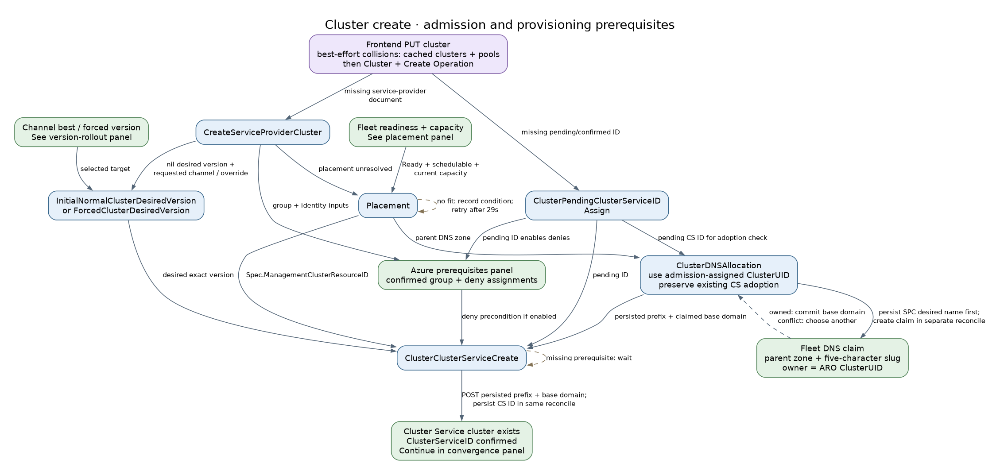

[Frontend create admission](../../frontend/pkg/frontend/cluster.go) uses cached subscription clusters and their node pools for best-effort collision checks; [deployment preflight](../../frontend/pkg/frontend/frontend.go) uses the same context without the create write. All four frontend caches must initially sync before API serving, even though cluster create uses only the two inventories; [ongoing freshness is not bounded](#admission-caches-and-startup).

Initial desired-version assignment uses the requested channel's best version; SRE pins and experimental exact versions use forced assignment. Both precede Cluster Service creation. The prerequisites panel separates selected `Spec.ManagementClusterResourceID` from observed placement. The [create controller](../../backend/pkg/controllers/cluster/creation/cluster_cluster_service_create_controller.go) requires pending ID, desired version, selected provision shard and, when enabled, the deny-assignment state (no pending entries, a nonempty confirmed list and `EarliestRecheckTime` set). [Placement](../../backend/pkg/controllers/cluster/placement/placement_controller.go) supplies the pre-create target; actual placement is learned after Cluster Service creation.

### Cluster create: fleet readiness and placement

[Full PNG](diagrams/controller-flows/fleet-placement.png) · [Graphviz source](diagrams/controller-flows/fleet-placement.dot)

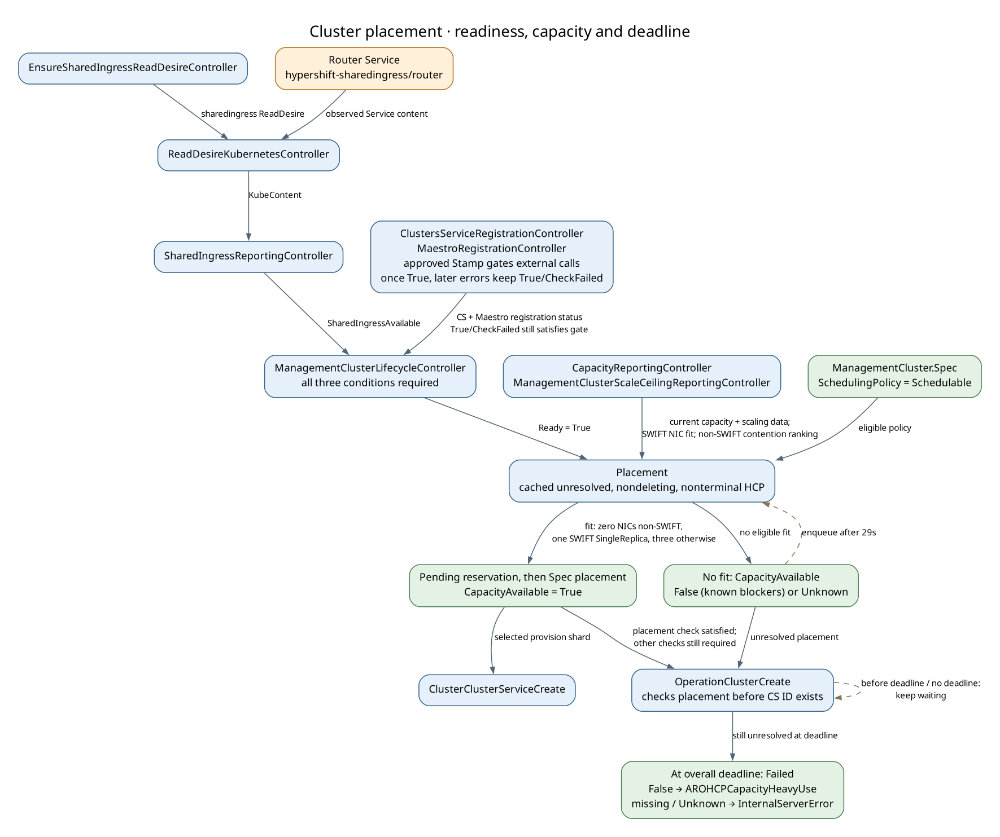

[Shared-ingress observation](../../fleet/pkg/controllers/sharedingress/shared_ingress_reporting_controller.go) supplies the third condition required by [lifecycle readiness](../../fleet/pkg/controllers/lifecycle/controller.go). Missing registration/ingress conditions preserve the previous Ready value until all exist. A missing ReadDesire also leaves ingress status unchanged; populated content, not its Successful condition, supplies IP evidence.

[Placement](../../backend/pkg/controllers/cluster/placement/placement_controller.go) requires schedulable policy, Ready and current capacity/scaling observations. It reserves capacity before writing Spec placement and CapacityAvailable together. No fit records False or Unknown and requeues after 29s. [OperationClusterCreate](../../backend/pkg/controllers/cluster/operations/operation_cluster_create.go) uses the overall create deadline to classify unresolved placement; this is not a separate placement timeout. The False/missing/Unknown paths in the graph apply only when no Spec placement was assigned.

### Cluster create: Azure prerequisites

[Full PNG](diagrams/controller-flows/cluster-azure-prerequisites.png) · [Graphviz source](diagrams/controller-flows/cluster-azure-prerequisites.dot)

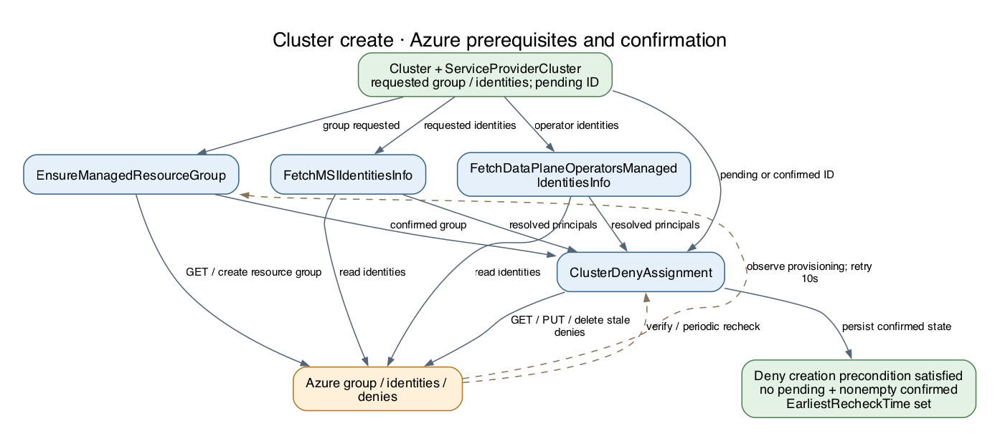

[EnsureManagedResourceGroup](../../backend/pkg/controllers/cluster/azureresources/managed_resource_group_controller.go)
records pending intent before Azure creation, then confirms provisioning. Identity
readers supply principals to [ClusterDenyAssignment](../../backend/pkg/controllers/cluster/denyassignments/deny_assignment_controller.go).
When deny assignments are enabled, cluster creation waits for no pending entries,
a nonempty confirmed list and `EarliestRecheckTime` set. Azure observation and
periodic verification form feedback loops; a successful request is not always a
confirmed resource.

### Cluster create: convergence and completion

[Full PNG](diagrams/controller-flows/cluster-convergence.png) · [Graphviz source](diagrams/controller-flows/cluster-convergence.dot)

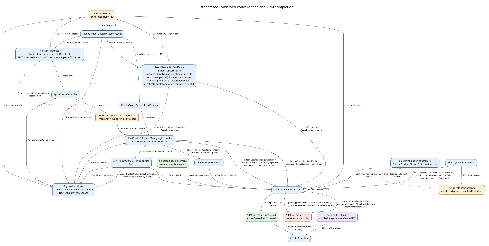

The [operation poller](../../backend/pkg/controllers/cluster/operations/operation_cluster_create.go) combines cluster validations, Cluster Service state, HostedCluster observations, API endpoint, serving CA and confirmed role assignments. A recorded validation remaining non-True (False or Unknown) for at least ten minutes fails the operation with `InvalidResource` once the operation is also at least ten minutes old; both timestamps must be nonzero. Frontend admission generates the immutable cluster UID on CREATE; billing independently needs both a UID and Succeeded provisioning. Old clusters without a UID are skipped by billing; there is no remaining backfill controller. The manifest path is collapsed around external Kubernetes/HyperShift reconciliation; a particular deployment may also involve Maestro/work-agent.

The HostedCluster edge includes an unconditional endpoint check and version-dependent availability/history checks, not an unconditional readiness gate; see the [create catalog entry](#operationclustercreate) for the compatibility thresholds. Ingress SecretSync observation and both confirmed TLS-certificate references are separate completion inputs.

### Cluster update

[Full PNG](diagrams/controller-flows/cluster-update.png) · [Graphviz source](diagrams/controller-flows/cluster-update.dot)

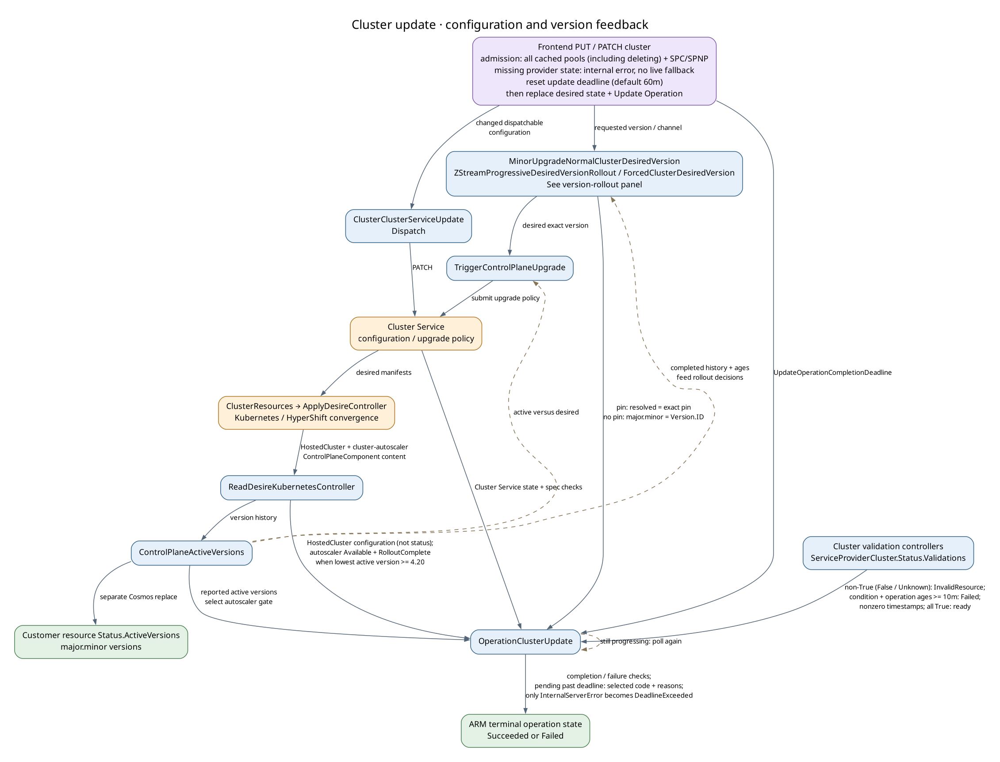

[Frontend update admission](../../frontend/pkg/frontend/cluster.go) combines cached node-pool inventory and SPC/SPNP state with a live target-cluster read. Deleting cached pools remain version-skew validation inputs and require cached SPNP state until they leave the inventory. Missing required provider state produces a contextual internal error, with no GetOrCreate or live parent fallback. These [admission inputs remain best effort](#admission-caches-and-startup), not an atomic snapshot.

[Desired-version assignment](#backend-fleet-control-plane-version-rollout), [upgrade dispatch](../../backend/pkg/controllers/cluster/version/trigger_control_plane_upgrade_controller.go) and [operation completion](../../backend/pkg/controllers/cluster/operations/operation_cluster_update.go) make separate decisions. The graph highlights version/configuration changes and validation observations. Non-True validation conditions (including Unknown) lasting at least ten minutes also fail the operation with `InvalidResource` once the operation is at least ten minutes old (both timestamps nonzero); sizing, identities and backup maintenance continue independently.

For the desired-version edge, the operation poller requires `Spec.ControlPlaneVersion.DesiredVersion` to equal an SRE exact pin, or else the experimental exact override, when present. Without either pin it compares only major/minor to the customer `Version.ID`. A pin on a different major/minor fails as incompatible; a compatible pin with a different resolved z-stream remains pending during the assignment wait.

The mirror edge means the [configuration comparisons and autoscaler gate](../../backend/pkg/controllers/cluster/operations/operation_cluster_update_state_calculation.go), not HostedCluster availability or installed-version completion. Active versions choose whether the autoscaler readiness gate applies; there is no direct upgrade-controller failure edge into operation evaluation. The [update catalog entry](#operationclusterupdate) records the comparison limitations and retained-content behavior.

### Control-plane version rollout

[Full PNG](diagrams/controller-flows/control-plane-version-rollout.png) · [Graphviz source](diagrams/controller-flows/control-plane-version-rollout.dot)

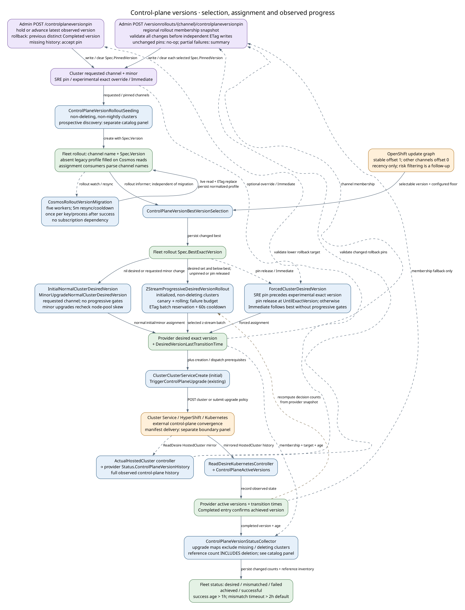

[Seeding](#controlplaneversionrolloutseeding) creates the channel document and
[best selection](#controlplaneversionbestversionselection) chooses its target.
[Initial](#initialnormalclusterdesiredversion) and [minor-version](#minorupgradenormalclusterdesiredversion)
assignments use the requested channel; [normal rollout](#zstreamprogressivedesiredversionrollout)
uses provider membership and bounded canary/rolling gates. [Forced assignment](#forcedclusterdesiredversion)
handles pins, exact overrides and experimental Immediate updates. Immediate advances
within the desired minor independently of canary progress, while pins and exact
overrides remain authoritative. Solid assignment edges are alternative ownership
paths. [Version observation](#controlplaneactiveversions) supplies the completed
history and timestamps for both [status collection](#controlplaneversionstatuscollector)
and normal assignment's own snapshot calculations. Persisted aggregate counts are
observations; normal assignment recomputes its decision inputs. An assigned version
is not upgrade completion, and automatic z-stream rollout creates no ARM operation.

### Cluster delete

[Full PNG](diagrams/controller-flows/cluster-delete.png) · [Graphviz source](diagrams/controller-flows/cluster-delete.dot)

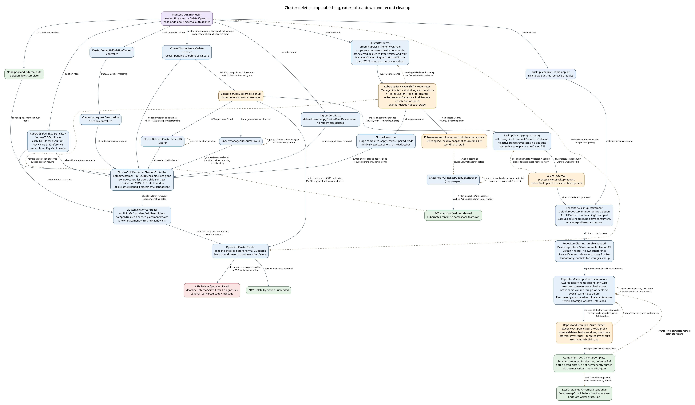

[ClusterResources](../../backend/pkg/controllers/clusterresources/cluster_resources_controller.go) first drops NodePool and supporting configuration ApplyDesires, then explicitly deletes and waits for ManagedCluster, shared-namespace ingress manifests, HostedCluster, PodNetworkInstance, PodNetwork and the two cluster namespaces, in that order. Kube-applier executes Delete intents and reports completion; HyperShift and Kubernetes controllers perform finalizer and dependent-resource cleanup. Owned orphan ReadDesires are swept after the chain drains. [Delete dispatch](../../backend/pkg/controllers/cluster/deletion/cluster_cluster_service_delete_dispatch_controller.go) independently calls Cluster Service DELETE, so external teardown can overlap the removal chain. [Child cleanup](../../backend/pkg/controllers/cluster/deletion/cluster_child_resources_cleanup_controller.go) waits for resource and credential children, and preserves owned ApplyDesires for their controllers and removes provider state only after managed-resource-group references, Maestro readonly bundles and cluster-scoped desires clear. [Managed-resource-group reconciliation](../../backend/pkg/controllers/cluster/azureresources/managed_resource_group_controller.go) observes deletion during normal flow but also initiates Azure deletion for orphaned managed resource groups (where Cluster Service deletion completed, Cluster Service ID cleared, but Azure resource group still exists). The optional orphan-group cleaner is a background repair path, not a prerequisite for typical deletion.

If a deleting PVC's snapshot source-protection finalizer stalls the control-plane namespace, the management-agent [SnapshotPVCFinalizerCleanupController](#snapshotpvcfinalizercleanupcontroller) reacts to PVC add/update or source VolumeSnapshot deletion. After its grace period and cached/live snapshot checks it removes only that finalizer; Kubernetes can then finish PVC and namespace deletion, which kube-applier reports to ClusterResources. The branch is conditional: cleanup also applies outside namespace teardown, and it does not issue the Namespace Delete intent, require HostedCluster absence or gate ARM completion directly. See the [controller entry](#snapshotpvcfinalizercleanupcontroller) for the wait, retry and live-snapshot safeguards.

The separate [BackupCleanup](#backupcleanup) branch requires live HC absence and all backup/operation/opt-out gates before requesting Velero deletion without waiting for TTL. Pending requests poll; processed requests with a remaining Backup retry, but stuck `InProgress` requests are not repaired. [BackupSchedule](../../backend/pkg/controllers/cluster/backups/schedule_controller.go) removes Schedules through Delete-type desires; [KeyRotationBackup](../../backend/pkg/controllers/cluster/backups/key_rotation_controller.go) only purges its Cosmos desires during cluster deletion.

[RepositoryCleanup plans](../../mgmt-agent/pkg/controller/repositorycleanup/plan.go) require all retirement gates, including absent Backups and Schedules. The repository finalizer hands off to a live-verified immutable cleanup CR before release. Repository absence and maintenance draining then enable the [direct Azure sweep](../../mgmt-agent/pkg/controller/repositorycleanup/storage/delete.go); completion retains a monitored tombstone, not proof of permanent soft-delete purge. Dashed loops represent waiting/rechecks, including 10m completed re-sweeps. This asynchronous branch has no edge to ARM success: neither ARM success nor Backup absence proves repository cleanup complete.

### Node pool create

[Full PNG](diagrams/controller-flows/nodepool-create.png) · [Graphviz source](diagrams/controller-flows/nodepool-create.dot)

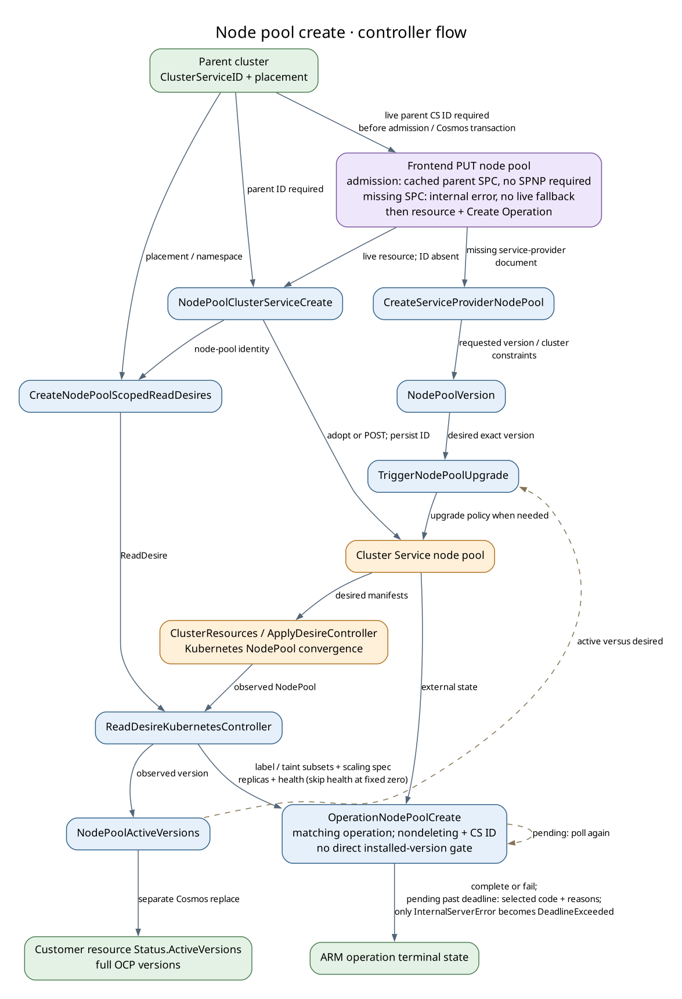

[Frontend create admission](../../frontend/pkg/frontend/node_pool.go) requires cached parent SPC state, but no SPNP. Parent-cluster and target-existence reads remain live. The live parent's Cluster Service ID must already be non-nil before frontend admission, unlike external-auth create; a missing ID or missing SPC fails with an internal error before the resource/operation transaction. Admission does not create provider state.

[Node-pool creation](../../backend/pkg/controllers/nodepool/creation/node_pool_cluster_service_create_controller.go) also needs the parent Cluster Service ID, but POST does not wait for the service-provider desired version. [Create-operation completion](../../backend/pkg/controllers/nodepool/operations/operation_node_pool_create.go) combines Cluster Service node-pool status with observed Kubernetes labels, taints, scaling and health checks (health is skipped for fixed zero replicas). There is no direct installed-version gate; version observation feeds subsequent upgrade decisions independently.

### Node pool update

[Full PNG](diagrams/controller-flows/nodepool-update.png) · [Graphviz source](diagrams/controller-flows/nodepool-update.dot)

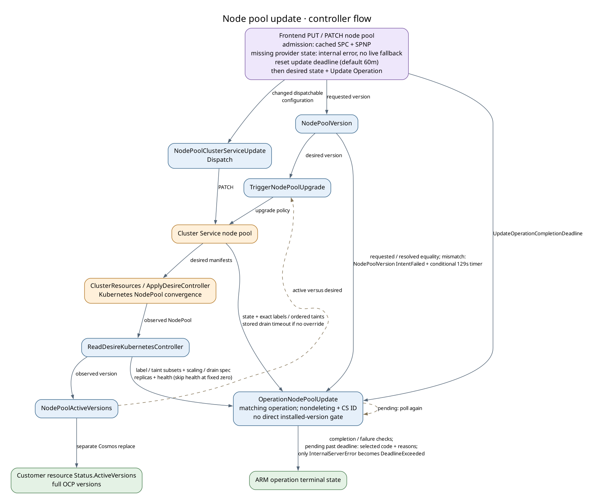

[Frontend update admission](../../frontend/pkg/frontend/node_pool.go) requires cached SPC and SPNP state; parent-cluster and target-node-pool reads remain live. Missing required provider state fails with an internal error, without a live fallback or provider creation, before the resource/operation transaction.

[Update completion](../../backend/pkg/controllers/nodepool/operations/operation_node_pool_update.go) combines version resolution, Cluster Service state/configuration and mirrored Kubernetes NodePool checks. [NodePoolVersion](../../backend/pkg/controllers/nodepool/version/nodepool_version_controller.go) selects desired state; [NodePoolActiveVersions](../../backend/pkg/controllers/nodepool/version/nodepool_active_version_controller.go) records both provider and customer-visible observations. Status completion requires replicas plus AllNodesHealthy and AllMachinesReady; both health checks are skipped for fixed zero replicas.

### Node pool delete

[Full PNG](diagrams/controller-flows/nodepool-delete.png) · [Graphviz source](diagrams/controller-flows/nodepool-delete.dot)

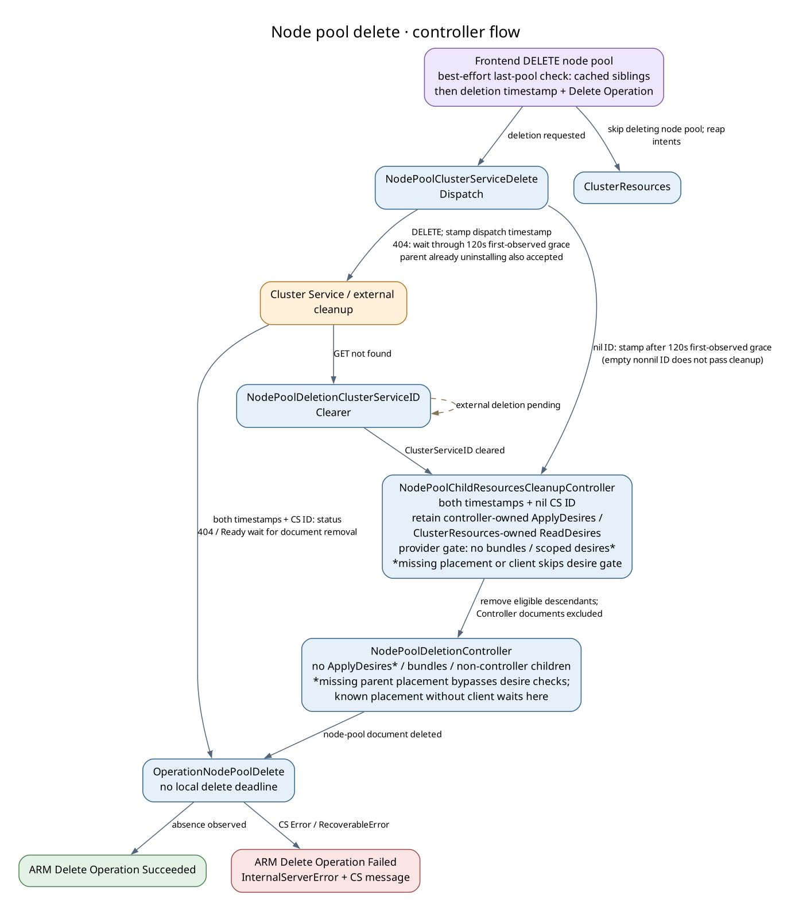

[Explicit frontend DELETE](../../frontend/pkg/frontend/node_pool.go) checks the cached sibling-pool inventory for best-effort last-pool protection before writing deletion intent. Target and operation reads remain live. [Cache lag and concurrent deletes](#admission-caches-and-startup) can still defeat this check; cluster/subscription cascade deletion continues to use live inventories and does not run this explicit-delete admission check.

[Node-pool delete dispatch](../../backend/pkg/controllers/nodepool/deletion/node_pool_cluster_service_delete_dispatch_controller.go) does not wait for ApplyDesire cleanup. [Child cleanup](../../backend/pkg/controllers/nodepool/deletion/node_pool_child_resources_cleanup_controller.go) removes its subtree and desires after the ID is cleared. ClusterResources stops publishing a deleting node pool, while external controllers may still be converging.

### External auth create

[Full PNG](diagrams/controller-flows/externalauth-create.png) · [Graphviz source](diagrams/controller-flows/externalauth-create.dot)

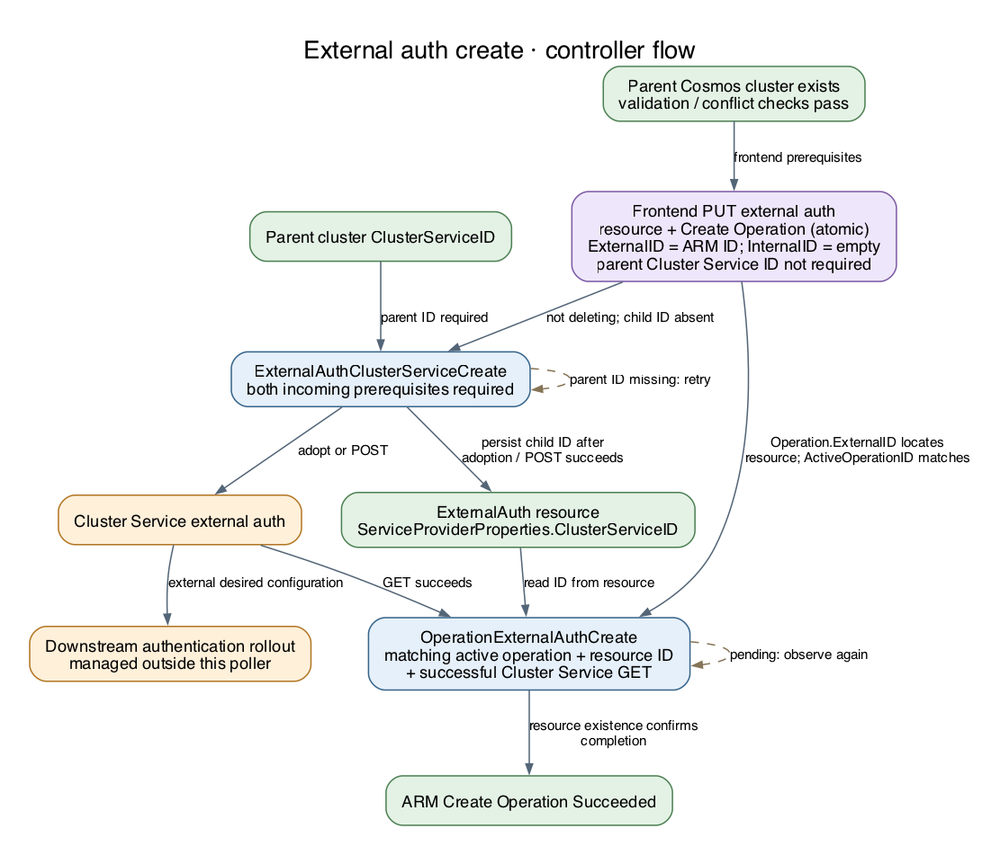

[Frontend create](../../frontend/pkg/frontend/external_auth.go) requires an existing
parent and passing validation/conflict checks, but no parent Cluster Service ID.
It atomically stores the resource and an operation with the external-auth ARM ID
in `ExternalID` and an empty `InternalID`.
[Backend creation](../../backend/pkg/controllers/externalauth/creation/external_auth_cluster_service_create_controller.go)
retries until the parent's Cluster Service ID is available, then adopts or creates
the external auth and stores its ID on the resource. The create poller reads that
resource ID before checking Cluster Service.

[Create completion](../../backend/pkg/controllers/externalauth/operations/operation_external_auth_create.go) succeeds after a Cluster Service GET succeeds; it does not establish downstream authentication readiness. [CreateServiceProviderExternalAuth](#createserviceproviderexternalauth) creates a separate provider singleton, and [OIDC health observation](#externalauthoidcclientsdegradedcontroller) plus the [user-facing aggregator](#externalauthuserfacingdegradedaggregator) independently expose health. Health observation reuses the parent HostedCluster ReadDesire, not an external-auth-scoped read pipeline; these background controllers do not gate the create poller.

### External auth update

[Full PNG](diagrams/controller-flows/externalauth-update.png) · [Graphviz source](diagrams/controller-flows/externalauth-update.dot)

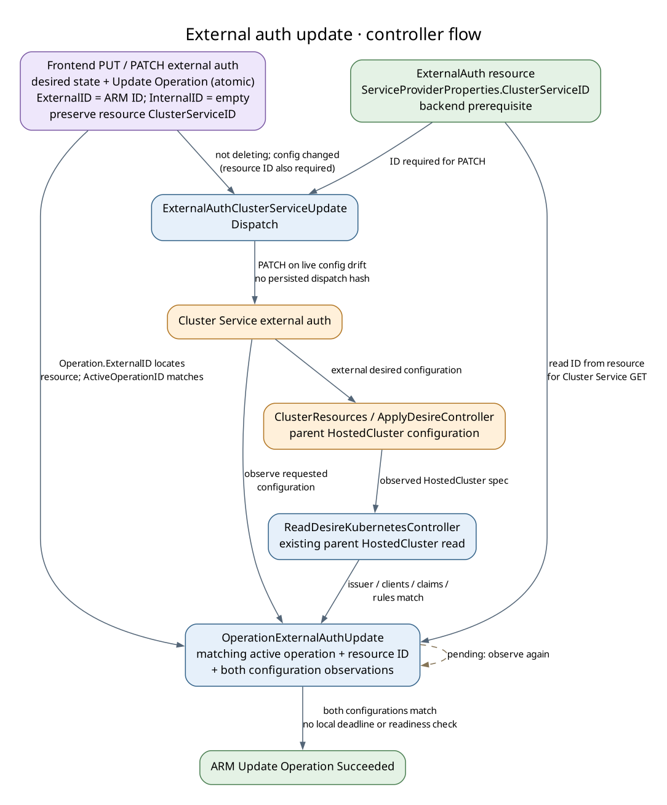

[Frontend update](../../frontend/pkg/frontend/external_auth.go) preserves any stored
resource Cluster Service ID while writing an operation with an empty `InternalID`.
The dispatcher and operation poller still require the resource's Cluster Service
ID; the poller locates the resource using `Operation.ExternalID`. Frontend
acceptance and backend completion therefore have different prerequisites.

[Update completion checks](../../backend/pkg/controllers/externalauth/operations/operation_external_auth_update_state_calculation.go) compare both Cluster Service configuration and the parent HostedCluster spec read through its existing ReadDesire. Authentication status is explicitly not checked. This is stricter than the create poller's existence check, but is still not end-to-end authentication validation.

### External auth delete

[Full PNG](diagrams/controller-flows/externalauth-delete.png) · [Graphviz source](diagrams/controller-flows/externalauth-delete.dot)

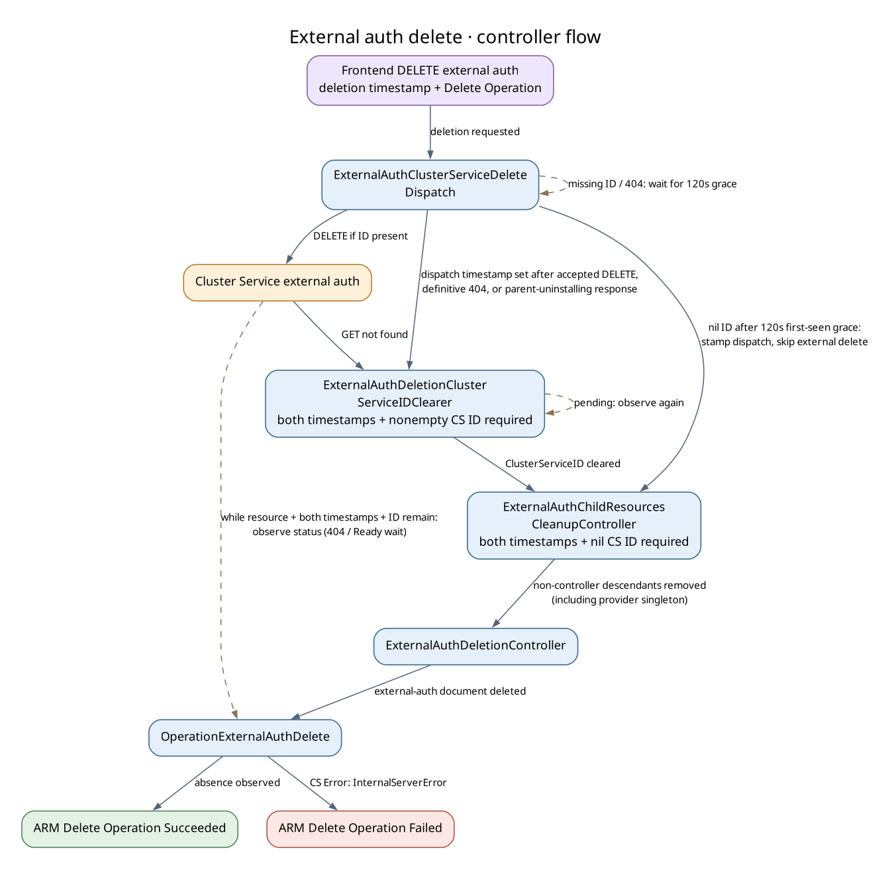

[Delete dispatch](../../backend/pkg/controllers/externalauth/deletion/external_auth_cluster_service_delete_dispatch_controller.go), [ID clearing](../../backend/pkg/controllers/externalauth/deletion/external_auth_cluster_service_id_clearer.go), child cleanup and document deletion are separate reconciliations. [Operation completion](../../backend/pkg/controllers/externalauth/operations/operation_external_auth_delete.go) observes the document disappearing.

The nil-ID bypass waits at least 120s from the dispatcher's first observation of deletion before stamping dispatch. A present ID's 404 has the same grace; successful DELETE or the recognized parent-uninstalling response can stamp immediately. Child cleanup and final deletion require both timestamps and a **nil** ID, not merely an empty ID string; an empty nonnil ID is not normalized by these controllers. Cleanup deletes the provider singleton but excludes Controller status documents, which also do not block final deletion. CS errors can fail the operation while asynchronous cleanup continues; the diagram separates that outcome from successful absence observation.

## 4. Shared Fields and Ownership

The important distinction is requested state versus externally confirmed state.
The API normally owns customer configuration; controllers fill runtime observations
and operation state. Full-document replacements preserve fields owned by other
actors and use optimistic concurrency; retries must re-read on conflict.

### ARM resource and operation fields

| Field / object | Writers and downstream meaning |
|---|---|
| Fleet `Stamp.Status.Conditions[Approved]` / management-cluster `Spec.SchedulingPolicy` | [Admin actions](#other-admin-writes-and-external-actions) write approval and scheduling intent; Fleet registration and placement consume it. These writes do not provision AKS resources. |
| Service-provider cluster `Spec.DesiredHostedClusterControlPlaneSize` / `Status.DesiredHostedClusterControlPlaneSize` | Admin writes or clears the desired SRE override; [ClusterClusterServiceUpdateDispatch](#clusterclusterserviceupdatedispatch) applies effective configuration, and [DesiredControlPlaneSize](#desiredcontrolplanesize) records Cluster Service confirmation. |
| Cluster `CustomerProperties`; node-pool/external-auth `Properties` | Frontend create/update writes customer intent. [ClusterBaseDomainPrefixSync](#clusterbasedomainprefixsync) fills the generated DNS prefix. Dispatch/version controllers react to relevant differences. |
| Cluster `ServiceProviderProperties.ProvisioningState`; node-pool/external-auth `Properties.ProvisioningState` | Frontend marks Accepted/Deleting; the matching operation controller writes progress/terminal state. This is ARM request state, not a complete inventory of external resources. |
| `ServiceProviderProperties.ActiveOperationID` | Frontend sets the new operation reference; terminal operation updates clear it. Pollers reject superseded operation IDs. |
| External-auth create/update `Operation.ExternalID` / `InternalID` | Frontend writes the ARM resource ID / empty ID, even for a resource with an existing Cluster Service ID. Pollers use `ExternalID` to look up the resource and its backend-owned `ServiceProviderProperties.ClusterServiceID`. The operation does not copy or clear the resource's ID. |
| Cluster/node-pool `ServiceProviderProperties.UpdateOperationCompletionDeadline` | Frontend PUT/PATCH admission resets this to now + 60m for each update. With `ExperimentalReleaseFeatures`, the resource-specific `aro-hcp.experimental.cluster.max-update-duration` or `aro-hcp.experimental.nodepool.max-update-duration` tag overrides it (Go duration, minimum 1m). The matching update operation controller consumes it and reports pending reasons on timeout. |
| `Operation.Status`, `Error`, `LastTransitionTime`, `NotificationURI` | Frontend initializes/cancels requests; operation controllers update status and send/clear async notifications through the shared helper. |
| `ServiceProviderProperties.DeletionTimestamp` | Frontend stamps deletion intent; dispatch, cleanup and final deletion controllers consume it. Deletion timestamp alone does not mean external resources are gone. |
| Cluster `PendingClusterServiceID` / `ClusterServiceID` | [Pending ID assignment](#clusterpendingclusterserviceidassign) reserves the ID. [Cluster creation](#clusterclusterservicecreate) confirms the external ID and clears pending. The [ID clearer](#clusterdeletionclusterserviceidclearer) clears confirmed ID only after external absence. Node-pool/external-auth create and clear controllers similarly share their confirmed-ID fields. |
| `ClusterServiceDeletionTimestamp` | Each delete dispatcher stamps completion of dispatch/creation-race handling; cleanup also requires the confirmed ID cleared. It is not a timestamp of all Azure/Kubernetes deletion. |
| Cluster `ClusterUID`, `BillingDocumentCosmosID`; Billing document `DeletionTime` | [Frontend cluster admission](../../internal/admission/admit_cluster.go) generates the immutable UID on CREATE; UPDATE does not backfill an absent UID. [CreateBillingDoc](#createbillingdoc) creates billing and links it. [ClusterDeletionController](#clusterdeletioncontroller) and [OrphanedBillingCleanup](#orphanedbillingcleanup) mark billing deleted. |
| Cluster `ServiceProviderProperties.API.URL`, `.Console.URL`, `.DNS.BaseDomain`, `.Platform.IssuerURL` | [ClusterPropertiesSync](#clusterpropertiessync) writes observed values. Frontend clears supplied values on create rather than persisting them; updates preserve stored values. |
| Cluster `Identity.UserAssignedIdentities` | Frontend supplies identity intent without create-body client/principal IDs; [ClusterIdentitySync](#clusteridentitysync) fills resolved identity fields or clears stale values when the provider has no matching identity. Updates preserve stored resolved values. Azure identities themselves are not created by that syncer. |
| Cluster/node-pool `Status.ActiveVersions` | [ControlPlaneActiveVersions](#controlplaneactiveversions) writes distinct major.minor cluster versions; [NodePoolActiveVersions](#nodepoolactiveversions) writes full node-pool versions. The 2026-10-01 API returns these stored observations through `properties.status.activeVersions`; customer configuration remains separately owned. |
| ARM Degraded / RequirementsValid conditions | Resource-specific aggregators combine Controller or service-provider validation conditions. A validation failure and a reconcile error are separate signals. |

### Service-provider state, fleet and external observations

| Field / object | Writers and downstream meaning |
|---|---|
| External-auth provider and health fields | [CreateServiceProviderExternalAuth](#createserviceproviderexternalauth) creates the `default` provider singleton. [ExternalAuthOIDCClientsDegradedController](#externalauthoidcclientsdegradedcontroller) writes its `Status.Conditions[OIDCClientsDegraded]`; the [user-facing aggregator](#externalauthuserfacingdegradedaggregator) writes ExternalAuth `Status.UserFacingConditions[Degraded]`. [ExternalAuthDegradedAggregator](#externalauthdegradedaggregator) independently writes internal `Status.Conditions[Degraded]` from Controller status. [Child cleanup](#externalauthchildresourcescleanupcontroller) deletes the provider singleton; neither health field gates create/update operation completion. |
| Service-provider cluster `Spec.ControlPlaneVersion.DesiredVersion` / `DesiredVersionLastTransitionTime` | [Initial assignment](#initialnormalclusterdesiredversion), [minor-version assignment](#minorupgradenormalclusterdesiredversion), [normal rollout](#zstreamprogressivedesiredversionrollout) and [forced assignment](#forcedclusterdesiredversion) write the target and transition time. Initial assignment also backfills a missing/zero time without changing the target. Cluster creation, upgrade dispatch and operation completion consume desired state; it is not an observed version. |
| Cluster `ServiceProviderProperties.ExperimentalFeatures.ZStreamUpdatePolicy` | Frontend admission projects the AFEC-gated `aro-hcp.experimental.cluster.z-stream-update-policy` tag; its only valid value is `Immediate`. Removing the tag or AFEC clears the policy. [Forced assignment](#forcedclusterdesiredversion) follows the desired channel's best z-stream without progressive gates, after pins and exact overrides. |
| Service-provider cluster `Spec.PinnedVersion` | [Admin API ControlPlaneVersionPin](#admin-api-post-controlplaneversionpin) and [FleetControlPlaneVersionPin](#admin-api-post-fleetcontrolplaneversionpin) set `ExactVersion` and optional `UntilExactVersion`; sending a nil `ExactVersion` clears the pin. [Forced assignment](#forcedclusterdesiredversion) also clears the pin once channel best reaches the release threshold. Pins precede experimental exact versions and normal assignment. |
| Fleet `ControlPlaneVersionRollout.Spec.Version.{ID,ChannelGroup}` | [Seeding](#controlplaneversionrolloutseeding) sets the profile on creation. Shared Cosmos conversion fills absent/zero legacy profiles on read; [migration](#cosmosrolloutversionmigration) and ordinary rollout replacements persist them. Consumers still parse channel names. |
| Fleet `ControlPlaneVersionRollout.Spec.BestExactVersion` | [Seeding](#controlplaneversionrolloutseeding) creates requested/pinned channel documents without a best version. [Best selection](#controlplaneversionbestversionselection) owns the target; assignment controllers consume it. |
| Fleet rollout status count maps | [Status collector](#controlplaneversionstatuscollector) alone persists desired, mismatched, failed, achieved and successful counts. Normal assignment recomputes its own snapshot counts to avoid collector lag. |
| Fleet rollout `Status.LastAssignmentTime` / `Status.Conditions` | [Normal assignment](#zstreamprogressivedesiredversionrollout) reserves batches before provider writes and reports Progressing/Degraded. Persisted cooldown protects across restarts; it does not claim external completion. |
| Service-provider cluster `Status.ControlPlaneVersion.ActiveVersions` / `Status.DesiredVersionChannels` | [ControlPlaneActiveVersions](#controlplaneactiveversions) copies exact HostedCluster history with per-version/state transition times and desired channels. Completed history and nonzero transition times drive rollout accounting. Desired target and active history can differ while an upgrade is underway. |
| Node-pool desired / active versions | [NodePoolVersion](#nodepoolversion) writes `Spec.NodePoolVersion.DesiredVersion`; [NodePoolActiveVersions](#nodepoolactiveversions) writes `Status.NodePoolVersion.ActiveVersions`. [TriggerNodePoolUpgrade](#triggernodepoolupgrade) reacts to their difference. |
| Service-provider cluster `Status.Placement.Conditions[CapacityAvailable]` | [Placement](#placement) records True with selected Spec placement, False for known lack of capacity/eligibility, or Unknown for incomplete observations. [OperationClusterCreate](#operationclustercreate) consumes it when placement remains unresolved at the overall deadline. |
| Management cluster `Status.SharedIngressIPAddresses` / `SharedIngressAvailable` / `Ready` | [SharedIngressReportingController](#sharedingressreportingcontroller) copies Service IPs and availability; [ManagementClusterLifecycleController](#managementclusterlifecyclecontroller) combines availability with registrations into Ready. [Admin responses](../../admin/server/handlers/stamp/managementcluster.go) expose observed IPs. |
| ServiceProviderCluster `Spec.ManagementClusterResourceID` / `Status.ManagementClusterResourceID` | [Placement](#placement) chooses the target; [ManagementClusterPlacementSync](#managementclusterplacementsync) fills initially unknown observed placement from Cluster Service. Desired placement enables creation; actual placement enables per-cluster kube-applier access. |
| Scheduling `Status.PendingAssignedClusters` | [Placement](#placement) reserves; [CapacityReportingController](#capacityreportingcontroller) removes observed entries; [PendingCleanup](#pendingcleanup) removes missing/misplaced entries and unresolved reservations for deleting/terminal clusters. |
| Scheduling observed capacity / scale ceiling; fleet HCP resource requirements | Fleet capacity and scale-ceiling controllers write observed scheduling inputs. [HCPResourceRequirementsController](#hcpresourcerequirementscontroller) aggregates per-HCP demand. Placement retains SWIFT NIC eligibility and selection, but prefers lower known CPU/memory contention against current capacity for zero-NIC demand. Aggregate HCP demand is not used for placement. |
| `Status.AzureResources.ManagedResourceGroup` | [EnsureManagedResourceGroup](#ensuremanagedresourcegroup) writes pending/confirmed reference and clears both after observing deletion. Deletes orphaned managed resource groups when Cluster Service deletion completed but the Azure resource group still exists. Deny/role assignment controllers need the confirmed group; final provider-document cleanup needs references gone.  |
| `Status.AzureResources.KubeAPIServerCertificate` / `IngressCertificate` | [KubeAPIServerTLSCertificate and IngressTLSCertificate](#kubeapiservertlscertificate-and-ingresstlscertificate) each own one pointer's `PendingReference`/`AzureReference`, independently of the other. [IngressCertificate](#ingresscertificate) consumes `IngressCertificate.AzureReference` to gate SecretProviderClass/SecretSync delivery; it does not write the pointer itself. [OperationClusterCreate](#operationclustercreate) consumes both `AzureReference`s (TLS certificate check) and separately observes the ingress SecretSync's own synced status (`defaultIngressServingCertificate` check) before CREATE can succeed. |
| `Status.AzureResources.DenyAssignments` / `RoleAssignments` | Their respective controllers track `PendingAzureResources` and confirmed `AzureResources`. The role controller confirms newly created assignments in a later observation pass. |
| `Status.MSIManagedIdentities`, `Status.DataPlaneOperatorsManagedIdentities`, `Status.ManagedIdentityDetails` | [FetchMSIIdentitiesInfo](#fetchmsiidentitiesinfo) and [FetchDataPlaneOperatorsManagedIdentitiesInfo](#fetchdataplaneoperatorsmanagedidentitiesinfo) write resolved IDs and errors for deny assignments, role assignments, and identity-property synchronization. [FetchManagedIdentitiesInfo](#fetchmanagedidentitiesinfo) writes `Status.ManagedIdentityDetails` by lowercased resource ID, including per-source metadata. `Spec.EarliestRecheckTimesByController` has independently owned entries for these identity controllers and role assignments; deny assignments keep their own `EarliestRecheckTime` under `Status.AzureResources.DenyAssignments`. |
| `Status.Validations` | Each registered validation writes its own condition in the service-provider cluster or node pool; requirements aggregators consume the set. |
| ServiceProviderCluster `Status.HostedClusterNamespace`, `ControlPlaneNamespace`, `ServingCABundle` | [ServiceProviderClusterPropertiesSync](#serviceproviderclusterpropertiessync) derives namespaces from mirrored HostedCluster identity and copies nonempty serving-CA content, retaining an old bundle when content is absent. Credentials and create-operation completion wait on them. |
| ServiceProviderCluster `Spec.BackupScheduleState` | Admin backup PATCH writes Enabled/Disabled; [BackupSchedule](#backupschedule) reconciles Velero intent. Mirrored Kubernetes status reports results separately. |
| Velero deletion intent | [BackupCleanup](#backupcleanup) SSA-applies `DeleteBackupRequest.spec.backupName` and retries its processed requests; Velero owns request status and Backup/data deletion. Backup/repository opt-outs do not cancel issued requests or Velero TTL. |
| Repository cleanup intent / protection / status | [RepositoryCleanup](#repositorycleanup) owns its repository finalizer, immutable `BackupRepositoryCleanup.spec` and intent finalizer, and `status.conditions[Complete]` through separate SSA managers. No owner reference ties the cleanup CR to the repository. Completed tombstones remain monitored; explicit removal requires fresh verification. No Cosmos field records cleanup completion. |
| Kubernetes PVC `metadata.finalizers` | External snapshot controller owns the normal source-protection lifecycle. Management-agent [SnapshotPVCFinalizerCleanupController](#snapshotpvcfinalizercleanupcontroller) removes only `snapshot.storage.kubernetes.io/pvc-as-source-protection` from a deleting PVC in any namespace when cached and live snapshot checks show no references; other finalizers remain under their respective owners. This Kubernetes update has no Cosmos field or direct ARM-operation write. |
| `ApplyDesire` / `ReadDesire` | Backend/fleet writers own desired content/targets; kube-applier owns execution/observation status. Credential cleanup and stale-resource cleanup during live ClusterResources reconciliation use Delete intents and wait. During whole-cluster deletion, ClusterResources drops only NodePool/supporting configuration ApplyDesires; its ordered removal chain uses Delete intents and waits for the remaining objects. Paired ReadDesires are removed on confirmed deletion, and owned orphan reads are swept after the chain drains. |
| Kubernetes CapacityReport | Management-agent [capacity-reporting](#capacity-reporting) server-side applies status, preserving zero CPU/memory/SWIFT-NIC quantities and replacing `hostedControlPlanes` atomically. Kube-applier mirrors it; Fleet scheduling mirrors populated reports even when stale, marking `CapacityDataCurrent=False`, whereas HCP resource-requirement aggregation skips non-current reports. Collection failures retain the previous payload while setting ReportCurrent=False. |

### Credential and controller bookkeeping

| Field / object | Writers and downstream meaning |
|---|---|
| Cluster `RevokeCredentialsOperationID` | Frontend sets the revoke sentinel; modern revoke-operation completion clears it. New issuance checks it before dispatch. |
| Credential request spec / status | [Credential dispatch](#systemadmincredentialdispatchrequestcredential) creates request material. [Issuance observation](#systemadmincredentialissuanceobserver) writes signed certificate and terminal conditions. Revocation marking and cluster deletion mark requests for cleanup; request controllers remove external artifacts and documents. |
| Credential revocation conditions / deletion timestamp | MarkRequests reports request marking; Completion combines that with observed certificate revocation and sets deletion intent; Deletion removes artifacts/document; operation poller observes disappearance. |
| Child `Controller` conditions and reconcile metadata | Generic wrappers persist bookkeeping; version/other syncers can set intent conditions. Degraded aggregators read them. “No domain write” in the catalog does not imply the wrapper never writes a Controller document. |
| Kubernetes Session status / secrets | Sessiongate's [control-plane controller](#sessioncontrolplanecontroller) owns session expiry, readiness, endpoint and credential references; [DataplaneController](#dataplanecontroller) consumes them to configure its in-memory proxy registry. |

## Regeneration

Use the separate [generation prompt](../prompts/controller-data-flow.md). Editable
DOT sources and their PNG renders live together in
[diagrams/controller-flows](diagrams/controller-flows/). Refresh controller inventory,
source evidence, ownership and diagrams together when behavior or registration changes.
