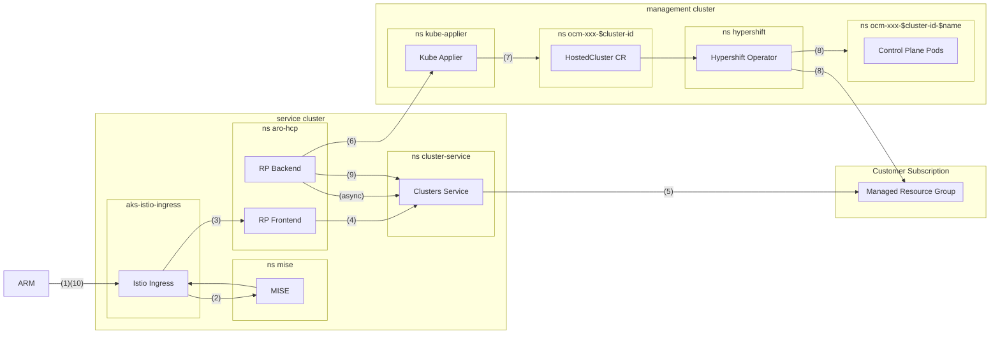

# ARO HCP High Level Cluster Creation Flow

This document describes the high level cluster creation flow of an ARO HCP cluster. It is meant to be a quick reference for developers and engineers working on the ARO HCP service. It is not a comprehensive overview of the ARO HCP architecture or a complete SOP/TSG for debugging during oncall.

The individual components are described in the [service components overview](../service-components.md). The flowchart below shows the rough flow of the cluster creation process through the individual service components. Helpful debug commands are provided for each component in their respective sections.

## Cluster Creation Flow Happy Path in a Nutshell

1. A cluster creation request from ARM enters the ARO HCP service on the istio gateway
2. ExternalAuthorizer rules apply to all requests that hit the istio gateway, and are redirected to MISE to ensure the request comes from ARM
3. On success, the request is routed to the RP frontend
4. The frontend conducts a preflight check towards Clusters Service and then issues a request to Clusters Service to create the cluster. It then stores both an Operation record and a Cluster record in CosmosDB on success. The frontend returns a 201 response to ARM and a reference to the long-running operation.
    - (Async) From this point forward, Backend sees the CosmosDB Operation record and asynchronously calls CS to determine current provisioning state and updates the Cluster so the customer has live feedback on status of the long-running request.
    - (Async) At the same time, ARM will automatically issue polling GET requests to the OperationStatus resources on the customer's behalf (to the Frontend) so they see this status in live time.
5. Clusters Service prepares a managed resource group in the customers subscription and creates the cloud resources for the cluster
6. Backend `ClusterResources` fetches the desired Kubernetes manifests from Clusters Service and writes per-management-cluster `ApplyDesire` documents into the kube-applier Cosmos container for the placed management cluster
7. kube-applier on the management cluster reconciles those `ApplyDesire` documents and server-side applies them, creating the `ocm-xxx-${CLUSTER_ID}` namespace, the Hypershift `HostedCluster` CR, and supporting secrets and configmaps
8. The Hypershift operator picks up on the `HostedCluster` CR, creates the `ocm-xxx-${CLUSTER_ID}-${CLUSTER_NAME}` namespace, the control plane deployments within it and supporting cloud resources in the managed resource group of the customer
9. Backend observes convergence through `ReadDesire` mirrors and Clusters Service status; CS updates its cluster records as provisioning progresses
10. The Backend ultimately reports the updated status and completes the asynchronous Operation. ARM reports the Operation as successful and returns the OperationResult. The RP frontend now reports the cluster as `Provisioned` to ARM for all future requests.



## RP Frontend

### Port Forward to the RP Frontend

In order to access the RP frontend without going through ARM, you can port forward to the service. This is useful for debugging and testing purposes, especially in non-production environments where there is no ARM route to the service.
Keep in mind that the port-forwarded service does not require authentication and does not enforce authorization!

```sh
kubectl port-forward -n aro-hcp svc/aro-hcp-frontend 8443:8443
```

### Query the State of an HCP

You can query the state of a hosted control plane by sending a GET request to the port-forwarded service. The URL should include the resource ID of the hosted control plane you want to query, so something matching this:

```sh
RESOURCE_ID="/subscriptions/.../resourceGroups/.../providers/Microsoft.RedHatOpenshift/hcpOpenShiftClusters/..."
curl -s localhost:8443${RESOURCE_ID}$?api-version=2024-06-10-preview | jq
```

Noteworthy fields:

* `.id` - the resource ID of the hosted control plane
* `.properties.provisioningState` - the provisioning state of the hosted control plane
* `.properties.api.url` - the HCP KAS URL
* `.properties.dns.baseDomain` - the base DNS zone for the HCP (exists in our infrastructure)

## Clusters Service

### Port Forward to Clusters Service

In order to access Clusters Service for debugging purposes, you can port forward to the service.
Keep in mind that the port-forwarded service does not require authentication and does not enforce authorization!

```sh
kubectl port-forward -n clusters-service svc/clusters-service 8001:8000
```

### Query the State of an HCP

To query the state of an HCP on the Clusters Service, you can use the following command based on information from the HCP resource ID.

```sh
export HCP_SUBSCRIPTION_ID=$(echo "$RESOURCE_ID" | cut -d'/' -f3)
export HCP_RESOURCE_GROUP_NAME=$(echo "$RESOURCE_ID" | cut -d'/' -f5)

curl -sG http://localhost:8001/api/aro_hcp/v1alpha1/clusters --data-urlencode "search=azure.subscription_id='$HCP_SUBSCRIPTION_ID' and azure.resource_group_name='$HCP_RESOURCE_GROUP_NAME'" | jq
```

>[!NOTE]
> This command does not filter on the resource name of the HCP because the search in CS does not offer filter functionality on the `azure.resource_name` field yet. As long as there is only one HCP resource per resource group, this is not a problem.

Noteworthy fields:

* `.id` - the Clusters Service ID of the hosted control plane - this is not the Azure Resource ID of the HCP!!
* `.href` - the base resource URL for the HCP in Clusters Service - needed if you want to query for subresources
* `.status` - contains details about the state of the HCP, including provisioning errors
* `.azure.subscription_id` - the Azure subscription ID of the customer
* `.azure.resource_group_name` - the Azure resource group name within the customer subscription, where the HCP was created
* `.azure.resource_name` - the Azure resource name of the HCP

### Query for the Management Cluster of an HCP

Once you have clusters `.href`, you can query the provision shard endpoint to find details about the management cluster of an HCP.

```sh
curl -sG http://localhost:8001/${CLUSTER_HREF}/provision_shard | jq
```

Currently this endpoint does not return yet direct management cluster metadata, but the management cluster can be inferred from the stamp number at the end of the CX KV URL `.azure_shard.cx_managed_identities_key_vault_url`. Look for a management cluster in the same region that has the same stamp number in the AKS name and/or the Azure resource group.

## RP Backend / kube-applier

Desired management-cluster manifests are delivered by the RP Backend writing `ApplyDesire` documents; kube-applier on the management cluster applies them. Observation of live objects flows back through `ReadDesire` documents.

### Check kube-applier Logs

kube-applier runs on the management cluster. To check its logs:

```sh
kubectl logs -n kube-applier deployment/kube-applier -c kube-applier
```

### Inspect Applied HostedCluster

After kube-applier has applied the HostedCluster desire, the CR should exist in the HostedCluster namespace:

```sh
kubectl get hostedcluster -A
kubectl get hostedcluster -n ocm-xxx-${CLUSTER_ID}
```

## Hypershift

### List Hypershift HostedCluster CRs

```sh
kubectl get hostedclusters -A
```

This shows the `HostedCluster` resources in the `ocm-xxx-${CLUSTER_ID}` namespace.

### Check on control plane pods

The `ocm-xxx-${CLUSTER_ID}-${CLUSTERNAME}` namespace contains the hosted control plane (e.g. pods, secrets, ...).

```sh
kubectl get pods -n ocm-xxx-${CLUSTER_ID}-${CLUSTER_NAME}
```
