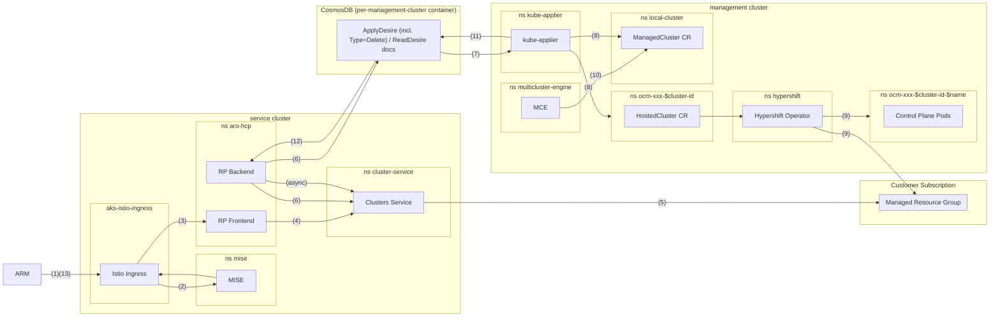

# ARO HCP High Level Cluster Creation Flow

This document describes the high level cluster creation flow of an ARO HCP cluster. It is meant to be a quick reference for developers and engineers working on the ARO HCP service. It is not a comprehensive overview of the ARO HCP architecture or a complete SOP/TSG for debugging during oncall.

The individual components are described in the [service components overview](../service-components.md). The flowchart below shows the rough flow of the cluster creation process through the individual service components. Helpful debug commands are provided for each component in their respective sections.

> [!IMPORTANT]
> **Cross-cluster resource delivery uses `kube-applier`.**
> The Backend writes `ApplyDesire` and `ReadDesire` documents to the CosmosDB container for the target management cluster. `kube-applier` reconciles those documents against the local Kubernetes API and writes status back to the same documents. The **fleet controller** handles management-cluster registration and lifecycle, and **mgmt-agent** handles management-cluster-local operations.
>
> Residual delivery artifacts may remain while [ARO-27508](https://issues.redhat.com/browse/ARO-27508) cleanup completes. Those artifacts are not part of the creation flow documented here.

## Cluster Creation Flow Happy Path in a Nutshell

<!-- BEGIN GENERATED: happy-path (derived from source; regenerate via the "Generation Prompt" at the bottom of this file — do not hand-edit) -->
1. A cluster creation request from ARM enters the ARO HCP service on the istio gateway
2. ExternalAuthorizer rules apply to all requests that hit the istio gateway, and are redirected to MISE to ensure the request comes from ARM
3. On success, the request is routed to the RP frontend
4. The frontend conducts a preflight check towards Clusters Service and then issues a request to Clusters Service to create the cluster. It then stores both an Operation record and a Cluster record in CosmosDB on success. The frontend returns a 201 response to ARM and a reference to the long-running operation.
    - (Async) From this point forward, Backend sees the CosmosDB Operation record and asynchronously calls CS to determine current provisioning state and updates the Cluster so the customer has live feedback on status of the long-running request.
    - (Async) At the same time, ARM will automatically issue polling GET requests to the OperationStatus resources on the customer's behalf (to the Frontend) so they see this status in live time.
5. Clusters Service prepares a managed resource group in the customers subscription and creates the cloud resources for the cluster
6. The ARO HCP Backend invokes the Clusters Service `GetClusterResources` endpoint for the desired management-cluster content (the `HostedCluster` Hypershift CRs and other supporting resources), converts the returned content into declarative `ApplyDesire` documents, and writes them to the per-management-cluster CosmosDB container. (Deletions are expressed as `ApplyDesire` documents with `Type=Delete`.)
7. `kube-applier`, running on the target management cluster, reads the `ApplyDesire` documents from CosmosDB and reconciles them against the local kube-apiserver. Reconciliation is dispatched on the document `Type`: `Type=ServerSideApply` documents are applied via Server-Side Apply, while `Type=Delete` documents are reconciled via the delete path.
8. Applying the desired resources creates the `ocm-xxx-${CLUSTER_ID}` namespace, the Hypershift `HostedCluster` CR, supporting secrets and configmaps, as well as the `ManagedCluster` MCE CR.
9. The Hypershift operator picks up on the `HostedCluster` CR, creates the `ocm-xxx-${CLUSTER_ID}-${CLUSTER_NAME}` namespace, the control plane deployments within it and supporting cloud resources in the managed resource group of the customer
10. MCE picks up on the finished `HostedCluster` provisioning and updates the `ManagedCluster` CR.
11. `kube-applier` reports apply status back as conditions written into the same CosmosDB documents, and mirrors live management-cluster object state (e.g. `HostedCluster`, `ManagedCluster` status) back to the service side via `ReadDesire` documents.
12. The Backend reads the reported status from CosmosDB and updates the cluster records
13. The Backend correlates Clusters Service status with kube-applier status and completes the asynchronous Operation. ARM reports the Operation as successful and returns the OperationResult. The RP frontend now reports the cluster as `Provisioned` to ARM for all future requests.
<!-- END GENERATED: happy-path -->

> [!NOTE]
> The creation flow above is kube-applier-only. If a NodePool CR unexpectedly reappears during deletion, check for residual delivery artifacts tracked by [ARO-27508](https://issues.redhat.com/browse/ARO-27508); that cleanup churn is bounded and is not an alternate creation path.

<!-- BEGIN GENERATED: flow-diagram (component/topology view of the cluster-creation write path; the step-numbered edges follow the same ARM->RP->CS->CosmosDB->kube-applier ordering narrated above, and complement the "Cluster create" and "Cluster create: convergence and completion" controller digraphs in ../cosmos-data-flow.md#cluster-create and ../cosmos-data-flow.md#cluster-create-convergence-and-completion; regenerate via the "Generation Prompt" at the bottom of this file — do not hand-edit) -->

<!-- END GENERATED: flow-diagram -->

## RP Frontend

### Port Forward to the RP Frontend

In order to access the RP frontend without going through ARM, you can port forward to the service. This is useful for debugging and testing purposes, especially in non-production environments where there is no ARM route to the service.
Keep in mind that the port-forwarded service does not require authentication and does not enforce authorization!

```sh
kubectl port-forward -n aro-hcp svc/aro-hcp-frontend 8443:8443
```

### Query the State of an HCP

You can query the state of a hosted control plane by sending a GET request to the port-forwarded service. The URL should include the resource ID of the hosted control plane you want to query, so something matching this:

```sh
RESOURCE_ID="/subscriptions/.../resourceGroups/.../providers/Microsoft.RedHatOpenshift/hcpOpenShiftClusters/..."
curl -s localhost:8443${RESOURCE_ID}$?api-version=2024-06-10-preview | jq
```

Noteworthy fields:

* `.id` - the resource ID of the hosted control plane
* `.properties.provisioningState` - the provisioning state of the hosted control plane
* `.properties.api.url` - the HCP KAS URL
* `.properties.dns.baseDomain` - the base DNS zone for the HCP (exists in our infrastructure)

## Clusters Service

### Port Forward to Clusters Service

In order to access Clusters Service for debugging purposes, you can port forward to the service.
Keep in mind that the port-forwarded service does not require authentication and does not enforce authorization!

```sh
kubectl port-forward -n clusters-service svc/clusters-service 8001:8000
```

### Query the State of an HCP

To query the state of an HCP on the Clusters Service, you can use the following command based on information from the HCP resource ID.

```sh
export HCP_SUBSCRIPTION_ID=$(echo "$RESOURCE_ID" | cut -d'/' -f3)
export HCP_RESOURCE_GROUP_NAME=$(echo "$RESOURCE_ID" | cut -d'/' -f5)

curl -sG http://localhost:8001/api/aro_hcp/v1alpha1/clusters --data-urlencode "search=azure.subscription_id='$HCP_SUBSCRIPTION_ID' and azure.resource_group_name='$HCP_RESOURCE_GROUP_NAME'" | jq
```

>[!NOTE]
> This command does not filter on the resource name of the HCP because the search in CS does not offer filter functionality on the `azure.resource_name` field yet. As long as there is only one HCP resource per resource group, this is not a problem.

Noteworthy fields:

* `.id` - the Clusters Service ID of the hosted control plane - this is not the Azure Resource ID of the HCP!!
* `.href` - the base resource URL for the HCP in Clusters Service - needed if you want to query for subresources
* `.status` - contains details about the state of the HCP, including provisioning errors
* `.azure.subscription_id` - the Azure subscription ID of the customer
* `.azure.resource_group_name` - the Azure resource group name within the customer subscription, where the HCP was created
* `.azure.resource_name` - the Azure resource name of the HCP

### Query for the Management Cluster of an HCP

Once you have clusters `.href`, you can query the provision shard endpoint to find details about the management cluster of an HCP.

```sh
curl -sG http://localhost:8001/${CLUSTER_HREF}/provision_shard | jq
```

Currently this endpoint does not return yet direct management cluster metadata, but the management cluster can be inferred from the stamp number at the end of the CX KV URL `.azure_shard.cx_managed_identities_key_vault_url`. Look for a management cluster in the same region that has the same stamp number in the AKS name and/or the Azure resource group.

## kube-applier

`kube-applier` runs on each management cluster and reconciles the declarative "desire" documents (`ApplyDesire` with `Type=ServerSideApply` or `Type=Delete`, and `ReadDesire`) stored in that cluster's dedicated CosmosDB container against the local kube-apiserver. Status is written back as `metav1.Condition` slices into the same documents. See [`kube-applier/docs/01-overview.md`](../../kube-applier/docs/01-overview.md) for the full design.

### Check kube-applier Logs

`kube-applier` runs on the management cluster. To check its logs:

<!-- BEGIN GENERATED: kube-applier-debug (log command, must-gather invocation, and Cosmos snapshot inspection commands derived from deployment manifests / topology config, tooling/hcpctl/, and internal/api/kubeapplierapi/; regenerate via the "Generation Prompt" at the bottom of this file — do not hand-edit) -->
```sh
kubectl logs -n kube-applier deployment/kube-applier -c kube-applier
```

### Inspect kube-applier Desire Documents

Use `hcpctl must-gather` to collect redacted CosmosDB document snapshots and kube-applier logs from Kusto. Replace the placeholder values before running:

```sh
KUSTO='<azure-data-explorer-cluster-name>'
REGION='<region>'
SUBSCRIPTION_ID='<subscription-id>'
RESOURCE_GROUP='<resource-group>'
OUTPUT_DIR='<output-directory>'

hcpctl must-gather query \
  --kusto "$KUSTO" \
  --region "$REGION" \
  --subscription-id "$SUBSCRIPTION_ID" \
  --resource-group "$RESOURCE_GROUP" \
  --output-path "$OUTPUT_DIR"
```

The gathered `cosmosContent` Git repository contains the desire documents. List the `ApplyDesire` and `ReadDesire` files:

```sh
find "$OUTPUT_DIR/cosmosContent" -type f \
  \( -path '*applydesires*.json' -o -path '*readdesires*.json' \) -print
```

Print one row per reported condition:

```sh
find "$OUTPUT_DIR/cosmosContent" -type f \
  \( -path '*applydesires*.json' -o -path '*readdesires*.json' \) \
  -exec jq -r '
    . as $doc |
    ($doc.properties.status.conditions // [])[] |
    [
      input_filename,
      ($doc.resourceType | split("/") | last),
      ($doc.properties.spec.type // "Read"),
      .type,
      .status,
      .reason,
      .message
    ] | @tsv
  ' {} +
```

To inspect a specific document, including its spec, conditions, and observed Kubernetes content, run:

```sh
jq '{resourceID, resourceType, spec: .properties.spec, status: .properties.status}' \
  '<desire-document.json>'
```
<!-- END GENERATED: kube-applier-debug -->

## MCE

### Query for ManagedClusters on the Management Cluster

Each HCP is represented by a `ManagedCluster` CR on the management cluster. To list all `ManagedCluster` resources, you can use the following command:

```sh
kubectl get managedclusters
```

Expect to see one `ManagedCluster` per HCP named after the Clusters Service cluster ID.

## Hypershift

### List Hypershift HostedCluster CRs

```sh
kubectl get hostedclusters -A
```

This shows the `HostedCluster` resources in the `ocm-xxx-${CLUSTER_ID}` namespace.

### Check on control plane pods

The `ocm-xxx-${CLUSTER_ID}-${CLUSTERNAME}` namespace contains the hosted control plane (e.g. pods, secrets, ...).

```sh
kubectl get pods -n ocm-xxx-${CLUSTER_ID}-${CLUSTER_NAME}
```

The `ocm-xxx-${CLUSTER_ID}-${CLUSTERNAME}` namespace contains the hosted control plane (e.g. pods, secrets, ...).

## Generation Prompt

The regions of this document between `<!-- BEGIN GENERATED: ... -->` and
`<!-- END GENERATED: ... -->` markers were generated by Claude Code from source.
All content outside those regions (including the intro, the cleanup callouts,
and the remaining per-component narrative) is hand-maintained and must be preserved.

To regenerate, paste the prompt below into a conversation rooted in the ARO-HCP
repo. See `CLAUDE.md` ("HCP Cluster Creation Flow Documentation") for when to run it.

```
Update docs/ops/hcp-cluster-creation-flow.md. Only modify the content between the
<!-- BEGIN GENERATED: <region> --> and <!-- END GENERATED: <region> --> markers.
Do NOT change any text outside the markers: leave the intro, the section order,
all headings, and every [!IMPORTANT]/[!NOTE]/[!WARNING] callout verbatim.
Regenerate each region from source:

1. happy-path — Derive the ordered, numbered cluster-create steps (ARM -> istio ->
   MISE -> RP frontend -> Clusters Service -> Backend -> Cosmos desire documents ->
   kube-applier -> Hypershift/MCE -> status back) from:
   - frontend/pkg/frontend/ (cluster.go, frontend.go) for the request path,
   - backend/pkg/controllers/ (creation, apply-desire, read-desire,
     management-cluster, status-aggregator controllers) for the async flow,
   - the kube-applier desire model and Clusters Service management-cluster content
     endpoints.
   Keep the existing numbered narrative style (1..N). Describe the Backend as
   the caller of Clusters Service `GetClusterResources`, the writer of
   `ApplyDesire` documents, and the consumer of `ReadDesire` and desire
   conditions. Do not attribute CosmosDB desire status consumption to
   Clusters Service.

2. flow-diagram — Regenerate the mermaid graph as a component/topology view of the
   cluster-creation write path, with step-numbered edges tracing the ARM -> RP -> CS
   -> CosmosDB -> kube-applier ordering from the numbered narrative above. This is a
   component view; consult the "Cluster create" and "Cluster create: convergence
   and completion" controller digraphs in docs/cosmos-data-flow.md#cluster-create
   and docs/cosmos-data-flow.md#cluster-create-convergence-and-completion for the
   field-level gating between controllers. Keep the existing service-cluster / management-cluster
   subgraph layout and step-number edge labels.

3. kube-applier-debug — Fill the namespace, deployment, and container names in the
   kube-applier debug commands from the deployment manifests / topology config
   (search config/ and the kube-applier component dir), not from memory. Document
   desire document types as `ApplyDesire` (with Type=ServerSideApply or Type=Delete)
   and `ReadDesire`, not `DeleteDesire` (which doesn't exist as a separate type).
   Derive `hcpctl must-gather` flags and snapshot output paths from
   tooling/hcpctl/cmd/must-gather/, document serialization from
   tooling/hcpctl/cmd/datadump-to-git/, and desire fields from
   internal/api/kubeapplierapi/. Include the `find` and `jq` commands for inspecting
   redacted CosmosDB desire-document snapshots and their reported conditions.
   Quote placeholder values so the shell examples remain syntactically valid.

Preserve this Generation Prompt section at the bottom of the file so it can be
edited and re-run.
```
