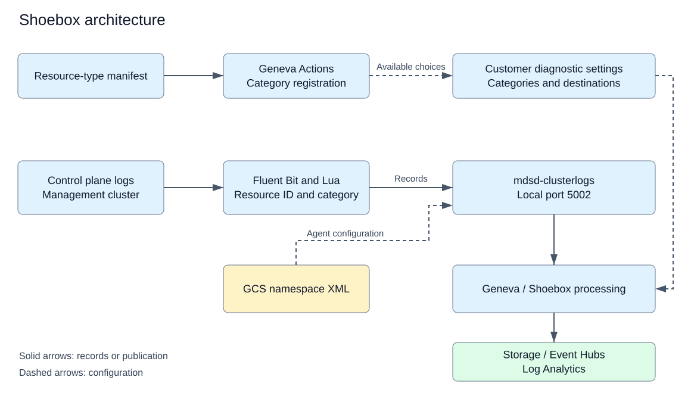

# Architecture

[Documentation index](README.md)

## Purpose

Hosted control plane containers produce logs on management clusters.
The Shoebox integration associates selected logs with the customer's HCP Azure resource.
Azure Monitor diagnostic settings specify the categories and destinations for that resource.

The resource type is `Microsoft.RedHatOpenShift/hcpOpenShiftClusters`.
The supported destinations are Storage, Event Hubs, and Log Analytics.
The E2E test checks Storage and Event Hubs only.

## Components

| Component | Responsibility | Source |
|---|---|---|
| Resource-type manifest | Declares the diagnostic categories | [Manifest update](deployment.md#update-the-shoebox-manifest) |
| Shoebox pipelines | Invoke the category registration operations | [Deployment](deployment.md) |
| Fluent Bit | Collects logs and adds Kubernetes metadata | [ConfigMap](../../observability/arobit/deploy/templates/forwarder-configmap.yaml#L117) |
| Lua functions | Add resource identity and create Shoebox records | [Lua configuration](../../observability/arobit/deploy/templates/forwarder-configmap.yaml#L429) |
| mdsd sidecar | Receives records and consumes Geneva configuration | [DaemonSet](../../observability/arobit/deploy/templates/forwarder-daemonset.yaml#L111) |
| Geneva Configuration Service (GCS) | Supplies namespace XML to mdsd | [Namespace XML](mdsd-configuration.md#namespace-xml) |
| Diagnostic settings | Select customer categories and destinations | [E2E settings creation](../../test/e2e/shoebox_logs.go#L306) |

The diagram groups Microsoft-managed processing into one component.
This repository does not contain that processing implementation.

## Log flow

1. The container tail input reads `/var/log/containers/*.log`.
2. The Kubernetes filter adds pod and namespace metadata.
3. The namespace router selects namespaces that match `^ocm-.*`.
4. The router changes the record tag to `ocm.logs`.
5. The resource identity function reads the namespace annotation.
6. The Shoebox router selects the required containers and pods.
7. The router creates a `shoeboxlogs` copy and retains the original record.
8. The transformation function creates the Shoebox record.
9. The forward output sends the record to `127.0.0.1:5002`.
10. The mdsd sidecar receives the record.

The [ConfigMap](../../observability/arobit/deploy/templates/forwarder-configmap.yaml#L277) defines this order.
The downstream XML and diagnostic settings determine the configured delivery path.

## Conditions for operation

The chart includes the Shoebox configuration when both conditions are true:

- `forwarder.clusterType` is `mgmt`.
- `forwarder.mdsd.enabled` is true.

The same condition controls the mdsd sidecar and its SecretProviderClass.
See the [configuration includes](../../observability/arobit/deploy/templates/forwarder-configmap.yaml#L30) and [SecretProviderClass](../../observability/arobit/deploy/templates/forwarder-secretprovider.yaml#L1).

The original `ocm.logs` record can continue to the operational Kusto output when that output is enabled.
A record in Kusto does not prove that the Shoebox copy reached the customer.

## Identity boundary

The customer ARM resource ID identifies the destination resource context.
The management cluster identity and OCM cluster identifier have different purposes.
Do not substitute either identifier for the customer ARM resource ID.

See [record identity](record-format.md#resource-identity) for the source field and rejection conditions.

## Registration and delivery

A registered category can appear in diagnostic settings before records reach a destination.
Successful delivery also requires source logs, correct record fields, agent configuration, and customer destination settings.

Use [verification](verification.md) to distinguish category registration from record delivery.
